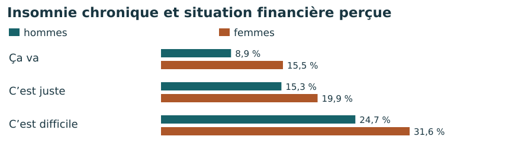

# BEL · B/L · Sociologie, dossier commun 2 du 21 juin 2024 · Corrigé guidé

*Corrigé rédigé par IA, non officiel. Signalez toute erreur.*

**Rédaction** · GPT-6.2 Astra Ultra · vitesse non renseignée

**Autocontrôle** · GPT-6.2 Astra Ultra · vitesse non renseignée

## Le sommeil des Français

Dormir répond à un besoin biologique mais impose aussi de libérer une partie de la journée, d’accorder ses horaires avec d’autres et de disposer de conditions permettant de se reposer. Les documents distinguent la durée passée à dormir, l’horaire du coucher, le sommeil partagé, la sieste et les difficultés déclarées.

> [!METHODE]
> Préparer en 90 minutes une réponse qui rapproche les documents. Le rapport prévoit quinze minutes d’exposé puis quinze minutes d’entretien. Dans chaque tableau, lire d’abord la population et le dénominateur. Les valeurs lues sur les courbes sont arrondies.

## Cheminement de l’exposé

Décrire les rythmes suppose de distinguer les mesures : les heures totales en journée travaillée ou non (document 1), le moment du coucher (document 3) et la durée non partagée au sein du couple (document 4). La même quantité de sommeil peut être située différemment dans l’horaire collectif.

La famille et le métier répartissent les ajustements. Le profil des femmes et des hommes selon le nombre d’enfants (document 2) et le décalage des couples ouvriers (document 4) renvoient à des contraintes domestiques et professionnelles qui s’emboîtent. Après la retraite, l’ancienne profession continue de différencier la sieste (document 5).

Enfin, un repos long n’est pas forcément un sommeil réparateur : l’état de santé est associé à la sieste (document 5), la situation financière à l’insomnie (document 6). Le document 7 rappelle que l’idée d’une durée continue, vécue la nuit d’un seul tenant, a elle-même une histoire.

## Lecture des pièces du dossier

### Le temps de sommeil change avec la journée et le métier

Document 1, p. 2. Capucine Rauch présente des durées estimées à caractéristiques contrôlées, avec intervalles de confiance à 95 %. Les jours travaillés, les cadres et professions intellectuelles supérieures dorment autour de 7 h 47, contre environ 8 h 15 chez les agriculteurs, artisans et commerçants. Chez les ouvriers, le point monte d’un peu moins de 8 h en journée travaillée à environ 9 h 35 en journée non travaillée, soit près de 1 h 40 d’écart. Il s’agit d’un contraste ajusté entre types de journées. Il ne démontre pas à lui seul une dette de sommeil biologique.

### La parentalité redistribue différemment le repos

Document 2, p. 3. À caractéristiques contrôlées, le point des femmes descend d’environ 8 h 50 sans enfant à environ 8 h 33 avec trois enfants ou plus. Chez les hommes, les quatre points restent voisins de 8 h 45. Les segments représentent l’incertitude autour des estimations. Cette divergence suggère d’observer qui répond aux réveils nocturnes et organise les matinées, y compris la veille de jours travaillés. Le nombre d’enfants ne mesure pas directement le temps que chacun des parents consacre à ces tâches.

### Se coucher plus tard au fil des enquêtes

Document 3, p. 4. La proportion cumulée au lit passe d’une valeur faible vers 21 h à un niveau élevé à minuit. À 23 h, on lit environ 60 % en 1985, autour de 50 % en 1998 et 40 % en 2009. À minuit les trois proportions sont de l’ordre de 89 %, 84 % et 75 %. Les heures de coucher se décalent vers plus tard. Pour en déduire des durées de sommeil, il faudrait connaître aussi les heures de lever, les interruptions et le temps effectivement endormi.

### L’emploi du temps d’un couple

Document 4, p. 5. Le graphique de Rauch mesure l’intervalle durant lequel seul un membre du couple dort. Il est d’environ 3 h pour les couples de deux ouvriers, contre environ 1 h 45 pour deux cadres. La durée moyenne pour un couple retraité se situe autour de 2 h 25 ; la ligne de référence et les intervalles à 95 % aident à situer les écarts. Deux personnes peuvent dormir le même nombre d’heures et ne pas les partager, lorsque des postes ou déplacements imposent des débuts décalés. La différence ne renseigne pas directement sur la qualité des relations conjugales.

### La sieste après la retraite

Document 5, p. 6. Le tableau donne 33,6 % à 60–64 ans et 62,4 % à 85 ans et plus. La fréquence est de 49,6 % chez les hommes et 43 % chez les femmes, de 57,5 % chez les anciens agriculteurs contre 39,9 % chez les professions intermédiaires. Dans le groupe déclarant une très bonne ou bonne santé elle est de 38,3 %, contre 74,2 % parmi ceux en mauvaise ou très mauvaise santé. La sieste peut répondre à la fatigue, à l’état de santé ou à un emploi du temps devenu plus libre. Le tableau ne permet pas d’en départager les effets.

### Temps compté et insomnie chronique

Document 6, p. 7. Le Baromètre Santé publique France 2010 compare les 18–75 ans selon le sexe et les conditions de vie. Entre 18 et 24 ans, 20,5 % des femmes et 9,1 % des hommes déclarent une insomnie chronique. En situation financière perçue comme difficile, les taux atteignent 31,6 % et 24,7 %, contre 15,5 % et 8,9 % lorsque les finances sont jugées satisfaisantes. Ces écarts sont descriptifs et peuvent croiser âge, santé et isolement. La qualité et la continuité du sommeil apportent ici une dimension absente du seul nombre d’heures.

### L’histoire du sommeil continu

Document 7, p. 8. Roger Ekirch décrit le recul progressif du sommeil segmenté en deux périodes. L’éclairage et la sécurité des rues étendent la soirée urbaine, mais l’accès à la lumière artificielle reste socialement différencié. Les horaires des artisans et la persistance de rythmes ruraux illustrent des transformations inégales. L’industrialisation et la diffusion des horloges favorisent un découpage plus régulier. Ce récit rend intelligible le caractère historique du sommeil continu ; les trois enquêtes contemporaines sur l’heure du coucher ne prouvent pas à elles seules cette histoire longue.

## Réponse au sujet

Dormir longtemps, dormir aux mêmes heures et dormir sans difficulté constituent des résultats différents. Les jours travaillés, la division familiale des tâches et la santé contribuent à leur distribution. Les usages historiques des soirées rappellent que les écarts de classe et de sexe prennent forme dans des horaires collectifs modifiables.

> [!INDICATION]
> Comment lire une barre d’incertitude ?

Le point indique l’estimation centrale et la barre un intervalle de confiance à 95 %. Un test de la différence entre deux estimations demanderait la précision du contraste, notamment leur covariance.

> [!INDICATION]
> Le coucher tardif prouve-t-il que l’on dort moins ?

Le document 3 observe qui est au lit à une heure donnée. Il faut encore savoir à quelle heure les personnes se lèvent et combien de temps elles restent effectivement endormies.

> [!INDICATION]
> Peut-on expliquer la sieste par l’âge seul ?

Les différences de fréquence apparaissent aussi selon la santé et le métier antérieur. Suivre les mêmes personnes avant et après leur départ en retraite aiderait à distinguer changement des horaires, cohortes et vieillissement.

[Feuillet officiel du 21 juin, pp. 1–8](https://www.ens.psl.eu/sites/default/files/bl_sujets_oraux_sociologie_tc2_21062024.pdf) · [Rapport de sociologie 2024](https://www.ens.psl.eu/sites/default/files/2024_bl_rapport_oral_sociologie_epreuve_commune.pdf)
