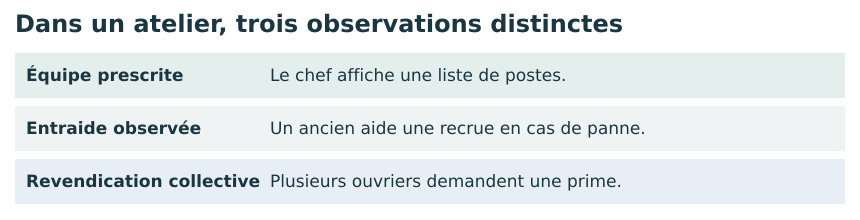

# BEL · B/L · Sociologie, billet d’option 1 du 13 juin 2024 · Corrigé guidé

*Corrigé rédigé par IA, non officiel. Signalez toute erreur.*

**Rédaction** · GPT-6.2 Astra Ultra · vitesse non renseignée

**Autocontrôle** · GPT-6.2 Astra Ultra · vitesse non renseignée

Après une heure et demie de préparation, le candidat présente un seul sujet pendant quinze minutes. Le jury dispose ensuite de quinze minutes pour l’entretien. Les deux exposés ci-dessous correspondent aux deux choix du billet.

## Les collectifs de travail

> [!METHODE]
> Un syndicat est-il nécessaire pour qu’un collectif existe ? Repérez dans l’exposé le cas précis qui permet de répondre.

Un service hospitalier peut réunir les mêmes professions sur l’organigramme sans que ses membres aient appris à se passer la main. Que faut-il donc ajouter à une division des tâches pour former un collectif ? Un collectif existe quand les travailleurs élaborent des manières communes de faire et des obligations réciproques. Sa capacité à parler d’une seule voix reste une autre question.

La coopération se construit dans les situations où les règles écrites laissent plusieurs solutions. Dans l’enquête ethnographique de Donald Roy sur un atelier américain payé aux pièces, les ouvriers limitent collectivement les quantités produites. Une productivité individuelle trop forte menace le tarif futur de tous. Le rappel à l’ordre fait apparaître une norme de métier dont on ne verrait aucune trace dans une simple addition de rendements individuels.

La solidarité a des frontières. Dans le travail hospitalier étudié par Anselm Strauss, la prise en charge suppose que soignants, médecins et proches s’accordent sur les séquences d’action. Celui qui organise un transfert ou compense un retard accomplit un travail d’articulation. Les membres d’une même équipe n’ont pourtant pas le même pouvoir de fixer les priorités, de réclamer de l’aide ou de refuser une tâche. Un collectif peut soutenir les anciens et isoler les précaires qui entrent dans le service.

La stabilité des horaires, l’existence d’un espace commun et la possibilité de transmettre le métier facilitent ces règles partagées. À l’inverse, la sous-traitance peut disperser les personnes tout en les obligeant à coopérer pendant un incident. Pour enquêter, je suivrais un dossier qui circule entre métiers, puis je comparerais ce qui se passe quand un intérimaire remplace un titulaire. On distinguerait ainsi l’équipe prescrite, le réseau effectif d’entraide et le groupe prêt à défendre une revendication.

> [!INDICATION]
> Un syndicat est-il nécessaire pour qu’un collectif existe ?

Non. La règle de rendement chez Roy implique des sanctions entre pairs sans supposer une organisation représentative. Un syndicat peut ensuite donner une durée et un porte-parole à une revendication.

> [!INDICATION]
> Comment observer le travail invisible ?

Suivre une transmission de poste et noter qui traduit, téléphone, anticipe ou rattrape une erreur. Interroger séparément les acteurs aide à repérer les contributions que le compte rendu omet.

## Peut-on prendre parti en sociologie ?

> [!METHODE]
> La neutralité axiologique interdit-elle de choisir les dominés comme objet ? Repérez dans l’exposé le cas précis qui permet de répondre.

Le sociologue qui décide d’interroger des personnes expulsées a déjà choisi un point de vue d’enquête. A-t-il pour autant décidé de ce qu’il trouvera ? Trois moments doivent être distingués : le choix d’un objet, la construction d’un résultat et l’usage public de ce résultat.

Pour Max Weber, des valeurs rendent certaines questions pertinentes. Étudier le coût d’une politique pour les ménages ou sa facilité de mise en œuvre pour les administrations produit des enquêtes différentes. Une fois l’objet choisi, le chercheur doit expliciter ses catégories, identifier les cas qui contredisent son interprétation et permettre la critique. Une enquête peut établir les effets inégaux d’une mesure sans déduire d’une fréquence ce qu’il serait juste de décider.

Dans « Whose Side Are We On? », Howard Becker montre que les institutions distribuent inégalement la crédibilité. Dans un établissement, les déclarations du directeur passent volontiers pour des faits, celles des usagers pour des plaintes. Aller vérifier les secondes peut déjà paraître partisan. L’enquêteur doit cependant soumettre les versions concurrentes aux mêmes exigences, par exemple comparer les motifs administratifs d’une sanction et les observations du travail quotidien.

L’engagement peut ouvrir des terrains et inspirer des hypothèses ; il peut aussi rendre certaines absences difficiles à voir. Une enquête sur une mobilisation gagnera à inclure les sympathisants qui s’abstiennent, les dissidents et les adversaires. La prise de position civique peut se nourrir de l’enquête à condition d’indiquer quelle prémisse morale s’ajoute à la description pour justifier l’action proposée.

> [!INDICATION]
> La neutralité axiologique interdit-elle de choisir les dominés comme objet ?

Le choix répond à un intérêt de connaissance. L’exigence de preuve porte sur la manière dont on explique les pratiques et examine les cas discordants.

> [!INDICATION]
> Donnez un résultat qui embarrasserait une enquête militante.

Une campagne d’accès aux droits peut toucher surtout des personnes déjà informées. Comparer participants et non-participants permet de le voir, même si le chercheur soutient la campagne.

[Feuillet officiel du 13 juin, p. 1](https://www.ens.psl.eu/sites/default/files/bl_sujets_oraux_sociologie_opt_1_13062024.pdf) · [Rapport de sociologie 2024](https://www.ens.psl.eu/sites/default/files/2024_bl_rapport_oral_sociologie_option.pdf)
