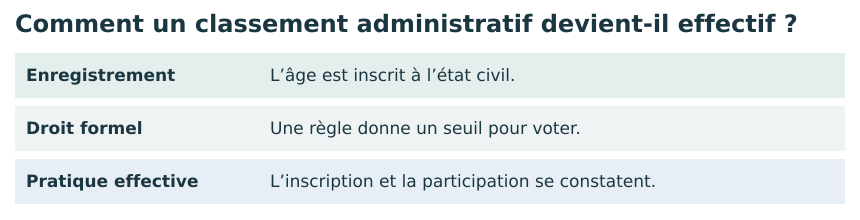

# BEL · B/L · Sociologie, billet d’option 2 du 13 juin 2024 · Corrigé guidé

*Corrigé rédigé par IA, non officiel. Signalez toute erreur.*

**Rédaction** · GPT-6.2 Astra Ultra · vitesse non renseignée

**Autocontrôle** · GPT-6.2 Astra Ultra · vitesse non renseignée

Après une heure et demie de préparation, le candidat présente un seul sujet pendant quinze minutes. Le jury dispose ensuite de quinze minutes pour l’entretien. Les deux exposés ci-dessous correspondent aux deux choix du billet.

## Comment l’État construit les individus ?

> [!METHODE]
> Une catégorie statistique façonne-t-elle mécaniquement les identités ? Repérez dans l’exposé le cas précis qui permet de répondre.

À la naissance, un enfant entre dans des catégories d’état civil qui lui ouvrent des droits avant qu’il puisse s’en réclamer. Comment ces opérations administratives deviennent-elles des caractéristiques qui comptent aussi dans la vie quotidienne ? La construction procède par classement, par apprentissage et par confrontation aux institutions.

L’état civil fixe des identités durables, l’école distribue des titres et les administrations sociales reconnaissent des ayants droit. Les enquêtes d’Alain Desrosières sur l’histoire de la statistique montrent que des nomenclatures stabilisent des équivalences : deux professions différentes peuvent être réunies dans une même catégorie pour compter une population. Produire un chiffre suppose ainsi une décision sur les différences pertinentes.

Les dispositifs produisent ensuite des dispositions. Les horaires scolaires et les exercices apprennent à régler son activité sur une durée impersonnelle. Un diplôme, à la différence d’un simple sentiment de compétence, peut être présenté à un recruteur et servir de seuil de candidature. La sociologie de Pierre Bourdieu aide à comprendre l’efficacité symbolique de cette certification, qui dépend de son acceptation par d’autres institutions.

La construction n’est jamais identique pour tous. Dans les enquêtes de Vincent Dubois sur la relation de guichet, des faits biographiques doivent être traduits dans les catégories d’un dossier. Ressources juridiques, maîtrise de l’écrit et soutien d’un tiers modifient la possibilité de faire reconnaître sa situation. L’État n’agit donc pas comme une personne dotée d’une volonté unique : juges, agents et enseignants peuvent classer différemment une même trajectoire, et les administrés contester la qualification reçue.

> [!INDICATION]
> Une catégorie statistique façonne-t-elle mécaniquement les identités ?

Elle devient plus efficace lorsqu’elle organise une prestation, un titre ou une représentation collective. Il faut observer si les personnes se l’approprient, l’ignorent ou la récusent.

> [!INDICATION]
> Comment comparer deux guichets ?

Apparier des dossiers proches, observer les pièces demandées et suivre les voies de recours. Le résultat final seul ne montre pas où s’est creusé l’écart.

## La sociologie doit-elle rester « éternellement jeune » ?

> [!METHODE]
> Puis-je simplement juxtaposer une théorie ancienne et un objet récent ? Repérez dans l’exposé le cas précis qui permet de répondre.

La formule évoque chez Max Weber des sciences dont les objets changent parce que les sociétés changent et parce que de nouveaux intérêts de connaissance apparaissent. Comment rester attentive au présent tout en accumulant des résultats que les générations suivantes pourront reprendre ?

Les catégories des acteurs ont une histoire. Les frontières entre emploi, chômage et inactivité dépendent des démarches de recherche d’emploi retenues et de leur inscription institutionnelle. Comparer deux dates exige donc de garder la définition en mémoire. Remplacer immédiatement les anciennes questions par les mots du moment ferait perdre précisément la possibilité de mesurer cette transformation.

La nouveauté peut aussi venir d’un déplacement du regard. Étudier les tâches domestiques comme travail a rendu mesurables des activités auparavant absorbées dans la vie familiale. Les enquêtes Emploi du temps comptabilisent les durées par carnet ; elles éclairent la répartition entre sexes mais saisissent plus difficilement la disponibilité permanente et les activités simultanées. La critique des instruments crée de nouvelles questions à partir d’un résultat transmissible.

L’accumulation prend la forme d’archives, de séries et de comparaisons qui explicitent leurs conditions de validité. Réenquêter dans une usine après automatisation permet de demander quelles hiérarchies de métier se maintiennent et lesquelles passent désormais par la maîtrise de logiciels. La jeunesse souhaitable est cette capacité de réviser le problème lorsque le terrain résiste, en conservant les preuves et les raisonnements qui rendent la révision intelligible.

> [!INDICATION]
> Puis-je simplement juxtaposer une théorie ancienne et un objet récent ?

Il faut préciser une attente issue de la théorie puis une observation qui la confirme ou oblige à la modifier.

> [!INDICATION]
> Comment distinguer changement réel et changement du questionnaire ?

Coder un même ensemble de cas avec les deux définitions ou poser les deux questions pendant une période de recouvrement. La comparaison révèle l’effet de mesure.

[Feuillet officiel du 13 juin, p. 1](https://www.ens.psl.eu/sites/default/files/bl_sujets_oraux_sociologie_opt_2_13062024.pdf) · [Rapport de sociologie 2024](https://www.ens.psl.eu/sites/default/files/2024_bl_rapport_oral_sociologie_option.pdf)
