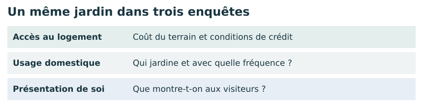

# BEL · B/L · Sociologie, billet d’option 3 du 13 juin 2024 · Corrigé brut

*Corrigé rédigé par IA, non officiel. Signalez toute erreur.*

**Rédaction** · GPT-6.2 Astra Ultra · vitesse non renseignée

**Autocontrôle** · GPT-6.2 Astra Ultra · vitesse non renseignée

Après une heure et demie de préparation, le candidat présente un seul sujet pendant quinze minutes. Le jury dispose ensuite de quinze minutes pour l’entretien. Les deux exposés ci-dessous correspondent aux deux choix du billet.

## Qu’est-ce que notre logement dit de nous ?

Un appartement central de petite taille peut signaler des moyens limités, une préférence pour la proximité du travail ou une installation provisoire. Lire le logement comme le portrait immédiat d’une personne conduit à confondre choix, contraintes et trajectoire.

Le logement situe d’abord un ménage dans un marché. Revenus, patrimoine et garanties ne procurent pas les mêmes possibilités de devenir propriétaire ou de signer un bail. L’enquête de Pierre Bourdieu et de ses collaborateurs sur l’accès à la maison individuelle montre comment le rôle du crédit et de la politique du logement transforme des aspirations en choix effectivement réalisables. Adresse et statut d’occupation ne révèlent pas, à eux seuls, les ressources dont on disposait au moment d’entrer.

L’intérieur rend visibles des usages et des relations. Une pièce conservée pour un enfant parti, un salon réservé aux invités ou un bureau partagé renseignent sur les priorités du ménage. Mais l’interprétation doit être contrôlée par l’entretien et le temps passé sur place. Le bureau vide en journée peut servir au travail de nuit ; un adolescent peut s’isoler dehors faute de place chez lui.

Enfin, une même adresse prend un autre sens selon la trajectoire. Rester dans un quartier qui se valorise ne représente pas le même processus que pouvoir y acheter aujourd’hui. Le logement dit donc quelque chose de l’histoire familiale, des politiques locales et de la position dans le cycle de vie. Comparer les logements successifs d’un ménage et les entrants récents dans le même immeuble permet de départager ces explications.

## Peut-on être sociologue de soi-même ?

La mémoire raconte volontiers une trajectoire en reliant ses épisodes au résultat final. La prendre pour objet suppose de transformer une expérience familière en problème susceptible d’être contredit. Que peut connaître un enquêté qui se trouve être aussi l’enquêteur ?

Une expérience située donne accès à des routines et à des émotions que la visite brève d’un chercheur saisit mal. Dans Retour à Reims, Didier Eribon met en relation le récit du départ, la honte et les distances de classe. La force de ce type de récit vient de la mise en relation d’une expérience et des frontières sociales qui lui donnent son sens. La sincérité du narrateur ne garantit ni la fréquence d’un mécanisme ni son effet.

La réflexivité exige d’objectiver les moyens de l’enquête. Pierre Bourdieu invite à situer le point de vue du chercheur, y compris sa position scolaire et professionnelle au moment où il raconte. Un diplôme acquis ultérieurement change le vocabulaire disponible pour raconter un conflit ancien. Bulletins, lettres, archives et témoignages contemporains de l’épisode peuvent révéler des choix alors ouverts que le souvenir a effacés.

La comparaison achève la transformation sociologique. Interroger des personnes de même promotion et de destins différents permet d’isoler des bifurcations et de repérer des contraintes partagées. Des désaccords entre proches sur un événement constituent des données sur les positions de chacun. L’auto-enquête établit ainsi la possibilité et l’enchaînement d’un mécanisme ; sa portée au-delà du cas demande d’autres matériaux.

[Feuillet officiel du 13 juin, p. 1](https://www.ens.psl.eu/sites/default/files/bl_sujets_oraux_sociologie_opt_3_13062024.pdf) · [Rapport de sociologie 2024](https://www.ens.psl.eu/sites/default/files/2024_bl_rapport_oral_sociologie_option.pdf)
