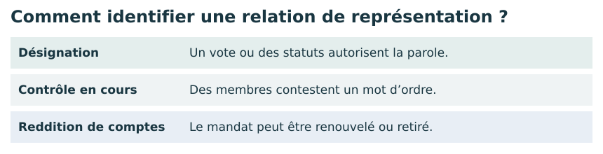

# BEL · B/L · Sociologie, billet d’option 1 du 20 juin 2024 · Corrigé brut

*Corrigé rédigé par IA, non officiel. Signalez toute erreur.*

**Rédaction** · GPT-6.2 Astra Ultra · vitesse non renseignée

**Autocontrôle** · GPT-6.2 Astra Ultra · vitesse non renseignée

Après une heure et demie de préparation, le candidat présente un seul sujet pendant quinze minutes. Le jury dispose ensuite de quinze minutes pour l’entretien. Les deux exposés ci-dessous correspondent aux deux choix du billet.

## Être porte-parole

Une déléguée syndicale qui déclare « nous demandons » engage des absents dont elle ne peut citer chacune des opinions. Comment une personne devient-elle autorisée à parler pour plusieurs et que fait cette parole au groupe qu’elle désigne ?

L’autorisation peut prendre la forme d’une élection, d’une désignation par une association ou d’une reconnaissance plus informelle. L’audience médiatique ne prouve pas qu’un mandat existe. Observer les règles d’investiture, l’obligation de rendre des comptes et les moyens de révoquer le mandataire permet de préciser les ressorts de sa légitimité. Les deux dimensions de la représentation, agir pour d’autres et donner une figure publique au groupe, ne coïncident pas forcément.

Bourdieu analyse le paradoxe de la délégation : des individus dispersés accèdent à une parole commune grâce au représentant, qui acquiert en retour le pouvoir de définir le groupe. Le travail de porte-parole comprend la sélection d’expériences à rendre exemplaires, la traduction d’une plainte en revendication et la négociation de ce qui peut être transigé. L’aisance à l’oral et la disponibilité pour des réunions distribuent inégalement les chances d’être désigné.

La représentation demeure éprouvée en situation. Face à la fermeture d’un site, les intérimaires n’ont pas toujours les mêmes priorités que les salariés en contrat stable. Suivre une assemblée avant la négociation, les phrases reprises dans la presse et le compte rendu au retour permet de voir ce qui a été porté, reformulé ou écarté. La critique par la base et la rotation des porte-parole peuvent contrôler la délégation, avec un coût d’apprentissage lorsque l’interlocuteur exige de l’expérience.

## Citation de Durkheim

« En chacun de nous, suivant des proportions variables, il y a l’homme d’hier ; et c’est même l’homme d’hier qui, par la force des choses, est prédominant en nous, puisque le présent n’est que bien peu de chose comparé à ce long passé au cours duquel nous nous sommes formés et d’où nous résultons. Seulement, cet homme du passé, nous ne le sentons pas, parce qu’il est invétéré en nous ; il forme la partie inconsciente de nous-même. » (Émile Durkheim, L’évolution pédagogique en France, 1938)

Le passage de L’Évolution pédagogique en France porte un paradoxe. Le passé pèse dans le présent précisément parce que les dispositions acquises sont devenues ordinaires et échappent à l’attention. Comment établir sociologiquement cette proposition sans traiter toute conduite comme la simple répétition d’un héritage ?

« Nous nous sommes formés » désigne des apprentissages accumulés. Langue, horaires et manières de se tenir sont d’abord corrigés ou imités, puis mis en œuvre sans délibération. L’histoire de l’institution scolaire permet de travailler à deux échelles : les cadres pédagogiques héritent de formes antérieures et chaque élève acquiert, en les fréquentant, une manière de produire un texte ou d’attendre son tour.

Les « proportions variables » comptent autant que la durée du passé. Chez Bourdieu, l’habitus permet d’expliquer des pratiques ajustées sans calcul explicite ; l’hystérésis apparaît lorsqu’un monde change plus vite que les dispositions. Une promotion professionnelle peut exposer un salarié à des codes de réunion qu’il ne connaissait pas. Ses hésitations font ressortir les routines jusque-là invisibles. Il faudrait comparer des trajectoires pour éviter de lire un incident isolé comme le signe de toute une classe.

Les socialisations sont également plurielles. Bernard Lahire montre que des dispositions acquises en famille, à l’école ou au travail peuvent se renforcer ou se contrarier, et que le contexte sélectionne celles qui s’actualisent. L’« inconscient » du texte renvoie ici à l’incorporation d’une histoire sociale. Une enquête biographique peut la reconstruire en croisant des récits avec des épisodes observés où l’action déjoue les attentes.

[Feuillet officiel du 20 juin, p. 1](https://www.ens.psl.eu/sites/default/files/bl_sujets_oraux_sociologie_opt_1_20062024.pdf) · [Rapport de sociologie 2024](https://www.ens.psl.eu/sites/default/files/2024_bl_rapport_oral_sociologie_option.pdf)
