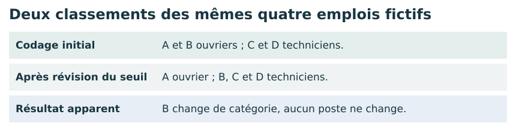

# BEL · B/L · Sociologie, billet d’option 2 du 20 juin 2024 · Corrigé brut

*Corrigé rédigé par IA, non officiel. Signalez toute erreur.*

**Rédaction** · GPT-6.2 Astra Ultra · vitesse non renseignée

**Autocontrôle** · GPT-6.2 Astra Ultra · vitesse non renseignée

Après une heure et demie de préparation, le candidat présente un seul sujet pendant quinze minutes. Le jury dispose ensuite de quinze minutes pour l’entretien. Les deux exposés ci-dessous correspondent aux deux choix du billet.

## Sports, sportifs et sportives

Qui compte comme sportif ? Une personne qui va au travail à vélo, une joueuse licenciée et une salariée d’un club n’apparaissent pas dans les mêmes statistiques. Le pluriel du sujet invite à relier les définitions des sports, la distribution des pratiques et le traitement des pratiquants.

Les conditions d’entrée varient selon le coût du matériel, les horaires, l’existence d’un terrain et la familiarité familiale. Un club local peut réduire les frais mais imposer le déplacement aux matchs le dimanche. La sociologie des pratiques sportives de Christian Pociello relie les goûts aux propriétés des groupes et aux usages sociaux du corps. La proximité statistique entre une classe et un sport laisse néanmoins place aux transformations de l’offre et aux trajectoires atypiques.

Les associations, les fédérations et les médias fabriquent aussi la différence entre sportifs et sportives. Les enquêtes de Christine Mennesson sur des femmes investies dans des sports historiquement masculins montrent l’importance des apprentissages familiaux et des épreuves de légitimité au sein des clubs. Compter les licences ne dit pas qui obtient le meilleur créneau, accède à l’encadrement ou bénéficie d’une rémunération.

Enfin, la pratique est une carrière traversée d’entrées et de sorties. Parentalité, blessure, accès au travail ou déménagement peuvent interrompre l’entraînement. Interroger des sortantes autant que les pratiquantes régulières et comparer un club amateur à une filière de haut niveau aide à distinguer sélection sociale et effets de la pratique. Les distinctions de sexe prennent alors sens avec l’âge, la classe et l’organisation du sport considéré.

## Citation de Dominique Merllié

« De manière évidente dans certains cas, mais probable dans tous les autres, ce ne sont pas tant les individus qui circulent entre les catégories que celles-ci qui bougent ou tremblent autour de ceux-là. » (Dominique Merllié, « Les classements professionnels dans les enquêtes de mobilité », Annales, 1990)

Le passage de Dominique Merllié invite à retourner le regard porté sur une table de mobilité. Un changement de case peut signaler un déplacement individuel, un changement de la structure des emplois ou une modification de la manière de classer les personnes. Que mesure exactement la différence enregistrée entre deux positions ?

Dans une table intergénérationnelle, on range une personne et son parent dans une nomenclature, puis on mesure les passages entre origines et destinations. Si l’emploi agricole se contracte pendant que les métiers de service croissent, tous les enfants d’agriculteurs ne peuvent reprendre la position de leurs parents. Les marges de la table changent. Une augmentation de mobilité observée reste compatible avec des chances relatives d’accès inégales selon l’origine.

Les catégories elles-mêmes « bougent ou tremblent ». L’intitulé donné par la personne, le statut d’emploi et les consignes de codage peuvent produire des classements différents d’une même activité. Une personne se déclarant « responsable » ne possède pas automatiquement le statut de cadre. Une reclassification administrative peut créer une mobilité apparente ; inversement la stabilisation d’une étiquette peut masquer un changement de responsabilité.

Il faut travailler sur la fabrication du chiffre. Recoder les réponses brutes dans une nomenclature constante, documenter les cas incertains et comparer les contenus d’emploi, les salaires et les trajectoires permet de tester des explications rivales. Le propos de Merllié n’annule pas les promotions et les déclassements réels. Il oblige à examiner la solidité de la frontière dont on mesure le franchissement avant d’en tirer une conclusion sur l’ouverture de la société.

[Feuillet officiel du 20 juin, p. 1](https://www.ens.psl.eu/sites/default/files/bl_sujets_oraux_sociologie_opt_2_20062024.pdf) · [Rapport de sociologie 2024](https://www.ens.psl.eu/sites/default/files/2024_bl_rapport_oral_sociologie_option.pdf)
