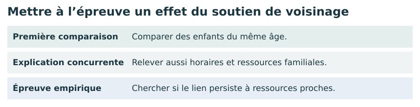

# BEL · B/L · Sociologie, billet d’option 3 du 20 juin 2024 · Corrigé guidé

*Corrigé rédigé par IA, non officiel. Signalez toute erreur.*

**Rédaction** · GPT-6.2 Astra Ultra · vitesse non renseignée

**Autocontrôle** · GPT-6.2 Astra Ultra · vitesse non renseignée

Après une heure et demie de préparation, le candidat présente un seul sujet pendant quinze minutes. Le jury dispose ensuite de quinze minutes pour l’entretien. Les deux exposés ci-dessous correspondent aux deux choix du billet.

## « Il faut tout un village pour élever un enfant »

> [!METHODE]
> Quel piège contient le mot « village » ? Repérez dans l’exposé le cas précis qui permet de répondre.

La formule transforme une pluralité d’adultes en communauté apparemment unanime. Elle peut servir de question sociologique à condition de demander qui s’occupe effectivement de l’enfant, selon quelles règles et avec quelles inégalités de ressources.

La socialisation est distribuée. Les parents transmettent des habitudes et choisissent certains cadres de vie ; la fratrie, les pairs, l’école et les professionnels de la petite enfance encadrent d’autres moments. Une consigne familiale d’entraide peut rencontrer un exercice scolaire qui exige un travail individuel. L’enfant apprend aussi à interpréter les attentes changeantes selon les lieux et conserve une part d’initiative.

Cette division du travail n’est pas également distribuée. Les recherches d’Annette Lareau sur des familles aux États-Unis comparent, dans leur contexte, un encadrement intensif par activités organisées et des formes d’autonomie enfantine. Inscrire un enfant au club suppose temps, moyens et capacité à dialoguer avec des institutions. Les enquêtes de terrain peuvent aussi rendre visible le travail peu reconnu des grands-mères, des assistantes maternelles et d’autres adultes dont la disponibilité soutient l’emploi des parents.

Le « village » ne se réduit ni à la parenté ni à un voisinage géographique. Une grand-mère éloignée peut participer tous les jours, tandis qu’un voisin proche demeure étranger. Suivre un enfant pendant plusieurs journées, en comparant semaine et vacances, ferait apparaître les relais, les conflits de normes et les plages sans encadrement. Le nombre d’intervenants ne garantit pas la qualité des relations ni l’accord entre eux.

> [!INDICATION]
> Quel piège contient le mot « village » ?

La métaphore peut naturaliser une solidarité absente et attribuer aux communautés rurales une harmonie supposée. Il faut observer les relations effectives et leurs asymétries.

> [!INDICATION]
> Comment intégrer les enfants dans l’enquête ?

Faire décrire par l’enfant à qui il demande de l’aide selon les situations et comparer avec l’emploi du temps des adultes. Une relation éducative peut être importante sans avoir été formellement organisée.

## Comment prouver qu’une théorie sociologique est fausse ?

> [!METHODE]
> Un entretien contradictoire constitue-t-il une réfutation ? Repérez dans l’exposé le cas précis qui permet de répondre.

Un contre-exemple réfute une proposition universelle si l’on s’accorde sur le fait observé et sur le champ de la proposition. Mais que peut réfuter un cas singulier lorsque la théorie porte sur des probabilités, des mécanismes ou des configurations historiques ?

La première tâche est de rendre la théorie exposée à l’épreuve. Dire que l’origine sociale a toujours « quelque effet » indique peu de choses ; annoncer un mécanisme, une population, un indicateur et la direction attendue du lien rend une comparaison possible. Dans la perspective de Karl Popper, préciser à l’avance ce qui compterait contre la proposition empêche de sauver après coup toute prédiction démentie.

Une proposition probabiliste peut admettre des exceptions individuelles. L’existence d’une réussite scolaire en milieu défavorisé ne réfute pas un écart de chances entre groupes. En revanche des enquêtes répétées, comparables et suffisamment précises qui ne retrouvent pas l’écart attendu fragilisent la proposition dans le champ annoncé. Il faut examiner le choix des groupes, les mesures et les autres causes possibles. Un résultat peu précis ne distingue pas absence d’effet et manque d’information.

Une démonstration qualitative peut mettre en échec le mécanisme lui-même. Suivre l’ordre des événements, chercher des cas où les conditions devraient agir et confronter une explication rivale permet d’établir qu’un mécanisme n’a pas opéré comme prévu. Jean-Claude Passeron souligne le caractère historique des configurations observées en sciences sociales. Cela oblige à délimiter la portée de la réfutation et à dire quelle hypothèse auxiliaire résiste ou tombe. La révision devient informative lorsqu’elle conduit à une nouvelle épreuve indépendante.

> [!INDICATION]
> Un entretien contradictoire constitue-t-il une réfutation ?

Il peut réfuter une proposition universelle sur les pratiques d’un groupe. S’il s’agit d’une fréquence, il faut établir où se situe le cas dans une distribution et éviter l’échantillonnage des seuls cas spectaculaires.

> [!INDICATION]
> Que faire quand deux théories expliquent le même résultat ?

Chercher une situation où leurs prédictions divergent, ou des traces du mécanisme qui ne sont attendues que par l’une. Dire à l’avance quelle observation trancherait réduit le risque de raisonnement circulaire.

[Feuillet officiel du 20 juin, p. 1](https://www.ens.psl.eu/sites/default/files/bl_sujets_oraux_sociologie_opt_3_20062024.pdf) · [Rapport de sociologie 2024](https://www.ens.psl.eu/sites/default/files/2024_bl_rapport_oral_sociologie_option.pdf)
