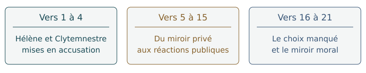

# BEL B/L — Version grecque 2024 · Corrigé guidé

*Corrigé rédigé par IA, non officiel. Signalez toute erreur.*

**Rédaction** · GPT-6.2 Astra Ultra · vitesse non renseignée · 26 novembre 2026

## Épouses indignes

Électre s’adresse à Clytemnestre, sa mère. Elle évoque d’abord Hélène, sœur de Clytemnestre, puis Iphigénie, la fille dont Clytemnestre invoque le sacrifice. Les repères ci-dessous suivent les vingt et un vers effectivement imprimés sur le feuillet.

## Traduction française

### Vers 1 à 4 · Le prétexte

**Indication.** Dans les deux premiers vers, opposez la troisième personne à la deuxième. De quel verbe le participe *προτείνουσα* dépend-il ? La note du sujet identifie l’enfant.

#### Traduction

L’une, en effet, s’est perdue en se laissant enlever de son plein gré. Toi, tu as fait périr le meilleur des hommes de Grèce. Tu donnes pour excuse que c’est pour ta fille que tu as tué ton époux. Mais on ne te connaît pas aussi bien que moi.

### Vers 5 à 11 · Le miroir et le jugement

**Indication.** Reconstituez l’ordre des mots autour de *πλόκαμον* et de *πρόσωπον*. Puis demandez-vous qui parle dans *διάγραφ᾽* et si les deux emplois de *ἥτις* désignent la même chose.

#### Traduction

Car toi, avant même que fût décidé le sacrifice de ta fille, alors que ton mari venait à peine de quitter la maison, tu arrangeais devant ton miroir les blondes tresses de ta chevelure. Or une femme qui se fait belle quand son mari est loin du foyer, je la tiens pour une mauvaise femme. Elle n’a en effet aucun besoin de montrer au-dehors un visage avenant, à moins qu’elle ne cherche à mal faire.

### Vers 12 à 15 · Le sort de Troie

**Indication.** Lisez ensemble *μόνην*, *σε* et les participes à l’accusatif. Que signifie le contraste entre la joie et l’assombrissement du visage dans les deux propositions en *εἰ* ?

#### Traduction

Je sais que, de toutes les Grecques, tu étais la seule à te réjouir chaque fois que les affaires des Troyens prospéraient, et à t’assombrir quand ils avaient le dessous. Tu ne voulais pas qu’Agamemnon revînt de Troie.

### Vers 16 à 21 · La gloire possible

**Indication.** Retrouvez le nom qualifié par *οὐ κακίον᾽*, le terme auquel on le compare et les deux attributs à l’accusatif. Qui aurait pu tirer une leçon de la conduite d’Hélène ?

#### Traduction

Pourtant, tu avais toute latitude pour te conduire en femme fidèle. Tu avais pour époux un homme qui ne le cédait en rien à Égisthe, un homme que la Grèce s’était choisi pour chef de son armée. Et puisque ta sœur Hélène avait commis de tels actes, il t’était possible, à toi, d’acquérir une grande gloire. Car les mauvaises actions offrent aux gens de bien un exemple et un miroir.

## Repères de lecture

### Vers 1 à 4 · Le prétexte

L’opposition *ἡ μὲν … σὺ δέ* fait passer d’Hélène à Clytemnestre. *Ἁρπασθεῖσα*, participe passif, est qualifié par *ἑκοῦσα*, « de son plein gré ». Le rapprochement donne à l’enlèvement la valeur d’un consentement dans le réquisitoire d’Électre. *Διώλεσας* est un aoriste de deuxième personne. Le sacrifice d’Iphigénie est le motif que la mère fait valoir, introduit par *ὡς*. Dans *οὐ … ἴσασιν*, le pluriel laisse indéfini le sujet qui connaît si mal cette mère.

### Vers 5 à 11 · Le miroir et le jugement

Le premier relatif de liaison vise Clytemnestre personnellement et motive l’accusation. *Πρὶν κεκυρῶσθαι σφαγάς* place la scène du miroir avant la décision du sacrifice. L’imparfait *ἐξήσκεις* décrit une conduite que la fille revoit. Le second *ἥτις* généralise à toute femme placée dans la situation invoquée. Le jury rétablit *διάγραφα*, première personne. Le jugement moral appartient à Électre. *Ἤν … μὴ ζητῇ* exprime l’exception à cette généralité.

### Vers 12 à 15 · Le sort de Troie

L’expression *πασῶν … Ἑλληνίδων* encadre la déclaration de la fille. Dans les deux hypothèses, l’optatif indique la répétition dans le passé. *Τὰ Τρώων* désigne le sort des Troyens, qui sert de sujet à chacune. *Κεχαρμένην*, *συννέφουσαν* et *χρῄζουσαν* s’accordent avec Clytemnestre. Le dernier participe dit ce qui expliquait, aux yeux d’Électre, ses réactions aux nouvelles de la guerre.

### Vers 16 à 21 · La gloire possible

*Παρεῖχέ σοι* et *ἐξῆν … σοι* insistent sur les possibilités qui s’offraient à la mère. *Αἰγίσθου* est le génitif du terme de comparaison. *Πόσιν* est attribut de « cet homme » et *στρατηλάτην* celui du relatif *ὅν*. Le génitif absolu ramène Hélène au terme de la tirade. Dans la maxime, le mauvais exemple peut aider les gens de bien à reconnaître leur propre conduite. L’image finale du miroir répond au miroir concret des vers 5 à 7.

Le rapport indique « v. 1055-1085 » en ouverture. Il situe par ailleurs la décision du sacrifice au v. 1069 et la tresse blonde au v. 1071, qui sont les vers 5 et 7 du feuillet. Ces repères concordent avec la suite 1065–1085. La traduction suit les 21 vers visibles, de l’enlèvement d’Hélène au miroir final.

## Sources

[Fac-similé du sujet](https://www.ens.psl.eu/sites/default/files/2024_blses_sujet_version_grecque.pdf) · [Rapport du jury](https://www.ens.psl.eu/sites/default/files/2024_bl_rapport_ecrit_grec_ancien.pdf)
