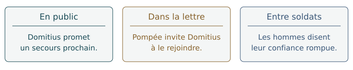

# BEL B/L — Version latine 2024 · Corrigé guidé

*Corrigé rédigé par IA, non officiel. Signalez toute erreur.*

**Rédaction** · GPT-6.2 Astra Ultra · vitesse non renseignée · 26 novembre 2026

## Déloyautés en série

À Corfinium, Domitius a demandé l’aide de Pompée. Le retour des messagers ouvre un écart entre ce que Domitius sait et ce qu’il annonce à son conseil. Les présents du récit français suivent les changements de point de vue de César.

## Traduction française

### Les messagers et le conseil

**Indication.** La note 1 donne le sujet d’*instituit*. Dans *missi ad Pompeium reuertuntur*, déterminez à quel mouvement se rapporte *ad Pompeium*. Après *hortatur*, trouvez les deux verbes au subjonctif et délimitez la portée de *ne*.

#### Traduction

Les jours suivants, César entreprend de ceindre la ville d’un retranchement et de fortins. Le gros de cet ouvrage est achevé quand, à peu près au même moment, les hommes envoyés auprès de Pompée sont de retour. Domitius lit la lettre jusqu’au bout et, sans rien laisser paraître, annonce en plein conseil que Pompée viendra bientôt à leur secours. Il exhorte les membres du conseil à garder courage et à préparer tout ce qui pourra servir à défendre la ville.

### Ce que Domitius ne dit pas

**Indication.** Suivez les quatre verbes sous la dépendance du premier *cum*. Distinguez les deux autres *cum*, placés devant un ablatif. La note 2 développe *consuesset*.

#### Traduction

Lui, cependant, s’entretient en secret avec quelques hommes de son entourage et se résout à former un projet de fuite. Or son visage démentait ses paroles. Il agissait en tout avec plus de fébrilité et de crainte que les jours précédents ; contrairement à son habitude, il passait beaucoup de temps à délibérer à l’écart avec les siens et se dérobait aux conseils comme aux réunions. Aussi fut-il impossible de tenir plus longtemps l’affaire cachée et de continuer à donner le change.

### La réponse de Pompée

**Indication.** Après *rescripserat*, repérez la personne désignée successivement par *sese*, *suo*, le *se* de *se … contulisse* et celui d’*ad se*. À qui Pompée demande-t-il de venir ?

#### Traduction

Pompée, en effet, lui avait répondu qu’il ne mettrait pas leur cause en très grand péril et que Domitius s’était retiré dans la ville de Corfinium sans avoir suivi son conseil ni obtenu son accord. En conséquence, si quelque possibilité s’en présentait, Domitius devait le rejoindre avec toutes ses troupes. Mais le siège et la ligne de retranchements qui enserrait la ville empêchaient que la chose fût possible.

### Les soldats délibèrent

**Indication.** Après *conloquuntur*, cherchez les sujets de quatre propositions infinitives. À quel groupe appartient *se* dans la première et dans la dernière ? Quel événement reste encore à l’état de projet ?

#### Traduction

Le projet de Domitius s’étant ébruité, les soldats qui se trouvaient à Corfinium se réunissent à part dès le début de la soirée. Par l’entremise des tribuns militaires, des centurions et des hommes les plus estimés de leurs rangs, ils échangent les propos suivants. César les assiège, les ouvrages et les fortifications sont presque achevés. S’ils avaient tenu jusqu’alors, c’était par espoir et par confiance en leur chef Domitius. Et voici que celui-ci abandonne tout et projette de fuir. À eux, désormais, de penser à leur propre salut.

## Repères de lecture

### Les messagers et le conseil

*Cuius operis maxima parte effecta* est un ablatif absolu. « Cet ouvrage » reprend le retranchement de la première phrase. *Missi* est un participe substantivé. Les hommes ont été envoyés auprès de Pompée et reviennent auprès de Domitius. *Subsidio* est un datif de destination. Le pluriel *eos* reprend les membres du conseil. Seul *deficiant* est sous la négation de *ne*. La relative *quae usui … sint* fournit l’objet de *parent*.

### Ce que Domitius ne dit pas

*Ipse* détache la conduite personnelle du chef de ses exhortations publiques. Dans *consilium fugae capere*, *fugae* complète le nom *consilium*. Quatre indices trahissent le projet, du visage jusqu’aux réunions évitées. *Consuesset* représente *consueuisset*. Avec ce verbe, le plus-que-parfait évoque une habitude déjà prise. *Consiliandi causa* indique le but des entrevues.

### La réponse de Pompée

*Deducturum* annonce une action future par rapport à la réponse. *Contulisse* présente comme déjà prise la décision de Domitius. *Sese* et *suo* renvoient à Pompée, auteur de la réponse, tandis que le réfléchi de *se … contulisse* reprend Domitius, sujet de l’infinitive. Dans *ad se … ueniret*, c’est vers Pompée que Domitius reçoit l’ordre de se diriger. *Id ne fieri posset … fiebat* énonce alors la raison matérielle qui empêche cette réunion.

### Les soldats délibèrent

*Corfinii* est un locatif. *Secessionem faciunt* fait de la réunion un acte de séparation. *Per* introduit les intermédiaires, y compris les soldats influents que désigne *honestissimos sui generis*. Le premier et le dernier *se* représentent les soldats. Entre les deux, les ouvrages, puis Domitius, sont sujets des infinitives. *Cuius spe atque fiducia* fait dépendre leur ancienne persévérance de l’espoir placé dans leur chef. *Proiectis omnibus* met son abandon en regard de leur décision encore à venir.

Chez César, le lecteur découvre le mensonge dans le même ordre que les personnages. L’annonce publique précède le contenu réel de la lettre. Quand les soldats prennent la parole, les pronoms réfléchis font entendre leur propre jugement.

## Sources

[Fac-similé du sujet](https://www.ens.psl.eu/sites/default/files/2024_blses_sujet_version_latine.pdf) · [Rapport du jury](https://www.ens.psl.eu/sites/default/files/2024_bl_rapport_ecrit_latin.pdf)
