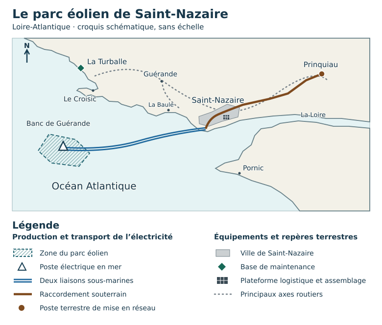

# BMA toutes spécialités — Histoire-géographie et enseignement moral et civique 2024 · Corrigé brut

*Corrigé rédigé par IA, non officiel. Signalez toute erreur.*

## Première partie — Histoire

### Question 1 — Trois dates

| Événement | Année |
|---|---|
| Création du baccalauréat professionnel | **1985** |
| Lois Auroux sur le droit du travail | **1982** |
| Abaissement de l’âge du droit de vote à 18 ans | **1974** |

### Question 2 — La démocratie sociale

La **démocratie sociale** désigne la participation des travailleurs et de leurs représentants aux décisions qui concernent la vie professionnelle, ainsi qu’au dialogue avec les employeurs. Ainsi, les syndicats représentatifs peuvent négocier avec les représentants des employeurs un accord sur les conditions de travail. Des représentants élus donnent également aux salariés une voix collective dans l’entreprise. Cette participation s’étend à certains organismes de protection sociale où siègent représentants des salariés et des employeurs.

### Question 3 — La chute du mur de Berlin

Le mur séparait depuis 1961 Berlin-Ouest de Berlin-Est et du reste de la RDA. Il matérialisait en Europe la coupure entre le bloc de l’Ouest et le bloc de l’Est. Le **9 novembre 1989**, l’ouverture des passages permet aux Berlinois de franchir la frontière et rend visible l’affaiblissement du régime est-allemand. L’Allemagne est réunifiée le **3 octobre 1990**. Cette séquence marque le recul de l’ordre bipolaire en Europe et annonce la fin de la guerre froide, dont la disparition de l’URSS en 1991 constitue un autre jalon.

### Question 4 — La propagande pendant la guerre froide

Le 12 avril 1961, le Soviétique Youri Gagarine devient le premier humain à effectuer un vol spatial. Les autorités soviétiques organisent son accueil triomphal à Moscou et font circuler son image de héros. Elles transforment un succès scientifique réel en argument politique. Le public soviétique est invité à être fier de son régime et le public étranger à voir dans cet exploit la preuve de la supériorité du modèle soviétique sur son rival américain. **La propagande sélectionne et met en scène des faits pour orienter l’opinion.**

## Deuxième partie — Géographie

### Question 1 — Localiser et situer le parc

À l’échelle de la France, le parc se situe à l’ouest du pays, sur la façade atlantique, au large de la Loire-Atlantique, en région Pays de la Loire. À l’échelle locale, il occupe une partie du banc de Guérande, au sud-ouest du Croisic et à l’ouest de l’estuaire de la Loire. La zone des éoliennes est située à plus de douze kilomètres de la côte d’après le dossier.

### Question 2 — Les acteurs du projet

| Fonction | Acteurs et responsabilités |
|---|---|
| Porteur du projet | La société **Parc du Banc de Guérande**, lauréate de l’appel d’offres lancé par l’État, porte le projet de construction et d’exploitation du parc. |
| Maître d’ouvrage et gestionnaire du raccordement | **Réseau de transport d’électricité (RTE)**, chargé par l’État de raccorder le parc au réseau public et de gérer ce raccordement. |
| Acteurs consultés | Les élus locaux, les pêcheurs, les associations et les acteurs économiques. La Commission nationale du débat public a organisé le débat de 2013. |

### Question 3 — Annexe 1 — Compléter le croquis

Au débouché du tracé terrestre déjà dessiné, placer un **disque à Prinquiau** pour le poste de mise en réseau. Tracer **deux traits bleus** entre le poste électrique du banc de Guérande et le point d’arrivée sur la côte de Saint-Nazaire, où ils rejoignent le tracé souterrain. Placer un **losange au port de La Turballe** pour la base d’exploitation et de maintenance. Reporter le disque, les deux traits et le losange dans les trois cases correspondantes de la légende de l’annexe. Les symboles choisis ci-dessous permettent de vérifier chacun de ces reports.

### Question 4 — Le conflit d’usage

Le même espace maritime sert à produire de l’électricité et fait partie du paysage auquel les habitants et les visiteurs sont attachés. Le maire de Guérande reconnaît que les éoliennes se voient, mais soutient leur contribution à la transition énergétique. La maire du Croisic accepte la nécessité de cette ressource dans le contexte de la crise énergétique, tout en dénonçant une modification de l’horizon plus forte qu’annoncé. **Le conflit porte donc sur la conciliation entre production d’énergie et préservation du paysage littoral.**

### Question 5 — La place de l’éolien en mer en France

La carte élaborée fin 2023 illustre le développement programmé d’une production renouvelable sur plusieurs façades maritimes. Elle classe Saint-Nazaire (480 MW) et Saint-Brieuc (500 MW) parmi les parcs en service. Elle représente notamment Fécamp en construction et un projet d’éolien flottant au sud de la Bretagne (250 MW). Des installations flottantes figurent également en Méditerranée. L’éolien en mer prend ainsi une place croissante dans la diversification du bouquet électrique. Les dates associées aux chantiers et projets étaient des prévisions à la date du document.

### Question 6 — Un aménagement et le développement durable

Au large de Saint-Nazaire, l’aménagement du banc de Guérande répond à l’objectif de développer les énergies renouvelables. Les 80 éoliennes de 6 MW représentent une puissance totale de 480 MW. Le raccordement au réseau rend cette production disponible à terre et contribue à diversifier l’approvisionnement électrique. Le projet mobilise aussi des activités littorales, avec l’assemblage à Saint-Nazaire et la maintenance à La Turballe. Mais l’espace marin est partagé, notamment avec les pêcheurs, et les éoliennes modifient l’horizon des communes côtières. Une concertation a associé élus, associations, acteurs économiques et pêcheurs, notamment lors du débat public de 2013. Les réserves exprimées au Croisic montrent ce qui reste à concilier. Cet aménagement illustre à la fois la recherche d’un bénéfice environnemental et la nécessité de discuter ses effets économiques et sociaux à l’échelle locale.

## Troisième partie — Enseignement moral et civique

### Question 1 — Le rôle du Sénat

Une mission d’information de la commission des lois du Sénat étudie les conditions qui rendraient possible le vote en ligne et éclaire la réflexion publique. Elle s’intéresse à la protection du scrutin, à l’identification de l’électeur et à sa liberté de choix, à l’égal accès au service, aux effets de la disparition du passage au bureau de vote et à la transparence des résultats. Le document rend compte d’un travail d’enquête et de discussion parlementaire.

### Question 2 — Les effets possibles sur la participation

Parmi les personnes interrogées en avril 2022, **71 %** pensent que le vote en ligne pourrait réduire l’abstention et **58 %** disent qu’il les inciterait à voter plus régulièrement. À Bruges, 547 personnes ont participé à la consultation en ligne sur les équipements sportifs, environ dix fois la participation habituelle à ce type de consultation selon l’élue interrogée. Le canal numérique peut donc attirer des participants qui ne se seraient pas déplacés. Ses effets sur une élection nationale resteraient à mesurer. Les réponses à un sondage expriment des opinions et Bruges a organisé une consultation locale.

### Question 3 — Les conditions du Sénat à l’épreuve de Bruges

**L’expérience confirme certaines préoccupations du Sénat sans les trancher toutes.** La municipalité cherchait une procédure simple et des résultats crédibles. L’association qui fournit la plateforme met en avant l’anonymisation et un code de vérification remis au votant, pour répondre au besoin de confiance dans le dépouillement. Ces affirmations décrivent le dispositif annoncé. Une consultation limitée, avec un enjeu local, ne suffit pas à démontrer l’identité de tous les votants ni la liberté de chacun à domicile pour une élection nationale. Le dossier ne montre pas davantage que tous les habitants ont un accès satisfaisant au numérique. L’affluence à Bruges éclaire l’intérêt de l’outil, mais laisse donc plusieurs conditions ouvertes.

### Question 4 — L’évolution des pratiques citoyennes

L’affirmation exprime le point de vue des promoteurs du vote en ligne. Les pratiques de discussion et d’information passent davantage par des outils numériques. Leurs promoteurs espèrent atteindre ainsi des citoyens qui s’expriment en ligne mais se déplacent peu aux urnes, notamment des jeunes. En avril 2022, 67 % des personnes interrogées approuvaient la possibilité de choisir entre internet et le bureau de vote, et 71 % des 18-24 ans y étaient favorables. À Bruges, la consultation a été prolongée par des ateliers en présence des habitants. Faire évoluer les formes d’expression peut donc aussi combiner plusieurs modes de participation. La mission du Sénat rappelle toutefois qu’il faut préserver le secret, l’égalité d’accès et la confiance dans le résultat.

### Question 5 — Participer au débat démocratique

Je défends l’idée d’associer des consultations en ligne à des rencontres ouvertes aux habitants. Une personne qui travaille aux heures d’une réunion pourrait tout de même contribuer à distance. À Bruges, la consultation sur les équipements sportifs a réuni 547 personnes, puis des ateliers ont permis une discussion plus approfondie. Mais ouvrir une plateforme ne donne pas automatiquement la parole à tous. Une personne mal connectée ou peu à l’aise avec l’écrit doit aussi pouvoir rencontrer un interlocuteur et participer sans ordinateur. Pour que cette démarche ait un sens, la collectivité devrait publier les propositions reçues et expliquer lesquelles elle retient. Enfin, une élection engage le pouvoir de tous les citoyens. Si l’on envisage un nouveau mode de vote, il faut en garantir le secret et offrir un moyen de contrôle qui inspire confiance. C’est en rendant la participation à la fois accessible et suivie d’effets qu’on pourra la développer.
