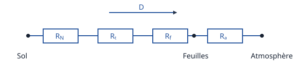
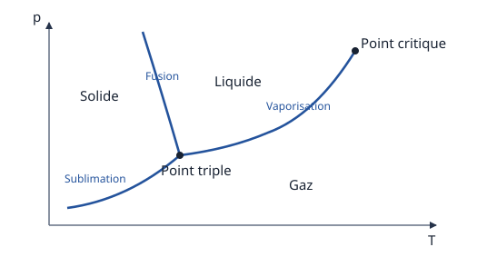

# CCINP MP — Physique-chimie 2024 · Corrigé brut

*Corrigé rédigé par IA, non officiel. Signalez toute erreur.*

## Partie I — Les besoins en eau du pin maritime

### Question 1

Le potentiel chimique est la dérivée de l’enthalpie libre $G$ par rapport à la quantité de matière à température et pression fixées. Pour ce corps pur liquide,
$$
\boxed{\mu(T,P)=\left(\frac{\partial G}{\partial n}\right)_{T,P}=G_m(T,P).}
$$
La seconde égalité découle de l’extensivité, $G(T,P,n)=nG_m(T,P)$.

### Question 2

Le potentiel chimique s’exprime en $\mathrm{J\,mol^{-1}}$ et le volume molaire en $\mathrm{m^3\,mol^{-1}}$. Ainsi $\mu/V_{em}$ s’exprime en $\mathrm{J\,m^{-3}}$, soit $\mathrm{N\,m^{-2}}=\mathrm{Pa}$. **Le potentiel hydrique a la dimension d’une pression.**

### Question 3

**a)** Dans un conducteur ohmique de conductivité $\sigma$, la loi d’Ohm locale donne $\vec j=\sigma\vec E=-\sigma\nabla V$.

Le potentiel hydrique $\psi$ joue le rôle de $V$, et $\vec j_M$ celui de $\vec j$. Dans la relation $\vec j_M=-\gamma\nabla\psi$, **la conductivité hydraulique est $\gamma=K/(\rho_e g)$**.

**b)** Comme $I=\iint_S\vec j\cdot\mathrm d\vec S$, le flux de $\vec j_M$ à travers la surface orientée joue le rôle de **l’intensité électrique $I$**.

### Question 4

**a)** En orientant le débit de $A$ vers $B$, on définit **$R_H=(\psi_A-\psi_B)/D$**.

**b)** Le potentiel hydrique s’exprime en $\mathrm{Pa}=\mathrm{kg\,m^{-1}\,s^{-2}}$ et le débit en $\mathrm{kg\,s^{-1}}$. Ainsi **$[R_H]=\mathrm{m^{-1}\,s^{-1}}$**.

### Question 5

Le long d’une racine, de l’extrémité côté sol vers le point $O$, la loi de Darcy donne $-\nabla\psi=\vec j_M/\gamma_r$. En régime stationnaire, le débit $D_r$ est le même à travers toute section droite de la racine. Dans le modèle cylindrique homogène, sa densité de courant axiale vaut $D_r/s_r$. La circulation donne

$$
\psi_S-\psi_O=\int_{S}^{O}(-\nabla\psi)\cdot\mathrm d\vec\ell
=\frac{D_r l_r}{\gamma_r s_r}.
$$

Les $N$ racines ont les mêmes potentiels aux deux extrémités, et leurs débits s’additionnent. **Elles sont en parallèle**, donc

$$
\boxed{\begin{gathered}
R_r=\frac{l_r}{\gamma_r s_r}\\
R_N=\frac{R_r}{N}.
\end{gathered}}
$$

### Question 6

En régime stationnaire, sans accumulation ni branchement extérieur à la chaîne, le débit total sortant des racines traverse successivement le tronc, les feuilles et l’interface. Le **même débit** traverse donc les quatre résistances, qui sont en série. La résistance de l’arbre vaut $R_p=R_N+R_t+R_f$.

### Question 7

La figure 2 donne $\psi_S=-0{,}05\,\mathrm{MPa}$, $\psi_F=-1{,}5\,\mathrm{MPa}$ aux feuilles du sommet, et $\psi_A=-100\,\mathrm{MPa}$ en atmosphère. Dans l’arbre et dans l’interface, le même débit vaut respectivement $(\psi_S-\psi_F)/R_p$ et $(\psi_F-\psi_A)/R_a$. Donc

$$
\boxed{R_a=R_p\frac{\psi_F-\psi_A}{\psi_S-\psi_F}
\simeq6{,}8\times 10^{10}\,\mathrm{m^{-1}\,s^{-1}}.}
$$

### Question 8

Avec $D=(\psi_S-\psi_F)/R_p=1{,}45\times10^{-3}\,\mathrm{kg\,s^{-1}}$ conservé pendant les douze heures d’exposition et un débit nocturne négligé, la masse évapo-transpirée est

$$
\boxed{m=D\,\Delta t\simeq63\,\mathrm{kg}\ \text{par pin et par jour}.}
$$

### Question 9

La plage de $15$ à $25\,\mathrm{t}$ par hectare et par jour correspond, en divisant par $300$, à **$50$ à $83\,\mathrm{kg}$ par pin et par jour**.

Les $63\,\mathrm{kg}$ calculés en Q8 sont dans cet intervalle. Réciproquement, le modèle donne environ $19\,\mathrm{t\,ha^{-1}\,j^{-1}}$.

## Partie II — Gemmage en forêt landaise et distillation de la résine de pin

### II.1 — Hydrodistillation

### Question 10

Dans le diagramme $(T,p)$, $T$ est en abscisse et $p$ en ordonnée. Les courbes de sublimation, fusion et vaporisation se rejoignent au **point triple**. La vaporisation s’arrête au **point critique**, au-delà duquel la distinction liquide–gaz disparaît. Pour l’eau, la courbe de fusion de la glace ordinaire a une pente négative.

### Question 11

Le pinène a pour masse molaire $M_p=136\,\mathrm{g\,mol^{-1}}$. À l’équilibre, sa pression partielle vaut $p_p=430\,\mathrm{Pa}$. Le gaz parfait donne la concentration massique

$$
\boxed{\frac{m_p}{V}=\frac{M_p p_p}{RT}\simeq24\,\mathrm{g\,m^{-3}}.}
$$

La valeur est presque cinq fois la limite de $5\,\mathrm{g\,m^{-3}}$. **Le local saturé est dangereux selon le critère de l’énoncé.**

### Question 12

À l’ébullition du corps pur, la pression de vapeur saturante égale la pression extérieure. Sur la figure 5, l’horizontale $1\,\mathrm{bar}$ coupe $p_p(T)$ à **$T\simeq430\,\mathrm K$, soit $157\,^\circ\mathrm C$**.

### Question 13

En présence des deux liquides non miscibles, l’ébullition vérifie $p_e(T)+p_p(T)=1\,\mathrm{bar}$. L’intersection de la courbe somme avec cette horizontale donne **$T_{\mathrm{éb}}\simeq368\,\mathrm K$, soit $95\,^\circ\mathrm C$**. Cette température est inférieure à celle d’ébullition du pinène seul.

### Question 14

À cette abscisse, les courbes donnent environ **$p_e\simeq0{,}85\,\mathrm{bar}$** et **$p_p\simeq0{,}15\,\mathrm{bar}$**. Leur somme est cohérente avec $1\,\mathrm{bar}$ à la précision graphique.

### Question 15

À même température et dans le même volume gazeux, le rapport des quantités de matière est $n_e/n_p=p_e/p_p$. Pour un condensat qui recueille ces quantités sans perte,

$$
\boxed{\frac{m_e}{m_p}=\frac{M_e p_e}{M_p p_p}\simeq0{,}75.}
$$

Il faut **vaporiser environ $0{,}75\,\mathrm{kg}$ d’eau** pour obtenir $1\,\mathrm{kg}$ de pinène, dans ce modèle.

### II.2 — Thermochimie de la réaction du pinène avec le diiode

### Question 16

Les masses molaires sont $M_p=136\ \mathrm{g\,mol^{-1}}$ et $M_{\mathrm I_2}=254\ \mathrm{g\,mol^{-1}}$. La masse de pinène vaut $\rho V=4{,}3\ \mathrm g$. La quantité de diiode introduite vaut $20/254\simeq7{,}9\times10^{-2}\ \mathrm{mol}$. La réaction consomme autant de diiode que de pinène. On obtient
$$
\begin{aligned}
n_p&=\frac{\rho V}{M_p}\simeq\boxed{3{,}2\times10^{-2}\ \mathrm{mol}},\\
n_{\mathrm{I_2,ex}}&=\frac{m_{\mathrm{I_2}}}{M_{\mathrm I_2}}-n_p
\simeq\boxed{4{,}7\times10^{-2}\ \mathrm{mol}}.
\end{aligned}
$$

### Question 17

On modélise le calorimètre comme thermiquement isolé. À pression constante et en l’absence de travail autre que celui des forces de pression, l’enthalpie totale se conserve. On décompose sa variation en trois étapes.

1. À $\theta_i$, le pinène réagit totalement selon (1). L’avancement est $n_p$.
2. À cette même température, le diiode restant se sublime. L’enthalpie de sublimation concerne les seules moles de diiode en excès.
3. Le diiode gazeux se réchauffe jusqu’à $\theta_f$. La capacité thermique du produit est négligée conformément au sujet.

$$
0=n_p\Delta_rH^\circ+n_{\mathrm{I_2,ex}}\Delta_{\mathrm{sub}}H^\circ
+n_{\mathrm{I_2,ex}}c_p(\theta_f-\theta_i).
$$
D’où
$$
\boxed{\Delta_r H^\circ=
-\frac{n_{\mathrm{I_2,ex}}}{n_p}
\left[\Delta_{\mathrm{sub}}H^\circ+c_p(\theta_f-\theta_i)\right]
\simeq-1{,}0\times10^2\ \mathrm{kJ\,mol^{-1}}.}
$$
La variation de température vaut $165\ \mathrm K$ et le chauffage du diiode gazeux coûte environ $6{,}1\ \mathrm{kJ\,mol^{-1}}$. Le signe négatif traduit une réaction exothermique.

## Partie III — La marche du berger landais sur échasses

### III.1 — Étude de la phase d’oscillation gauche

### Question 18

Dans le référentiel du buste supposé galiléen, on étudie la jambe gauche autour de l’axe fixe $F_g y$. La liaison pivot idéale a un moment axial nul. La direction de la jambe orientée du pied vers la hanche fait l’angle $\theta$ avec la verticale ascendante, positif dans le sens de la figure 7b. On écrit donc $\overrightarrow{F_gG_{jg}}=-\Delta(\sin\theta\,\vec u_x+\cos\theta\,\vec u_z)$ et $\vec P=-m_jg\,\vec u_z$. Le moment du poids projeté sur $\vec u_y$ vaut $-m_jg\Delta\sin\theta$. Le théorème du moment cinétique projeté donne

$$
\boxed{J_F\ddot\theta=-m_jg\Delta\sin\theta.}
$$

### Question 19

**a)** Des oscillations sont isochrones lorsque leur période est indépendante de l’amplitude.

**b)** Au voisinage de la jambe verticale suspendue, $\sin\theta\simeq\theta$. L’équation de Q18 devient $J_F\ddot\theta+m_jg\Delta\theta=0$. La pulsation propre est indépendante de l’amplitude. Les oscillations sont donc isochrones dans cette approximation.

**c)** La phase étudiée relie les deux extrémités opposées de l’oscillation, en une demi-période. On trouve
$$
\boxed{\begin{aligned}
\omega_{\mathrm{os}}&=\sqrt{m_jg\Delta/J_F},\\
\tau_{\mathrm{os}}&=\pi/\omega_{\mathrm{os}}.
\end{aligned}}
$$

### III.2 — Étude de la phase de double contact

### Question 20

L’énergie cinétique de rotation de la jambe droite gagne $\tfrac12 J_O\Omega(\tau_{\mathrm{dc}})^2$ car sa vitesse angulaire initiale est nulle. La jambe gauche gagne autant par hypothèse. La translation quasi uniforme du buste donne une variation cinétique négligeable. Ses variations d’énergie potentielle valent $m_bgh$, tandis que celles des jambes sont négligées. On en déduit

$$
\boxed{\Delta E=J_O\Omega(\tau_{\mathrm{dc}})^2+m_bgh.}
$$

### III.3 — Coût énergétique et pas optimal de la marche ordinaire

### Question 21

Dans le référentiel galiléen du sol, la variation d’énergie mécanique d’un système est égale à la somme des travaux des forces dont l’énergie potentielle n’est pas déjà comptabilisée, y compris le travail interne pertinent pour un système articulé. Les réactions du sol aux contacts fixes ne travaillent pas. Le poids est pris en compte dans l’énergie potentielle. En négligeant les pertes, il reste le travail moteur des muscles, soit $P\tau_{\mathrm{dc}}$ pour une puissance quasi constante. **On obtient $P=\Delta E/\tau_{\mathrm{dc}}$.**

### Question 22

On remplace dans Q20 $\Omega(\tau_{\mathrm{dc}})^2$ par $m_jg\Delta/J_F$ et $h$ par $p^2/(2l_j)$. Avec $1/\tau_{\mathrm{dc}}=V_{\mathrm{dc}}/p$, la relation de Q21 donne

$$
\boxed{P=gV_{\mathrm{dc}}\left(
\frac{J_O}{J_F}\frac{m_j\Delta}{p}
+\frac{m_b p}{2l_j}\right).}
$$

### Question 23

À vitesse $V_{\mathrm{dc}}$ fixée, la puissance est proportionnelle à $A/p+Bp$ pour $p>0$, avec $A=(J_O/J_F)m_j\Delta>0$ et $B=m_b/(2l_j)>0$.

Sa dérivée vaut $-A/p^2+B$, négative puis positive de part et d’autre de $\sqrt{A/B}$. L’unique minimum est donc atteint pour

$$
\boxed{p_{\mathrm{opt}}=\sqrt{\frac{2l_jJ_Om_j\Delta}{J_Fm_b}}.}
$$

### Question 24

Pour une jambe uniforme, $\Delta=l_j/2$ et $J_O=J_F$. Ainsi **$p_{\mathrm{opt}}=l_j\sqrt{m_j/m_b}\simeq0{,}41\,\mathrm m$**.

### III.4 — Pas optimal avec des échasses

### Question 25

**a)** La tige supplémentaire étant sans masse, $m_j$, $m_b$, $\Delta$ et $J_F$ sont inchangés.

Le pivot au sol passe de $O$ à $E$, d’où le remplacement de $J_O$ par $J_E^*$. La longueur utilisée dans la relation géométrique de hauteur passe de $l_j$ à $l_j+l^*$.

**b)** En appliquant Q23,

$$
\boxed{p_{\mathrm{opt}}^*
=\sqrt{\frac{2(l_j+l^*)J_E^*m_j\Delta}{J_Fm_b}}.}
$$

$$
\boxed{\frac{p_{\mathrm{opt}}^*}{p_{\mathrm{opt}}}
=\sqrt{\frac{J_E^*}{J_O}\left(1+\frac{l^*}{l_j}\right)}.}
$$

### Question 26

**a)** Posons $r=l^*/l_j$. Le tableau donne $J_E^*/J_O=1+3r+3r^2$, donc **$p_{\mathrm{opt}}^*/p_{\mathrm{opt}}=\sqrt{(1+r)(1+3r+3r^2)}$**.

**b)** Pour $r=1$, le rapport vaut **$\sqrt{14}\simeq3{,}74$**.

**c)** En phase oscillante, la rotation est toujours autour du pivot fémoral. Comme $\Delta$, $m_j$ et $J_F$ sont inchangés, **$\omega_{\mathrm{os}}$ et $\tau_{\mathrm{os}}$ sont inchangées**.

**d)** Avec la proportionnalité donnée, le rapport des vitesses vaut le rapport des pas, soit **$V^*/V\simeq3{,}74$** dans ce cas. Le modèle prévoit une augmentation marquée de la vitesse. Une telle estimation est à nuancer, notamment parce que $p_{\mathrm{opt}}^*\simeq1{,}53\,\mathrm m$ pour une jambe équivalente de $2\,\mathrm m$, ce qui éloigne la géométrie du régime asymptotique des très petits angles.

## Partie IV — La préparation du pastis landais

### Question 27

On additionne la dissociation acide de $\mathrm{H_2P_2O_7^{2-}}$ de constante $K_{a1}$, la protonation de $\mathrm{HCO_3^-}$ en $\mathrm{CO_{2,aq}}$ et eau de constante $1/K_{a3}$.

On ajoute ensuite le dégazage de $\mathrm{CO_{2,aq}}$ de constante $1/K_s$. Les constantes se multiplient.

$$
\boxed{K_1=\frac{K_{a1}}{K_{a3}K_s}\simeq14.}
$$

### Question 28

Les masses molaires des deux sels sont $M_d=222\,\mathrm{g\,mol^{-1}}$ et $M_b=84\,\mathrm{g\,mol^{-1}}$. La stœchiométrie impose $m_d/M_d=m_b/M_b$. La somme $m_d+m_b$ vaut $11\,\mathrm g$ après retrait de l’amidon. Les deux masses sont donc

$$
\boxed{m_d=11\,\mathrm g\,\frac{M_d}{M_d+M_b}\simeq8{,}0\,\mathrm g,\qquad
m_b\simeq3{,}0\,\mathrm g.}
$$

### Question 29

La quantité produite est $n_{\mathrm{CO_2}}=(m_d+m_b)/(M_d+M_b)\simeq3{,}59\times10^{-2}\,\mathrm{mol}$ puisque la réaction est totale et la préparation stœchiométrique. Sous $p=1\,\mathrm{bar}$ à $T=443\,\mathrm K$, le volume est

$$
\boxed{V=\frac{n_{\mathrm{CO_2}}RT}{p}\simeq1{,}32\,\mathrm L.}
$$

### Question 30

**a)** À pH croissant, les espèces phosphorées prédominantes sont successivement $\mathrm{H_2P_2O_7^{2-}}$ (courbe 1), $\mathrm{HP_2O_7^{3-}}$ (2) et $\mathrm{P_2O_7^{4-}}$ (3). La droite décroissante 4 vérifie $\log_{10}([\mathrm{H_3O^+}]/c^\circ)=-\mathrm{pH}$. La droite croissante 5 vérifie $\log_{10}([\mathrm{OH^-}]/c^\circ)=\mathrm{pH}-14$.

**b)** Le plateau de la courbe 1 en milieu acide, où la première espèce représente pratiquement tout le phosphore sous forme diphosphate, est vers $-0{,}45$. On en tire **$C_p\simeq0{,}35$ à $0{,}36\,\mathrm{mol\,L^{-1}}$**.

**c)** Au point $P$, les concentrations de l’acide et de sa base conjuguée du premier couple sont égales, donc $\mathrm{pH}_P=pK_{a1}=6{,}7$. Au point $Q$, la même propriété pour le second couple donne **$\mathrm{pH}_Q=pK_{a2}=9{,}3$**.

### Question 31

Après la réaction totale et le dégazage, l’espèce introduite dans l’équilibre (a) est $\mathrm{HP_2O_7^{3-}}$. La réaction (a) forme les deux autres espèces phosphorées en quantités égales. Le pH se lit donc à l’intersection des courbes 1 et 3, vers **$\mathrm{pH}\simeq8{,}0$**. En effet, l’égalité des concentrations extrêmes donne aussi $\mathrm{pH}=(pK_{a1}+pK_{a2})/2$ en combinant les deux lois d’action des masses.

## Partie V — Bronzage sur les plages de la Côte d’Argent et protection solaire

### V.1 — Pénétration des rayonnements dans la peau

### Question 32

La charge volumique est nulle. Le courant de conduction est $\vec j=\gamma\vec E$. On néglige $\varepsilon_0\partial_t\vec E$, courant de déplacement, devant $\vec j$. Les équations de Maxwell dans ce modèle sont
$$
\begin{aligned}
\operatorname{div}\vec E&=0,& \operatorname{div}\vec B&=0,\\
\operatorname{rot}\vec E&=-\partial_t\vec B,&
\operatorname{rot}\vec B&=\mu_0\gamma\vec E.
\end{aligned}
$$

### Question 33

Le rotationnel de Maxwell–Faraday vaut $-\partial_t(\operatorname{rot}\vec B)=-\mu_0\gamma\partial_t\vec E$. L’identité fournie et $\operatorname{div}\vec E=0$ donnent aussi $-\Delta\vec E$. Il vient l’équation de diffusion
$$
\boxed{\Delta\vec E=\mu_0\gamma\,\partial_t\vec E.}
$$

### Question 34

**a)** L’onde pénètre suivant $+\vec u_z$ et son champ électrique est toujours parallèle à $\vec u_x$. La polarisation est rectiligne selon $Ox$.

**b)** Sur l’onde $(\partial_t,\Delta)$ agissent respectivement par multiplication par $i\omega$ et $-k^2$. Il vient
$$
k^2=-i\mu_0\gamma\omega=-i\,\frac{2\pi\mu_0\gamma c}{\lambda}.
$$
Avec la convention $e^{i(\omega t-kz)}$, l’atténuation dans $z>0$ impose $\operatorname{Im}k<0$. La racine qui convient est donc
$$
\boxed{k=(1-i)\sqrt{\frac{\pi\mu_0\gamma c}{\lambda}}.}
$$
Sa partie réelle positive correspond bien à une propagation suivant $+\vec u_z$.

**c)** L’amplitude est $E_0e^{-z/\delta}$, avec
$$
\boxed{\delta=\sqrt{\frac{\lambda}{\pi\mu_0\gamma c}}
=\sqrt{\frac{2}{\mu_0\gamma\omega}}.}
$$
Cette longueur est l’**épaisseur de peau**. Au bout de cette distance, l’amplitude est divisée par $e$.

### Question 35

Dans ce modèle à conductivité constante, $\delta$ croît comme $\sqrt{\lambda}$. Il prédit une pénétration plus profonde des UVA que des UVB, puis des infrarouges plus profondément encore. Cet ordre concorde qualitativement avec la figure 9. Le modèle homogène ne permet pas de localiser les interfaces entre les couches de la peau. L’absence d’UVC à la surface de la Terre relève de l’absorption atmosphérique mentionnée dans le document.

### V.2 — Les filtres solaires inorganiques

### Question 36

Les ions $\mathrm{Ti^{4+}}$ occupent les huit sommets et le centre de la maille. Ils comptent pour $8/8+1=2$ ions par maille. Parmi les ions $\mathrm{O^{2-}}$, quatre siègent sur deux faces opposées et sont partagés par deux mailles. Les deux autres sont intérieurs. On compte $4/2+2=4$ ions oxygène. La maille contient donc **deux motifs $\mathrm{TiO_2}$**.

### Question 37

Le volume de la maille vaut $a^2b$, avec $a=459\times10^{-12}\ \mathrm m$ et $b=296\times10^{-12}\ \mathrm m$. Sa masse est $2M(\mathrm{TiO_2})/N_A$. Avec $M(\mathrm{TiO_2})\simeq80\ \mathrm{g\,mol^{-1}}$,
$$
\boxed{\rho=\frac{2M(\mathrm{TiO_2})}{N_A a^2 b}
\simeq4{,}26\times10^3\ \mathrm{kg\,m^{-3}}.}
$$
Cette valeur correspond au **rutile**.

### Question 38

Le $\mathrm{TiO_2}$ absorbe davantage dans la zone courte du graphe, notamment dans les UVB. Les courbes se croisent vers $345\ \mathrm{nm}$. Le $\mathrm{ZnO}$ absorbe davantage au-delà, sur une bonne partie des UVA, avant la chute vers $390\ \mathrm{nm}$. Le mélange combine donc les deux domaines d’absorption et élargit la plage de protection.

### V.3 — Des antioxydants dans les crèmes solaires

### Question 39

Avec les volumes finaux assimilés aux volumes d’eau donnés, $M(\mathrm{I_2})=254\,\mathrm{g\,mol^{-1}}$ et $M(\mathrm{Na_2S_2O_3})=158\,\mathrm{g\,mol^{-1}}$. La dissolution libère un ion thiosulfate par unité de sel. On trouve

$$
\boxed{\begin{aligned}
C_i&=\frac{m_i}{M(\mathrm{I_2})V_i^{\mathrm{préparation}}}
\simeq4{,}92\times10^{-2}\,\mathrm{mol\,L^{-1}},\\
C_t&=\frac{m_t}{M(\mathrm{Na_2S_2O_3})V_t^{\mathrm{préparation}}}
\simeq9{,}49\times10^{-2}\,\mathrm{mol\,L^{-1}}.
\end{aligned}}
$$

### Question 40

L’acide ascorbique cède deux électrons pour former $\mathrm{C_6H_6O_6}$ et deux protons. Le diiode accepte ces deux électrons. Avant le dosage, le bilan est donc

$$
\boxed{\mathrm{C_6H_8O_6+I_2\longrightarrow C_6H_6O_6+2I^-+2H^+}.}
$$

Au dosage, deux ions thiosulfate cèdent ensemble deux électrons pour former un ion tétrathionate. D’où

$$
\boxed{\mathrm{I_2+2S_2O_3^{2-}\longrightarrow2I^-+S_4O_6^{2-}}.}
$$

### Question 41

Il y avait initialement $C_iV_i$ moles de diiode dans l’erlenmeyer. La première réaction consomme une mole de diiode par mole d’acide ascorbique. À l’équivalence du dosage en retour, la quantité de diiode restant vaut $C_tV_t/2$. Ainsi

$$
\boxed{n_a=C_iV_i-\frac{C_tV_t}2\simeq5{,}55\times10^{-4}\,\mathrm{mol}.}
$$

### Question 42

Le prélèvement de $20{,}0\,\mathrm{mL}$ représente le cinquième de la solution préparée à partir de $500\,\mathrm{mg}$ de poudre, soit une masse équivalente de $100\,\mathrm{mg}$. La masse molaire de l’acide ascorbique vaut $176\,\mathrm{g\,mol^{-1}}$. La pureté est donc

$$
\boxed{w=\frac{n_a M(\mathrm{C_6H_8O_6})}
{(20{,}0/100)\,m_{\mathrm{poudre}}}
\simeq0{,}978,\quad\text{soit }97{,}8\,\%.}
$$

FIN
