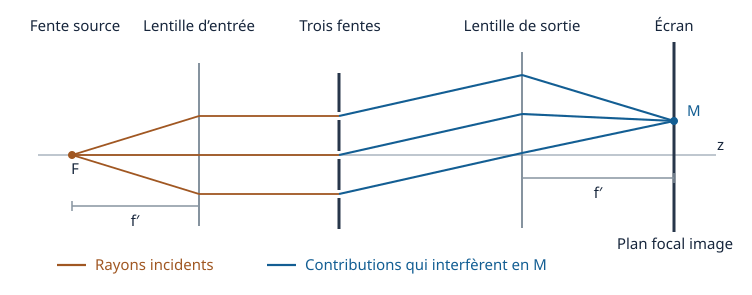
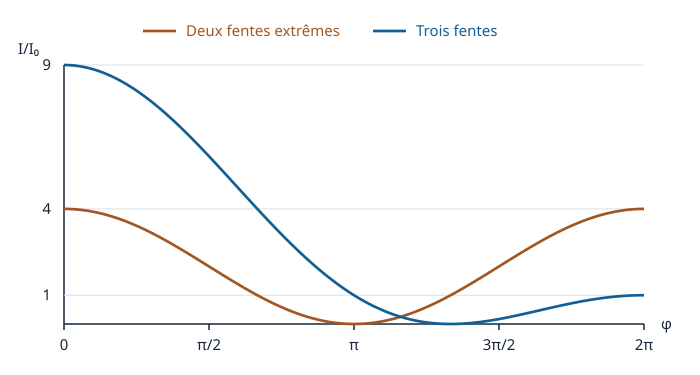

# CCINP MP — Physique 2024 · Corrigé brut

*Corrigé rédigé par IA, non officiel. Signalez toute erreur.*

## Partie I — Dualité onde-corpuscule pour la lumière

### Question 1

**a)** Dans le vide, un photon de fréquence $\nu=c/\lambda$ possède
$$
\begin{aligned}E&=h\nu=\frac{hc}{\lambda},\\\vec p&=\frac h\lambda\vec e_z.\end{aligned}
$$

**b)** Pour $\lambda=475\ \mathrm{nm}$, on trouve $E=4{,}19\times10^{-19}\ \mathrm J\simeq2{,}62\ \mathrm{eV}$. On utilise $1\ \mathrm{eV}=1{,}602\times10^{-19}\ \mathrm J$. L’exposant $-9$ imprimé pour la charge élémentaire dans les données est une coquille.

### Question 2

**a)** Après le trou, la position transverse est localisée sur une largeur de l’ordre de $r$. L’inégalité $\Delta x\,\Delta p_x\ge\hbar/2$ impose alors une dispersion transverse non nulle. Même si l’impulsion transverse moyenne est nulle, les directions possibles s’étalent autour de l’axe.

**b)** Pour une faible inclinaison, la dispersion angulaire est de l’ordre de $\Delta p_x/(h/\lambda)$. En prenant $\Delta x\sim r$, l’inégalité impose une échelle minimale $\lambda/(4\pi r)$ pour cet écart-type. Elle rend compte d’une ouverture de l’ordre de $\lambda/r$ à un facteur numérique près. La forme exacte de la tache dépend de l’ouverture et de la définition de sa largeur. Le phénomène est la **diffraction**. Un trou plus étroit ou une longueur d’onde plus grande élargit le faisceau.

### Question 3

Dans l’effet photoélectrique, un électron absorbe l’énergie $h\nu$ d’un photon. L’émission n’a lieu qu’au-dessus de la fréquence seuil $W_e/h$, et l’énergie cinétique maximale augmente linéairement avec $\nu$.

### Question 4

L’énergie du photon dépasse le travail d’extraction du césium, du sodium et du potassium. Elle reste inférieure aux seuils du titane et du fer. Pour chacun des trois premiers métaux, l’électron émis sans perte supplémentaire possède $E_{c,\max}=E-W_e$, puis
$$
v_{\max}=\sqrt{\frac{2(E-W_e)}{m_e}},
$$
avec l’énergie exprimée en joules.

- **Cs** · $v_{\max}\simeq7{,}2\times10^5\ \mathrm{m\,s^{-1}}$.
- **Na** · $v_{\max}\simeq4{,}2\times10^5\ \mathrm{m\,s^{-1}}$.
- **K** · $v_{\max}\simeq3{,}7\times10^5\ \mathrm{m\,s^{-1}}$.

Les vitesses sont faibles devant $c$, ce qui justifie la formule non relativiste. Le césium émet les électrons les plus rapides puisque son travail d’extraction est le plus faible.

### Question 5

**a)** À $632{,}8\ \mathrm{nm}$, le photon a une énergie $hc/\lambda=3{,}14\times10^{-19}\ \mathrm J$. Le débit est $\dot N=P\lambda/(hc)\simeq3{,}2\times10^{15}\ \mathrm{s^{-1}}$ pour $P=1\ \mathrm{mW}$.

**b)** Un photon en moyenne par intervalle de $10^{-12}\ \mathrm s$ correspond à $P\sim3\times10^{-7}\ \mathrm W$, soit environ $0{,}3\ \mathrm{\mu W}$. Pour rendre rares les arrivées multiples par intervalle avec une source ordinaire atténuée, on descend nettement sous cette puissance, à rendement et transmission supposés unitaires.

**c)** Les premiers impacts sont ponctuels et dispersés. Leur accumulation révèle des franges. Les zones brillantes correspondent à une plus forte fréquence d’impacts, les zones sombres à une fréquence très faible.

**d)** Si $\psi_1(M)$ et $\psi_2(M)$ sont les amplitudes associées aux deux trajets indiscernables, la densité de probabilité vérifie
$$
|\psi_1+\psi_2|^2
=|\psi_1|^2+|\psi_2|^2+2\operatorname{Re}(\psi_1\overline{\psi_2}).
$$
Le principe de superposition s’applique aux **amplitudes**. Le terme croisé explique les franges.

## Partie II — Interférences lumineuses à deux ou trois ondes

### Question 6

**a)** Les trous prélèvent deux zones du même front d’onde. Il s’agit d’une division du front d’onde. Les interférences occupent le volume de recouvrement des faisceaux diffractés et ne sont pas localisées sur un plan particulier.

**b)** Prenons $\delta=O_2M-O_1M$, le plan des trous étant éclairé en phase. La différence des carrés est $2ax$. Comme $O_1M+O_2M\simeq2D$,
$$
\delta\simeq\frac{ax}{D}.
$$
Les sources secondaires issues du même front d’onde sont cohérentes et d’égale intensité $I_1$. Le module carré de la somme des amplitudes donne $2I_1(1+\cos(2\pi\delta/\lambda))$. Ainsi
$$
I(M)=\frac{I_{\max}}2\left[1+\cos\left(\frac{2\pi ax}{\lambda D}\right)\right].
$$
Ici $I_{\max}=4I_1$.

### Question 7

**a)** L’intensité varie périodiquement avec $x$, d’où des franges droites parallèles à $Oy$, alternativement brillantes et sombres. Leur interfrange est $i=\lambda D/a=cD/(\nu a)$.

**b)** Des fentes fines parallèles à $Oy$ conservent la séparation en $x$ et la dépendance en phase correspondante dans le champ commun. Elles transmettent davantage de lumière. Une translation transverse du couple conserve l’interfrange. Pour un déplacement $\Delta x$ dans la direction de séparation et un écran à distance finie, elle décale le centre des franges de $\Delta x$ au même ordre paraxial. Une translation selon $Oy$ est sans effet sur la phase des franges dans ce modèle. L’enveloppe peut se déplacer et il faut rester dans la zone éclairée.

### Question 8

**a)** Les bandes distinctes sont incohérentes entre elles. Posons $\delta=ax/D$ et notons $J_\nu=J_0$ le profil constant entre $\nu_-=\nu_0-\Delta\nu/2$ et $\nu_+=\nu_0+\Delta\nu/2$. La fraction spectrale $J_0\,\mathrm d\nu$ contribue avec le facteur de Fresnel $1+\cos(2\pi\nu\delta/c)$ et un même facteur géométrique. L’intégration du cosinus donne
$$
I(M)=\frac{I_{\max}}2\left[1+\operatorname{sinc}\!\left(\frac{\pi\Delta\nu\,\delta}{c}\right)
\cos\left(\frac{2\pi x}{i}\right)\right].
$$
L’interfrange vaut $i=cD/(\nu_0a)$.
La normalisation se lit en $x=0$, où l’intensité vaut $I_{\max}$.

**b)** Dans l’écriture proposée, $V(M)=\operatorname{sinc}(\pi\Delta\nu\,\delta/c)$ est le coefficient signé. La visibilité locale mesurée comme contraste est sa valeur absolue. Quand le coefficient change de signe, maxima et minima du cosinus sont échangés.

**c)** Le premier zéro correspond à $\pi\Delta\nu\,L/c=\pi$. Ainsi $L=c/\Delta\nu\simeq\lambda_0^2/\Delta\lambda$. L’écart d’ordre $\delta\Delta\nu/c$ entre les bords du spectre vaut alors 1, comme attendu au premier brouillage. Au-delà, le modèle rectangulaire prévoit des réapparitions plus faibles.

**d)** Le temps associé à la longueur de cohérence est $\tau=L/c=1/\Delta\nu$.

**e)** La zone centrale est comprise entre $-L$ et $L$ en différence de marche. Chaque interfrange correspond à une variation $\lambda_0$ de cette différence, d’où $N=2L/\lambda_0$.

**f)** Avec les longueurs d’onde prises en mètres dans les calculs, on obtient les ordres de grandeur suivants.

- **Laser He–Ne**, $632{,}991\ \mathrm{nm}$ et $0{,}001\ \mathrm{nm}$ · $\tau\simeq1{,}3\times10^{-9}\ \mathrm s$, $L\simeq0{,}40\ \mathrm m$, $N\simeq1{,}3\times10^6$.
- **Raie rouge de l’hydrogène**, $656{,}2\ \mathrm{nm}$ et $0{,}1\ \mathrm{nm}$ · $\tau\simeq1{,}4\times10^{-11}\ \mathrm s$, $L\simeq4{,}3\times10^{-3}\ \mathrm m$, $N\simeq1{,}3\times10^4$.
- **Lumière blanche filtrée**, $500\ \mathrm{nm}$ et $20\ \mathrm{nm}$ · $\tau\simeq4{,}2\times10^{-14}\ \mathrm s$, $L\simeq1{,}3\times10^{-5}\ \mathrm m$, $N\simeq50$.

Une raie plus étroite permet de distinguer les franges sur un intervalle plus large, à géométrie et enveloppe de diffraction comparables.

### Question 9

**a) et b)** La lentille d’entrée transforme l’onde de la fente source en onde plane normale. Pour un point $M$ du plan focal image de la lentille de sortie, les rayons issus des trois fentes se propagent dans la même direction inclinée avant la lentille. Ils convergent en $M$ après celle-ci. La normale optique est $Oz$ et l’angle paraxial est $x/f'$.

**c)** Avec les fentes en $-a/2$, $0$ et $a/2$, l’écart de phase entre les deux fentes extrêmes est $\varphi=2\pi ax/(\lambda f')$. À un facteur commun près, les amplitudes sont donc $e^{-j\varphi/2}$, 1 et $e^{j\varphi/2}$. Il vient
$$
I_3(\varphi)=I_0\bigl(1+2\cos(\varphi/2)\bigr)^2.
$$

**d)** Pour la paire extrême seule, $I_2(\varphi)=4I_0\cos^2(\varphi/2)$. Le graphe demandé sur $[0,2\pi]$ est ci-dessous.

**e)** En $\varphi=0$, l’intensité passe de $4I_0$ à $9I_0$. Le premier zéro passe de $\pi$ à $4\pi/3$. À écartement extérieur fixé, la zone centrale est donc plus lumineuse et **plus large**, avec une largeur entre zéros multipliée par $4/3$. À pas entre fentes voisines fixé, la comparaison change et les pics se resserrent, comme le montre Q10.

Dans le cas à trois fentes, le sommet secondaire entre les deux zéros voisins de deux maxima principaux vaut $I_0$.

**f)** Dans la partie exploitable de la photo 2, les intervalles entre les traits sombres alternent entre environ $0{,}5\ \mathrm{mm}$ et $1{,}0\ \mathrm{mm}$. Les zéros de Q9.c sont à $4\pi/3$ et $8\pi/3$ modulo $4\pi$, d’où des espacements égaux au tiers et aux deux tiers de l’intervalle entre maxima principaux.

La somme des deux espacements vaut environ $1{,}5$ à $1{,}6\ \mathrm{mm}$. Puisque le pas entre franges principales vaut $i_3=2\lambda f'/a$, on en déduit
$$
a=\frac{2\lambda f'}{i_3}\simeq0{,}41\ \mathrm{mm}.
$$
C’est l’écartement des deux fentes initiales. Le pas entre fentes voisines vaut $a/2\simeq0{,}20\ \mathrm{mm}$.

## Partie III — Réseau et effet Talbot

### Question 10

**a)** Le montage de Q9 s’étend à $N$ fentes régulièrement espacées. La source ponctuelle au foyer objet fournit une onde plane entre les deux lentilles. Le rayon issu d’une fente, dans la direction inclinée appropriée, traverse la lentille de sortie et arrive en $M$ dans son plan focal image. Dans l’autre plan transverse, la composante d’inclinaison vaut $y/f'$. Sur le schéma de Q9, les rayons bleus montrent ce trajet pour trois fentes.

**b)** Dans cette question, $a$ désigne le pas entre fentes **voisines**, donc $\varphi=2\pi ax/(\lambda f')$ est leur écart de phase. Pour $e^{j\varphi}\ne1$, la somme des amplitudes, rapportée à l’amplitude d’une fente et à une phase commune près, est
$$
\sum_{s=0}^{N-1}e^{js\varphi}
=e^{j(N-1)\varphi/2}\frac{\sin(N\varphi/2)}{\sin(\varphi/2)}.
$$
On obtient $I=N^2I_0[\sin(N\varphi/2)/(N\sin(\varphi/2))]^2$. Aux valeurs où le dénominateur s’annule, la somme initiale vaut $N$.

**c)** Le numérateur est nul pour $\varphi=2\pi m/N$, $m\in\mathbb Z$. Si $m$ est multiple de $N$, les amplitudes sont en phase et atteignent la borne $N$ en module. Ces valeurs $\varphi=2\pi\ell$ donnent les maxima principaux. Les autres sont de véritables zéros.

Il y a **$N-1$ zéros entre deux maxima principaux successifs**.

**d)** Le rapport des intensités de crête est $H=N^2$.

**e)** Les premiers zéros autour de $2\pi\ell$ sont à une distance $2\pi/N$. La largeur entre zéros est $\delta\varphi=4\pi/N$.

**f)** À pas fixé, les pics principaux gagnent en intensité et se resserrent à mesure que $N$ augmente. Pour $N=3$, l’écart de phase entre les deux fentes extrêmes est deux fois celui entre voisines. Dans la notation de Q9, il faut donc remplacer le $\varphi$ de Q10 par $\varphi_{\mathrm{Q9}}/2$ pour retrouver exactement $I_3$. Le résultat sur la largeur à pas fixé correspond à une comparaison différente de Q9, où l’écartement extérieur était fixe.

### Question 11

En incidence normale, les fentes voisines sont illuminées en phase. La différence de marche d’émission dans la direction $\theta$ vaut $a\sin\theta$ au signe près. L’interférence est constructive quand elle est égale à un multiple de $\lambda$, d’où $\sin\theta_n=n\lambda/a$. L’entier $n$ est l’**ordre de diffraction**. Pour une incidence d’angle algébrique $\theta_i$, avec les deux angles comptés de la même façon depuis la normale, la relation devient
$$
a(\sin\theta_n-\sin\theta_i)=n\lambda.
$$

### Question 12

**a)** L’onde est plane, progressive et monochromatique, de pulsation $\omega$, polarisée rectilignement selon $Oy$. Elle se propage dans le sens $+Oz$, avec $\vec k_l=(\omega/c)\vec e_z$.

**b)** Dans l’air assimilé au vide,
$$
\vec B_l=\frac{\vec k_l\times\vec E_l}{\omega}
=-\frac{E_0}{c}e^{j(\omega t-k_lz)}\vec e_x.
$$

**c)** Le produit vectoriel des champs réels vaut $E_0^2\cos^2(\omega t-k_lz)\vec e_z/c$. Comme la moyenne de $\cos^2$ est $1/2$,
$$
\vec\Pi_0=\frac{E_0^2}{2\mu_0c}\vec e_z.
$$

### Question 13

**a)** Dans le modèle de fentes identiques, les contributions ont la même amplitude et la même polarisation selon $Oy$. Le déphasage pour deux fentes voisines est $2\pi n$ dans la direction $\theta_n$, et pour des fentes non voisines un multiple de cette valeur. Les contributions sont donc en phase au point d’observation.

**b)** On peut les additionner directement. Avec $\vec k_d=(2\pi/\lambda)(\sin\theta_n\,\vec e_x+\cos\theta_n\,\vec e_z)$,
$$
\vec E_{dT}=N\alpha(\theta_n)E_0\,e^{j(\omega t-\vec k_d\cdot\overrightarrow{OM})}\,\vec e_y.
$$

### Question 14

**a)** La moyenne de Poynting de l’onde résultante est
$$
\vec\Pi_N
=N^2|\alpha(\theta_n)|^2\,\|\vec\Pi_0\|
(\sin\theta_n\,\vec e_x+\cos\theta_n\,\vec e_z).
$$
La norme du flux incident sert de référence. Le flux diffracté est dirigé suivant $\vec k_d$.

**b)** Dans la même direction et avec la même illumination, une seule fente donne la norme $|\alpha(\theta_n)|^2\|\vec\Pi_0\|$. On retrouve $H=N^2$ lorsque cette norme est non nulle.

**c)** La densité vaut $100\ \mathrm{mm^{-1}}$, soit un pas $a=10\ \mathrm{\mu m}$. Le diamètre éclairé vaut $2{,}0\ \mathrm{mm}$. Dans le modèle d’éclairement uniforme de Q10, environ 200 traits sont éclairés, ce qui donne **$H\simeq4{,}0\times10^4$**.

**d)** La relation $\theta_n=\arcsin(n\lambda/a)$ donne, pour les ordres 0 à 3, **$0^\circ$, $3{,}63^\circ$, $7{,}27^\circ$ et $10{,}94^\circ$**. Les ordres négatifs sont obtenus par symétrie.

### Question 15

Pour un ordre propagatif vers l’avant, $k_0=2\pi/\lambda$ et $\sin\theta_n=n\lambda/a$. Donc
$$
\begin{aligned}k_{n,x}&=\frac{2\pi n}{a},\\k_{n,z}&=\frac{2\pi}{\lambda}\sqrt{1-\left(\frac{n\lambda}{a}\right)^2}.\end{aligned}
$$
L’ordre est propagatif si $|n|\lambda\le a$, avec propagation rasante à l’égalité.

### Question 16

La somme est cohérente et porte sur des amplitudes d’ondes de même pulsation. La périodicité du masque fixe $k_{n,x}$ et sa géométrie fixe le poids $C_n$. Dans les formules imprimées pour $C_n$, les coefficients doivent être indépendants de $x$. Pour des ouvertures rectangulaires centrées de largeur $\varepsilon$ et de période $a$, l’intégration sur une période donne
$$
\begin{aligned}C_0&=\frac{\varepsilon}{a},\\C_n&=\frac1a\int_{-\varepsilon/2}^{\varepsilon/2}e^{j2\pi nu/a}\,\mathrm du\\&=\frac{\sin(\pi n\varepsilon/a)}{\pi n}\qquad(n\ne0).\end{aligned}
$$
Pour la partie propagative, Q15 donne
$$
A_{\mathrm{prop}}(x,z,t)
=\alpha_0e^{j\omega t}\!
\sum_{|n|\lambda\le a}C_n
e^{-j(2\pi/\lambda)z\sqrt{1-(n\lambda/a)^2}}\,
e^{-j2\pi nx/a}.
$$
La somme formelle sur tous les ordres inclut aussi des termes évanescents. Pour $|n|\lambda>a$, le choix $k_{n,z}=-j(2\pi/\lambda)\sqrt{(n\lambda/a)^2-1}$ les fait décroître quand $z>0$ augmente, conformément à la convention de phase de l’énoncé.

### Question 17

**a)** Avec $q=\lfloor a/\varepsilon\rfloor$, posons $T_q(x)=\sum_{n=-q}^{q}C_n e^{-j2\pi nx/a}$. Dans l’approximation donnée, le facteur supplémentaire vaut $e^{j\pi\lambda zn^2/a^2}$. Ainsi
$$
\begin{aligned}
A(x,0,t)&=\alpha_0e^{j\omega t}T_q(x),\\
A(x,z_T/2,t)&=\alpha_0e^{j(\omega t-2\pi z_T/(2\lambda))}
  \sum_{n=-q}^{q} C_n(-1)^n e^{-j2\pi nx/a},\\
A(x,z_T,t)&=\alpha_0e^{j(\omega t-2\pi z_T/\lambda)}T_q(x),
\end{aligned}
$$
avec $z_T=2a^2/\lambda$. À la demi-distance, $e^{j\pi n^2}=(-1)^n$. À la distance entière, $e^{j2\pi n^2}=1$.

**b)** Le facteur $(-1)^n=e^{-j2\pi n(a/2)/a}$ transforme la somme de la demi-distance en $T_q(x+a/2)$. La phase globale disparaît de l’intensité. On observe donc le motif translaté de **$a/2$ modulo $a$** à $z_T/2$ et le motif non décalé à $z_T$.

### Question 18

Sur la photo 1, quatre motifs occupent environ $250\lambda$ en largeur, soit $a/\lambda\simeq62{,}5$. Au niveau du réseau, à $z/\lambda=0$, une bande claire couvre environ 8 à 12 pixels, contre environ 107 pixels entre deux bandes. L’épaisseur est de l’ordre de $6\lambda$, avec une incertitude de lecture liée au contraste. On en déduit **$\varepsilon/a\simeq0{,}1$**. La bande s’élargit dès que l’on mesure plus haut sur la photo.

Les bandes reparaissent dans les mêmes positions vers $z/\lambda\simeq8{,}0\times10^3$, décalées d’un demi-pas vers $4{,}0\times10^3$. À $z_T/4$, on distingue un motif fractionnaire plus serré. La formule donne $z_T/\lambda=2(a/\lambda)^2\simeq7{,}8\times10^3$, compatible avec la photo.

### Question 19

Le facteur au quotient de sinus décrit les interférences des $N$ motifs. Il concentre la lumière en pics séparés d’environ $i=\lambda D/a$ sur l’écran lointain. Le facteur $\operatorname{sinc}^2(\pi\varepsilon x/(\lambda D))$ décrit la diffraction par un motif de largeur $\varepsilon$. Il module la hauteur des pics, avec des premiers zéros en $x=\pm\lambda D/\varepsilon$.

Pour les hématies, la largeur caractéristique de $8\ \mathrm{\mu m}$ est comparable au pas de $12\ \mathrm{\mu m}$. Dans une coupe décrite par la formule unidimensionnelle, les premiers zéros de l’enveloppe sont à environ une fois et demie le pas entre pics. On observe donc surtout le pic central et les premiers ordres de part et d’autre. Pour une monocouche hexagonale, les taches s’organisent selon les directions caractéristiques du réseau hexagonal et leur intensité est modulée par la diffraction de chaque hématie. La figure lointaine révèle la périodicité et la symétrie. Pour distinguer la forme individuelle à l’échelle 1, on se rapproche du réseau.

Dans le modèle unidimensionnel du sujet, en prenant pour $a$ le pas fourni, on estime la distance de l’auto-image à l’échelle 1 par
$$
z_T=\frac{2a^2}{\lambda}\simeq4{,}5\times10^{-4}\ \mathrm m,
$$
soit environ **$0{,}45\ \mathrm{mm}$**. La distance $z_T/2$ produirait le motif décalé dans le modèle à une dimension.

## Partie IV — Interférences d’ondes de matière

### Question 20

**a)** La relation de de Broglie est $\lambda=h/p$. Un électron initialement quasi immobile gagne l’énergie cinétique $eU$ avec $e=1{,}602\times10^{-19}\ \mathrm C$. Le régime est non relativiste puisque $eU\ll m_ec^2$. Pour $U=100\ \mathrm V$, on obtient $p=\sqrt{2m_eeU}$ puis
$$
\lambda=\frac{h}{\sqrt{2m_eeU}}\simeq1{,}23\times10^{-10}\ \mathrm m.
$$

**b)** À ouverture comparable, la résolution limitée par la diffraction est d’autant meilleure que la longueur d’onde est petite. La longueur d’onde électronique, environ $0{,}12\ \mathrm{nm}$ ici, est très inférieure à celle de la lumière visible. Les aberrations électroniques et l’échantillon peuvent également limiter la résolution réelle.

### Question 21

À l’équilibre dans le régime classique, le théorème d’équipartition attribue $k_BT/2$ en moyenne à chaque degré de liberté qui intervient quadratiquement dans l’énergie. Pour les trois composantes de la vitesse,
$$
\frac12m\langle v^2\rangle=\frac32k_BT.
$$
Avec $u=\sqrt{\langle v^2\rangle}$ et $m=M/N_A$ pour une masse molaire $M$,
$$
u=\sqrt{\frac{3k_BT}{m}}=\sqrt{\frac{3RT}{M}}.
$$

- Hélium à $295\ \mathrm K$ · $u\simeq1{,}36\times10^3\ \mathrm{m\,s^{-1}}$.
- Néon à $2{,}5\ \mathrm{mK}$ · $u\simeq1{,}8\ \mathrm{m\,s^{-1}}$.

La valeur $225\ \mathrm{m\,s^{-1}}$ imprimée pour l’hélium à $83\ \mathrm K$ est incompatible avec cette formule, qui donne environ $7{,}2\times10^2\ \mathrm{m\,s^{-1}}$. Les deux lectures sont précisées en Q22.

### Question 22

**a)** Pour l’hélium, la longueur d’onde estimée à la vitesse quadratique moyenne est $\lambda=hN_A/(Mu)$. On obtient environ $7{,}4\times10^{-11}\ \mathrm m$ à $295\ \mathrm K$ et $1{,}4\times10^{-10}\ \mathrm m$ à $83\ \mathrm K$ avec l’équipartition.

Avec la largeur $\varepsilon_F=2\ \mathrm{\mu m}$, le lobe central issu de $F$ mesure environ $2L\lambda/\varepsilon_F$, soit $47\ \mathrm{\mu m}$ ou $89\ \mathrm{\mu m}$. Les deux fentes séparées de $8\ \mathrm{\mu m}$ sont donc éclairées.

Chacune, de largeur $1\ \mathrm{\mu m}$, produit au détecteur un lobe d’environ $94\ \mathrm{\mu m}$ ou $178\ \mathrm{\mu m}$. Ces lobes se recouvrent. Pour un impact dans la zone commune, les deux chemins via $F_1$ et $F_2$ sont ainsi possibles.

L’usage de la vitesse imprimée à $83\ \mathrm K$ donne une longueur d’onde plus grande encore, $4{,}4\times10^{-10}\ \mathrm m$, et confirme les deux recouvrements.

**b)** Les amplitudes des deux trajets, cohérentes grâce à la fente source commune, interfèrent. Les maxima du module carré de la somme des amplitudes correspondent aux droites à nombreux impacts. Les minima correspondent aux interférences destructives.

**c)** Par la relation de Young donnée, $i=\lambda L'/a$. Cela donne **$5{,}9\ \mathrm{\mu m}$ à $295\ \mathrm K$** et **$11\ \mathrm{\mu m}$ à $83\ \mathrm K$** avec l’équipartition.

Si l’on reprend la vitesse $225\ \mathrm{m\,s^{-1}}$ indiquée dans le tableau, le second résultat devient **$35\ \mathrm{\mu m}$**. Ces estimations utilisent une vitesse représentative du faisceau.

### Question 23

**a)** Avec le modèle de Young à vitesse constante donné par le sujet, le résultat expérimental $i=1{,}1\ \mathrm{mm}$ correspond à
$$
\lambda_{\mathrm{eff}}=\frac{ia}{D}\simeq7{,}8\times10^{-9}\ \mathrm m.
$$
Pour le néon, $m=M/N_A\simeq3{,}32\times10^{-26}\ \mathrm{kg}$. On en déduit $h/(m\lambda_{\mathrm{eff}})\simeq2{,}6\ \mathrm{m\,s^{-1}}$. Cette estimation fondée sur un interfrange de Young doit être comparée à la vitesse réelle obtenue en b).

**b)** En supposant le départ sans vitesse, la conservation de l’énergie donne $v^2=2g\Delta z$. On trouve $v_F=\sqrt{2gd}\simeq0{,}83\ \mathrm{m\,s^{-1}}$ aux fentes et $v_D=\sqrt{2g(d+D)}\simeq4{,}2\ \mathrm{m\,s^{-1}}$ au détecteur. La vitesse obtenue en a) est intermédiaire. L’hypothèse de vitesse constante néglige l’accélération entre les fentes et l’écran.

On peut préciser cette comparaison. Le temps de vol entre les deux plans est $\Delta t=(v_D-v_F)/g\simeq0{,}34\ \mathrm s$. Dans l’approximation paraxiale, deux trajectoires issues de fentes séparées de $a$ et arrivant au même point ont des vitesses transverses qui diffèrent de $a/\Delta t$, car l’accélération est verticale. La relation de de Broglie donne alors un écart de vecteur d’onde transverse de module $ma/(\hbar\Delta t)$. L’interfrange est donc $h\Delta t/(ma)\simeq1{,}13\ \mathrm{mm}$, en accord avec la mesure. La vitesse de a) décrit ainsi approximativement la vitesse verticale moyenne $D/\Delta t$ sur ce trajet.

**c)** Refroidir les atomes réduit le mouvement initial désordonné et la dispersion des vitesses. La pesanteur joue alors un rôle dominant en moyenne et les franges sont moins brouillées. L’hypothèse de vitesse initiale nulle de b) reste une idéalisation.
