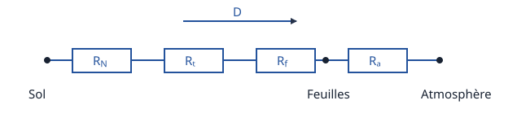
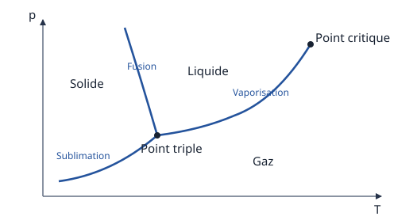
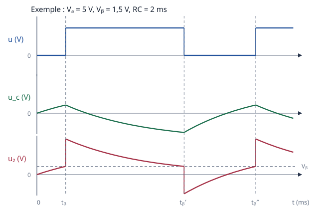

# CCINP MPI — Physique-chimie 2024 · Corrigé guidé

*Corrigé rédigé par IA, non officiel. Signalez toute erreur.*

## Présentation du sujet

L’épreuve dure quatre heures, calculatrice autorisée. Les 39 questions constituent six parties indépendantes. L’excursion dans les Landes sert de cadre à des bilans de transport, à des lectures graphiques, à la mécanique, à l’électronique et à la chimie des solutions.

| Questions | Travail demandé |
|---|---|
| Q1–Q7 | Construire l’analogie entre circulation de sève et courant électrique, puis chiffrer la masse échangée. |
| Q8–Q13 | Lire un diagramme de phases et les pressions saturantes pour étudier l’hydrodistillation. |
| Q14–Q22 | Étudier les phases du pas et comparer le modèle avec et sans échasses. |
| Q23–Q27 | Expliquer le dégagement de dioxyde de carbone et le pH final du mélange. |
| Q28–Q35 | Suivre un oscillateur à portes logiques et lire la commande d’arrosage. |
| Q36–Q39 | Déterminer la pureté d’une poudre par dosage en retour du diiode. |

Commencez par les parties dont vous connaissez bien les lois de base. Les transitions entre exercices permettent de reprendre ailleurs si une lecture bloque. Gardez la figure 5 pour retrouver les trois pressions de la partie II, et la figure 9 à côté du brouillon pendant l’étude de l’oscillateur. Le jury insiste sur la conservation du débit, les moments projetés, les conventions des tensions et la différence entre équivalence et équilibre.

[Sujet officiel](https://www.concours-commun-inp.fr/_resource/annales%20%C3%A9crits/2024/MPI/2024_MPI2PC.pdf?download=true) · [Rapport 2024](https://www.concours-commun-inp.fr/_resource/annales%20%C3%A9crits/2024/MPI/MPI_ECRIT_PhysiqueChimie_2024.pdf?download=true) · [BO MP2I](https://www.education.gouv.fr/bo/21/Special1/ESRS2035777A.htm) · [BO MPI](https://www.education.gouv.fr/bo/21/Hebdo31/ESRS2111756A.htm)

## Partie I — Les besoins en eau du pin maritime (ou pin des Landes)

Le potentiel hydrique et le débit se traitent comme deux grandeurs conjuguées de l’analogie électrique. La conservation du débit détermine les associations.

### Question 1

> [!INDICATION]
> Mettez la loi de Darcy dans la même forme que la loi d’Ohm locale, puis reliez une densité de courant à son flux.

#### Solution

**a)** Dans un conducteur ohmique de conductivité $\sigma$, la loi d’Ohm locale donne $\vec j=\sigma\vec E=-\sigma\nabla V$.

Le potentiel hydrique $\psi$ joue le rôle de $V$, et $\vec j_M$ celui de $\vec j$. Dans la relation $\vec j_M=-\gamma\nabla\psi$, **la conductivité hydraulique est $\gamma=K/(\rho_e g)$**.

**b)** Comme $I=\iint_S\vec j\cdot\mathrm d\vec S$, le flux de $\vec j_M$ à travers la surface orientée joue le rôle de **l’intensité électrique $I$**.

> [!JURY]
> Le rapport attend de justifier l’analogie du débit par la définition de l’intensité, qui est le flux orienté de la densité de courant.

### Question 2

> [!INDICATION]
> Construisez le quotient analogue à une résistance en orientant le débit vers le potentiel le plus bas.

#### Solution

**a)** En orientant le débit de $A$ vers $B$, on définit **$R_H=(\psi_A-\psi_B)/D$**.

**b)** Le potentiel hydrique s’exprime en $\mathrm{Pa}=\mathrm{kg\,m^{-1}\,s^{-2}}$ et le débit en $\mathrm{kg\,s^{-1}}$. Ainsi **$[R_H]=\mathrm{m^{-1}\,s^{-1}}$**.

> [!JURY]
> Le rapport relève la confusion entre débit massique et grandeur par unité de masse. Ici, la masse s’écoule par unité de temps.

### Question 3

> [!INDICATION]
> Intégrez la loi locale suivant l’axe d’une racine, puis étudiez ce qui se conserve ou s’additionne pour plusieurs racines.

> [!INDICATION]
> Sur une section droite, le débit est la densité normale multipliée par la section. Gardez cette densité constante le long de la racine.

#### Solution

Le long d’une racine, de l’extrémité côté sol vers le point $O$, la loi de Darcy donne $-\nabla\psi=\vec j_M/\gamma_r$. En régime stationnaire, le débit $D_r$ est le même à travers toute section droite de la racine. Dans le modèle cylindrique homogène, sa densité de courant axiale vaut $D_r/s_r$. La circulation donne

$$
\psi_S-\psi_O=\int_{S}^{O}(-\nabla\psi)\cdot\mathrm d\vec\ell
=\frac{D_r l_r}{\gamma_r s_r}.
$$

Les $N$ racines ont les mêmes potentiels aux deux extrémités, et leurs débits s’additionnent. **Elles sont en parallèle**, donc

$$
\boxed{\begin{gathered}
R_r=\frac{l_r}{\gamma_r s_r}\\
R_N=\frac{R_r}{N}.
\end{gathered}}
$$

> [!JURY]
> Une circulation utilise l’élément tangent au trajet. Le rapport relève des écritures de flux ou des signes corrigés artificiellement.

### Question 4

> [!INDICATION]
> Comparez le débit avant et après chacun des compartiments. Y a-t-il une accumulation de masse ?

#### Solution

En régime stationnaire, sans accumulation ni branchement extérieur à la chaîne, le débit total sortant des racines traverse successivement le tronc, les feuilles et l’interface. Le **même débit** traverse donc les quatre résistances, qui sont en série. La résistance de l’arbre vaut $R_p=R_N+R_t+R_f$.

> [!JURY]
> Le rapport demande de caractériser une association en série par le débit commun. L’ordre des éléments sur le dessin ne suffit pas.

### Question 5

> [!INDICATION]
> Repérez sur la figure les potentiels aux deux bornes de l’arbre et de l’interface. Exprimez deux fois le même débit.

#### Solution

La figure 2 donne $\psi_S=-0{,}05\,\mathrm{MPa}$, $\psi_F=-1{,}5\,\mathrm{MPa}$ aux feuilles du sommet, et $\psi_A=-100\,\mathrm{MPa}$ en atmosphère. Dans l’arbre et dans l’interface, le même débit vaut respectivement $(\psi_S-\psi_F)/R_p$ et $(\psi_F-\psi_A)/R_a$. Donc

$$
\boxed{R_a=R_p\frac{\psi_F-\psi_A}{\psi_S-\psi_F}
\simeq6{,}8\times 10^{10}\,\mathrm{m^{-1}\,s^{-1}}.}
$$

> [!JURY]
> Pour un diviseur, choisissez les chutes séparément. Le rapport relève des applications où une chute est confondue avec un potentiel absolu.

### Question 6

> [!INDICATION]
> Reliez le débit à la perte de potentiel à travers la partie dont la résistance est donnée, puis convertissez la durée solaire.

#### Solution

Avec $D=(\psi_S-\psi_F)/R_p=1{,}45\times10^{-3}\,\mathrm{kg\,s^{-1}}$ conservé pendant les douze heures d’exposition et un débit nocturne négligé, la masse évapo-transpirée est

$$
\boxed{m=D\,\Delta t\simeq63\,\mathrm{kg}\ \text{par pin et par jour}.}
$$

> [!METHODE]
> L’unité du débit permet de vérifier que la multiplication par la durée donne une masse.

### Question 7

> [!INDICATION]
> Ramenez les deux estimations à la même surface ou au même nombre d’arbres et à la même durée.

#### Solution

La plage de $15$ à $25\,\mathrm{t}$ par hectare et par jour correspond, en divisant par $300$, à **$50$ à $83\,\mathrm{kg}$ par pin et par jour**.

Les $63\,\mathrm{kg}$ calculés en Q6 sont dans cet intervalle. Réciproquement, le modèle donne environ $19\,\mathrm{t\,ha^{-1}\,j^{-1}}$.

> [!METHODE]
> Une plage de valeurs se compare en contrôlant les deux bornes. Le modèle ne prétend pas donner un débit instantané valable en toute saison.

## Partie II — Gemmage en forêt landaise et distillation de la résine de pin

L’hydrodistillation exploite deux pressions partielles. Une lecture à pression fixée donne la température recherchée.

### Question 8

> [!INDICATION]
> Placez d’abord les axes et les trois courbes de coexistence. L’une d’elles s’interrompt à son extrémité haute.

> [!INDICATION]
> Pour la fusion de la glace usuelle, comparez la densité du solide à celle du liquide et examinez l’effet de la pression.

#### Solution

Dans le diagramme $(T,p)$, $T$ est en abscisse et $p$ en ordonnée. Les courbes de sublimation, fusion et vaporisation se rejoignent au **point triple**. La vaporisation s’arrête au **point critique**, au-delà duquel la distinction liquide–gaz disparaît. Pour l’eau, la courbe de fusion de la glace ordinaire a une pente négative.

> [!JURY]
> Le jury relève des axes inversés et des domaines incohérents. Une isotherme ou une isobare permet de vérifier l’ordre des domaines.

### Question 9

> [!INDICATION]
> Exprimez la quantité de pinène en phase gazeuse par unité de volume, puis passez à sa masse.

#### Solution

Le pinène a pour masse molaire $M_p=136\,\mathrm{g\,mol^{-1}}$. À l’équilibre, sa pression partielle vaut $p_p=430\,\mathrm{Pa}$. Le gaz parfait donne la concentration massique

$$
\boxed{\frac{m_p}{V}=\frac{M_p p_p}{RT}\simeq24\,\mathrm{g\,m^{-3}}.}
$$

La valeur est presque cinq fois la limite de $5\,\mathrm{g\,m^{-3}}$. **Le local saturé est dangereux selon le critère de l’énoncé.**

> [!METHODE]
> La pression donnée est la pression partielle de l’espèce. Employez-la dans la loi des gaz parfaits avec la température absolue.

### Question 10

> [!INDICATION]
> Pour le liquide pur, utilisez uniquement sa propre courbe de pression saturante.

#### Solution

À l’ébullition du corps pur, la pression de vapeur saturante égale la pression extérieure. Sur la figure 5, l’horizontale $1\,\mathrm{bar}$ coupe $p_p(T)$ à **$T\simeq430\,\mathrm K$, soit $157\,^\circ\mathrm C$**.

> [!METHODE]
> Tracez l’horizontale imposée, puis projetez l’intersection sur l’axe de température. La conversion en degrés Celsius se fait après la lecture.

### Question 11

> [!INDICATION]
> Additionnez les deux pressions partielles en présence des deux liquides. Quelle courbe représente déjà cette somme ?

#### Solution

En présence des deux liquides non miscibles, l’ébullition vérifie $p_e(T)+p_p(T)=1\,\mathrm{bar}$. L’intersection de la courbe somme avec cette horizontale donne **$T_{\mathrm{éb}}\simeq368\,\mathrm K$, soit $95\,^\circ\mathrm C$**. Cette température est inférieure à celle d’ébullition du pinène seul.

> [!METHODE]
> Dans le modèle des liquides non miscibles, la contribution d’une espèce ne retranche pas celle de l’autre. L’ébullition intervient à une température plus basse.

### Question 12

> [!INDICATION]
> À la température trouvée en Q11, lisez séparément les deux courbes de corps purs.

#### Solution

À cette abscisse, les courbes donnent environ **$p_e\simeq0{,}85\,\mathrm{bar}$** et **$p_p\simeq0{,}15\,\mathrm{bar}$**. Leur somme est cohérente avec $1\,\mathrm{bar}$ à la précision graphique.

> [!JURY]
> Le rapport demande de comparer la somme des deux lectures à la pression totale imposée.

### Question 13

> [!INDICATION]
> Utilisez le rapport des lois de gaz parfait pour éliminer volume et température, puis convertissez les quantités de matière en masses.

#### Solution

À même température et dans le même volume gazeux, le rapport des quantités de matière est $n_e/n_p=p_e/p_p$. Pour un condensat qui recueille ces quantités sans perte,

$$
\boxed{\frac{m_e}{m_p}=\frac{M_e p_e}{M_p p_p}\simeq0{,}75.}
$$

Il faut **vaporiser environ $0{,}75\,\mathrm{kg}$ d’eau** pour obtenir $1\,\mathrm{kg}$ de pinène, dans ce modèle.

> [!JURY]
> Le rapport relève la confusion entre fractions molaires et massiques. Faites intervenir les deux masses molaires dans le rapport final.

## Partie III — La marche du berger landais sur échasses

Chaque phase de la marche est décrite avec son système, son pivot et ses hypothèses. Les modèles de puissance et d’oscillation répondent ensuite à des questions distinctes.

## III.1 — Étude de la phase d’oscillation gauche

### Question 14

> [!INDICATION]
> Choisissez l’axe du pivot et exprimez le bras de levier dans la base du dessin avant de calculer le moment.

> [!INDICATION]
> Orientez la jambe du pied vers la hanche pour définir l’angle avec la verticale ascendante. Le vecteur reliant le pivot au centre de masse pointe en sens opposé.

#### Solution

Dans le référentiel du buste supposé galiléen, on étudie la jambe gauche autour de l’axe fixe $F_g y$. La liaison pivot idéale a un moment axial nul. La direction de la jambe orientée du pied vers la hanche fait l’angle $\theta$ avec la verticale ascendante, positif dans le sens de la figure 7b. On écrit donc $\overrightarrow{F_gG_{jg}}=-\Delta(\sin\theta\,\vec u_x+\cos\theta\,\vec u_z)$ et $\vec P=-m_jg\,\vec u_z$. Le moment du poids projeté sur $\vec u_y$ vaut $-m_jg\Delta\sin\theta$. Le théorème du moment cinétique projeté donne

$$
\boxed{J_F\ddot\theta=-m_jg\Delta\sin\theta.}
$$

> [!JURY]
> Le rapport relève les confusions entre moment vectoriel et projection scalaire. Le poids fournit le moment axial, tandis que le pivot idéal n’en fournit pas.

### Question 15

> [!INDICATION]
> Développez le terme de rappel au voisinage de la position stable. Comparez les positions initiale et finale sur la figure.

#### Solution

La position d’équilibre stable correspond à la jambe suspendue verticalement, soit $\theta=0$ dans la convention de Q14. Pour de petits écarts, $\sin\theta\simeq\theta$. La jambe décrit une oscillation harmonique de pulsation $\omega_{\mathrm{os}}$. Elle passe d’une extrémité de l’oscillation à l’autre pendant une demi-période. Ainsi

$$
\boxed{\begin{gathered}
\omega_{\mathrm{os}}=\sqrt{\frac{m_jg\Delta}{J_F}}\\
\tau_{\mathrm{os}}=\frac{\pi}{\omega_{\mathrm{os}}}.
\end{gathered}}
$$

> [!JURY]
> Le signe doit être celui d’un oscillateur harmonique. Le rapport relève l’oubli du facteur qui distingue une demi-période d’une période.

## III.2 — Étude de la phase de double contact

### Question 16

> [!INDICATION]
> Faites l’inventaire de la variation d’énergie de chaque jambe puis de celle du buste.

> [!INDICATION]
> La jambe en rotation autour du contact fixe fournit directement une variation cinétique. L’énoncé donne ensuite une relation entre les deux jambes.

#### Solution

L’énergie cinétique de rotation de la jambe droite gagne $\tfrac12 J_O\Omega(\tau_{\mathrm{dc}})^2$ car sa vitesse angulaire initiale est nulle. La jambe gauche gagne autant par hypothèse. La translation quasi uniforme du buste donne une variation cinétique négligeable. Ses variations d’énergie potentielle valent $m_bgh$, tandis que celles des jambes sont négligées. On en déduit

$$
\boxed{\Delta E=J_O\Omega(\tau_{\mathrm{dc}})^2+m_bgh.}
$$

> [!JURY]
> Le rapport relève l’oubli de la seconde jambe et de l’étude de l’énergie cinétique du buste. Justifiez chaque terme retenu ou négligé.

## III.3 — Coût énergétique et pas optimal de la marche ordinaire

### Question 17

> [!INDICATION]
> Écrivez le théorème de l’énergie mécanique pour le système articulé. Quels travaux disparaissent et lequel reste moteur ?

#### Solution

Dans le référentiel galiléen du sol, la variation d’énergie mécanique d’un système est égale à la somme des travaux des forces dont l’énergie potentielle n’est pas déjà comptabilisée, y compris le travail interne pertinent pour un système articulé. Les réactions du sol aux contacts fixes ne travaillent pas. Le poids est pris en compte dans l’énergie potentielle. En négligeant les pertes, il reste le travail moteur des muscles, soit $P\tau_{\mathrm{dc}}$ pour une puissance quasi constante. **On obtient $P=\Delta E/\tau_{\mathrm{dc}}$.**

> [!METHODE]
> Pour passer d’un travail à une puissance, distinguez le travail des muscles de celui des réactions du sol aux contacts fixes.

### Question 18

> [!INDICATION]
> Mettez dans la variation d’énergie les expressions données, en conservant une forme littérale jusqu’à la division par la durée.

#### Solution

On remplace dans Q16 $\Omega(\tau_{\mathrm{dc}})^2$ par $m_jg\Delta/J_F$ et $h$ par $p^2/(2l_j)$. Avec $1/\tau_{\mathrm{dc}}=V_{\mathrm{dc}}/p$, la relation de Q17 donne

$$
\boxed{P=gV_{\mathrm{dc}}\left(
\frac{J_O}{J_F}\frac{m_j\Delta}{p}
+\frac{m_b p}{2l_j}\right).}
$$

> [!JURY]
> Le rapport demande de détailler les substitutions, même lorsque la réponse figure dans le sujet.

### Question 19

> [!INDICATION]
> Écrivez la puissance comme la somme d’un terme inversement proportionnel au pas et d’un terme proportionnel au pas.

#### Solution

À vitesse $V_{\mathrm{dc}}$ fixée, la puissance est proportionnelle à $A/p+Bp$ pour $p>0$, avec $A=(J_O/J_F)m_j\Delta>0$ et $B=m_b/(2l_j)>0$.

Sa dérivée vaut $-A/p^2+B$, négative puis positive de part et d’autre de $\sqrt{A/B}$. L’unique minimum est donc atteint pour

$$
\boxed{p_{\mathrm{opt}}=\sqrt{\frac{2l_jJ_Om_j\Delta}{J_Fm_b}}.}
$$

> [!JURY]
> Le rapport relève des recherches de zéros de la puissance. C’est le changement de signe de sa dérivée qui permet de justifier le minimum.

### Question 20

> [!INDICATION]
> Simplifiez les rapports d’inertie et la distance au centre de masse avant de remplacer les données numériques.

#### Solution

Pour une jambe uniforme, $\Delta=l_j/2$ et $J_O=J_F$. Ainsi **$p_{\mathrm{opt}}=l_j\sqrt{m_j/m_b}\simeq0{,}41\,\mathrm m$**.

> [!METHODE]
> Le seul facteur portant la dimension d’une longueur doit subsister après simplification.

## III.4 — Pas optimal avec des échasses

### Question 21

> [!INDICATION]
> Distinguez l’axe de rotation à la hanche de l’axe de rotation au sol. Quelle longueur règle la géométrie de l’élévation ?

#### Solution

**a)** La tige supplémentaire étant sans masse, $m_j$, $m_b$, $\Delta$ et $J_F$ sont inchangés.

Le pivot au sol passe de $O$ à $E$, d’où le remplacement de $J_O$ par $J_E^*$. La longueur utilisée dans la relation géométrique de hauteur passe de $l_j$ à $l_j+l^*$.

**b)** En appliquant Q19,

$$
\boxed{p_{\mathrm{opt}}^*
=\sqrt{\frac{2(l_j+l^*)J_E^*m_j\Delta}{J_Fm_b}}.}
$$

$$
\boxed{\frac{p_{\mathrm{opt}}^*}{p_{\mathrm{opt}}}
=\sqrt{\frac{J_E^*}{J_O}\left(1+\frac{l^*}{l_j}\right)}.}
$$

> [!METHODE]
> Une tige sans masse modifie la géométrie et le point de contact. Elle n’ajoute pas d’inertie autour de l’axe fémoral.

### Question 22

> [!INDICATION]
> Formez les rapports à partir du tableau. Pour la phase oscillante, revenez aux paramètres de la pulsation de Q15.

> [!INDICATION]
> L’échasse influe sur le pivot de contact mais n’a pas de masse. Examinez si la même conclusion vaut autour du pivot fémoral.

#### Solution

**a)** Posons $r=l^*/l_j$. Le tableau donne $J_E^*/J_O=1+3r+3r^2$, donc **$p_{\mathrm{opt}}^*/p_{\mathrm{opt}}=\sqrt{(1+r)(1+3r+3r^2)}$**.

**b)** Pour $r=1$, le rapport vaut **$\sqrt{14}\simeq3{,}74$**.

**c)** En phase oscillante, la rotation est toujours autour du pivot fémoral. Comme $\Delta$, $m_j$ et $J_F$ sont inchangés, **$\omega_{\mathrm{os}}$ et $\tau_{\mathrm{os}}$ sont inchangées**.

**d)** Avec la proportionnalité donnée, le rapport des vitesses vaut le rapport des pas, soit **$V^*/V\simeq3{,}74$** dans ce cas. Le modèle prévoit une augmentation marquée de la vitesse. Une telle estimation est à nuancer, notamment parce que $p_{\mathrm{opt}}^*\simeq1{,}53\,\mathrm m$ pour une jambe équivalente de $2\,\mathrm m$, ce qui éloigne la géométrie du régime asymptotique des très petits angles.

> [!METHODE]
> Un résultat obtenu aux petits angles se discute lorsque le pas calculé n’est plus petit devant la longueur de jambe équivalente.

## Partie IV — La préparation du pastis landais

Une première partie suit les réactifs consommés. La fin s’intéresse à l’espèce amphotère restant après dégazage.

### Question 23

> [!INDICATION]
> Décomposez la réaction en réactions acido-basiques et transfert du dioxyde de carbone entre phases.

#### Solution

On additionne la dissociation acide de $\mathrm{H_2P_2O_7^{2-}}$ de constante $K_{a1}$, la protonation de $\mathrm{HCO_3^-}$ en $\mathrm{CO_{2,aq}}$ et eau de constante $1/K_{a3}$.

On ajoute ensuite le dégazage de $\mathrm{CO_{2,aq}}$ de constante $1/K_s$. Les constantes se multiplient.

$$
\boxed{K_1=\frac{K_{a1}}{K_{a3}K_s}\simeq14.}
$$

> [!JURY]
> Le rapport relève les combinaisons additives de constantes. Si une réaction est inversée, sa constante devient l’inverse de la constante initiale.

### Question 24

> [!INDICATION]
> Utilisez la masse d’actifs du sachet et exprimez les deux masses par une quantité de matière commune.

#### Solution

Les masses molaires des deux sels sont $M_d=222\,\mathrm{g\,mol^{-1}}$ et $M_b=84\,\mathrm{g\,mol^{-1}}$. La stœchiométrie impose $m_d/M_d=m_b/M_b$. La somme $m_d+m_b$ vaut $11\,\mathrm g$ après retrait de l’amidon. Les deux masses sont donc

$$
\boxed{m_d=11\,\mathrm g\,\frac{M_d}{M_d+M_b}\simeq8{,}0\,\mathrm g,\qquad
m_b\simeq3{,}0\,\mathrm g.}
$$

> [!JURY]
> Le rapport rappelle que les coefficients stœchiométriques relient des quantités de matière. Les deux réactifs n’ont pas la même masse molaire.

### Question 25

> [!INDICATION]
> Trouvez la quantité libérée si les réactifs sont en proportions stœchiométriques et la réaction totale.

#### Solution

La quantité produite est $n_{\mathrm{CO_2}}=(m_d+m_b)/(M_d+M_b)\simeq3{,}59\times10^{-2}\,\mathrm{mol}$ puisque la réaction est totale et la préparation stœchiométrique. Sous $p=1\,\mathrm{bar}$ à $T=443\,\mathrm K$, le volume est

$$
\boxed{V=\frac{n_{\mathrm{CO_2}}RT}{p}\simeq1{,}32\,\mathrm L.}
$$

> [!METHODE]
> Pour la loi des gaz parfaits en SI, une pression en bars doit être convertie en pascals et la température en kelvins.

### Question 26

> [!INDICATION]
> Repérez les espèces extrêmes du diagramme par leurs domaines de prédominance, puis identifiez les deux droites qui dépendent directement du pH.

#### Solution

**a)** À pH croissant, les espèces phosphorées prédominantes sont successivement $\mathrm{H_2P_2O_7^{2-}}$ (courbe 1), $\mathrm{HP_2O_7^{3-}}$ (2) et $\mathrm{P_2O_7^{4-}}$ (3). La droite décroissante 4 vérifie $\log_{10}([\mathrm{H_3O^+}]/c^\circ)=-\mathrm{pH}$. La droite croissante 5 vérifie $\log_{10}([\mathrm{OH^-}]/c^\circ)=\mathrm{pH}-14$.

**b)** Le plateau de la courbe 1 en milieu acide, où la première espèce représente pratiquement tout le phosphore sous forme diphosphate, est vers $-0{,}45$. On en tire **$C_p\simeq0{,}35$ à $0{,}36\,\mathrm{mol\,L^{-1}}$**.

**c)** Au point $P$, les concentrations de l’acide et de sa base conjuguée du premier couple sont égales, donc $\mathrm{pH}_P=pK_{a1}=6{,}7$. Au point $Q$, la même propriété pour le second couple donne **$\mathrm{pH}_Q=pK_{a2}=9{,}3$**.

> [!METHODE]
> Pour identifier un point de croisement, écrivez le rapport acide/base qui vaut un à cette abscisse.

### Question 27

> [!INDICATION]
> Écrivez le bilan d’avancement de la réaction (a) à partir de l’ion amphotère. Quelles concentrations doivent devenir égales ?

> [!INDICATION]
> Comparez les concentrations issues des deux produits de l’équilibre. Utilisez ensuite le graphique pour transformer leur égalité en abscisse.

#### Solution

Après la réaction totale et le dégazage, l’espèce introduite dans l’équilibre (a) est $\mathrm{HP_2O_7^{3-}}$. La réaction (a) forme les deux autres espèces phosphorées en quantités égales. Le pH se lit donc à l’intersection des courbes 1 et 3, vers **$\mathrm{pH}\simeq8{,}0$**. En effet, l’égalité des concentrations extrêmes donne aussi $\mathrm{pH}=(pK_{a1}+pK_{a2})/2$ en combinant les deux lois d’action des masses.

> [!PIEGE]
> Le croisement cherché concerne les deux espèces formées dans des quantités égales. Les deux croisements étiquetés comparent chacun un autre couple.

## Partie V — Système d’arrosage automatique d’un green de golf

La tension du condensateur relie les états successifs malgré les sauts des sorties logiques. Les graphes du capteur permettent ensuite de suivre l’électrovanne.

### Question 28

> [!INDICATION]
> Écrivez la négation de l’opération ET, puis imposez l’égalité des deux entrées.

#### Solution

| Entrée 1 | Entrée 2 | NAND |
|---:|---:|---:|
| 0 | 0 | 1 |
| 0 | 1 | 1 |
| 1 | 0 | 1 |
| 1 | 1 | 0 |

Avec les entrées reliées, $\overline{x\land x}=\overline x$. **La porte devient un inverseur.**

> [!METHODE]
> Une table de vérité s’établit sur les niveaux logiques. Les tensions ne sont nécessaires que pour savoir quand la porte change de niveau.

### Question 29

> [!INDICATION]
> Tracez le courant entre la résistance et le condensateur au nœud d’entrée de la porte 2.

> [!INDICATION]
> Écrivez la chute dans la résistance avec les deux potentiels de nœud. Pour le condensateur, exprimez le courant avec la différence imposée dans l’énoncé.

#### Solution

Au nœud de potentiel $u_2$, le courant d’entrée des portes et le prélèvement de l’étage suivant sont négligés.

Le courant venant de $u_1$ par $R$ est $(u_1-u_2)/R$. Il entre dans la borne de $C$ au potentiel $u_2$ puis ressort au potentiel $u$.

Avec cette convention, il vaut $C\,\mathrm du_c/\mathrm dt$, où $u_c=u_2-u$. En remplaçant $u_2$ par $u+u_c$, on obtient l’équation avec la constante de temps $\tau=RC$.

$$
\boxed{\tau\frac{\mathrm du_c}{\mathrm dt}+u_c=u_1-u.}
$$

La porte 2 inverse le niveau de $u_2$ et fournit $u_1$. La porte 1 inverse à son tour $u_1$ et fournit $u$.

> [!JURY]
> Le rapport relève des erreurs de signe. Choisissez le courant entrant dans la borne du condensateur associée au premier terme de la tension.

### Question 30

> [!INDICATION]
> La porte 1 inverse le niveau de son entrée. Utilisez l’état imposé et la condition initiale du condensateur.

#### Solution

**a)** Lorsque $u_1=V_a$, la porte 1 fournit **$u(0^+)=0$** et maintient $u=0$. L’équation de Q29 a pour second membre $V_a$. Avec $u_c(0)=0$, on obtient, sur $[0,t_b[$,

$$
\boxed{u_c(t)=u_2(t)=V_a(1-e^{-t/\tau}).}
$$

**b)** La porte 2 bascule dès que son entrée $u_2$ atteint $V_b$. Donc

$$
\boxed{t_b=\tau\ln\!\left(\frac{V_a}{V_a-V_b}\right).}
$$

> [!JURY]
> Le rapport distingue le seuil d’entrée de la tension de sortie. Le basculement est déclenché par l’entrée de la porte qui surveille la charge.

### Question 31

> [!INDICATION]
> Au basculement, conservez la tension aux bornes du condensateur et réévaluez immédiatement les sorties des deux portes.

> [!INDICATION]
> Suivez la porte reliée au nœud qui franchit le seuil, puis la seconde porte. Reconstituez la tension du nœud avec la tension continue du condensateur.

#### Solution

**a)** À la montée de $u_2$ jusqu’au seuil, la porte 2 donne $u_1=0$, puis la porte 1 donne $u=V_a$.

La tension $u_c$ est continue et vaut encore $V_b$ à la commutation. L’entrée $u_2$ saute à $V_a+V_b$, ce qui maintient la porte 2 dans son nouvel état. L’équation devient **$\tau\dot u_c+u_c=-V_a$**.

**b)** En prenant l’origine du temps de cette phase en $t_b$,

$$
\boxed{\begin{aligned}
u_c(t)&=-V_a+(V_a+V_b)e^{-(t-t_b)/\tau},\\
u_2(t)&=(V_a+V_b)e^{-(t-t_b)/\tau}.
\end{aligned}}
$$

**c)** Au basculement suivant, $u_2(t_b'^{-})=V_b$. Donc

$$
\boxed{t_b'-t_b=\tau\ln\!\left(\frac{V_a+V_b}{V_b}\right).}
$$

> [!JURY]
> Le rapport relève l’oubli de décaler l’origine des temps. La condition de cette phase est fournie par la phase précédente.

### Question 32

> [!INDICATION]
> Traitez le basculement inverse avec la même règle de continuité. Cherchez la nouvelle condition de départ de l’exponentielle.

#### Solution

**a)** À $t_b'$, la porte 2 repasse à $u_1=V_a$ et la porte 1 à $u=0$.

La tension du condensateur reste à $u_c(t_b')=V_b-V_a$, donc $u_2$ saute de $V_b$ à $V_b-V_a$, en dessous du seuil.

L’équation redevient $\tau\dot u_c+u_c=V_a$, avec la nouvelle condition initiale. On obtient

$$
\boxed{u_c(t)=u_2(t)=V_a+(V_b-2V_a)e^{-(t-t_b')/\tau}.}
$$

**b)** En imposant $u_2(t_b''^{-})=V_b$,

$$
\boxed{t_b''-t_b'=\tau\ln\!\left(\frac{2V_a-V_b}{V_a-V_b}\right).}
$$

> [!PIEGE]
> Le seuil fixe la valeur juste avant le saut, tandis que la sortie d’une porte fixe l’amplitude du saut de la tension d’entrée.

### Question 33

> [!INDICATION]
> Tracez d’abord les créneaux et la grandeur qui ne saute jamais. Reconstituez la troisième par addition.

#### Solution

La tension $u$ est en créneaux et $u_c$ est continue.

La tension $u_2=u+u_c$ suit donc la même courbure exponentielle que $u_c$ entre les basculements, mais saute de $+V_a$ ou $-V_a$ à chaque changement d’état de $u$.

Le seuil $V_b$ est atteint juste avant chaque saut de $u_2$.

> [!METHODE]
> Alignez les dates de basculement sur les trois tracés. Marquez le seuil sur la courbe de l’entrée qui provoque chaque commutation.

### Question 34

> [!INDICATION]
> Additionnez les durées de deux états successifs du cycle établi, puis caractérisez la fonction du montage.

#### Solution

**a)** Dès $t_b$, les deux phases se répètent. La période est la somme de leurs durées.

$$
\boxed{T=RC\ln\!\left(\frac{(V_a+V_b)(2V_a-V_b)}
{V_b(V_a-V_b)}\right).}
$$

**b)** On a $RC=2{,}00\,\mathrm{ms}$, d’où **$T\simeq4{,}71\,\mathrm{ms}$**.

**c)** L’étage 1 génère le signal périodique qui excite le capteur. C’est un **oscillateur de relaxation**, ou multivibrateur astable.

> [!PIEGE]
> La première charge démarre avec une tension particulière. Elle ne représente pas une alternance du régime périodique.

### Question 35

> [!INDICATION]
> Identifiez séparément le signal à seuil, la sortie logique et le signal lent. Pour décider de l’arrosage, comparez le signal lent à la valeur donnée.

> [!INDICATION]
> Le seuil du capteur et le seuil d’arrosage portent sur deux signaux différents. Identifiez d’abord les signaux sur les deux figures.

#### Solution

**a)** L’entrée de la porte 3 ne prélève pas de courant dans le modèle. Le courant dans la série $R_h,C_h$ est donc nul. La chute dans $R_h$ est nulle et l’écart de potentiel aux bornes de $C_h$ reste constant. Ainsi **$u_h(t)=u_2(t)+k$**.

**b)** Le signal **B** présente les variations exponentielles et sauts de $u_2$ avec un décalage, donc représente $u_h$. Le signal **C** est la sortie de l’inverseur, donc $u_i$. Le signal **A** varie plus lentement autour d’un niveau, donc représente $u_{rd}$.

**c)** En figure 10a, le niveau A reste sous $3{,}5\,\mathrm V$. En figure 10b, il est d’environ $4\,\mathrm V$, au-dessus du seuil. **L’arrosage a lieu dans le cas 10b, pour $C_h=700\,\mathrm{pF}$.** Puisque l’arrosage correspond au sol le plus sec, **$C_h$ augmente avec l’humidité** dans ce montage.

**d)** En figure 10a, lorsque B dépasse $V_b$, C est bas. Le reste du temps, C est haut. Cela explique les impulsions basses courtes de la sortie. Quand la diode conduit vers cette sortie basse, elle abaisse rapidement A. Quand elle se bloque, le réseau $R_d,C_d$ fait remonter A plus lentement vers $V_a$. En figure 10b, B atteint tout juste le voisinage de $V_b$ et ne le dépasse que très brièvement. C reste donc haut presque tout le temps, avec de brèves chutes sur le graphe. Le filtrage maintient A au-dessus du seuil d’arrosage. Le modèle logique idéal décrit les états hors de ces transitoires, tandis que le graphe montre des chutes qui ne descendent pas jusqu’au niveau bas idéal.

> [!JURY]
> Le rapport relève l’inversion des deux situations. Il faut appliquer le seuil de déclenchement à la sortie du filtrage, puis en déduire le lien avec l’humidité.

## Partie VI — Bronzage sur les plages de la Côte d’Argent et protection solaire

Le diiode introduit en excès sert de réactif. Le dosage du diiode restant révèle la quantité qui a réagi.

### Question 36

> [!INDICATION]
> Convertissez chaque masse de solide en quantité de matière avant de diviser par le volume préparé.

#### Solution

Avec les volumes finaux assimilés aux volumes d’eau donnés, $M(\mathrm{I_2})=254\,\mathrm{g\,mol^{-1}}$ et $M(\mathrm{Na_2S_2O_3})=158\,\mathrm{g\,mol^{-1}}$. La dissolution libère un ion thiosulfate par unité de sel. On trouve

$$
\boxed{\begin{aligned}
C_i&=\frac{m_i}{M(\mathrm{I_2})V_i^{\mathrm{préparation}}}
\simeq4{,}92\times10^{-2}\,\mathrm{mol\,L^{-1}},\\
C_t&=\frac{m_t}{M(\mathrm{Na_2S_2O_3})V_t^{\mathrm{préparation}}}
\simeq9{,}49\times10^{-2}\,\mathrm{mol\,L^{-1}}.
\end{aligned}}
$$

> [!JURY]
> Le rapport relève des erreurs dès le calcul de concentration molaire. Vérifiez les unités avant de substituer les nombres.

### Question 37

> [!INDICATION]
> Écrivez les transferts électroniques séparément pour chacune des deux réactions, puis combinez les demi-équations.

#### Solution

L’acide ascorbique cède deux électrons pour former $\mathrm{C_6H_6O_6}$ et deux protons. Le diiode accepte ces deux électrons. Avant le dosage, le bilan est donc

$$
\boxed{\mathrm{C_6H_8O_6+I_2\longrightarrow C_6H_6O_6+2I^-+2H^+}.}
$$

Au dosage, deux ions thiosulfate cèdent ensemble deux électrons pour former un ion tétrathionate. D’où

$$
\boxed{\mathrm{I_2+2S_2O_3^{2-}\longrightarrow2I^-+S_4O_6^{2-}}.}
$$

> [!JURY]
> Le rapport signale des électrons conservés dans un bilan global. Contrôlez la charge et les atomes après les avoir éliminés.

### Question 38

> [!INDICATION]
> Séparez la quantité de diiode ajoutée de celle restant après réaction. Calculez cette dernière grâce au dosage.

> [!INDICATION]
> Le dosage se fait sur l’excès de réactif, après la réaction avec l’acide. Écrivez d’abord le bilan du réactif ajouté.

#### Solution

Il y avait initialement $C_iV_i$ moles de diiode dans l’erlenmeyer. La première réaction consomme une mole de diiode par mole d’acide ascorbique. À l’équivalence du dosage en retour, la quantité de diiode restant vaut $C_tV_t/2$. Ainsi

$$
\boxed{n_a=C_iV_i-\frac{C_tV_t}2\simeq5{,}55\times10^{-4}\,\mathrm{mol}.}
$$

> [!JURY]
> Le rapport relève une relation d’équivalence qui oublie les coefficients. Le diiode n’est pas consommé mole pour mole par le thiosulfate.

### Question 39

> [!INDICATION]
> Rapportez la masse d’acide trouvée à la masse de poudre représentée par le prélèvement.

#### Solution

Le prélèvement de $20{,}0\,\mathrm{mL}$ représente le cinquième de la solution préparée à partir de $500\,\mathrm{mg}$ de poudre, soit une masse équivalente de $100\,\mathrm{mg}$. La masse molaire de l’acide ascorbique vaut $176\,\mathrm{g\,mol^{-1}}$. La pureté est donc

$$
\boxed{w=\frac{n_a M(\mathrm{C_6H_8O_6})}
{(20{,}0/100)\,m_{\mathrm{poudre}}}
\simeq0{,}978,\quad\text{soit }97{,}8\,\%.}
$$

> [!METHODE]
> Le volume prélevé détermine la fraction de poudre analysée. Utiliser directement la masse préparée ferait intervenir deux périmètres différents.

## Bilan

- Dans une analogie de transport, distinguez potentiel, densité de courant et flux. Pour justifier une association, identifiez ce que le modèle conserve.
- Dans une lecture de diagramme, écrivez d’abord la condition qui définit le point. Reportez ensuite le résultat avec des unités et une précision cohérentes avec la graduation.
- En mécanique, fixez le référentiel, le système et l’axe avant le bilan. Une hypothèse faite pour un mouvement ne se reporte pas automatiquement à une autre phase.
- Dans un oscillateur, reliez les phases par la grandeur continue. Pour un dosage en retour, distinguez quantité initiale, quantité consommée et quantité excédentaire dosée.
