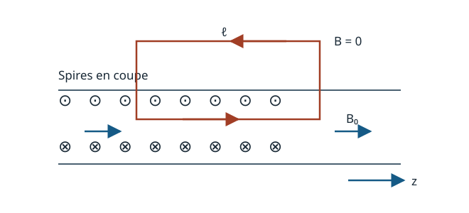
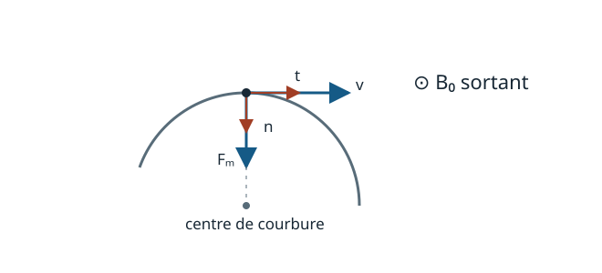
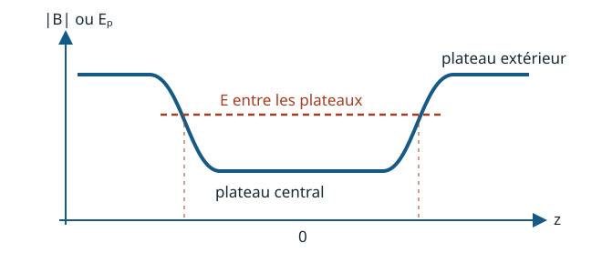
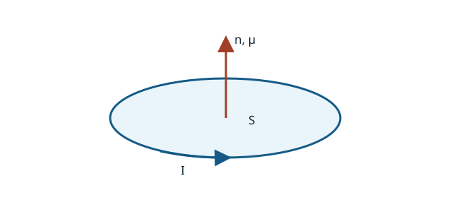
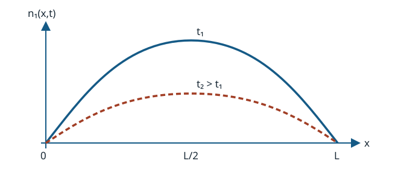

# Corrigé CCINP PC Physique 2024

*Corrigé rédigé par IA, non officiel. Signalez toute erreur.*

## Présentation du sujet

Cette épreuve de quatre heures étudie le confinement et le chauffage d’un plasma de fusion. Les questions 1 à 13 relient le champ d’un solénoïde, le mouvement cyclotron et le miroir magnétique. Les questions 14 à 29 construisent la diffusion ambipolaire puis distinguent les régimes de champ faible et de champ fort. Les questions 30 à 46 abordent la barrière coulombienne, le chauffage par induction et la résonance cyclotron.

Les bilans locaux des questions 14 à 22 et les équations de Maxwell aux questions 37 à 40 permettent d’avancer rapidement. Gardez du temps pour justifier les orientations aux questions 1, 3 et 10, les trajectoires au miroir aux questions 12 et 13, puis le flux et la condition initiale aux questions 32 à 35. Les relations intermédiaires données dans le sujet permettent de reprendre une sous-partie après un calcul difficile.

## I. Confinement d’un plasma

### Question 1

> [!INDICATION]
> Combinez une symétrie de la distribution de courant avec une antisymétrie, puis choisissez un rectangle dont un grand côté est hors du solénoïde.

#### Solution

Les translations axiales et les rotations autour de l’axe laissent invariant le solénoïde idéal. Le plan méridien passant par le point d’étude est un plan d’antisymétrie des courants azimutaux. Le champ magnétique, vecteur axial, appartient donc à ce plan. Le plan transverse passant par le même point est un plan de symétrie des courants. Le champ lui est normal. Il est ainsi de la forme $B(r)\vec u_z$.

Sur le contour rectangulaire de longueur axiale $\ell$, les côtés radiaux ont une circulation nulle et le grand côté extérieur est dans le champ nul supposé. Le contour enlace $N\ell/d$ spires. Avec une orientation compatible avec le courant, le théorème d’Ampère donne $B_0\ell=\mu_0 NI\ell/d$, soit $B_0=\mu_0 NI/d$. Le sens du champ suit la règle de la main droite.

### Question 2

> [!INDICATION]
> Prenez le produit scalaire de la force magnétique par la vitesse.

#### Solution

La puissance de la force de Lorentz magnétique est $e(\vec v\times\vec B)\cdot\vec v=0$. Le théorème de l’énergie cinétique assure la conservation de $mv^2/2$. Ainsi $v=v_0$.

### Question 3

> [!INDICATION]
> Utilisez la règle de la main droite pour le produit vectoriel, puis placez la normale de Frenet.

#### Solution

Si $\vec B$ sort du plan et si la vitesse initiale est dirigée vers la droite, $e\vec v\times\vec B$ pointe vers le bas. La trajectoire incurvée dans ce sens est tangente à la vitesse initiale. Dans le repère de Frenet, $\vec t$ suit la vitesse et $\vec n$ pointe vers le centre de courbure.

### Question 4

> [!INDICATION]
> Projetez le principe fondamental de la dynamique sur la normale.

#### Solution

On écrit $\vec a=\dot v\vec t+(v^2/r)\vec n$. Avec $v=v_0$ et $\vec v\perp\vec B$, la composante normale donne $m v_0^2/r=e v_0 B_0$. Le rayon constant $r=mv_0/(eB_0)=v_0/\omega_c$ donne un mouvement circulaire uniforme.

### Question 5

> [!INDICATION]
> Projetez la force sur l’axe puis comparez la composante axiale à la norme totale.

#### Solution

La force magnétique a une composante axiale nulle, donc $v_z$ garde sa valeur initiale $+v_0$ ou $-v_0$ selon le sens choisi. La norme de la vitesse restant $v_0$, les composantes transverses restent nulles. La trajectoire est rectiligne uniforme le long du champ et une extrémité ouverte laisse fuir la particule.

### Question 6

> [!INDICATION]
> Considérez le devenir d’une particule qui suit une ligne de champ jusqu’à une extrémité.

#### Solution

En refermant le dispositif sur lui-même en tore, on obtient dans ce modèle des lignes de champ fermées. Le déplacement parallèle au champ se poursuit le long de ces lignes, sans déboucher sur une extrémité.

### Question 7

> [!INDICATION]
> Vérifiez le nombre de charges élémentaires portées par le cation avant de comparer les échelles.

#### Solution

La charge vaut $+e$ pour $\mathrm{He}^+$. On prend $v_\perp=v_0$ pour une vitesse perpendiculaire au champ. Le rayon de Larmor vaut
$$
r=\frac{6{,}6\times10^{-27}\times3{,}0\times10^5}{1{,}6\times10^{-19}\times12}
 =1{,}0\times10^{-3}\,\mathrm m.
$$
Si la vitesse est oblique, $v_\perp\leq v_0$ et cette valeur est un majorant du rayon. Elle est très petite devant les dimensions de quelques mètres indiquées. La gyration autour d’une ligne de champ reste donc très localisée devant les rayons intérieurs de $2$ et $3{,}4\,\mathrm m$. Le cation peut rester confiné dans le tore.

### Question 8

> [!INDICATION]
> Encadrez un faisceau de lignes par un tube et appliquez la conservation du flux.

#### Solution

Un tube de champ a un flux magnétique constant d’une section à l’autre, car $\operatorname{div}\vec B=0$ et le champ est tangent à la paroi latérale. Les lignes plus serrées correspondent à une section plus petite et à un champ plus intense. Sur l’axe, $B$ est constant sur le plateau central, augmente vers chaque étranglement, puis atteint un plateau extérieur plus élevé.

### Question 9

> [!INDICATION]
> Fermez les doigts de la main droite dans le sens du courant.

#### Solution

Pour une spire plane de surface $S$ parcourue par le courant $I$, $\vec\mu=IS\vec n$, où $\vec n$ est la normale orientée par la règle de la main droite à partir du courant.

### Question 10

> [!INDICATION]
> Remplacez l’orbite par le passage répété d’une charge à travers un point fixe.

#### Solution

Dans un champ axial $B\vec u_z$, la rotation du cation est horaire vue depuis le côté $+z$. Le courant équivalent est $I=e/(2\pi/\omega_c)$ et l’aire est $\pi r_L^2$ avec $r_L=mv_\perp/(eB)$. Par conséquent
$$
\vec\mu=-I\pi r_L^2\vec u_z=-\frac{mv_\perp^2}{2B}\vec u_z.
$$

### Question 11

> [!INDICATION]
> Décomposez la vitesse selon les directions axiale et transverse.

#### Solution

Dans l’approximation adiabatique, $|\vec\mu|$ est invariant. L’énergie potentielle du dipôle est $E_p=-\vec\mu\cdot\vec B=|\vec\mu|B=mv_\perp^2/2$. L’énergie cinétique de translation du dipôle est $mv_z^2/2$. Son énergie mécanique est donc
$$
E=\frac{mv_z^2}{2}+E_p=\frac{m(v_z^2+v_\perp^2)}{2}.
$$
Cette énergie mécanique du dipôle coïncide avec l’énergie cinétique totale constante du cation.

### Question 12

> [!INDICATION]
> Comparez l’énergie totale aux deux plateaux de l’énergie potentielle.

#### Solution

Le profil d’énergie potentielle reproduit celui de $B$, à un facteur positif près (figure 3). Une particule lancée dans le puits avec $E_{p,\min}<E<E_{p,\mathrm{ext}}$ a deux points de rebroussement, donnés par $E_p(z)=E$, où $v_z$ s’annule. Si $E>E_{p,\mathrm{ext}}$, la particule franchit la zone de champ renforcé du côté vers lequel elle se dirige. Si $E=E_{p,\min}$, une particule au centre reste sans mouvement axial. À la valeur du plateau extérieur, on atteint la limite entre ces régimes.

### Question 13

> [!INDICATION]
> Examinez les trajectoires presque alignées sur le champ et l’effet des collisions.

#### Solution

Depuis le centre du miroir, le retournement exige $mv_0^2/2<|\vec\mu| B_{\max}$, soit $v_{\perp,0}^2/v_0^2>B_{\min}/B_{\max}$. Une particule assez alignée sur le champ peut donc s’échapper. Les collisions changent la direction des vitesses et peuvent envoyer une particule initialement piégée dans ce cône de pertes.

## II. Diffusion des particules chargées

### Question 14

> [!INDICATION]
> Écrivez les flux entrant et sortant d’une tranche de section constante.

#### Solution

Pour une espèce $s=e$ ou $i$, la tranche fixe de section $S$ comprise entre $x$ et $x+\mathrm dx$ contient $n_s S\,\mathrm dx$ particules.

Sans source volumique, la variation sur $\mathrm dt$ vaut $S[j_s(x)-j_s(x+\mathrm dx)]\,\mathrm dt$. À la limite,
$$
\partial_t n_s+\partial_x j_s=0.
$$

### Question 15

> [!INDICATION]
> Comptez la charge algébrique déposée lors de la recombinaison.

#### Solution

La recombinaison à la paroi absorbe les charges par paires ion-électron. La charge reçue par unité de surface et de temps est $e(j_i-j_e)$ à la paroi de droite, et son opposée à gauche avec la convention de flux selon $+x$. L’absence d’accumulation impose $j_i=j_e$ aux parois.

### Question 16

> [!INDICATION]
> Soustrayez les bilans locaux puis utilisez une condition de paroi.

#### Solution

La soustraction des bilans donne $\partial_t(n_i-n_e)+\partial_x(j_i-j_e)=0$. Avec $n_i=n_e$, la différence des flux est indépendante de $x$. Sa valeur étant nulle à la paroi, $j_i=j_e$ dans tout le plasma.

### Question 17

> [!INDICATION]
> Distinguez le transport vers les faibles concentrations de celui entraîné par le champ.

#### Solution

La diffusion de Fick donne $-D_s\partial_x n_s$. Le drift électrique a pour vitesse $\mu_i E$ pour les ions et $-\mu_e E$ pour les électrons, les mobilités étant positives. Ainsi
$$
\begin{aligned}
j_i=-D_i\partial_x n_i+\mu_i n_iE,\\
j_e=-D_e\partial_x n_e-\mu_e n_e E.
\end{aligned}
$$

### Question 18

> [!INDICATION]
> Égalisez les flux puis éliminez le champ électrique de l’une des deux expressions.

#### Solution

Avec $n_i=n_e=n$ et des flux égaux, $(\mu_i+\mu_e)nE=(D_i-D_e)\partial_x n$. Dans le plasma, $n>0$ permet d’isoler
$$
E=\frac{(D_i-D_e)\,\partial_x n}{n(\mu_i+\mu_e)}.
$$
La substitution dans l’un des flux fournit
$$
\begin{aligned}
j=-D_a\partial_x n,\\
D_a=\frac{\mu_iD_e+\mu_eD_i}{\mu_i+\mu_e}.
\end{aligned}
$$

### Question 19

> [!INDICATION]
> Injectez le flux commun dans le bilan de l’une des espèces.

#### Solution

Le bilan de particules donne $\partial_t n=-\partial_x j$. Pour $D_a$ constant, on en déduit $\partial_t n=D_a\partial_x^2 n$.

### Question 20

> [!INDICATION]
> Divisez par le produit des facteurs et identifiez les variables dont dépendent les deux quotients.

#### Solution

Avec $n=F(t)G(x)$, l’équation devient $F'G=D_a FG''$. En dehors des zéros, $F'/F=D_a G''/G$. Chaque membre dépend d’une variable différente, donc les deux sont constants. Une décroissance temporelle impose une constante négative, que l’on note $-1/\tau$, où $\tau>0$ est un temps.

### Question 21

> [!INDICATION]
> Résolvez séparément l’équation temporelle du premier ordre et l’oscillateur spatial.

#### Solution

On obtient $F'=-F/\tau$ et $G''+G/(D_a\tau)=0$. En absorbant la constante de normalisation de $F$ dans $A,B$, on a
$$
n(x,t)=e^{-t/\tau}\bigg[A\cos\left(\frac{x}{\sqrt{D_a\tau}}\right)+B\sin\left(\frac{x}{\sqrt{D_a\tau}}\right)\bigg].
$$

### Question 22

> [!INDICATION]
> Appliquez d’abord la condition en zéro, puis celle à l’autre extrémité.

#### Solution

La condition $G(0)=0$ annule $A$. Puis $G(L)=0$ impose $L/\sqrt{D_a\tau}=p\pi$ pour un mode non nul. D’où
$$
\begin{aligned}
\tau_p=\frac{L^2}{p^2\pi^2D_a},\\
p=1,2,\ldots
\end{aligned}
$$

### Question 23

> [!INDICATION]
> Cherchez quelle constante de temps est la plus grande, puis dessinez le même mode à deux amplitudes.

#### Solution

Pour $p=1$, $n_1(x,t)=A_1\sin(\pi x/L)\,e^{-\pi^2D_a t/L^2}$, avec ici $\tau_1=L^2/(\pi^2D_a)$. La courbe reste nulle aux parois et son maximum au milieu décroît, car les particules diffusent vers les parois où elles se recombinent. Les densités des deux espèces chargées diminuent ensemble et la densité nette de charge reste nulle dans l’approximation quasi neutre. Les modes d’ordre supérieur décroissent plus rapidement, puisque $\tau_p=\tau_1/p^2$.

### Question 24

> [!INDICATION]
> Combinez les dimensions d’une vitesse et d’un temps pour produire une surface par unité de temps.

#### Solution

Comme $[D]=L^2T^{-1}$, $[v^*]=LT^{-1}$ et $[\tau^*]=T$, on obtient les exposants $2$ pour la vitesse et $1$ pour le temps.

Une marche aléatoire de pas typique $v^*\tau^*$ et d’intervalle $\tau^*$ donne $D\sim(v^*\tau^*)^2/\tau^*=(v^*)^2\tau^*$. À vitesse caractéristique fixée, des collisions plus espacées allongent le libre parcours et augmentent $D$ sans champ.

### Question 25

> [!INDICATION]
> Comparez le terme quadratique à l’unité dans le coefficient fourni.

#### Solution

D’après $D'_i/D_i=[1+(\omega_c\tau^*)^2]^{-1}$, la diffusion transverse est fortement réduite si $\omega_c\tau^*\gg1$. À l’inverse, $\omega_c\tau^*\ll1$ correspond à une faible courbure entre deux collisions, donc à un régime de champ faible.

### Question 26

> [!INDICATION]
> Injectez le résultat de l’analyse dimensionnelle dans les deux limites du coefficient donné.

#### Solution

Avec $D_i\simeq (v_i^*)^2\tau^*$, le coefficient fourni $D'_i=D_i/[1+(\omega_c\tau^*)^2]$ donne en champ fort
$$
D'_i\sim\frac{(v_i^*)^2}{\omega_c^2\tau^*}.
$$
Sans magnétisation appréciable, $D'_i\simeq D_i\sim(v_i^*)^2\tau^*$. Le rapport des deux estimations est $(\omega_c\tau^*)^{-2}\ll1$. À caractéristiques collisionnelles fixées, augmenter $B$ diminue la diffusion transverse.

### Question 27

> [!INDICATION]
> Comptez la fraction de tour parcourue entre deux collisions dans chaque cas.

#### Solution

La figure 6(a) représente le champ fort. Plusieurs tours cyclotron y sont visibles entre des collisions, ce qui signifie que leur intervalle est long devant la période cyclotron. En 6(b), les arcs entre collisions correspondent à une fraction de tour.

### Question 28

> [!INDICATION]
> Cherchez ce qui arrive au centre de l’orbite quand la vitesse change au choc.

#### Solution

Entre collisions, la gyration borne l’écart transverse à l’ordre du rayon de Larmor. Une collision change la vitesse et déplace aléatoirement le centre de gyration d’environ ce rayon. Dans le régime fort, à vitesse et champ fixés, espacer les collisions réduit le nombre de ces sauts par unité de temps, d’où $D'_i\sim r_L^2/\tau^*$.

### Question 29

> [!INDICATION]
> Repérez la direction dans laquelle les particules diffusent pour atteindre les parois.

#### Solution

Un champ intense réduit les pertes par diffusion perpendiculaire vers les parois. Dans le tore, les lignes de champ fermées permettent par ailleurs le transport parallèle sans fuite aux extrémités, conformément au modèle idéal de la question 6.

## III. Chauffage du plasma

### Question 30

> [!INDICATION]
> Comparez l’énergie coulombienne à la distance nucléaire et l’énergie thermique caractéristique.

#### Solution

Par intégration de la force répulsive de Coulomb $e^2/(4\pi\varepsilon_0 r^2)$, avec énergie nulle à l’infini, on obtient $U(r)=e^2/(4\pi\varepsilon_0 r)$.

Pour atteindre classiquement une distance nucléaire $r_*\sim10^{-15}\,\mathrm m$, il faut une énergie cinétique relative de l’ordre de $U(r_*)\sim2{,}3\times10^{-13}\,\mathrm J$.

En l’assimilant en ordre de grandeur à $k_BT$, on obtient $T\sim1{,}7\times10^{10}\,\mathrm K$, c’est-à-dire de l’ordre de $10^{10}\,\mathrm K$.

### Question 31

> [!INDICATION]
> À l’échelle nucléaire, examinez ce que le caractère ondulatoire des noyaux change au voisinage de la barrière coulombienne.

#### Solution

L’effet tunnel donne une probabilité de traversée non nulle aux noyaux dont l’énergie est inférieure au sommet de la barrière coulombienne. Des réactions ont donc lieu à une température inférieure à l’estimation classique.

### Question 32

> [!INDICATION]
> Intégrez le champ primaire sur la portion de surface où il est non nul.

#### Solution

Avec des orientations concordantes, le champ primaire ne contribue au flux dans la spire secondaire de rayon $a_2$ que sur le disque $r<a_1$. Ce flux vaut $\beta i_1\pi a_1^2$, d’où $M=\beta\pi a_1^2$.

Les données donnent $\beta=13/(46\times10^3)\,\mathrm{T\,A^{-1}}$ et $M=3{,}55\times10^{-3}\,\mathrm H$.

### Question 33

> [!INDICATION]
> Additionnez les flux propre et extérieur avant d’appliquer la loi de Faraday.

#### Solution

La loi de Faraday donne une f.é.m. $-\mathrm d(L_2 i_2+Mi_1)/\mathrm dt$. Avec $\dot i_1=-I_0/t_1$, l’équation du secondaire devient
$$
\begin{aligned}
L_2\dot i_2+R_2i_2=\frac{MI_0}{t_1},\\
\dot i_2+\frac{i_2}{\tau_2}=\frac{I_0}{\tau_1},\\
\tau_2=\frac{L_2}{R_2},\quad \tau_1=\frac{L_2t_1}{M}.
\end{aligned}
$$

### Question 34

> [!INDICATION]
> Justifiez la condition initiale et développez l’exponentielle au voisinage de zéro.

#### Solution

Sur la rampe, le courant primaire part de $I_0$ sans saut de flux au démarrage.

Le courant secondaire reste donc continu et vaut $i_2(0)=0$. L’intégration donne
$$
i_2(t)=\frac{I_0\tau_2}{\tau_1}(1-e^{-t/\tau_2}).
$$
Pour $t\ll\tau_2$, le développement $1-e^{-t/\tau_2}\simeq t/\tau_2$ donne $i_2(t)\simeq I_0t/\tau_1=MI_0t/(L_2t_1)$. Lorsque $t_1\ll\tau_2$, l’approximation vaut sur toute la rampe.

### Question 35

> [!INDICATION]
> Intégrez la puissance résistive sur la durée de la rampe.

#### Solution

La chaleur déposée dans le plasma sur $[0,t_1]$ vaut, dans cette approximation,
$$
Q=\int_0^{t_1}R_2i_2^2(t)\,\mathrm dt
\simeq \frac{R_2t_1}{3}\left(\frac{MI_0}{L_2}\right)^2 .
$$
Le chauffage provient de la dissipation par effet Joule du courant induit.

### Question 36

> [!INDICATION]
> Suivez la résistance pendant que le dépôt d’énergie élève la température.

#### Solution

À géométrie et section conductrice données, $R_2$ est proportionnelle à la résistivité du plasma. Comme $R_2\propto T^{-3/2}$, elle diminue quand le plasma s’échauffe. Le courant et le chauffage sont ainsi couplés à l’évolution thermique, et un calcul à résistance constante ne décrit qu’un intervalle de température limité.

### Question 37

> [!INDICATION]
> Séparez les deux relations de divergence et les deux relations de rotationnel.

#### Solution

En notation locale, les équations de Maxwell s’écrivent
$$
\begin{aligned}
\operatorname{div}\vec E&=\rho/\varepsilon_0,&\operatorname{div}\vec B&=0,\\
\operatorname{rot}\vec E&=-\partial_t\vec B,&
\operatorname{rot}\vec B&=\mu_0\vec j+\mu_0\varepsilon_0\partial_t\vec E.
\end{aligned}
$$

### Question 38

> [!INDICATION]
> Calculez explicitement la divergence en coordonnées cartésiennes.

#### Solution

Le champ d’onde n’a pas de composante longitudinale et ses composantes transverses dépendent seulement de $z,t$. Ainsi $\operatorname{div}\vec E=\partial_xE_x+\partial_yE_y+\partial_zE_z=0$ et Maxwell-Gauss impose $\rho=0$.

### Question 39

> [!INDICATION]
> Appliquez un second rotationnel à la loi de Faraday.

#### Solution

En appliquant le rotationnel à Maxwell-Faraday puis en utilisant Maxwell-Ampère, on obtient $\nabla(\operatorname{div}\vec E)-\Delta\vec E=-\mu_0\partial_t\vec j-\mu_0\varepsilon_0\partial_t^2\vec E$. Comme la divergence est nulle,
$$
\begin{aligned}
\Delta\vec E-\frac{1}{c^2}\partial_t^2\vec E=\mu_0\partial_t\vec j,\\
c=\frac1{\sqrt{\mu_0\varepsilon_0}}.
\end{aligned}
$$

### Question 40

> [!INDICATION]
> Comparez les accélérations produites par une même force électrique.

#### Solution

À même module de charge, la force électrique donne une accélération inversement proportionnelle à la masse. Les ions bien plus lourds répondent beaucoup moins que les électrons à cette excitation rapide, loin de la résonance ionique. Le courant alternatif est essentiellement électronique.

### Question 41

> [!INDICATION]
> Utilisez la charge négative de l’électron et le facteur temporel complexe donné.

#### Solution

Avec $\alpha=eE_0/m_e$ et $\omega_c=eB_0/m_e$, la projection de la force $-e(\vec E+\vec v\times B_0\vec u_z)$ en $z=0$ donne $i\omega v_x=-\alpha-\omega_cv_y$ et $i\omega v_y=i\alpha+\omega_cv_x$.

La division par $i\omega$ donne bien
$$
\begin{aligned}
v_x=i\frac{\alpha}{\omega}+i\frac{\omega_c}{\omega}v_y,\\
v_y=\frac{\alpha}{\omega}-i\frac{\omega_c}{\omega}v_x.
\end{aligned}
$$

### Question 42

> [!INDICATION]
> Comparez la pulsation d’excitation et celle de la rotation libre des électrons.

#### Solution

La polarisation circulaire proposée tourne dans le sens cyclotron des électrons. La pulsation cyclotron est celle de leur mouvement libre dans le champ statique. La réponse harmonique du modèle porte le facteur $1/(\omega-\omega_c)$, d’où la résonance à $\omega=\omega_c$. Dans le modèle idéal, une excitation exactement résonante donne une amplitude croissante et aucune réponse harmonique stationnaire de vitesse finie. Les mécanismes dissipatifs du plasma réel élargissent la résonance et permettent la conversion de l’énergie transférée en chaleur.

### Question 43

> [!INDICATION]
> Reliez le courant à la vitesse électronique puis remplacez les dérivées par leurs facteurs complexes.

#### Solution

La relation donnée pour $\vec v$ entraîne
$$
\vec j=-en_0\vec v=-\frac{i n_0 e^2}{m_e(\omega-\omega_c)}\vec E.
$$
Avec la convention $e^{i(\omega t-kz)}$, l’équation d’onde devient $(\omega^2/c^2-k^2)\vec E=i\mu_0\omega\vec j$. On trouve donc
$$
\begin{aligned}
k^2=\frac{\omega^2}{c^2}\left[1-\frac{\omega_p^2}{\omega(\omega-\omega_c)}\right],\\
\omega_p^2=\frac{n_0e^2}{m_e\varepsilon_0}.
\end{aligned}
$$

### Question 44

> [!INDICATION]
> Appliquez la racine carrée après avoir substitué les constantes en unités SI.

#### Solution

Pour $n_0=10^{20}\,\mathrm{m^{-3}}$, $e=1{,}6\times10^{-19}\,\mathrm C$, $m_e=9{,}1\times10^{-31}\,\mathrm{kg}$ et $\varepsilon_0=8{,}85\times10^{-12}\,\mathrm{F\,m^{-1}}$, $\omega_p\simeq5{,}6\times10^{11}\,\mathrm{rad\,s^{-1}}$.

### Question 45

> [!INDICATION]
> Lisez sur quelles branches le carré de la vitesse de phase est positif.

#### Solution

Une onde propagative possède un $k$ réel non nul, donc $v_\phi^2=\omega^2/k^2>0$. La lecture du graphe de l’énoncé délimite deux bandes, $0<\omega<\omega_c$ et $\omega>\omega_g$.

Entre $\omega_c$ et $\omega_g$, $k^2<0$ et la solution spatiale est évanescente. On retrouve la coupure $\omega_g=(\omega_c+\sqrt{\omega_c^2+4\omega_p^2})/2$ en annulant $k^2$.

### Question 46

> [!INDICATION]
> Suivez la branche propagative jusqu’à la résonance et examinez la limite du modèle.

#### Solution

Sur la première bande propagative, $v_\phi\to0$ lorsque $\omega\to\omega_c^-$ et $k$ diverge dans le modèle idéal. La pulsation $\omega_c$ est précisément la résonance des électrons, où la réponse harmonique idéale devient singulière et où le transfert vers les électrons est favorisé en pratique. Une vitesse de phase qui tend vers zéro signifie que les surfaces de phase se déplacent de plus en plus lentement sur cette branche.

## Bilan

Le même champ produit trois effets distincts. Il borne le déplacement transverse lors de la gyration, réfléchit certaines particules si son intensité varie le long de leur trajectoire et fixe la pulsation à laquelle les électrons résonnent avec l’onde. Pour la diffusion, le rapport entre le temps libre et le temps cyclotron commande le changement de régime. Pour l’induction, il faut distinguer flux, puissance et énergie et intégrer la puissance dissipée sur la durée de la rampe.

FIN
