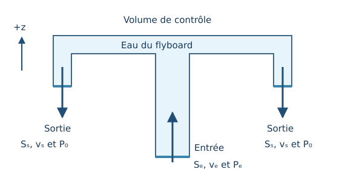
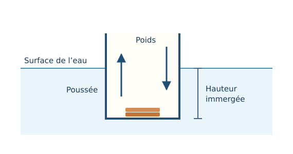

# CCINP PSI — Physique-chimie 2024 · Corrigé brut

*Corrigé rédigé par IA, non officiel. Signalez toute erreur.*

## Partie I — Mégagaf

### I.2 — Vitesse d’expulsion nécessaire à l’équilibre

### Question 1

Le système proposé est ouvert : de l’eau entre et sort en continu. On ne peut pas lui appliquer directement la forme du principe fondamental de la dynamique réservée à un système matériel fermé. Il faut prendre en compte les flux de quantité de mouvement ou suivre un système fermé associé.

### Question 2

En régime stationnaire, $v_e$, $v_s$, $S_e$ et $S_s$ restent constants dans le temps dans le référentiel choisi. Cela n’impose pas des valeurs égales à l’entrée et à la sortie.

### Question 3

À $t$, $\Sigma$ est formé de l’eau contenue dans $\Sigma^*$ et de la tranche entrante qui va franchir l’entrée entre $t$ et $t+\mathrm dt$.

À $t+\mathrm dt$, ce même ensemble matériel occupe $\Sigma^*$ et les deux tranches qui viennent de sortir. Ces deux descriptions suivent les mêmes particules.

### Question 4

Le débit volumique sortant à travers une section orientée est $\iint_S\vec v\cdot\vec n\,\mathrm dS$. La masse du volume de contrôle ne varie pas. La masse volumique étant uniforme et constante, les débits volumiques entrant et sortant sont égaux. Pour les profils uniformes et les deux tuyères identiques,
$$
\boxed{D_v=v_eS_e=2v_sS_s.}
$$

### Question 5

La quantité de mouvement dans le volume de contrôle est inchangée. La tranche entrante de masse $\mu D_v\mathrm dt$ se déplace vers $+z$ à $v_e$, tandis que les deux tranches sortantes de même masse totale se déplacent vers $-z$ à $v_s$. La variation par unité de temps est donc $-\mu D_v(v_e+v_s)$.

Les forces sur l’eau sont les pressions aux trois sections, le poids de l’eau et la réaction des parois. Aux trois sections, la normale sortante pointe vers le bas, donc les pressions donnent $P_eS_e+2P_0S_s$ vers le haut. L’action des parois sur l’eau vaut $-F$ en projection.
$$
\boxed{\begin{aligned} F&=P_eS_e+2P_0S_s-M_{\rm eau}g+\mu D_v^2\alpha,\\\alpha&=\frac{1}{S_e}+\frac{1}{2S_s}.\end{aligned}}
$$

### Question 6

L’écoulement est stationnaire, parfait et incompressible. La pesanteur est conservative et aucune machine n’est traversée entre la section d’entrée, à $z=0$, et la sortie, à $z=H$. On applique le théorème de Bernoulli le long d’une même ligne de courant reliant l’entrée à l’une des deux sorties. On obtient
$$
P_e+\tfrac12\mu v_e^2=P_0+\tfrac12\mu v_s^2+\mu gH.
$$
Par Q4,
$$
\boxed{P_e=P_0+\mu gH+\frac{\mu D_v^2}{2}\left(\frac{1}{4S_s^2}-\frac1{S_e^2}\right).}
$$

### Question 7

En substituant Q6 dans Q5, on trouve
$$
\boxed{F=P_0(2S_s+S_e)-M_{\rm eau}g+\mu gHS_e+\mu D_v^2\beta.}
$$
Le coefficient se simplifie en
$$
\beta=\alpha+\frac{S_e}{8S_s^2}-\frac{1}{2S_e}
=\frac{1}{2S_e}+\frac{1}{2S_s}+\frac{S_e}{8S_s^2}.
$$

### Question 8

Dans le modèle où l’eau des tuyères est négligée, $M_{\rm eau}=\mu HS_e$. Son poids compense le terme $\mu gHS_e$ de Q7. Il reste **$F=P_0(2S_s+S_e)+\mu D_v^2\beta$**.

### Question 9

La poussée intérieure vaut $F$ vers le haut et le poids $Mg$ vers le bas. Sur la surface extérieure, la pression uniforme de l’air a pour résultante verticale $-P_0(S_e+2S_s)$. En effet, si l’on ferme fictivement la surface par les trois sections orientées vers le bas, la résultante d’une pression uniforme sur cette surface fermée est nulle. L’aire des sections fictives fournit donc la correction à retrancher.

L’équilibre s’écrit $F-P_0(S_e+2S_s)-Mg=0$. Avec Q8,
$$
\boxed{D_{v,\rm eq}=\sqrt{\frac{Mg}{\mu\beta}}.}
$$

### Question 10

On utilise $S_e=8{,}0\times10^{-3}\ \mathrm{m^2}$ et $S_s=2{,}5\times10^{-3}\ \mathrm{m^2}$. Par Q4, **$v_e=7{,}5\ \mathrm{m\,s^{-1}}$ et $v_s=12{,}0\ \mathrm{m\,s^{-1}}$**.

### I.3 — Puissance de la pompe

### Question 11

$$
\Delta P=\mu gH+\frac{\mu}{2}(v_s^2-v_e^2)
=5{,}0\times10^4+4{,}39\times10^4\ \mathrm{Pa}.
$$
On obtient $9{,}4\times10^4\ \mathrm{Pa}$, d’où le choix **$0{,}9\ \mathrm{bar}$**.

### Question 12

Le membre de droite a la dimension $M L^{a+b-4}T^{-a}$, tandis qu’une pression a pour dimension $M L^{-1}T^{-2}$. On en déduit $a=2$ puis $a+b-4=-1$, d’où **$b=1$**.

### Question 13

À une section de débit $D_v$, une pression $P$ correspond à une puissance $PD_v$. La pompe relève la pression de $P_0$ à $P_e+\Delta P_c$. Ainsi
$$
\boxed{\mathcal P_{\rm pompe}=(P_e+\Delta P_c-P_0)D_v.}
$$
Les 12 kW donnés sont la puissance hydraulique utile dans le modèle. Les 75 à 125 kW désignent une puissance moteur recommandée, dont une partie sert à propulser le jetski. Pompage et transmission ont un rendement inférieur à un. Il faut aussi une marge pour les pertes supplémentaires et les mouvements en dehors du vol stationnaire.

## Partie II — Milieu marin

### II.1 — Structure cristallographique du chlorure de sodium

### Question 14

Les cations occupent huit sommets partagés par huit mailles et six centres de faces partagés par deux mailles. Leur nombre par maille est **$8/8+6/2=4$**.

### Question 15

Les sites octaédriques sont au centre du cube et au milieu de ses douze arêtes. Ils comptent pour $1+12/4=4$ par maille. La stœchiométrie NaCl exige quatre chlorures pour quatre ions sodium. Tous les sites octaédriques sont donc occupés.

### Question 16

La distance minimale entre sodiums vaut $a/\sqrt2=393\ \mathrm{pm}$, le long d’une diagonale de face. Elle dépasse $2r=194\ \mathrm{pm}$ : les ions sodium ne se touchent pas. Sur une arête, un sodium au sommet et un chlorure au milieu sont distants de $a/2=278\ \mathrm{pm}=r+R$. Les ions opposés se touchent suivant les directions des arêtes.

### Question 17

La maille de côté $a=2(r+R)$ contient quatre cations et quatre anions. La compacité vaut
$$
\boxed{\mathcal C=\frac{4(4\pi/3)(r^3+R^3)}{8(r+R)^3}
=\frac{2\pi}{3}\frac{r^3+R^3}{(r+R)^3}.}
$$

### Question 18

La masse de la maille vaut $4[M(\mathrm{Na})+M(\mathrm{Cl})]/N_A$, donc
$$
\boxed{\rho_{\rm NaCl}=\frac{M(\mathrm{Na})+M(\mathrm{Cl})}{2N_A(r+R)^3}.}
$$
Le calcul donne environ $2{,}26\times10^3\ \mathrm{kg\,m^{-3}}$ avec les rayons fournis. Parmi les propositions, **$2{,}16\ \mathrm{g\,cm^{-3}}$** est la valeur cohérente avec cet ordre de grandeur.

### II.2 — Enthalpie de dissolution

### Question 19

Dans le modèle adiabatique, à pression constante, la somme des variations d’enthalpie est nulle. Ainsi
$$
(C+m_1c_e)(T_3-T_1)+m_2c_e(T_3-T_2)=0.
$$
On en déduit **$C=c_e[m_2(T_2-T_3)/(T_3-T_1)-m_1]$**. Pour les données, $C/c_e=0{,}0333\ \mathrm{kg}$.

### Question 20

À pression constante et sans échange thermique extérieur, le bilan s’écrit $m_4\Delta_{\rm diss}h+(m_3c_e+C)\Delta T=0$. Par conséquent
$$
\boxed{\Delta_{\rm diss}h=-\frac{(m_3c_e+C)\Delta T}{m_4}>0.}
$$
La dissolution est endothermique puisque le mélange se refroidit.

### Question 21

La dissolution $\mathrm{NaCl}(s)\rightleftharpoons\mathrm{Na^+}(aq)+\mathrm{Cl^-}(aq)$ est endothermique. Par la loi de Van ’t Hoff, $\mathrm d\ln K/\mathrm dT=\Delta_rH^\circ/(RT^2)>0$. À saturation en eau pure, les deux concentrations ioniques sont égales à la solubilité molaire. Dans l’approximation des activités par les concentrations réduites, $K\simeq(s/c^\circ)^2$. **La solubilité augmente donc avec la température.**

### II.3 — Corrosion

### Question 22

Dans la goutte, ce sont les **ions mobiles** qui ferment le circuit, notamment les cations métalliques et les anions $\mathrm{OH^-}$ formés ou présents. Les électrons circulent dans le métal. L’eau de mer contient de nombreux ions et conduit mieux que l’eau peu minéralisée. La résistance de la goutte est plus faible, ce qui favorise les courants de corrosion. Les chlorures peuvent aussi fragiliser des couches protectrices.

### Question 23

Le zinc est moins noble que le fer, comme l’indiquent les potentiels standard fournis. Relié au fer, il fournit les électrons à la réduction du dioxygène. Dans le milieu aqueux non acidifié du modèle,
$$
\begin{aligned}
\mathrm{Zn}(s)&\longrightarrow\mathrm{Zn^{2+}}(aq)+2e^-,\\
\mathrm{O_2}+2\mathrm{H_2O}+4e^-&\longrightarrow4\mathrm{OH^-}.
\end{aligned}
$$
En doublant la première demi-équation,
$$
\boxed{2\mathrm{Zn}+\mathrm{O_2}+2\mathrm{H_2O}\longrightarrow
2\mathrm{Zn^{2+}}+4\mathrm{OH^-}.}
$$
Il s’agit d’une **protection cathodique par anode sacrificielle**. Le zinc est l’anode et le fer est protégé.

### Question 24

Chaque mole de zinc cède deux moles d’électrons. La charge disponible est $2F m_{\rm Zn}/M_{\rm Zn}$. Si le courant est constant et tout le zinc utilisable, on trouve
$$
\boxed{\Delta t=\frac{2F\,m_{\rm Zn}}{M_{\rm Zn}I}.}
$$

## Partie III — Le Conseil

### Question 25

On considère le verre et ses $n$ pièces. Tant que le verre flotte, le poids $(M+nm)g$ est compensé par la poussée d’Archimède $\mu S H_n g$, où $H_n$ est la hauteur immergée.

Le bord atteint l’eau pour $M+nm=\mu Sh=200\ \mathrm g$. On obtient $n=(200-125)/10=7{,}5$. Avec sept pièces, la masse vaut 195 g et le verre flotte encore. À la huitième, elle vaut 205 g et aucun équilibre sans invasion du verre n’est possible. Le Maître pose les pièces impaires et le candidat les paires. **Le candidat pose la huitième et perd. Le Maître du temps gagne.**

### Question 26

Par Q25, chaque pièce ajoute $m/(\mu S)=5{,}0\ \mathrm{mm}$ à la hauteur immergée. Le sommet de la pile gagne $e=2{,}0\ \mathrm{mm}$ au-dessus du fond, tandis que le fond descend de 5,0 mm. Pour un ajout laissant le verre en flottaison,
$$
\boxed{\Delta z=e-\frac{m}{\mu S}=-3{,}0\ \mathrm{mm}.}
$$
Le sommet descend par rapport à l’eau.

## Partie IV — L’épreuve de la caserne

### Question 27

Une spire fournit deux discontinuités séparées de $\pi$ d’après la figure 10. La figure 11 comporte six montées et six descentes, soit douze sauts. Les spires étant décalées, leurs sauts sont distincts. On compte donc **$n=6$ spires**.

### Question 28

La somme $\cos(\omega_S t)\cos\theta+\sin(\omega_St)\sin\theta$ vaut $\cos(\theta-\omega_St)$. Ainsi
$$
\boxed{\begin{aligned}\vec B_S&=B_{S0}\cos(\theta-\omega_St)\vec e_r,\\ B_{S0}&=K_S I_{S\max}.\end{aligned}}
$$
Le profil angulaire se déplace sans déformation. Son maximum positif est à $\theta=\omega_St$ modulo $2\pi$. Le champ tourne dans le sens positif à $\omega_S$.

### Question 29

Dans le modèle symétrique, les axes des deux enroulements du stator sont orthogonaux. Le flux créé par l’un à travers l’autre s’annule. Il en va de même pour les deux enroulements du rotor. Ainsi **$M_{S1,S2}=M_{R1,R2}=0$**.

### Question 30

Pour $R_2$, la normale est tournée de $\pi/2$ par rapport à celle de $R_1$. On remplace $\theta_R$ par $\theta_R+\pi/2$ dans les deux expressions données. Ainsi
$$
\boxed{\begin{aligned}
M_{S1,R2}&=-M_{SR}\sin\theta_R,\\
M_{S2,R2}&=M_{SR}\cos\theta_R.
\end{aligned}}
$$

### Question 31

Le flux statorique lié à $R_1$ varie lorsque les courants statoriques varient ou lorsque le rotor tourne. La loi de Faraday donne une fém si le flux total varie. L’enroulement rotorique est fermé sur lui-même, donc cette fém y entraîne un courant sans alimentation externe.

### Question 32

$$
\boxed{\begin{aligned}
\phi_{S1,R1}&=M_{SR}i_{S1}\cos\theta_R,\\
\phi_{S2,R1}&=M_{SR}i_{S2}\sin\theta_R.
\end{aligned}}
$$

### Question 33

Avec $\theta_R=\Omega t$, la loi de Faraday donne
$$
\begin{aligned}
e_{S1,R1}&=-M_{SR}\dot i_{S1}\cos(\Omega t)+M_{SR}\Omega i_{S1}\sin(\Omega t),\\
e_{S2,R1}&=-M_{SR}\dot i_{S2}\sin(\Omega t)-M_{SR}\Omega i_{S2}\cos(\Omega t).
\end{aligned}
$$

### Question 34

La maille fermée donne $L_R\dot i_{R1}+R_R i_{R1}=e_{S1,R1}+e_{S2,R1}$. Le second membre est donc
$$
-M_{SR}\Big[(\dot i_{S1}+\Omega i_{S2})\cos(\Omega t)
+(\dot i_{S2}-\Omega i_{S1})\sin(\Omega t)\Big].
$$
En remplaçant les courants, le flux total s’écrit $M_{SR}I_{S\max}\cos[(\omega_S-\Omega)t]$. Son opposé dérivé donne la forme demandée,
$$
\boxed{\begin{aligned}
\omega&=\omega_S-\Omega,\\
A&=M_{SR}I_{S\max}(\omega_S-\Omega).
\end{aligned}}
$$

### Question 35

Le circuit linéaire forcé oscille en régime établi à la pulsation du second membre. Comme $\omega_S>\Omega$, **$\omega_R=\omega_S-\Omega$**.

### Question 36

Dans la maille du rotor, le module de l’impédance vaut $\sqrt{R_R^2+(L_R\omega_R)^2}$. Par Q34–Q35,
$$
\boxed{I_{R\max}=
\frac{|M_{SR}|I_{S\max}(\omega_S-\Omega)}
{\sqrt{R_R^2+L_R^2(\omega_S-\Omega)^2}}.}
$$
À la vitesse synchrone, le flux est constant dans le repère rotorique, donc la fém et le courant permanent sont nuls. Il n’y a alors plus de couple électromagnétique d’entraînement. En fonctionnement en moteur sous charge, le rotor tourne un peu moins vite que le champ statorique.

### Question 37

Posons $a=\omega_R t-\varphi$ et $b=\theta-\Omega t$. La somme des champs, divisée par $K_R I_{R\max}$, vaut $\sin a\cos b-\cos a\sin b=\sin(a-b)$.

Le profil est proportionnel à $\sin[(\omega_R+\Omega)t-\theta-\varphi]$. Dans le repère fixe, le champ rotorique tourne donc à **$\omega_R+\Omega=\omega_S$**. Les deux champs tournent à la même vitesse alors que le rotor matériel tourne à $\Omega$.

### Question 38

Dans une machine à courant continu idéale, les deux champs sont stationnaires dans le repère du stator. Le collecteur et les balais commutent le courant des conducteurs rotoriques au passage de la ligne de commutation. La distribution spatiale résultante d’ampères-tours garde une orientation fixe par rapport aux balais même si le rotor matériel tourne. Les champs sont donc synchrones quelle que soit sa vitesse.

### Question 39

La puissance transmise vaut $\Gamma_z\omega_S$ et la conversion mécanique $\Gamma_z\Omega$. Leur différence est dissipée dans les deux enroulements rotoriques. Donc
$$
\boxed{P_{JR}=\Gamma_z(\omega_S-\Omega)=g P_S.}
$$
On peut aussi employer $P_{JR}=2R_R I_{R\max}^2/2$ et vérifier la même relation avec Q36 et le couple fourni.

### Question 40

Au démarrage, $\Omega=0$, donc **$g=1$**. La fraction de la puissance transmise convertie en puissance mécanique vaut $\Gamma_z\Omega/(\Gamma_z\omega_S)=1-g$ en fonctionnement sous couple. Elle est meilleure pour un glissement proche de zéro. Au démarrage, la puissance mécanique instantanée est nulle malgré le couple possible. À $g=0$ exactement, le modèle donne un couple et des puissances nuls. Le rendement réel tient aussi compte des autres pertes.

FIN
