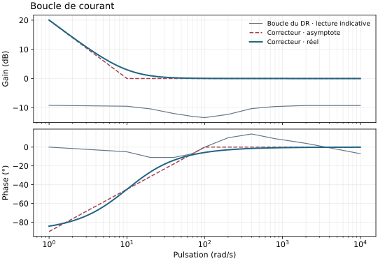
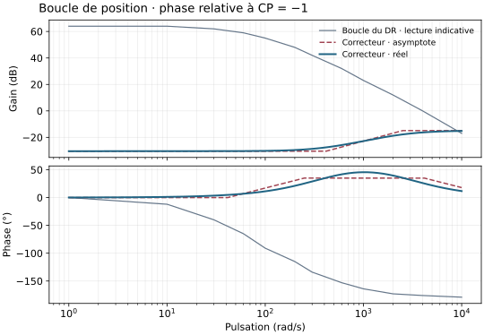

# CCINP PSI — Sciences industrielles de l’ingénieur 2024 · Corrigé guidé

*Corrigé rédigé par IA, non officiel. Signalez toute erreur.*

## Présentation du sujet

Cette épreuve de quatre heures sans calculatrice étudie une pince de micro-manipulation, de son architecture mécanique jusqu’au retour haptique et aux commandes alternatives. Le sujet intègre sept annexes et le document réponse. Les figures de Bode du document réponse servent de base aux tracés et aux réglages.

On peut répartir les quatre heures en 30 minutes d’architecture, 45 de géométrie, 55 de mécanique, 85 d’asservissement et 25 de diagrammes d’état et de relecture. Q1–Q3, Q7–Q8, Q18–Q19 et Q29–Q30 sont des points d’entrée. Gardez du temps pour les projections de Q9–Q17, puis pour comparer des résultats chiffrés aux exigences.

## I — Contexte et architecture

### Question 1

> [!INDICATION]
> Identifiez qui agit sur la pince et laquelle touche l’objet dans chaque situation.

#### Solution

- Saisie manuelle · $F_u$ et $F_o$.
- Saisie en co-manipulation · $F_u$, $F_o$ et $C_m$.
- Téléopération, pince maître · $F_u$ et $C_m$.
- Téléopération, pince esclave · $F_o$ et $C_m$.

Les cases indiquent les actions susceptibles d’être non nulles dans le cas considéré. L’objet est saisi par l’esclave en téléopération.

### Question 2

> [!INDICATION]
> Repérez dans le diagramme la possibilité d’actionner les branches sans moteur.

#### Solution

La sous-exigence **1.5, Réversibilité**, impose que la pince puisse être actionnée manuellement.

### Question 3

> [!INDICATION]
> Suivez le type de puissance d’un bloc à l’autre et repérez le capteur d’angle.

#### Solution

1. Moteur électrique brushless.
2. Système vis–écrou à billes.
3. Galets en contact avec les cames des branches.
4. Codeur rotatif magnétique.
5. Position angulaire du rotor.
6. Puissance électrique modulée par le driver.
7. Puissance mécanique de rotation.
8. Puissance mécanique de translation.

## II — Géométrie de la pince

### Question 4

> [!INDICATION]
> Comparez les directions possibles de la vitesse de rotation de l’écrou sur les deux chemins.

#### Solution

La chaîne $2\to3\to0$ impose $\vec\Omega(2/0)\parallel\vec x_0$.

Dans l’autre chaîne, $2\to4\to1\to0$, les pivots donnent des composantes suivant $\vec z_0$. La liaison cylindre-plan peut aussi admettre une composante suivant $\vec y_2$.

La résultante appartient donc au plan engendré par $\vec z_0$ et $\vec y_2$. Pour la géométrie étudiée, $\vec x_0$ n’appartient pas à ce plan.

Ainsi $\vec\Omega(2/0)=\vec0$. L’écrou 2 est en translation rectiligne suivant $\vec x_0$, imposée par l’axe de l’hélicoïdale.

### Question 5

> [!INDICATION]
> Comptez les contraintes et distinguez la rotation libre du galet du mouvement commandé.

#### Solution

La demi-pince comporte quatre solides mobiles. Trois pivots et une hélicoïdale apportent chacun cinq contraintes. La liaison linéaire rectiligne en apporte deux, soit 22 contraintes. Il y a une mobilité utile, le mouvement d’ouverture commandé par la vis, et une mobilité interne, la rotation libre du galet si le contact est compté comme une liaison parfaite sans adhérence tangentielle. Donc
$$
h=22-6\times4+2=0.
$$
Le modèle géométrique de la demi-pince est isostatique.

### Question 6

> [!INDICATION]
> Comparez les nouvelles contraintes aux nouvelles composantes cinématiques.

#### Solution

On ajoute les solides $1'$ et $4'$ et une branche de liaisons avec deux pivots et un contact linéaire rectiligne, soit 12 contraintes pour 12 composantes de vitesse supplémentaires. La rotation libre du second galet ajoute une mobilité interne. Avec une mobilité utile et deux internes, on obtient $h=34-6\times6+3=1$. La seconde branche répète notamment la contrainte qui empêche l’écrou de tourner autour de l’axe de la vis.

### Question 7

> [!INDICATION]
> Projetez le trajet depuis O jusqu’à B sur l’axe transversal.

#### Solution

La symétrie donne $d=2\overrightarrow{OB}\cdot\vec y_0$. La fermeture $\overrightarrow{OB}=\overrightarrow{OA}+\overrightarrow{AB}$ fournit
$$
d=2(y_A+x_B\sin\alpha+y_B\cos\alpha).
$$

### Question 8

> [!INDICATION]
> Linéarisez les deux fonctions trigonométriques, puis lisez ordonnée et pente.

#### Solution

Pour $|\alpha|\ll1$, $\sin\alpha\simeq\alpha$ et $\cos\alpha\simeq1$. Donc $a=2x_B$ et $b=2(y_A+y_B)$.

Sur la figure 4, $d(0)\simeq8{,}6\,\mathrm{mm}$ et $d$ s’annule vers $0{,}046\,\mathrm{rad}$.

Cela donne $a\simeq-0{,}19\,\mathrm{m\,rad^{-1}}$ et $b\simeq8{,}6\times10^{-3}\,\mathrm m$.

### Question 9

> [!INDICATION]
> Projetez la fermeture dans une direction qui élimine la distance variable le long de la came.

#### Solution

On exprime $\overrightarrow{OI}$ par $OAEI$ puis par $ODCI$ et on projette sur $\vec y_2$. Cette projection élimine $x_I$. En posant $\gamma=\alpha+\beta$,
$$
y_A\cos\gamma-x_E\sin\beta=-(x_D+x_C)\sin\gamma+y_C\cos\gamma+R_g.
$$
On en déduit la forme demandée, avec $d_1=x_E$, $d_2=y_C-y_A$, $d_3=R_g$ et $d_4=x_C$.

### Question 10

> [!INDICATION]
> Mesurez une variation de translation et divisez-la par une variation d’angle.

#### Solution

La figure 5 donne environ $1{,}0\,\mathrm{mm}$ de translation pour $0{,}045\,\mathrm{rad}$. La pente est $K_D\simeq2{,}2\times10^{-2}\,\mathrm{m\,rad^{-1}}$. Le gain est positif.

### Question 11

> [!INDICATION]
> Transformez un pas de codeur en déplacement de l’écrou puis en ouverture.

#### Solution

Posons $\kappa=\mathrm{pas}/(2\pi K_D)$. Les relations approchées donnent $\alpha=\kappa\theta_3$ et $d=b+a\kappa\theta_3$. Le codeur absolu associe $2^{14}$ codes à un tour. Ainsi
$$
\begin{aligned}
\Delta\theta_3&=2\pi/2^{14},\\
\Delta d&=|a|\kappa\Delta\theta_3
        =\frac{|a|\,\mathrm{pas}}{K_D\,2^{14}}.
\end{aligned}
$$

## III — Dynamique, couple et raideur

### Question 12

> [!INDICATION]
> Égalez les vitesses projetées à la tangente au contact.

#### Solution

Par le roulement sans glissement au point $I$, les vitesses du galet et de la branche coïncident. Projetées sur $\vec x_2$, elles sont respectivement $\dot x_D\cos(\alpha+\beta)-R_g\omega_{4/0}$ et $x_E\dot\alpha\sin\beta$. La seconde expression utilise $\overrightarrow{AI}=x_E\vec x_1+x_I\vec x_2$, dont le terme en $x_I$ ne contribue pas à la projection. Ainsi
$$
\begin{aligned}
\omega_{4/0}&=\frac{K_D\cos(\alpha+\beta)-x_E\sin\beta}{R_g}\,\dot\alpha,\\
K_G&=\frac{K_D\cos\beta-x_E\sin\beta}{R_g}
\end{aligned}
$$
dans l’approximation des petits angles.

### Question 13

> [!INDICATION]
> Pour un galet, combinez la translation du centre et la rotation autour de lui.

#### Solution

Les deux branches tournent avec des vitesses opposées, de même module. L’écrou se translate et la vis tourne autour de son axe. Chaque galet se translate avec son centre, avec une contribution d’inertie en rotation autour de ce centre. D’où
$$
E_c=I_1\dot\alpha^2+\tfrac12m_2\dot x_D^2+\tfrac12 I_3\dot\theta_3^2
    +m_4\dot x_D^2+I_4 K_G^2\dot\alpha^2 .
$$
Les contributions cinétiques s’additionnent même lorsque les rotations sont opposées.

### Question 14

> [!INDICATION]
> Exprimez chaque vitesse dans la même variable avant d’identifier l’inertie.

#### Solution

Avec $\dot\alpha=\kappa\dot\theta_3$ et $\dot x_D=K_D\kappa\dot\theta_3$, l’identification à $\tfrac12 J_{\rm eq}\dot\theta_3^2$ donne
$$
J_{\rm eq}=I_3+\kappa^2\left[2I_1+2I_4K_G^2+(m_2+2m_4)K_D^2\right].
$$

### Question 15

> [!INDICATION]
> Pour chaque effort, prenez la vitesse de son point d’application dans la direction du glisseur.

#### Solution

Les pivots idéaux avec le bâti ont une puissance nulle. Les poids sont négligés. Le moteur fournit $C_m\dot\theta_3$ et le frottement moteur dissipe $C_f\dot\theta_3^2$. Les lamelles fixées au bâti fournissent une puissance $-2C_r\alpha\dot\alpha$.

À petits angles, les vitesses normales aux actions de l’utilisateur et de l’objet valent respectivement $x_E\dot\alpha$ et $x_B\dot\alpha$ sur la branche 1. Les actions de la seconde branche donnent les mêmes puissances. Au total,
$$
\mathcal P_{\rm ext}=C_m\dot\theta_3-C_f\dot\theta_3^2
         -2C_r\alpha\dot\alpha-2x_EF_u\dot\alpha+2x_BF_o\dot\alpha.
$$

### Question 16

> [!INDICATION]
> Additionnez les puissances réciproques des actions de liaison.

#### Solution

Les liaisons intérieures idéales ont une puissance totale nulle. En particulier, les vitesses au point commun de contact sont égales en roulement sans glissement. Les actions réciproques du contact ont alors des puissances opposées.

### Question 17

> [!INDICATION]
> Utilisez le théorème de l’énergie cinétique et identifiez les coefficients après changement de variable.

#### Solution

En écrivant $\mathrm dE_c/\mathrm dt=\mathcal P_{\rm ext}$ et en ramenant les vitesses sur l’axe moteur, on obtient la relation de l’énoncé avec
$$
\begin{aligned}
C_{\rm eq}&=2C_r\kappa^2,& f_{\rm eq}&=C_f,\\
l_u&=2x_E\kappa,& l_o&=2x_B\kappa .
\end{aligned}
$$
Les deux coefficients de longueur sont algébriques et négatifs dans le repère donné.

### Question 18

> [!INDICATION]
> Supprimez les termes dynamiques puis identifiez l’action absente de la pince maître.

#### Solution

En pince maître statique, $F_o=0$ et les vitesses et accélérations sont nulles. Il faut
$$
C_m=C_{\rm eq}\theta_3+l_uF_u .
$$
À position donnée, la composante de couple commandée par l’effort utilisateur décroît avec $F_u$ et s’oppose à la fermeture.

### Question 19

> [!INDICATION]
> Écartez l’effort utilisateur sur l’esclave et conservez l’action de l’objet.

#### Solution

En pince esclave statique, $F_u=0$. Il faut
$$
C_m=C_{\rm eq}\theta_3-l_oF_o .
$$
Le couple augmente avec l’effort de serrage demandé. Les droites de la figure 6 illustrent les variations de couple à partir de leur point de référence.

### Question 20

> [!INDICATION]
> Lisez les deux couples à 5 N puis convertissez-les en courant et tension à l’arrêt.

#### Solution

Les exigences demandent des efforts jusqu’à $5\,\mathrm N$, avec une alimentation USB limitée à $5\,\mathrm V$ et $1{,}5\,\mathrm A$. La figure 6 donne environ $2{,}75\,\mathrm{mN\,m}$ en valeur absolue pour la pince maître et $7\,\mathrm{mN\,m}$ pour l’esclave à cet effort.

Avec $K_c=3{,}52\,\mathrm{mN\,m\,A^{-1}}$, ces couples demandent environ $0{,}78\,\mathrm A$ et $2{,}0\,\mathrm A$. À l’arrêt, la f.c.é.m. est nulle. Avec $R=2{,}9\,\Omega$, les tensions correspondantes sont environ $2{,}3\,\mathrm V$ et $5{,}8\,\mathrm V$. Le moteur permet l’effort exigé en maître. En esclave, l’effort de 5 N dépasse la limite de courant et celle de tension.

### Question 21

> [!INDICATION]
> Comparez le terme de rappel naturel et le terme de rappel recherché.

#### Solution

En reportant $C_m$ au premier membre du modèle, on doit y retrouver $2C_a\kappa^2\theta_3$. Il faut donc
$$
C_m=(C_{\rm eq}-2C_a\kappa^2)\theta_3
    =2(C_r-C_a)\kappa^2\theta_3.
$$

### Question 22

> [!INDICATION]
> Utilisez la constante de couple pour convertir le résultat en intensité.

#### Solution

Le courant correspondant est $i=2(C_r-C_a)\kappa^2\theta_3/K_c$. Pour retrouver la raideur naturelle, $C_a=C_r$ et ce courant de compensation est nul.

## IV — Asservissements et retour haptique

### Question 23

> [!INDICATION]
> Suivez les trois couples au sommateur et distinguez vitesse et angle.

#### Solution

Sous conditions initiales nulles, $\Omega_3=p\Theta_3$, donc $H_4=1/p$. Les deux efforts ont pour gains avant le sommateur $H_1=-l_u$ et $H_2=l_o$. De la somme des couples à la vitesse moteur,
$$
H_3(p)=\frac{p}{J_{\rm eq}p^2+f_{\rm eq}p+C_{\rm eq}}.
$$

### Question 24

> [!INDICATION]
> Écrivez les deux signaux du comparateur avec la même ouverture de référence.

#### Solution

Dans le diagramme, $N_c=K_{\rm conv}(d_c-b)$, $N=K_{\rm jauges}\alpha$ et $d=b+k_6\alpha$. Les écarts de référence se simplifient en choisissant $K_{\rm conv}=K_{\rm jauges}/k_6$. On obtient alors
$$
\varepsilon_P=K_{\rm conv}(d_c-d).
$$
Les produits par $b$ représentent la même origine de mesure et s’annulent. Le gain est positif, les deux termes de son quotient étant négatifs.

### Question 25

> [!INDICATION]
> Ouvrez la boucle de mesure du courant et conservez la f.c.é.m. du moteur.

#### Solution

On ouvre la boucle de courant et on conserve la rétroaction interne de f.c.é.m. En posant $D_m=J_{\rm eq}p^2+f_{\rm eq}p+C_{\rm eq}$, on obtient
$$
H_{\rm BOI}=\frac{D_m}{(R+Lp)D_m+K_eK_c p}.
$$
En normalisant,
$$
\begin{aligned}
a_1&=f_{\rm eq}/C_{\rm eq},&
a_2&=J_{\rm eq}/C_{\rm eq},\\
a_3&=a_1+L/R+K_eK_c/(RC_{\rm eq}),&
a_4&=a_2+(L/R)a_1,\\
a_5&=(L/R)a_2 .
\end{aligned}
$$

### Question 26

> [!INDICATION]
> Reliez l’erreur relative à la valeur statique de la boucle ouverte corrigée.

#### Solution

Pour un échelon de courant, l’erreur statique relative est $1/(1+K_{pI}/R)$ avec le correcteur proportionnel et le retour unitaire. Pour ne pas dépasser 5 %, il faut $K_{pI}\ge19R\simeq55\,\mathrm{V\,A^{-1}}$.

### Question 27

> [!INDICATION]
> Repérez la cassure du PI et superposez ses asymptotes aux axes du document réponse.

#### Solution

La pulsation de cassure vaut $1/T_I=10\,\mathrm{rad\,s^{-1}}$. Le gain asymptotique décroît de 20 dB par décade avant la cassure et vaut 0 dB après. Au point de cassure, le gain réel vaut $3\,\mathrm{dB}$ et la phase $-45^\circ$. La phase évolue de $-90^\circ$ vers $0^\circ$.

### Question 28

> [!INDICATION]
> Additionnez les phases à la coupure et comparez les marges aux seuils. Regardez l’ordre de la boucle en zéro.

#### Solution

À la lecture du DR, la plante vaut environ $-9\,\mathrm{dB}$ aux très basses pulsations. Pour $K_{pI}=1$, la coupure de la boucle corrigée se situe vers $3{,}5$ à $4\,\mathrm{rad\,s^{-1}}$. En y additionnant les phases, on trouve une marge de phase de l’ordre de $105^\circ$, supérieure à $45^\circ$.

La phase n’atteint pas $-180^\circ$ et la marge de gain est infinie, au-dessus des 10 dB exigés. Le PI impose une erreur statique nulle, donc inférieure à 5 %.

Un gain $K_{pI}>0$ déplace la coupure sans modifier la phase. Dans la zone de phase légèrement négative de la plante aux pulsations intermédiaires, la phase du PI remonte déjà vers zéro. Le diagramme permet de vérifier que la somme ne descend pas près de $-135^\circ$. À haute fréquence, l’impédance électrique domine et la plante tend vers $-90^\circ$, le PI tendant vers $0^\circ$. Les conclusions de précision et de stabilité restent donc valables pour les gains strictement positifs dans ce modèle. La rapidité change avec le gain.

### Question 29

> [!INDICATION]
> Repérez les situations où la même sollicitation ferme davantage ou moins la pince.

#### Solution

Avec $C_a=1{,}1\,\mathrm{N\,m\,rad^{-1}}$, le courant est positif et l’ouverture chute davantage sous le même effort. Le moteur assiste la fermeture. Avec $C_a=4{,}4\,\mathrm{N\,m\,rad^{-1}}$, le courant est négatif et la fermeture est moindre. Le moteur s’oppose au geste.

### Question 30

> [!INDICATION]
> Repérez la courbe dont le courant de compensation est nul.

#### Solution

La courbe à $C_a=2{,}2\,\mathrm{N\,m\,rad^{-1}}$ correspond à un courant nul. La raideur naturelle est donc $C_r=2{,}2\,\mathrm{N\,m\,rad^{-1}}$.

### Question 31

> [!INDICATION]
> Déterminez le sens dans lequel la mesure des jauges doit évoluer pour réduire une erreur positive.

#### Solution

Le gain des jauges est négatif et $k_5>0$. Pour une erreur positive, il faut accroître la mesure $N$, donc diminuer $\alpha$. Le moteur doit alors recevoir un courant de commande négatif. Le signe négatif de $C_P$ assure une action correctrice dans le bon sens.

Le gain statique de boucle est fini. La figure du DR montre environ $64\,\mathrm{dB}$, soit un module voisin de $1{,}6\times10^3$. L’erreur statique relative à un échelon est petite, environ $6\times10^{-4}$, mais non nulle. L’exigence d’erreur statique nulle n’est pas respectée.

### Question 32

> [!INDICATION]
> Lisez la phase au premier passage à 0 dB et cherchez un passage à −180 degrés.

#### Solution

Le passage à $0\,\mathrm{dB}$ se lit vers $4\times10^3\,\mathrm{rad\,s^{-1}}$. La phase est alors proche de $-175^\circ$, donnant une marge de seulement quelques degrés, très inférieure aux $60^\circ$ exigés. La courbe n’atteint pas $-180^\circ$ à fréquence finie dans le modèle représenté, ce qui correspond à une marge de gain infinie. L’exigence globale de stabilité n’est pas satisfaite à cause de la marge de phase.

### Question 33

> [!INDICATION]
> Fixez la coupure par la rapidité, puis calculez séparément la phase manquante et le gain nécessaire.

#### Solution

On vise la limite de rapidité $\omega_c=1000\,\mathrm{rad\,s^{-1}}$ et on y place l’avance maximale. Sur le diagramme avec $C_P=-1$, la phase est environ $-165^\circ$ à cette pulsation. Pour une marge de $60^\circ$, on vise $-120^\circ$ en boucle corrigée, d’où une avance d’environ $45^\circ$.
$$
\begin{aligned}
a&=\frac{1+\sin\phi_{\max}}{1-\sin\phi_{\max}}\simeq6,\\
T_a&=\frac1{\omega_c\sqrt a}\simeq4\times10^{-4}\,\mathrm s.
\end{aligned}
$$
À cette pulsation, le réseau d’avance seul multiplie le module par $\sqrt a$. Le gain de la boucle avec $C_P=-1$ est de l’ordre de $23\,\mathrm{dB}$. Pour amener le gain total à 0 dB, il faut $|K_{pP}|\simeq10^{-23/20}/\sqrt a\simeq0{,}03\,\mathrm{A\,inc^{-1}}$. On garde le signe négatif justifié en Q31.

### Question 34

> [!INDICATION]
> Placez le zéro et le pôle avant de tracer les deux plateaux et la phase ajoutée.

#### Solution

Pour le gain, les plateaux asymptotiques sont $20\log_{10}|K_{pP}|$ et $20\log_{10}|aK_{pP}|$. Entre $1/(aT_a)$ et $1/T_a$, la pente asymptotique vaut $+20\,\mathrm{dB}$ par décade.

La courbe réelle est lissée et passe au niveau $20\log_{10}(|K_{pP}|\sqrt a)$ en $\omega_{\max}$.

Par rapport au signe négatif qui était déjà présent dans le DR, la phase apportée par le réseau part de zéro, passe par $\phi_{\max}$ puis revient à zéro. Pour le correcteur signé seul, avec $K_{pP}<0$, la phase absolue vaut
$$
-180^\circ+\arctan(aT_a\omega)-\arctan(T_a\omega)
\pmod{360^\circ},
$$
avec les angles exprimés en degrés. On obtient ce tracé en décalant la courbe de phase relative de la figure de $-180^\circ$.

### Question 35

> [!INDICATION]
> Positionnez la cassure du PI assez bas pour limiter son effet à l’ancienne coupure.

#### Solution

On place la cassure $1/T_P$ nettement en dessous de $\omega_c$. Par exemple, $T_P=0{,}1\,\mathrm s$ place cette cassure à $10\,\mathrm{rad\,s^{-1}}$. À la coupure de position, le nouveau facteur est alors proche de 1 en module et de $0^\circ$ en phase. Son intégrateur rend le gain statique infini et annule l’erreur à un échelon si la boucle reste stable.

### Question 36

> [!INDICATION]
> Repérez l’instant de contact simulé et comparez valeurs de maintien et valeurs maximales aux exigences.

#### Solution

Avant $0{,}10\,\mathrm s$, la pince est ouverte à environ $8{,}6\,\mathrm{mm}$. Après l’application des $3\,\mathrm N$, elle se ferme librement jusqu’à atteindre environ $4\,\mathrm{mm}$ vers $0{,}12\,\mathrm s$, avec un courant jusque-là pratiquement nul. Une tension apparaît pendant ce mouvement pour compenser la f.c.é.m.

Le contact simulé active l’asservissement. Le courant négatif s’oppose alors à la fermeture. L’ouverture descend légèrement sous 4 mm, puis revient vers cette valeur en quelques millisecondes. Le dépassement est de quelques dixièmes de millimètre au plus, donc inférieur à 10 % de la variation d’ouverture de $4{,}6\,\mathrm{mm}$, et le retour se fait à moins de 30 ms. Le PI de courant aide au suivi du courant demandé. L’avance de phase amortit la réponse et l’intégration de position ramène l’ouverture à la consigne.

On lit $|I|_{\max}\simeq0{,}85\,\mathrm A$ et $|U_m|_{\max}\simeq2{,}2\,\mathrm V$. Ces valeurs restent sous les limites USB de $1{,}5\,\mathrm A$ et $5\,\mathrm V$.

La figure 11 donne $I_n=0{,}915\,\mathrm A$ et $U_n=4{,}5\,\mathrm V$. On a donc aussi $0{,}85<0{,}915$ en ampères et $2{,}2<4{,}5$ en volts. Le palier de courant d’environ $-0{,}24\,\mathrm A$ représente l’effort de maintien ressenti.

## V — Fonctionnements alternatifs

### Question 37

> [!INDICATION]
> Distinguez un nouvel appui d’une pédale qui reste enfoncée. Mémorisez la fermeture à maintenir.

#### Solution

Les deux transitions sont déclenchées sur un nouvel appui, donc par un front montant de con. Pour $r_1$, on mémorise l’ouverture courante comme consigne de maintien au moment du front. Pour $r_2$, le front suivant désactive le maintien. L’événement de front empêche un appui prolongé de franchir les deux transitions de suite.

### Question 38

> [!INDICATION]
> Séparez les événements sur l’effort et sur l’angle des gardes qui autorisent les transitions.

#### Solution

- $r_3$ · franchissement montant de $F_{u,\max}$, avec la garde $\alpha>\alpha_{\max}$.
- $r_4$ · nouveau franchissement montant de $F_{u,\max}$ après relâchement sous le seuil.
- $r_5$ · franchissement descendant du seuil $\alpha_{\max}$ pendant la réouverture.

On distingue le passage de seuil, qui est un événement, de la condition d’angle qui autorise la fermeture.

## Bilan

L’ouverture dépend de l’angle moteur par la vis et la came. Le modèle énergétique ramène inertie, frottement et rappel sur l’axe moteur. Les limites d’alimentation distinguent la capacité en maître et en esclave. Les correcteurs de courant et de position ont des fonctions différentes, et le retour haptique n’active le blocage qu’au contact simulé. Pour vérifier les performances, associez à chaque exigence sa grandeur mesurée et sa limite.

FIN
