# Centrale-Supélec MP — Physique-chimie 1 2024 · Corrigé brut

*Corrigé rédigé par IA, non officiel. Signalez toute erreur.*

## I — La motorisation des trains

### I.A — Le moteur Diesel

### Question 1

Dans le diagramme de Watt, le volume est en abscisse et la pression en ordonnée. L’admission $A_0\to A$ et l’éjection $A\to A_0$ se superposent sur l’isobare atmosphérique.

La compression adiabatique $A\to B$ monte vers la gauche. La combustion $B\to C$ se fait à pression constante vers la droite. La détente adiabatique $C\to D$ descend vers la droite.

Le refroidissement $D\to A$ se fait à volume constant. La boucle $ABCDA$ est parcourue dans le sens horaire et fournit un travail mécanique.

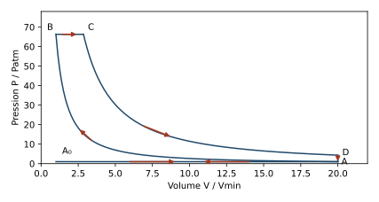

### Question 2

Pour le gaz parfait à capacités constantes, $PV^\gamma$ est conservé sur une adiabatique réversible. Sur $AB$, les volumes sont $V_{\max}$ et $V_{\min}$.

Sur $CD$, la pression de départ est celle de $B$ et les volumes sont $V_C$ et $V_{\max}$. D’où
$$
\begin{aligned}
P_B&=P_{\rm atm}x^\gamma,\\
P_D&=P_B y^{-\gamma}=P_{\rm atm}(x/y)^\gamma.
\end{aligned}
$$

### Question 3

Avec la convention des échanges reçus par le gaz, le rendement est $\eta_D=-W/Q_{BC}$, où $W$ est le travail algébrique reçu sur le cycle. Les branches $AB$ et $CD$ sont adiabatiques et le travail des trajets atmosphériques se compense.

À pression constante $Q_{BC}=n C_{pm}(T_C-T_B)>0$.

À volume constant $Q_{DA}=n C_{vm}(T_A-T_D)<0$. Le premier principe sur le cycle donne $-W=Q_{BC}+Q_{DA}$. Ainsi,
$$
\boxed{\eta_D=1-\frac{T_D-T_A}{\gamma(T_C-T_B)}.}
$$

### Question 4

L’équation d’état donne
$$
\begin{aligned}
T_B/T_A&=x^{\gamma-1},\\
T_C/T_A&=x^\gamma/y,\\
T_D/T_A&=(x/y)^\gamma.
\end{aligned}
$$
En reportant dans Q3,
$$
\boxed{\eta_D=1-\frac{(x/y)^\gamma-1}{\gamma(x^\gamma/y-x^{\gamma-1})}\simeq0{,}611.}
$$
Le rendement réel de 0,45 est plus bas. Le cycle idéalisé omet notamment le transfert thermique vers les parois, les frottements mécaniques et les irréversibilités des échanges et de la combustion.

### Question 5

On a $n=P_{\rm atm}V_{\max}/(RT_A)\simeq2{,}29\ \mathrm{mol}$. Les températures $T_B$ et $T_C$ valent environ 994 et 2 841 K, d’où $Q_{BC}\simeq1{,}23\times10^5\ \mathrm J$ par cycle. En assimilant ce transfert à l’énergie libérée par le carburant, le débit de cycles vaut $f=2000/60\ \mathrm{s^{-1}}$, donc
$$
\boxed{\mathcal P_{\rm méc}=0{,}45fQ_{BC}\simeq1{,}84\ \mathrm{MW}.}
$$
À 140 km/h, 100 km prennent $t=100/140\ \mathrm h\simeq2{,}57\times10^3\ \mathrm s$. La masse consommée vaut
$$
\boxed{m=\frac{fQ_{BC}t}{46{,}8\times10^6\ \mathrm{J\,kg^{-1}}}\simeq225\ \mathrm{kg}.}
$$

### I.B — La pile à hydrogène PEMFC

### Question 6

L’oxydation se produit à l’anode et la réduction à la cathode. Avec deux électrons transférés pour l’avancement molaire de la réaction écrite,
$$
\begin{aligned}
\text{anode : } &\mathrm{H_2(g)\longrightarrow 2H^+(aq)+2e^-},\\
\text{cathode : } &\mathrm{\tfrac12O_2(g)+2H^+(aq)+2e^-\longrightarrow H_2O(l)}.
\end{aligned}
$$

### Question 7

L’anode est le pôle négatif, la cathode le pôle positif. Les électrons vont de l’anode à la cathode dans le circuit extérieur et le courant conventionnel y circule en sens inverse. Dans la membrane, les protons et le courant conventionnel vont de l’anode à la cathode. L’hydrogène arrive à l’anode et l’oxygène à la cathode, où l’eau est produite.

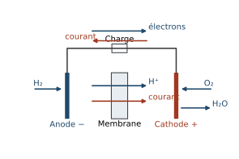

### Question 8

Pour la réaction écrite, les enthalpies standard de formation des corps simples gazeux sont nulles. On obtient
$$
\begin{aligned}
\Delta_r H^\circ&=-286\ \mathrm{kJ\,mol^{-1}},\\
\Delta_r S^\circ&=0{,}070-0{,}131-\tfrac12(0{,}205)\simeq-0{,}164\ \mathrm{kJ\,mol^{-1}\,K^{-1}},\\
\Delta_r G^\circ&=\Delta_r H^\circ-298\Delta_r S^\circ\simeq-237\ \mathrm{kJ\,mol^{-1}}.
\end{aligned}
$$
Avec deux électrons échangés par avancement molaire, $\Delta_r G^\circ=-2Fe^\circ$. Il vient **$e^\circ\simeq1{,}23\ \mathrm V$**.

### Question 9

Le travail électrique fourni au circuit est compté positif. La réaction exothermique fait diminuer l’enthalpie du système, donc $\Delta H<0$. L’énergie de référence disponible vaut $-\Delta H>0$ et le rendement est $W_e/(-\Delta H)$.

### Question 10

À pression extérieure égale à la pression constante du système, le premier principe donne $\Delta U=Q-P\Delta V-W_e$, donc $\Delta H=Q-W_e$. Avec un thermostat à la température commune $T$, le deuxième principe donne $T\Delta S\geq Q$, l’égalité caractérisant la réversibilité. Alors
$$
\boxed{\Delta G=\Delta H-T\Delta S\leq -W_e.}
$$
Le travail électrique maximal fourni vaut donc $-\Delta G$.

### Question 11

En fonctionnement réversible, $W_{e,\max}=-\Delta G$. Sous les conditions standard maintenues, pour un avancement $\xi$ on a $\Delta G=\xi\Delta_r G^\circ$ et $\Delta H=\xi\Delta_r H^\circ$. Le rapport vaut donc
$$
\boxed{\eta_{\max}=\frac{\Delta_r G^\circ}{\Delta_r H^\circ}=1-T\frac{\Delta_r S^\circ}{\Delta_r H^\circ}.}
$$

### Question 12

En supposant que $\Delta_r H^\circ$ et $\Delta_r S^\circ$ varient peu entre 298 et 333 K,
$$
\boxed{\eta_{\max}\simeq1-333{,}15\,\frac{-0{,}1635}{-286}\simeq0{,}810.}
$$

### Question 13

Il faut environ $N=300/0{,}7\simeq429$ cellules en série. Le courant nominal vaut $I=200\,000/300\simeq667\ \mathrm A$. À $j_n=0{,}45\ \mathrm{A\,cm^{-2}}$, chaque cellule doit donc présenter
$$
\boxed{S=I/j_n\simeq1{,}48\times10^3\ \mathrm{cm^2}=0{,}148\ \mathrm{m^2}}.
$$

### Question 14

Une mole de $\mathrm{H_2}$ fournit $2F$ de charge, donc la consommation d’une cellule est $I/(2F)$. Pour la pile entière,
$$
\boxed{\dot n_{\mathrm{H_2}}=\frac{NI}{2F}\simeq1{,}48\ \mathrm{mol\,s^{-1}}.}
$$
L’autonomie correspond à $1000/100=10\ \mathrm h$. Avec $M_{\mathrm{H_2}}=2{,}00\times10^{-3}\ \mathrm{kg\,mol^{-1}}$, la masse consommée est d’environ **$107\ \mathrm{kg}$**, cohérente avec les 108 kg donnés ensuite.

### Question 15

Les huit sommets contiennent chacun un huitième de Ti et le centre contient un Fe entier. La maille porte un motif FeTi. Sa masse volumique donne
$$
\boxed{a=\left(\frac{M_{\rm Fe}+M_{\rm Ti}}{N_A\rho_{\rm FeTi}}\right)^{1/3}\simeq300\ \mathrm{pm}.}
$$
Le contact le long de la demi-diagonale du cube donne aussi l’estimation géométrique $a=2(r_{\rm Ti}+r_{\rm Fe})/\sqrt3\simeq298\ \mathrm{pm}$.

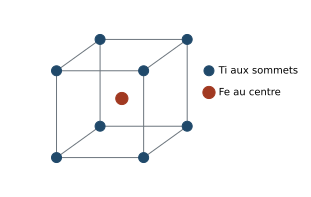

### Question 16

Au centre d’une face, les quatre sommets de la face sont des Ti et les deux centres des mailles de part et d’autre sont des Fe. Les six centres de face comptent chacun pour moitié, soit trois sites par motif FeTi. Le remplissage théorique complet donnerait **$\mathrm{FeTiH_3}$**.

### Question 17

Pour un motif FeTi, l’absorption maximale réelle correspond à 1,9 atome H. Le rapport de masse entre l’hydrogène absorbé et le substrat est $1{,}9M_H/(M_{\rm Fe}+M_{\rm Ti})$. La capacité volumique vaut donc
$$
\boxed{C_V=\rho_{\rm FeTi}\frac{1{,}9M_H}{M_{\rm Fe}+M_{\rm Ti}}\simeq116\ \mathrm{kg\,m^{-3}}.}
$$

### Question 18

Il faut $108/C_V\simeq0{,}93\ \mathrm{m^3}$ d’alliage. À l’état liquide, $108/70{,}8\simeq1{,}53\ \mathrm{m^3}$. Le modèle du gaz parfait à 700 bar et 298 K donne
$$
V_{\rm gaz}=\frac{108RT}{M_{\rm H_2}P}\simeq1{,}91\ \mathrm{m^3}.
$$
Le modèle idéal à 700 bar donne un ordre de grandeur. Le stockage dans l’alliage est le plus compact dans cette comparaison de volumes utiles. Il demande toutefois environ $5{,}9\ \mathrm t$ de substrat, et la comparaison n’inclut ni les réservoirs ni les équipements de gestion thermique.

## II — Mécanique du transport ferroviaire

### II.A — Démarrage du train de Trevithick

### Question 19

Dans le référentiel terrestre supposé galiléen, les wagons subissent leur poids $M_c\vec g$, les réactions verticales des rails et la traction de la locomotive appliquée à l’attelage avant. Sur l’axe horizontal orienté vers l’avant, seule la traction intervient. Le théorème de la résultante cinétique donne
$$
\boxed{\vec F_{\Sigma_2/\Sigma_1}=M_c\vec a_0.}
$$

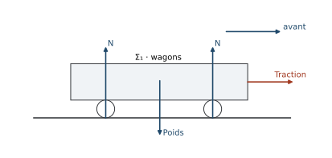

### Question 20

Pour la locomotive, on trace le poids au centre de gravité, la force exercée par les wagons vers l’arrière à l’attelage et les efforts des rails aux quatre contacts. Chaque effort du rail possède une composante normale verticale vers le haut et une composante tangentielle vers l’avant, comme le montre le bilan de Q21. Les contacts des deux côtés se superposent en vue de profil.

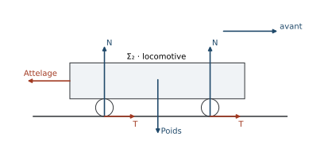

### Question 21

La traction des wagons est une force vers l’arrière de norme $M_c a_0$. En écrivant le bilan horizontal de la locomotive,
$$
4\vec T_{r/2}-M_c\vec a_0=M_\ell\vec a_0.
$$
D’où **$\vec T_{r/2}=(M_\ell+M_c)\vec a_0/4$**. Cette force est indispensable et dirigée dans le sens de l’accélération. L’adhérence des roues motrices transmet l’effort de traction.

### Question 22

L’équilibre vertical donne $4\|\vec N_{r/2}\|=M_\ell g$ pour des réactions identiques. En combinant cette somme avec la loi proposée et Q21,
$$
a_0=0{,}1 f_a\frac{M_\ell}{M_\ell+M_c}g\simeq1{,}07\times10^{-2}\ \mathrm{m\,s^{-2}}.
$$
La vitesse de croisière vaut $8/3{,}6\ \mathrm{m\,s^{-1}}$. Avec un départ au repos, **$t=v_0/a_0\simeq208\ \mathrm s$**, soit environ 3 min 28 s.

### II.B.1 — Passage en courbe

### Question 23

La direction du mouvement tourne de $180^\circ-120^\circ=60^\circ$. Les rayons aux extrémités sont perpendiculaires aux tangentes et forment donc un angle au centre de $60^\circ$. La corde vaut $d_{AB}=2R_{\mathcal C}\sin30^\circ$. Ainsi **$R_{\mathcal C}=d_{AB}$**.

### Question 24

Sur les deux portions rectilignes uniformes, l’accélération est nulle. Sur l’arc circulaire uniforme, elle est centripète et sa norme est constante. Si $t_A$ et $t_B$ désignent les instants de raccordement,
$$
\|\vec a(t)\|=
\begin{cases}
0,&0\leq t<t_A,\\
V_0^2/R_{\mathcal C},&t_A<t<t_B,\\
0,&t_B<t\leq t_f.
\end{cases}
$$
L’arc fait un angle $\pi/3$, donc $t_B-t_A=\pi R_{\mathcal C}/(3V_0)$. Les sauts traduisent le raccordement idéal sans transition de courbure.

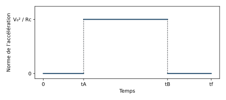

### Question 25

Avec $V_0=300/3{,}6\ \mathrm{m\,s^{-1}}$ et $R_{\mathcal C}=2000\ \mathrm m$,
$$
\boxed{a_{\mathcal C}=\frac{V_0^2}{R_{\mathcal C}}\simeq3{,}47\ \mathrm{m\,s^{-2}}.}
$$

### Question 26

Dans le repère du train, l’accélération d’entraînement est dirigée vers l’intérieur du virage. Le pendule est en équilibre sous son poids, la tension du fil et la force d’inertie d’entraînement vers l’extérieur. Le fil pointe donc vers le bas et l’extérieur et fait avec la verticale terrestre un angle $\alpha$ tel que
$$
\tan\alpha=\frac{(287/3{,}6)^2}{4000\,g}\simeq0{,}162.
$$
On obtient $\alpha\simeq9{,}2^\circ$. La carte donne la courbure vers la gauche dans le sens de la marche. Sur la photographie tournée vers l’avant, le fil penche légèrement vers la droite, du côté extérieur, par rapport au segment fixé au siège. La lecture donne environ $2^\circ$, avec une précision limitée par la photo. Le segment solidaire de la caisse penche donc d’environ $\beta=\alpha-2^\circ\simeq7^\circ$ par rapport à la verticale terrestre. Le rail extérieur est plus haut et, pour un écartement mesuré dans le plan des rails, **$h=E_r\sin\beta\simeq0{,}17\ \mathrm m$**. En négligeant la petite différence visible sur la photo, on trouve environ 0,22 m. L’estimation situe le dévers autour de deux décimètres.

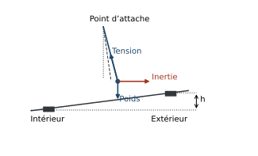

### II.B.2 — Usure abrasive des rails

### Question 27

Le référentiel terrestre est en rotation, approximativement uniforme, par rapport au référentiel géocentrique, autour de l’axe des pôles orienté vers le nord. La période vaut environ un jour sidéral. Dans le référentiel géocentrique, un point fixé à la surface décrit un cercle centré sur l’axe de rotation.

### Question 28

Dans la base directe est, nord, haut, à latitude $\lambda$, le vecteur rotation terrestre vaut $\vec\Omega=\Omega(\cos\lambda\,\vec e_N+\sin\lambda\,\vec e_H)$. Le train roule vers le sud, donc $\vec V=-V_0\vec e_N$. Comme $\vec e_H\times\vec e_N=-\vec e_E$, on obtient
$$
\boxed{\vec F_{\rm Cor}=-2m\vec\Omega\times\vec V=-2m\Omega V_0\sin\lambda\,\vec e_E.}
$$
L’effet centrifuge stationnaire est inclus dans la pesanteur locale. La force de Coriolis pousse donc vers l’ouest, à droite du train regardant le sud. Le rail ouest exerce la réaction normale horizontale vers l’est sur le boudin de la roue. Les deux files de rails exercent des réactions verticales vers le haut sur les bandes de roulement.

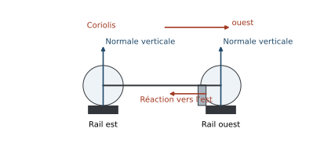

### Question 29

À conditions d’essai fixées, une force de contact normale plus grande augmente le volume usé, et un parcours glissé plus long cumule davantage d’usure. Une plus grande dureté la réduit. Le coefficient $k$ représente l’effet des matériaux et des conditions de contact. Même lorsqu’on parle de roulement avec adhérence à l’échelle de la roue, la zone de contact de taille finie peut présenter du glissement local.

### Question 30

Avec $[F_n]=MLT^{-2}$, $[d]=L$, $[H]=ML^{-2}$ et $[V]=L^3$,
$$
\boxed{[k]=\frac{[V][H]}{[F_n][d]}=L^{-1}T^2.}
$$
L’unité correspondante est la seconde carrée par mètre.

### Question 31

La face supérieure du rail ouest supporte environ la moitié du poids si le partage vertical entre rails est symétrique. Sa face intérieure équilibre la force de Coriolis horizontale. En supposant des duretés, des distances de glissement effectives et des coefficients $k$ comparables,
$$
\frac{V_{\rm intérieur}}{V_{\rm dessus}}
\simeq\frac{2m\Omega V_0\sin\lambda}{mg/2}
=\frac{4\Omega V_0\sin\lambda}{g}.
$$
À latitude moyenne voisine de $47^\circ$, avec $\Omega\simeq7{,}3\times10^{-5}\ \mathrm{s^{-1}}$ et $V_0\simeq83\ \mathrm{m\,s^{-1}}$, le rapport vaut environ $1{,}8\times10^{-3}$. La face supérieure s’use davantage dans ce modèle. L’estimation néglige les effets du lacet, du partage de charge et les écarts de glissement local ou de géométrie des contacts.

## III — Connexion à Internet par LiFi

### III.A — Émission du signal lumineux

### Question 32

Dans le modèle de la caractéristique, l’émission commence immédiatement au-dessus de **$U_{\min}=V_{sb}=2{,}90\ \mathrm V$**. Au seuil lui-même, le courant est nul et la puissance lumineuse s’annule.

### Question 33

Lorsque la diode conduit, $u_e=V_{sb}+r_e i_1$. Il faut donc **$U_0=2{,}90+10\times0{,}73=10{,}2\ \mathrm V$**. La diode reçoit $V_{sb}i_0$, ce qui donne **$\Phi_{e0}=\eta_{\rm led}V_{sb}i_0\simeq0{,}70\ \mathrm W$**.

### Question 34

En notant $\alpha_a$ la phase du signal informatif et $k$ le coefficient du multiplieur,
$$
u_e(t)=U_0+k p_m a_m\cos(\omega_p t+\alpha_p)\cos(\omega_a t+\alpha_a).
$$
Le signal reste au-dessus du seuil pour toutes les phases si $k p_m a_m<U_0-V_{sb}$. La valeur limite est donc **$7{,}30\ \mathrm V$**. À la limite, il peut atteindre le seuil avec extinction instantanée. Une marge stricte garantit une émission toujours positive.

### Question 35

Pour $A=k p_m a_m$, la porteuse électrique oscille autour de $U_0$ avec une enveloppe dont la demi-largeur est $A|\cos(\omega_a t+\alpha_a)|$. Quand le cosinus lent change de signe, la phase de l’oscillation rapide s’inverse.

Le produit de cosinus donne deux raies dans le spectre unilatéral en amplitude, à $f_p-f_a=0{,}9f_p$ et $f_p+f_a=1{,}1f_p$, chacune d’amplitude $A/2$. La composante continue est $U_0$.

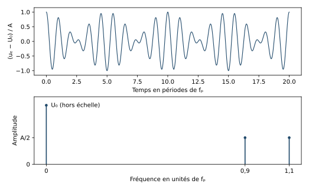

### Question 36

Pendant la moitié haute du créneau, $u_e=U_0+A\cos(\omega_p t+\alpha_p)$, avec $A=k p_m a_m$.

Pendant la moitié basse, $u_e=U_0$. La moyenne $a_m/2$ du créneau ajoute à la composante continue $U_0$ une raie centrale à $f_p$ d’amplitude $A/2$.

Les harmoniques impaires d’ordre $n$ du créneau ont une amplitude $2a_m/(\pi n)$.

Leur multiplication par le sous-porteur donne des contributions latérales à $|f_p\pm n f_a|$, chacune de module $A/(\pi n)$ avant regroupement.

Le schéma montre les premières harmoniques. Sur un spectre complet, les contributions à une même fréquence se somment avec leurs phases.

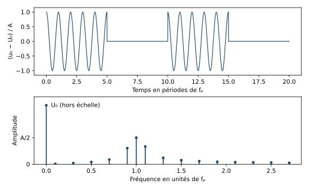

### III.B — Réception du signal lumineux et extraction de l’information

### Question 37

Pour une surface petite devant $d^2$ et orientée face à la source, la puissance est répartie sur la demi-sphère d’aire $2\pi d^2$.

On a $\Phi_r=s_r\Phi_e/(2\pi d^2)$ et $u_r=r i_2$.

Quand la LED conduit, $i_1=(u_e-V_{sb})/r_e$, d’où
$$
\boxed{u_r(t)=\frac{rK_r K_e s_r}{2\pi d^2 r_e}\bigl(u_e(t)-V_{sb}\bigr).}
$$
Sous le seuil, le courant lumineux et la tension de réception s’annulent dans le modèle.

### Question 38

Le condensateur en série bloque les basses fréquences. Le diviseur d’impédances donne un passe-haut du premier ordre,
$$
\boxed{H_F(j\omega)=\frac{j\omega r_2 C_2}{1+j\omega r_2 C_2}.}
$$
Sa pulsation de coupure à $-3\ \mathrm{dB}$ vaut **$\omega_c=1/(r_2C_2)$**.

### Question 39

Posons $B=rK_rK_e s_r/(2\pi d^2r_e)$. En régime permanent, le passe-haut supprime $KB(U_0-V_{sb})$ et laisse pratiquement inchangées les deux bandes latérales, car $\omega_p\pm\omega_a\gg\omega_c$. Le second multiplieur donne donc
$$
\begin{aligned}
u_{r3}(t)&\simeq U_{3m}\cos^2(\omega_p t+\alpha_p)\cos(\omega_a t),\\
U_{3m}&=KB k^2p_m^2a_m.
\end{aligned}
$$
L’identité $\cos^2 x=(1+\cos2x)/2$ donne une raie informative à $f_a$ d’amplitude $|U_{3m}|/2$ et deux autres à $2f_p\pm f_a$ d’amplitude $|U_{3m}|/4$.

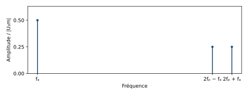

### Question 40

Un passe-bas RC, résistance en série et sortie aux bornes du condensateur, convient. On choisit
$$
f_a\ll\frac1{2\pi R_f C_f}\ll2f_p-f_a.
$$
Il laisse la raie informative et atténue les produits de mélange à haute fréquence. La tension de sortie vaut alors approximativement $(U_{3m}/2)\cos(\omega_a t)$.

### III.C — Débit binaire du LiFi

### Question 41

Un débit de 10 Mbit/s correspond à 10 MHz si chaque période transporte un bit. La condition exige une sous-porteuse supérieure à $100\times10\ \mathrm{MHz}=1\ \mathrm{GHz}$. Une fréquence de quelques gigahertz satisfait ce critère d’ordre de grandeur.

### Question 42

Dans le vide,
$$
\boxed{f_b=\frac{c}{\lambda_b}\simeq6{,}38\times10^{14}\ \mathrm{Hz}.}
$$
Pour une estimation d’ordre de grandeur dans le modèle proposé, on peut prendre la sous-porteuse environ cent fois plus lente que l’oscillation lumineuse. Cela donne $f_p\sim6\times10^{12}\ \mathrm{Hz}$, puis un débit plafonnant autour de **$6\times10^{10}\ \mathrm{bit\,s^{-1}}$** à un bit par période. Le rapport de séparation entre porteuse et sous-porteuse est une hypothèse d’estimation. Le critère de l’énoncé relie le débit à $f_p$ sans fixer lui-même cette sous-porteuse. Cette estimation idéale est supérieure au débit WiFi cité. Dans un dispositif réel, la bande passante de la LED, du photodétecteur et de l’électronique fixe une limite pratique bien avant la fréquence optique.

FIN
