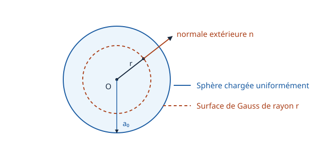
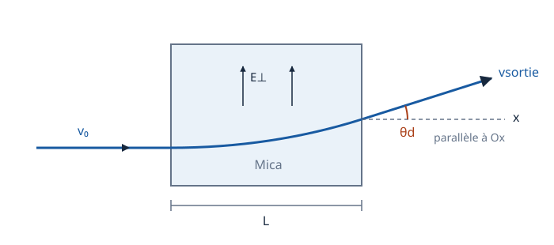
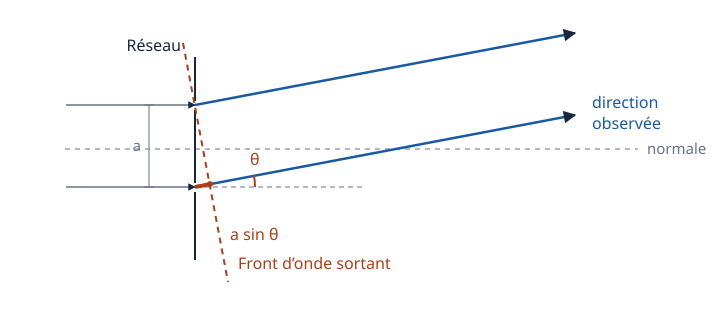

# Centrale-Supélec MP — Physique-chimie 2 2024 · Corrigé guidé

*Corrigé rédigé par IA, non officiel. Signalez toute erreur.*

## Présentation du sujet

L’épreuve dure quatre heures, calculatrice autorisée. Les trois parties confrontent des modèles physiques à des expériences sur la structure de la matière.

- **Partie A (Q1–Q24).** Construire le modèle de Thomson, évaluer la diffusion de particules et étudier la perte d’énergie d’un électron classique.
- **Partie B (Q25–Q42).** Estimer la taille de l’atome par un modèle quantique puis comparer l’interfrange de molécules à une mesure.
- **Partie C (Q43–Q49).** Relier une marche aléatoire à la diffusion et obtenir des constantes à partir des mesures de Brillouin et Perrin.

Le sujet mobilise les forces centrales, l’électromagnétisme, les probabilités, les interférences et la diffusion. Le jury relève que les graphiques de fin des parties B et C ont été peu exploités. Les questions Q1–Q9, Q25–Q28 et Q43–Q46 offrent des points d’entrée indépendants. Gardez du temps pour Q10, Q42 et Q47–Q49.

## Partie A — L’atome classique, réussites et difficultés

Reconstruisez d’abord le champ d’une distribution uniforme et les forces qui en découlent. Les mesures de diffusion et le rayonnement éprouvent ensuite deux hypothèses distinctes de l’atome classique.

### I — Le modèle « plum pudding » de J. J. Thomson

#### I.A — Champ électrique de la distribution de charge positive

### Question 1

> [!INDICATION]
> Repérez les plans de symétrie de la distribution qui contiennent le point d’observation.

#### Solution

Tout plan contenant $O$ et $M$ est plan de symétrie de la distribution sphérique.

Le champ électrique, vecteur polaire, appartient à chacun de ces plans au point $M$.

Leur intersection est la droite $(OM)$.

Ainsi **$\mathbf E(M)=E_r(M)\mathbf u_r$** pour $r>0$.

Au centre, l’invariance par toutes les rotations impose $\mathbf E(O)=\mathbf0$.

### Question 2

> [!INDICATION]
> Comparez deux points situés sur une même sphère à l’aide d’une rotation.

#### Solution

La distribution de charges est invariante par toute rotation de centre $O$. Si une rotation amène $M$ en $M'$, le champ en $M'$ est le champ en $M$ tourné du même angle. La composante radiale garde donc la même valeur pour tous les points au même rayon. Ainsi **$E_r=E_r(r)$**.

> [!JURY]
> Le jury demande de partir des invariances de la distribution de charges et d’en déduire celles du champ.

### Question 3

> [!INDICATION]
> Choisissez une surface fermée concentrique et calculez la fraction de charge qu’elle enferme.

> [!INDICATION]
> La charge incluse est proportionnelle au volume de la boule intérieure.

#### Solution

Le théorème de Gauss donne, pour une surface fermée orientée vers l’extérieur, $\iint\mathbf E\cdot d\mathbf S=Q_{\rm int}/\varepsilon_0$. Ici le champ est celui de la distribution positive seule. Sur la sphère de rayon $r<a_0$, le champ est parallèle à la normale et constant en valeur algébrique. La charge intérieure vaut $Q_{\rm int}=Q(r/a_0)^3$.

On obtient $4\pi r^2 E_r=Q_{\rm int}/\varepsilon_0$, donc
$$
\boxed{\mathbf E(\mathbf r)=\frac{Q}{4\pi\varepsilon_0a_0^3}\,\mathbf r.}
$$

#### I.B — Étude mécanique

### Question 4

> [!INDICATION]
> Comparez les forces à l’échelle atomique, puis estimez l’effet du poids près du centre.

#### Solution

L’intensité électrique caractéristique sur la longueur $a_0$ est $e^2/a_0^2\simeq2{,}3\times10^{-8}\,\mathrm N$, où $e^2=q_e^2/(4\pi\varepsilon_0)$. Le poids vaut $mg\simeq8{,}9\times10^{-30}\,\mathrm N$. Leur rapport est d’environ $4\times10^{-22}$.

La force électrique s’annule exactement au centre. Si l’on gardait le poids, il déplacerait l’équilibre de $mg\,a_0^3/e^2\simeq4\times10^{-32}\,\mathrm m$. Cette longueur est négligeable devant $a_0$, ce qui justifie le modèle sans poids.

### Question 5

> [!INDICATION]
> Examinez le moment de la force électrique par rapport au centre.

#### Solution

La force électrique est radiale et son moment par rapport à $O$ est nul. Le moment cinétique $\mathbf L_O=m\mathbf r\times\mathbf v$ est donc constant. S’il est non nul, $\mathbf r$ reste dans le plan fixe perpendiculaire à $\mathbf L_O$. Si les données initiales sont colinéaires, la force centrale donne un mouvement sur une droite passant par $O$, par unicité de la solution. Dans tous les cas le mouvement est plan.

### Question 6

> [!INDICATION]
> Multipliez le champ intérieur par la charge de l’électron puis projetez le principe fondamental de la dynamique.

#### Solution

La charge de l’électron est $-q_e$, donc $m\ddot{\mathbf r}=-e^2\mathbf r/a_0^3$. Les deux projections donnent
$$
\begin{cases}
\ddot x+\omega_0^2x=0,\\
\ddot y+\omega_0^2y=0,
\end{cases}
\qquad
\omega_0=\sqrt{\frac{q_e^2}{4\pi\varepsilon_0ma_0^3}}.
$$

### Question 7

> [!INDICATION]
> Choisissez les axes selon la position et la vitesse initiales.

#### Solution

Prenons $Ox$ suivant la position initiale et $Oy$ suivant la vitesse initiale, supposées non nulles.

Les conditions initiales donnent $x(t)=r_0\cos\omega_0t$ et $y(t)=(v_0/\omega_0)\sin\omega_0t$.

La trajectoire est **une ellipse centrée en $O$** de demi-axes $r_0$ et $v_0/\omega_0$.

Pour $v_0=\omega_0r_0$, elle est circulaire.

Si une amplitude s’annule, elle se réduit à un segment.

### Question 8

> [!INDICATION]
> Utilisez la positivité de l’énergie cinétique pour majorer le rayon atteint.

#### Solution

La force étant $-m\omega_0^2\mathbf r$, on choisit $E_p(r)=m\omega_0^2r^2/2$ à une constante près. L’énergie mécanique
$$
E_m=\frac m2 v^2+\frac m2\omega_0^2r^2
=\frac m2 v_0^2+\frac m2\omega_0^2r_0^2
$$
se conserve. Si $v_0<\omega_0\sqrt{a_0^2-r_0^2}$, alors $E_m<m\omega_0^2a_0^2/2$. Le rayon $a_0$ ne peut être atteint, car son énergie potentielle seule dépasserait $E_m$.

### Question 9

> [!INDICATION]
> Convertissez la pulsation mécanique en fréquence puis en longueur d’onde.

#### Solution

Les oscillations sont de pulsation $\omega_0\simeq1{,}6\times10^{16}\,\mathrm{rad\,s^{-1}}$. Le rayonnement prévu dans ce modèle a donc une fréquence $f=\omega_0/(2\pi)\simeq2{,}5\times10^{15}\,\mathrm{Hz}$. La longueur d’onde $c/f$ vaut **environ $1{,}2\times10^{-7}\,\mathrm m$, dans l’ultraviolet**.

### II — Découverte du noyau (Rutherford)

#### II.A — Déviation par une feuille de mica

### Question 10

> [!INDICATION]
> Reliez l’angle à la direction de la vitesse de sortie, puis utilisez l’impulsion transverse.

> [!INDICATION]
> L’angle est celui de la vitesse après la traversée. Un petit angle autorise le calcul du temps de transit avec la vitesse incidente.

#### Solution

On choisit $Ox$ selon la vitesse incidente de module $v_0$ et $Oy$ dans la direction du champ transverse effectif $E_\perp$. La faible déviation permet de prendre une durée de traversée $L/v_0$ et une vitesse longitudinale pratiquement constante.

Pour la particule de charge $2q_e$ et de masse $m_\alpha$, la composante de vitesse gagnée vaut $2q_eE_\perp L/(m_\alpha v_0)$. La tangente de l’angle de sortie est cette composante divisée par $v_0$. Avec $\mathcal E_c=m_\alpha v_0^2/2$,
$$
E_\perp=\frac{\mathcal E_c\tan\theta_d}{q_e L}.
$$
L’énergie rapportée à $q_e$ vaut $5{,}0\times10^6\,\mathrm V$.

Avec $\theta_d=2^\circ$ et $L=3{,}0\times10^{-5}\,\mathrm m$, on obtient **$E_\perp\simeq5{,}8\times10^9\,\mathrm{V\,m^{-1}}$**, soit $5{,}8\times10^7\,\mathrm{V\,cm^{-1}}$.

C’est de l’ordre de $10^8\,\mathrm{V\,cm^{-1}}$.

> [!JURY]
> Le jury valorise le schéma et relève que l’angle de déviation porte sur la vitesse de sortie.

#### II.B — Déviation des α dans le modèle de Thomson

### Question 11

> [!INDICATION]
> Projetez le champ intérieur sur l’axe perpendiculaire à la trajectoire approchée.

#### Solution

Sur le segment retenu, la coordonnée transverse est $y=b$. Le champ de Q3, avec $Q=Zq_e$, a donc pour composante $E_y=Zq_e b/(4\pi\varepsilon_0a_0^3)$. La charge de la particule vaut $2q_e$, d’où **$F_y=2Ze^2 b/a_0^3$**. Son signe est répulsif si $b>0$.

### Question 12

> [!INDICATION]
> Multipliez la force constante par la durée de traversée de la corde et maximisez le résultat en $b$.

#### Solution

Pour $0\leq b\leq a_0$, la corde de la sphère mesure $2\sqrt{a_0^2-b^2}$. Ainsi
$$
\Delta p_y=\frac{4Ze^2}{a_0^3v_0}\,b\sqrt{a_0^2-b^2}.
$$
Le carré du dernier produit est $b^2(a_0^2-b^2)$. Son maximum est atteint pour $b^2=a_0^2/2$ et le produit vaut alors $a_0^2/2$. Donc **$\Delta p_m=2Ze^2/(a_0v_0)$**.

### Question 13

> [!INDICATION]
> Utilisez le rapport de l’impulsion transverse à l’impulsion longitudinale et vérifiez l’unité de l’angle.

#### Solution

La déviation est faible, donc $\delta\theta\simeq\Delta p_m/(m_\alpha v_0)$. Avec $\mathcal E_c=m_\alpha v_0^2/2$,
$$
\boxed{\delta\theta\simeq\frac{Ze^2}{a_0\mathcal E_c}\simeq2{,}2\times10^{-4}\,\mathrm{rad}.}
$$
Pour l’or, $Z=79$. On a utilisé $e^2=1{,}4\,\mathrm{eV\,nm}$, $a_0=0{,}10\,\mathrm{nm}$ et $\mathcal E_c=5{,}0\,\mathrm{MeV}$. En degrés, la déviation est d’environ $0{,}013^\circ$.

> [!JURY]
> Le jury relève des confusions entre radians et degrés dans cette application et dans celle de la question suivante.

### Question 14

> [!INDICATION]
> Estimez combien de couches d’épaisseur atomique la feuille contient, puis utilisez la loi en racine carrée.

> [!INDICATION]
> Choisissez une longueur atomique comme pas moyen avant de multiplier l’écart par collision par la racine du nombre de collisions.

#### Solution

En prenant comme pas d’une couche un diamètre $2a_0$, on estime $N\simeq L/(2a_0)\simeq5\times10^3$. L’écart-type est alors
$$
\Delta\theta=\delta\theta\sqrt N\simeq1{,}6\times10^{-2}\,\mathrm{rad}\simeq0{,}9^\circ.
$$
Un autre choix de distance interatomique du même ordre conserve une dispersion d’environ un degré. Des angles de plusieurs dizaines de degrés sont très loin de cette dispersion. Le modèle de charges positives diluées ne rend pas compte des grandes déviations observées.

#### II.C — Rétrodiffusion des α dans le modèle de Rutherford

### Question 15

> [!INDICATION]
> Au point de rebroussement frontal, traduisez la disparition de l’énergie cinétique.

#### Solution

À grande distance, l’énergie potentielle est nulle et l’énergie mécanique est $\mathcal E_c$. Hors du noyau, le potentiel d’interaction répulsif vaut $2Ze^2/r$. Sur une trajectoire frontale, la vitesse s’annule au point de retour, donc
$$
r_{\rm retour}=\frac{2Ze^2}{\mathcal E_c}.
$$
Le modèle suppose que la particule reste hors de la distribution de charge. Le rayon nucléaire est donc au plus **$r_0=2Ze^2/\mathcal E_c$**.

### Question 16

> [!INDICATION]
> Réutilisez la distance minimale avec l’énergie maximale pour laquelle la rétrodiffusion est observée.

#### Solution

Pour $Z=79$ et $\mathcal E_c=40\,\mathrm{MeV}$, la borne vaut **$r_0\simeq5{,}5\times10^{-15}\,\mathrm m$**, soit un diamètre d’au plus environ $1{,}1\times10^{-14}\,\mathrm m$. C’est plus de quatre ordres de grandeur sous l’échelle atomique. La rétrodiffusion indique une charge concentrée dans un noyau, et ce calcul en fixe une borne dans le modèle donné.

### III — Instabilité d’un modèle d’atome « classique »

#### III.A — Puissance électromagnétique rayonnée par une charge accélérée

### Question 17

> [!INDICATION]
> Utilisez la relation des champs d’une onde plane et exprimez la projection transverse dans une base sphérique.

#### Solution

Avec l’axe polaire dirigé selon $\mathbf a$, on a $\mathbf a_\perp=\mathbf a-(\mathbf a\cdot\mathbf u_r)\mathbf u_r=-a\sin\theta\,\mathbf u_\theta$. Comme l’onde se propage dans le sens $+\mathbf u_r$,
$$
\mathbf B=\frac{\mathbf u_r\times\mathbf E}{c}
=-\frac{qa\sin\theta}{4\pi\varepsilon_0c^3r}\,\mathbf u_\phi .
$$

### Question 18

> [!INDICATION]
> Appliquez la définition du vecteur de Poynting puis le produit vectoriel triple.

#### Solution

Le vecteur de Poynting est $\vec{\Pi}=(\mathbf E\times\mathbf B)/\mu_0$. Comme $\mathbf E$ est transverse, **$\vec{\Pi}=\varepsilon_0c E^2\mathbf u_r$**. C’est une densité vectorielle de flux de puissance, en $\mathrm{W\,m^{-2}}$. Son flux à travers une surface donne la puissance électromagnétique qui la traverse.

> [!JURY]
> Le jury attend l’interprétation en termes de flux de puissance à travers une surface.

### Question 19

> [!INDICATION]
> Intégrez le flux sur une sphère et tenez compte du facteur angulaire de l’élément de surface.

> [!INDICATION]
> Le champ est proportionnel au sinus de l’angle polaire. Le flux ajoute le facteur angulaire de la surface.

#### Solution

Le champ dépend de l’angle par $\sin\theta$. Le flux sortant vaut donc
$$
P=\frac{q^2a^2}{16\pi^2\varepsilon_0c^3}
\int_0^{2\pi}d\phi\int_0^\pi\sin^3\theta\,d\theta.
$$
Le facteur $r^2$ de la surface compense celui du champ au carré. Avec l’intégrale donnée, **$P=q^2a^2/(6\pi\varepsilon_0c^3)$**. L’expression concerne l’accélération à l’instant d’émission correspondant.

#### III.B — Étude énergétique de l’atome « planétaire »

### Question 20

> [!INDICATION]
> Reliez la vitesse circulaire à la force attractive avant d’additionner les deux énergies.

#### Solution

Le mouvement circulaire impose $mv^2/R=e^2/R^2$. L’énergie cinétique vaut donc $e^2/(2R)$ et le potentiel électrique vaut $-e^2/R$, avec le zéro à l’infini. Ainsi **$E_m=-e^2/(2R)$**.

### Question 21

> [!INDICATION]
> Remplacez l’accélération de la formule de Larmor par l’accélération coulombienne.

#### Solution

Au premier ordre quasi circulaire, $a=e^2/(mR^2)$. On applique Q19 avec $q=-q_e$ et $q_e^2/(4\pi\varepsilon_0)=e^2$. Il vient
$$
\boxed{P=\frac{2(e^2)^3}{3m^2c^3R^4}.}
$$

### Question 22

> [!INDICATION]
> Posez la dérivée de l’énergie mécanique égale à l’opposé de la puissance rayonnée.

#### Solution

Le bilan donne $dE_m/dt=-P$. Comme $E_m=-e^2/(2R)$, sa dérivée est $(e^2/2R^2)\,dR/dt$. Avec Q21,
$$
\boxed{R^2\frac{dR}{dt}=-\frac{4(e^2)^2}{3m^2c^3}.}
$$
Le signe négatif correspond à une diminution du rayon.

> [!JURY]
> Le jury insiste sur le signe du bilan radiatif avant l’intégration du mouvement.

### Question 23

> [!INDICATION]
> Intégrez l’équation pour le cube du rayon jusqu’à l’annulation prévue par le modèle.

#### Solution

La dérivée de $R^3$ est $3R^2\,dR/dt$. Si $R(0)=a_0$, l’intégration donne $R^3(t)=a_0^3-4(e^2)^2t/(m^2c^3)$. Le temps d’effondrement formel est donc
$$
\boxed{\tau=\frac{m^2c^3a_0^3}{4(e^2)^2}.}
$$

### Question 24

> [!INDICATION]
> Évaluez le temps de chute et confrontez-le à la stabilité observée de la matière.

#### Solution

Avec $a_0=1{,}0\times10^{-10}\,\mathrm m$, $m=9{,}1\times10^{-31}\,\mathrm{kg}$, $e^2=2{,}3\times10^{-28}\,\mathrm{J\,m}$ et $c=3{,}0\times10^8\,\mathrm{m\,s^{-1}}$, on trouve **$\tau\simeq1{,}1\times10^{-10}\,\mathrm s$**. L’atome classique devrait s’effondrer presque instantanément, en désaccord avec la stabilité des atomes. Le calcul décrit une évolution quasi circulaire non relativiste et perd sa validité à très petit rayon, sans modifier l’ordre de grandeur du temps prédit.

## Partie B — L’atome quantique

Une contrainte sur le produit des dispersions fixe une échelle de localisation. Une expérience d’interférences permet ensuite de comparer une autre prédiction quantique au profil mesuré.

### IV — Relations d’Heisenberg

### Question 25

> [!INDICATION]
> Intégrez la densité de probabilité sur le volume où elle est non nulle.

#### Solution

Le module carré $|\psi|^2$ est la densité de probabilité de présence par unité de volume. La probabilité totale vaut $|A|^2(4\pi r_0^3/3)=1$. À une phase globale près, on choisit **$A=\sqrt{3/(4\pi r_0^3)}$**.

### Question 26

> [!INDICATION]
> Utilisez la symétrie pour le premier moment et la mesure sphérique pour le deuxième.

#### Solution

L’intégrale vectorielle est nulle par inversion $\mathbf r\mapsto-\mathbf r$, donc $\langle\mathbf r\rangle=\mathbf0$. Le deuxième moment vaut
$$
\langle r^2\rangle=4\pi|A|^2\int_0^{r_0}r^4\,dr
=\frac35r_0^2.
$$
La dispersion définie par le sujet est **$\Delta r=\sqrt{3/5}\,r_0$**.

### Question 27

> [!INDICATION]
> Interprétez un petit volume de l’espace des quantités de mouvement comme un ensemble de résultats possibles.

#### Solution

La probabilité d’obtenir, lors d’une mesure, une quantité de mouvement dans un domaine $\mathcal D$ est $\int_{\mathcal D}|\chi(\mathbf p)|^2\,d^3p$. Ainsi $|\chi|^2$ est la densité de probabilité en quantité de mouvement.

### Question 28

> [!INDICATION]
> Reprenez la normalisation et le calcul du deuxième moment avec une boule de rayon $p_0$.

#### Solution

La normalisation donne $|B|^2(4\pi p_0^3/3)=1$, donc **$B=\sqrt{3/(4\pi p_0^3)}$** à une phase près. L’isotropie donne $\langle\mathbf p\rangle=\mathbf0$. L’intégrale radiale $4\pi|B|^2\int_0^{p_0}p^4\,dp$ vaut $3p_0^2/5$. Donc **$\Delta p=\sqrt{3/5}\,p_0$**.

### Question 29

> [!INDICATION]
> Écrivez l’inégalité de Heisenberg pour une composante cartésienne puis utilisez l’isotropie.

> [!INDICATION]
> Exprimez les dispersions en trois dimensions comme des multiples des dispersions cartésiennes.

#### Solution

Pour une coordonnée cartésienne, $\Delta x\,\Delta p_x\geq\hbar/2$. L’isotropie donne $\Delta r=\sqrt3\,\Delta x$ et $\Delta p=\sqrt3\,\Delta p_x$. Par conséquent
$$
\Delta r\,\Delta p\geq\frac{3\hbar}{2}.
$$
Dans l’estimation du fondamental, on cherche l’énergie cinétique la plus basse compatible avec une localisation donnée. On retient une dispersion en quantité de mouvement à l’échelle imposée par cette borne. Avec Q26 et Q28, **$\frac35p_0r_0\sim\hbar$**. La constante issue de la borne ne doit pas être interprétée comme un coefficient exact. Les deux distributions uniformes du sujet constituent une modélisation approchée, qui ne donne pas une paire exacte de fonctions d’onde reliées par transformée de Fourier.

> [!JURY]
> Le jury demande d’écrire explicitement une inégalité de Heisenberg avant de passer à l’ordre de grandeur.

### Question 30

> [!INDICATION]
> Associez la charge négative de l’électron au potentiel créé par le proton.

#### Solution

Le potentiel électrique du proton est $q_e/(4\pi\varepsilon_0r)$ avec le zéro à l’infini. En multipliant par la charge $-q_e$, on obtient **$E_p(r)=-e^2/r$**.

### Question 31

> [!INDICATION]
> Moyennez le potentiel avec la densité de probabilité de Q25.

#### Solution

On obtient
$$
\langle E_p\rangle=
-4\pi |A|^2 e^2\int_0^{r_0}r\,dr
=\boxed{-\frac{3e^2}{2r_0}}.
$$
La singularité en $r=0$ est intégrable grâce au facteur $r^2$ de l’élément de volume.

### Question 32

> [!INDICATION]
> Utilisez le moment quadratique de la quantité de mouvement calculé en Q28.

#### Solution

Comme $E_c=p^2/(2m)$ et $\langle p^2\rangle=3p_0^2/5$, on trouve **$\langle E_c\rangle=3p_0^2/(10m)$**.

### Question 33

> [!INDICATION]
> Appliquez la substitution demandée seulement pour ce modèle d’ordre de grandeur.

#### Solution

On pose $p_0=5\hbar/(3r_0)$ en remplaçant l’ordre de grandeur de Q29 par l’égalité prescrite. En additionnant Q31 et Q32,
$$
\boxed{\langle E_m\rangle(r_0)=
\frac{5\hbar^2}{6mr_0^2}-\frac{3e^2}{2r_0}.}
$$

### Question 34

> [!INDICATION]
> Dérivez l’énergie en fonction de $r_0$ et vérifiez le sens de variation autour du point stationnaire.

#### Solution

Notons $A_c=5\hbar^2/(6m)$ et $B_p=3e^2/2$. La dérivée de $A_c/r_0^2-B_p/r_0$ est $(B_p r_0-2A_c)/r_0^3$. Elle change du signe négatif au signe positif pour $r_0=2A_c/B_p$, ce qui donne le minimum. Ainsi
$$
a_0=\frac{10}{9}\frac{\hbar^2}{me^2}
\sim\frac{\hbar^2}{me^2}.
$$
Le facteur $10/9$ dépend du modèle de calcul de Q33.

### Question 35

> [!INDICATION]
> Vérifiez l’échelle du résultat en mètres puis comparez à un rayon atomique typique.

#### Solution

Avec les constantes fournies, $\hbar^2/(me^2)\simeq5{,}3\times10^{-11}\,\mathrm m$. Le minimum du modèle approché est **$a_0\simeq5{,}9\times10^{-11}\,\mathrm m$**. C’est de l’ordre d’un dixième de nanomètre, cohérent avec l’échelle atomique supposée en partie A.

### V — L’atome quantique, onde ou particule ?

### Question 36

> [!INDICATION]
> Additionnez les masses molaires selon la formule brute puis divisez par la constante d’Avogadro.

#### Solution

La masse molaire vaut $(32\times12+18\times1+8\times14)\,\mathrm{g\,mol^{-1}}=514\,\mathrm{g\,mol^{-1}}$. La conversion en unités SI et la division par $N_A$ donnent **$m_{\rm molécule}\simeq8{,}5\times10^{-25}\,\mathrm{kg}$**.

### Question 37

> [!INDICATION]
> Éliminez le temps entre le mouvement horizontal uniforme et la chute verticale.

#### Solution

Le déplacement horizontal vaut $x=v_0t$. L’axe vertical est dirigé vers le haut, et la composante verticale de la vitesse initiale est nulle. On a donc $h=-gt^2/2$. Au plan $x=D$, **$h=-\frac12g(D/v_0)^2$**.

### Question 38

> [!INDICATION]
> Transformez les deux bornes en vitesse avant de choisir un centre et une demi-largeur.

#### Solution

Pour une chute de module $|h|$, $v_0=D\sqrt{g/(2|h|)}$.

Avec $D=0{,}96\,\mathrm m$, les extrémités $240$ et $160\,\mathrm{\mu m}$ correspondent respectivement à $137$ et $168\,\mathrm{m\,s^{-1}}$.

En prenant le milieu comme vitesse représentative et la demi-largeur comme dispersion, on trouve **$v_0\simeq153\,\mathrm{m\,s^{-1}}$ et $\Delta v\simeq16\,\mathrm{m\,s^{-1}}$**.

Le milieu en chute donne environ $150\,\mathrm{m\,s^{-1}}$, compatible avec cette estimation.

### Question 39

> [!INDICATION]
> Associez la longueur d’onde à la quantité de mouvement non relativiste.

#### Solution

La longueur d’onde de de Broglie vaut $\lambda_B=h/p=h/(m_{\rm molécule}v_0)$. Avec $h=2\pi\hbar\simeq6{,}6\times10^{-34}\,\mathrm{J\,s}$, les valeurs de Q36 et Q38 donnent **$\lambda_B\simeq5{,}1\times10^{-12}\,\mathrm m$**.

### Question 40

> [!INDICATION]
> Projetez la séparation de deux fentes sur la direction observée et imposez la condition de phase.

#### Solution

Les fronts incidents atteignent des fentes voisines en phase dans le modèle d’éclairement normal. Dans une direction $\theta$ par rapport à la normale, on compare les chemins sur un même plan d’onde. La différence de marche algébrique, à l’ordre des fentes près, est la projection $a\sin\theta$. La phase relative est $2\pi a\sin\theta/\lambda_B$.

Lorsque cette différence de phase est un multiple de $2\pi$, les contributions de toutes les fentes s’ajoutent en phase. Les directions constructives vérifient donc **$a\sin\theta_k=k\lambda_B$** pour $k\in\mathbb Z$ lorsque cette direction existe.

> [!JURY]
> Le jury attend un schéma qui justifie la différence de marche.

### Question 41

> [!INDICATION]
> Reliez la direction angulaire à la position sur l’écran, puis propagez la dispersion de vitesse.

> [!INDICATION]
> La dispersion relative de l’interfrange vient de la dépendance inverse en vitesse.

#### Solution

Les maxima sont aux positions $x_k=L_2\tan\theta_k$. Aux petits angles, $\tan\theta_k\simeq\sin\theta_k$. L’interfrange est la distance entre deux maxima successifs, soit
$$
\boxed{i\simeq\frac{L_2\lambda_B}{a}\simeq29\,\mathrm{\mu m}.}
$$
On a pris $L_2=0{,}564\,\mathrm m$ et $a=100\,\mathrm{nm}$. Comme $i$ est inversement proportionnel à $v_0$, $\Delta i/i\simeq\Delta v/v_0\simeq0{,}10$. Cela donne **$\Delta i\simeq3\,\mathrm{\mu m}$**, avec la même convention de demi-largeur qu’en Q38.

### Question 42

> [!INDICATION]
> Mesurez l’écart entre le maximum central et les pics voisins sur le profil intégré.

#### Solution

Le profil de la figure 3 situe le maximum principal près de $0\,\mathrm{\mu m}$ et les premiers maxima latéraux autour de $-28$ et $+28\,\mathrm{\mu m}$ à la précision du graphe. L’interfrange observé, de l’ordre de $30\,\mathrm{\mu m}$, est compatible avec la prédiction $29\,\mathrm{\mu m}$ et sa dispersion. Les impacts sont localisés, et leur distribution forme des franges compatibles avec les interférences d’ondes de de Broglie.

## Partie C — Le mouvement brownien

La paroi accumule des grains retirés de la population mobile. Les deux graphes emploient des variables différentes pour décrire l’évolution du dépôt.

### VI — Présentation de l’expérience de Brillouin et Perrin

### Question 43

> [!INDICATION]
> Pensez à deux mécanismes de transport irréversible sans propagation ondulatoire.

#### Solution

La conduction thermique en milieu homogène vérifie une équation de diffusion pour la température. La diffusion moléculaire d’un soluté dans un fluide au repos satisfait une équation analogue pour la concentration.

> [!JURY]
> Le jury rappelle que l’équation de diffusion et celle de d’Alembert décrivent des évolutions différentes.

#### VI.A — Résolution numérique

### Question 44

> [!INDICATION]
> Faites le bilan des particules présentes après un pas. Distinguez départ, arrivée et immobilité.

#### Solution

Dans l’intervalle $k\geq2$, une fraction $1-2p$ des particules reste dans son intervalle. Les fractions arrivant depuis $k-1$ et $k+1$ sont $p$ fois leurs valeurs respectives. Les normalisations des nombres de particules sont les mêmes. Ainsi
$$
u_{k,m+1}=(1-2p)u_{k,m}+p u_{k-1,m}+p u_{k+1,m}.
$$
En retranchant $u_{k,m}$, on retrouve $u_{k,m+1}-u_{k,m}=p(u_{k+1,m}+u_{k-1,m}-2u_{k,m})$.

### Question 45

> [!INDICATION]
> Divisez la différence temporelle par le pas et identifiez la différence seconde spatiale.

#### Solution

La récurrence se réécrit
$$
\frac{u(x,t+\tau)-u(x,t)}{\tau}
=\frac{pa^2}{\tau}
\frac{u(x+a,t)+u(x-a,t)-2u(x,t)}{a^2}.
$$
Pour une limite régulière, les deux quotients tendent vers $\partial_tu$ et $\partial_x^2u$ lorsque les pas tendent vers zéro, en conservant $pa^2/\tau=D$. Comme $u=n/n_0$, les deux grandeurs obéissent à **$\partial_t n=D\,\partial_x^2n$**.

### Question 46

> [!INDICATION]
> Sur la paroi, distinguez la population déposée de la population encore mobile.

#### Solution

Le dépôt $u_{0,m}$ conserve ses particules et gagne celles qui sautent de la tranche 1, soit $p u_{1,m}$. Il ne renvoie aucune particule à la tranche 1. Dans cette dernière, seuls les grains restés sur place et ceux arrivés de la tranche 2 contribuent à la population mobile suivante. Ainsi
$$
\begin{aligned}
u_{0,m+1}&=u_{0,m}+p u_{1,m},\\
u_{1,m+1}&=(1-2p)u_{1,m}+p u_{2,m}.
\end{aligned}
$$

### Question 47

> [!INDICATION]
> Lisez la pente de la droite en temps compté en pas, puis convertissez-la en pente pour la densité physique.

#### Solution

Aux temps longs, la figure 5 donne une droite. Deux lectures de l’ajustement sont environ $(m,u_{0,m}^2)=(100,9)$ et $(400,45)$. La pente vaut donc $s\simeq0{,}12$. Ainsi $u_{0,m}^2\simeq s\,m=s\,t/\tau$ au terme constant près, négligeable aux temps longs.

En remplaçant $M_0=n_0 a\,u_{0,m}$ et $pa^2/\tau=D$, on obtient
$$
M_0^2(t)\simeq \frac{s}{p}D n_0^2 t.
$$
Avec $p=0{,}1$, **$\alpha=s/p\simeq1{,}2$**.

#### VI.B — Comparaison avec les résultats de Brillouin et Perrin

### Question 48

> [!INDICATION]
> Lisez les axes eux-mêmes, puis mettez la pente au carré pour obtenir la proportionnalité à la durée.

> [!INDICATION]
> Si deux graphes ont pour axes le nombre de grains et sa racine du temps, la droite obtenue peut être transformée par élévation au carré.

#### Solution

La légende et les axes de la figure 6 décrivent deux représentations différentes. L’abscisse tracée est $\sqrt{t/(1\,\mathrm h)}$ et l’ordonnée porte le nombre de grains $N_p$. La droite orange passe approximativement par $(0,0)$ et $(12,640)$. On lit donc **$N_p\simeq53\sqrt{t/(1\,\mathrm h)}$**. Les deux représentations expriment la même loi à condition de transformer la pente.

Comme $M_0=N_p/S$, la relation de Q47 donne $N_p^2=\alpha D (Sn_0)^2t$ après le transitoire.

La pente de $N_p^2$ en fonction de $t$ exprimé en secondes est $53^2/3600\simeq0{,}78\,\mathrm{s^{-1}}$.

Avec $S=2{,}1\times10^{-8}\,\mathrm{m^2}$, $n_0=7{,}9\times10^{14}\,\mathrm{m^{-3}}$ et $\alpha\simeq1{,}2$,
$$
\boxed{D=\frac{53^2}{3600\,\alpha(Sn_0)^2}
\simeq2{,}4\times10^{-15}\,\mathrm{m^2\,s^{-1}}.}
$$

### Question 49

> [!INDICATION]
> Convertissez le rayon et la température en unités SI, puis utilisez $R=N_Ak_B$.

#### Solution

Les données de l’expérience sont $\eta=0{,}165\,\mathrm{Pa\,s}$, $r=5{,}2\times10^{-7}\,\mathrm m$ et $T=38{,}7+273{,}15\simeq311{,}9\,\mathrm K$. En conservant les chiffres intermédiaires de Q48,
$$
\boxed{k_B=\frac{6\pi\eta rD}{T}
\simeq1{,}2\times10^{-23}\,\mathrm{J\,K^{-1}}.}
$$
Avec $R=8{,}31\,\mathrm{J\,K^{-1}\,mol^{-1}}$, il vient **$N_A=R/k_B\simeq6{,}8\times10^{23}\,\mathrm{mol^{-1}}$**. La valeur donnée est $6{,}02\times10^{23}\,\mathrm{mol^{-1}}$. Un écart d’environ $13\,\%$ est cohérent avec la dispersion du graphe et l’estimation des pentes. On retrouve l’ordre de grandeur de la constante à partir de mesures macroscopiques de diffusion.

## Bilan

- Pour appliquer Gauss, identifiez les symétries des sources puis la charge incluse par la surface choisie.
- Dans une déviation, comparez les composantes de la vitesse ou de la quantité de mouvement. Précisez l’unité de l’angle.
- Pour relier une prédiction d’interfrange à une distribution de vitesses, propagez la dispersion dans le rapport de de Broglie.
- Dans une diffusion avec dépôt, distinguez l’accumulation à la paroi de la densité mobile. Identifiez les variables effectivement tracées avant de convertir une pente.
