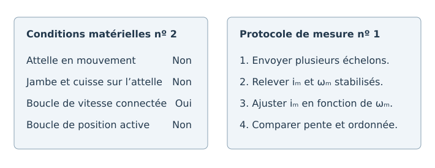

# Centrale-Supélec MP — Sciences industrielles 2024 · Corrigé guidé

*Corrigé rédigé par IA, non officiel. Signalez toute erreur.*

## Présentation du sujet

L’option S2I MP 2024 étudie un arthromoteur qui mobilise le genou selon un profil de consigne. Les 28 questions relient cinématique, régression linéaire, identification des frottements, asservissements de vitesse et de position et validation expérimentale. Les exigences, la structure du dispositif et les chaînes fonctionnelles sont annexées au sujet.

Sur les quatre heures de l’épreuve, les premières questions de cinématique fournissent un point d’entrée. Gardez du temps pour la régression et le récapitulatif en Q16, puis pour lire les courbes et comparer les réglages en Q23–25.

## I — Mise en situation et problématique

### Question 1

> [!INDICATION]
> Calculez la durée d’une rampe puis l’aire du trapèze de vitesse.

#### Solution

Notons $A=\ddot\theta_{gcm}>0$ le module de l’accélération de consigne. La montée de zéro à $\omega_0$ prend **$t_1=\omega_0/A$** et la descente dure autant. L’aire du profil de flexion est le déplacement angulaire $\theta_f-\theta_i$,
$$
\theta_f-\theta_i=\tfrac12\omega_0t_1+\omega_0(T-2t_1)+\tfrac12\omega_0t_1.
$$
Ainsi **$T=(\theta_f-\theta_i)/\omega_0+\omega_0/A$**. En extension, on reprend le profil opposé entre les deux pauses. Avec les unités du sujet, les durées sont en minutes. L’intégrale de la consigne, avec l’angle initial approprié, donne la consigne de position. Le plateau est réalisable si $T\geq2t_1$, donc si $\theta_f-\theta_i\geq\omega_0^2/A$. En dessous, un profil triangulaire est possible avec un pic de vitesse inférieur à $\omega_0$.

### Question 2

> [!INDICATION]
> Mesurez un écart vertical et la pente de la courbe mesurée sur le segment central.

#### Solution

Pour l’exigence **1.2.1**, la figure 6 donne en flexion vers $15\ \mathrm s$ environ $76^\circ$ en consigne et $70{,}5^\circ$ en mesure. L’erreur de l’ordre de $5{,}5^\circ$ dépasse les $2^\circ$ autorisés. En extension le retard change le signe de $\varepsilon$ et atteint aussi plusieurs degrés en module.

Pour **1.2.3**, la pente de la consigne sur la portion rectiligne est d’environ $4{,}0\ \mathrm{{}^\circ\,s^{-1}}$, soit $240\ \mathrm{{}^\circ\,min^{-1}}$.

La courbe mesurée passe approximativement de $52^\circ$ à $70{,}5^\circ$ en cinq secondes, soit environ $222\ \mathrm{{}^\circ\,min^{-1}}$. L’écart d’environ $18\ \mathrm{{}^\circ\,min^{-1}}$ dépasse la tolérance de $5\ \mathrm{{}^\circ\,min^{-1}}$. Le réglage initial échoue sur les deux critères.

> [!JURY]
> Le jury attend une pente et un écart de vitesse exprimés dans une même unité.

## II — Modélisation de la commande angulaire

### Question 3

> [!INDICATION]
> Suivez l’origine de chacun des deux retours de mesure.

#### Solution

Dans la chaîne d’information, **1** est le pupitre de commande, **2** le capteur de vitesse angulaire du moteur, **3** le capteur d’angle du genou. Dans la chaîne de puissance, **4** est le moteur électrique, **5** le réducteur et **6** le dispositif vis-écrou. Le flux **7**, prélevé sur l’arbre avant le réducteur, transmet la vitesse angulaire mécanique $\omega_m$. Le flux **8**, prélevé sur l’attelle, transmet l’angle du genou $\theta_g$. Les capteurs convertissent ensuite ces grandeurs en informations de mesure.

## III — Détermination des paramètres de la carte de commande

### III.A — Modèle cinématique de l’attelle

### Question 4

> [!INDICATION]
> Recomposez l’angle orienté de l’axe crural vers l’axe jambier.

#### Solution

L’angle absolu de $\vec x_3$ vaut $\theta_3-\alpha_3$, puisque $\theta_3$ est repéré sur $\vec x'_3$. Celui de $\vec x_4$ vaut $\theta_4$. Par composition,
$$
\boxed{\theta_g=\theta_3-\alpha_3-\theta_4.}
$$

### Question 5

> [!INDICATION]
> Éliminez l’angle du bras 6 en imposant la longueur de BO.

#### Solution

La fermeture $\overrightarrow{O_1A}+\overrightarrow{AB}+\overrightarrow{BO}=\overrightarrow{O_1O}$ donne
$$
\begin{aligned}
L_6\cos\theta_6&=L_0-\lambda-L_3\cos\theta_3,\\
L_6\sin\theta_6&=-h-h_0-L_3\sin\theta_3.
\end{aligned}
$$
En élevant au carré et en additionnant, puis en choisissant la branche $\cos\theta_6\geq0$ de la configuration dessinée,
$$
\boxed{\lambda=L_0-L_3\cos\theta_3
-\sqrt{L_6^2-(h+h_0+L_3\sin\theta_3)^2}.}
$$
Le radicand est positif ou nul sur la branche accessible.

### Question 6

> [!INDICATION]
> Annulez les deux dérivées partielles du coût.

#### Solution

La dérivée par rapport à $a$ est le produit des résidus par $-2\lambda_k$, sommés. Celle par rapport à $b$ est la somme des résidus multipliée par $-2$. On obtient les équations normales
$$
\begin{aligned}
a\sum_k\lambda_k^2+b\sum_k\lambda_k&=\sum_k\lambda_k\theta_{gk},\\
a\sum_k\lambda_k+nb&=\sum_k\theta_{gk}.
\end{aligned}
$$
Le coût, somme de carrés de fonctions affines, est convexe. Toute solution des équations normales est donc un minimum.

### Question 7

> [!INDICATION]
> Éliminez b grâce à la deuxième équation et repérez le cas où toutes les abscisses coïncident.

#### Solution

Avec $S_x=\sum_k\lambda_k$, $S_y=\sum_k\theta_{gk}$, $S_{xx}=\sum_k\lambda_k^2$ et $S_{xy}=\sum_k\lambda_k\theta_{gk}$, on obtient
$$
\begin{aligned}
a&=\frac{nS_{xy}-S_xS_y}{nS_{xx}-S_x^2},\\
b&=\frac{S_y-aS_x}{n}.
\end{aligned}
$$
Le dénominateur est $n\sum_k(\lambda_k-S_x/n)^2$. Il est strictement positif si au moins deux abscisses diffèrent, condition d’unicité de la pente et de l’ordonnée à l’origine. Si toutes coïncident, seule la valeur de la droite à cette abscisse est déterminée.

### Question 8

> [!INDICATION]
> Accumulez une contribution par élément. Pour les produits, parcourez les indices communs.

#### Solution

Les deux premières fonctions parcourent directement la liste. La troisième exploite l’hypothèse que les deux listes ont la même longueur.

```python
def Sum_Li(Li):
    somme = 0.0
    for valeur in Li:
        somme = somme + valeur
    return somme


def Sum_Li_2(Li):
    somme = 0.0
    for valeur in Li:
        somme = somme + valeur * valeur
    return somme


def Sum_XY(X, Y):
    somme = 0.0
    for k in range(len(X)):
        somme = somme + X[k] * Y[k]
    return somme
```

### Question 9

> [!INDICATION]
> Réutilisez les trois sommes de Q8 dans les formules de Q7.

#### Solution

La fonction suppose des listes de même longueur et au moins deux abscisses distinctes, comme les données de la régression de l’énoncé.

```python
def reg_lin(L, T):
    n = len(L)
    sx = Sum_Li(L)
    sy = Sum_Li(T)
    sxx = Sum_Li_2(L)
    sxy = Sum_XY(L, T)
    a = (n * sxy - sx * sy) / (n * sxx - sx * sx)
    b = (sy - a * sx) / n
    return a, b
```

### III.B — Modélisation, identification et réglage de la boucle de vitesse

### Question 10

> [!INDICATION]
> Classez les actions selon la frontière de l’ensemble et calculez leurs puissances.

#### Solution

**Puissances extérieures.** Le stator, extérieur à l’ensemble des pièces mobiles, fournit $C_m\omega_m$. Les actions de pesanteur donnent la somme des puissances des poids de la jambe et de la cuisse, soit $C_{\rm pes}\omega_m$ par définition. La pesanteur des composants d’attelle est négligée. Les actions des liaisons parfaites avec le bâti fixe sont de puissance nulle.

**Puissances intérieures.** Pour chaque liaison parfaite interne, la somme des puissances des deux actions réciproques est nulle, d’après la vitesse relative compatible. Les deux dissipations équivalentes rapportées à l’arbre fournissent
$$
\begin{aligned}
P_v&=-f_v\omega_m^2,\\
P_{\rm sec}&=C_{\rm sec}\omega_m=-K_{\rm sec}|\omega_m|.
\end{aligned}
$$
Ces deux puissances sont comptées une seule fois. Une part attribuée à un contact avec le bâti serait classée comme puissance extérieure dissipative et sortirait du bilan intérieur, sans changement de leur somme. Le stockage cinétique est modélisé par $E_c=J_{\rm eq}\omega_m^2/2$. En écrivant son bilan et en divisant par $\omega_m$ en mouvement, on retrouve l’équation (III.1).

> [!JURY]
> Identifiez les puissances relatives au système isolé et précisez les termes nuls.

### Question 11

> [!INDICATION]
> La pente et l’ordonnée à l’origine de la droite donnent deux effets distincts.

#### Solution

Sans patient et en flexion, $C_{\rm pes}=0$ et $C_{\rm sec}=-K_{\rm sec}$. Le régime permanent donne
$$
i_m=\frac{f_v}{k_t}\omega_m-\frac{C_{\rm sec}}{k_t}.
$$
La figure 14 fournit environ $(200;0{,}14)$ et $(800;0{,}20)$ en unités SI. La pente vaut $1{,}0\times10^{-4}\ \mathrm{A\,s\,rad^{-1}}$ et l’ordonnée à l’origine $0{,}12\ \mathrm A$.

Avec $k_t=0{,}0256\ \mathrm{N\,m\,A^{-1}}$, on obtient **$f_v\simeq2{,}56\times10^{-6}\ \mathrm{N\,m\,s\,rad^{-1}}$** et **$C_{\rm sec}\simeq-3{,}07\times10^{-3}\ \mathrm{N\,m}$**.

### Question 12

> [!INDICATION]
> Pendant l’identification de la motorisation seule, les couples sec et de pesanteur sont négligés.

#### Solution

L’équation sans les deux perturbations s’écrit $J_{\rm eqmot}\dot\omega_m+f_v\omega_m=k_t i_m$. Avec conditions initiales nulles,
$$
\begin{aligned}
H_m(p)&=\frac{\Omega_m(p)}{I_m(p)}\\
&=\frac{k_t}{J_{\rm eqmot}p+f_v}
=\frac{K_m}{1+\tau_mp}.\end{aligned}
$$
Ici $K_m=k_t/f_v$ et $\tau_m=J_{\rm eqmot}/f_v$.

### Question 13

> [!INDICATION]
> Fermez la boucle avec le correcteur proportionnel et un retour unitaire.

#### Solution

Le retour négatif unitaire donne $H_v=K_pH_m/(1+K_pH_m)$. La forme canonique est
$$
\boxed{H_v(p)=
\frac{K_pk_t}{f_v+K_pk_t}
\frac{1}{1+\dfrac{J_{\rm eqmot}}{f_v+K_pk_t}p}.}
$$
Le gain statique est le premier facteur et la constante de temps est $\tau_v=J_{\rm eqmot}/(f_v+K_pk_t)$.

### Question 14

> [!INDICATION]
> Lisez l’instant auquel la vitesse atteint 63,2 % de sa propre valeur finale.

#### Solution

La figure 17 donne une vitesse finale d’environ $282\ \mathrm{rad\,s^{-1}}$. Le niveau à 63,2 % est donc environ $178\ \mathrm{rad\,s^{-1}}$, atteint vers $0{,}04\ \mathrm s$. Avec les valeurs de Q11 et de l’énoncé,
$$
\boxed{J_{\rm eqmot}=\tau_v(f_v+K_pk_t)
\simeq 0{,}04(2{,}56\times10^{-6}+0{,}0094\times0{,}0256)
\simeq9{,}7\times10^{-6}\ \mathrm{kg\,m^2}.}
$$
La lecture graphique donne un ordre de grandeur de $10^{-5}\ \mathrm{kg\,m^2}$.

### Question 15

> [!INDICATION]
> Ramenez l’énergie de translation de l’attelle à la vitesse de l’arbre moteur.

#### Solution

En utilisant $\dot\lambda=K_vK_r\omega_m$, l’énergie de translation ramenée à l’arbre est $m_2(K_vK_r)^2\omega_m^2/2$. Ainsi
$$
\boxed{J_{\rm eq}=J_{\rm eqmot}+m_2(K_vK_r)^2.}
$$
Avec $m_2<0{,}49\ \mathrm{kg}$, $K_r=1/16$ et $K_v=5\times10^{-3}/(2\pi)\ \mathrm{m\,rad^{-1}}$, l’ajout est inférieur à $1{,}22\times10^{-9}\ \mathrm{kg\,m^2}$, soit environ $1{,}3\times10^{-4}$ de l’inertie du moteur. On peut donc utiliser $J_{\rm eq}\simeq J_{\rm eqmot}$.

### Question 16

> [!INDICATION]
> Isolez les frottements de la motorisation et faites plusieurs mesures permanentes.

#### Solution

**Figure 18 à compléter.** Choisir les conditions matérielles **N°2** et le protocole de mesure **N°1**. Cocher « non » pour attelle en mouvement et pour jambe et cuisse posées. Cocher « oui » pour boucle de vitesse connectée et « non » pour boucle de position connectée.

À plusieurs vitesses positives stabilisées, relever $i_m$ puis tracer la droite en fonction de $\omega_m$. Une ordonnée à l’origine proche de zéro valide la faible contribution du frottement sec moteur. Si la pente est proche de celle de la figure 14 dans les incertitudes de mesure, le frottement visqueux de l’attelle est négligeable. Les deux effets sont ainsi identifiés par des paramètres indépendants de la droite.



> [!JURY]
> Le rapport demande d’expliquer comment exploiter la pente et l’ordonnée à l’origine.

### Question 17

> [!INDICATION]
> Reliez le centre de gravité de la jambe au point fixe de la hanche.

#### Solution

Les données donnent $\overrightarrow{C_hG_j}=-L_{cu}\vec x_4-L_j\vec x_3$. En dérivant dans le repère fixe, sachant que les orientations absolues sont $\theta_4$ et $\theta_3-\alpha_3$, on obtient
$$
\boxed{\vec V_{G_j,3/0}=-L_{cu}\dot\theta_4\vec y_4-L_j\dot\theta_3\vec y_3.}
$$

### Question 18

> [!INDICATION]
> Projetez la vitesse trouvée en Q17 sur la direction opposée au poids.

#### Solution

La puissance est le produit scalaire du poids $-M_jg\vec y_0$ par la vitesse du centre de gravité de la jambe. Les projections de $\vec y_4$ et $\vec y_3$ sur $\vec y_0$ valent respectivement $\cos\theta_4$ et $\cos(\theta_3-\alpha_3)$. Donc
$$
\boxed{P_{\mathrm{pes}\to3/0}=M_jg
\bigl[L_{cu}\cos\theta_4\,\dot\theta_4+
L_j\cos(\theta_3-\alpha_3)\,\dot\theta_3\bigr].}
$$

### Question 19

> [!INDICATION]
> Composez les trois gains cinématiques de la vitesse moteur à celle du genou.

#### Solution

La vitesse du genou vaut $\dot\theta_g=a\dot\lambda=aK_vK_r\omega_m$. Avec la puissance donnée dans le sujet,
$$
\boxed{P_{\rm pes}=aK_vK_r\bigl[3{,}42\cos(\theta_3-\alpha_3)
-34{,}12\cos\theta_4\bigr]\omega_m(t).}
$$
Le facteur de $\omega_m$ est le couple équivalent $C_{\rm pes}$.

### Question 20

> [!INDICATION]
> Comparez les variations des deux termes du couple sur la trajectoire réelle, où les angles évoluent ensemble.

#### Solution

Le crochet de Q19 est négatif sur les intervalles donnés. Le terme de la cuisse domine en module. Au cours de la flexion, $\theta_3-\alpha_3$ augmente, tandis que $\theta_4$ diminue. La dérivée du crochet par rapport à $\theta_g$ dans le modèle linéarisé vaut
$$
-3{,}42K_3\sin(\theta_3-\alpha_3)+34{,}12K_4\sin\theta_4.
$$
Le premier terme est négatif, de module au plus $3{,}42\times0{,}34\sin21{,}51^\circ<0{,}43$. Le second est positif et vaut au moins $34{,}12\times0{,}66\sin30{,}35^\circ>11$. Le couple augmente donc et son module décroît. Le maximum de ce module est au début, pour **$\theta_3=23{,}8^\circ$ et $\theta_4=-30{,}35^\circ$**. La substitution donne $C_{\rm pes}\simeq-5{,}5\times10^{-3}\ \mathrm{N\,m}$, cohérent avec la valeur arrondie retenue pour la suite.

### Question 21

> [!INDICATION]
> Distinguez la fidélité du modèle à la mesure et la conformité de la mesure au cahier des charges.

#### Solution

**Écart simulé–mesuré.** Sur la figure 23, les deux courbes restent voisines pendant la montée et convergent vers environ $250\ \mathrm{rad\,s^{-1}}$. Elles entrent dans la bande à 5 % de leur valeur finale au bout d’environ $0{,}13\ \mathrm s$. Le modèle reproduit donc l’essai chargé pour ces deux performances.

**Écart mesuré–souhaité.** Le temps de réponse mesuré à 5 % de sa valeur finale est inférieur à $0{,}3\ \mathrm s$. En revanche, la consigne est $285\ \mathrm{rad\,s^{-1}}$, d’où une erreur permanente de l’ordre de $35\ \mathrm{rad\,s^{-1}}$ au lieu de zéro. La réponse n’entre jamais dans une bande de 5 % autour de la consigne elle-même. L’exigence de précision invalide le correcteur par défaut.

> [!JURY]
> Séparez l’écart simulé–mesuré de l’écart mesuré–souhaité.

### Question 22

> [!INDICATION]
> Écrivez le transfert en retour unitaire, puis comparez le dénominateur au second ordre canonique.

#### Solution

Le correcteur est $C_v=K_p+K_i/p$ et le procédé vaut $H_m=K_m/(1+\tau_mp)$. Sans perturbation, la boucle fermée donne
$$
H_v(p)=\frac{K_m(K_p p+K_i)}{\tau_m p^2+(1+K_mK_p)p+K_mK_i}.
$$
Pour $K_i>0$, la forme demandée s’obtient en divisant par $K_mK_i$,
$$
\begin{aligned}
\tau&=K_p/K_i,\\
\omega_0&=\sqrt{K_mK_i/\tau_m},\\
\xi&=\frac{1+K_mK_p}{2\sqrt{\tau_mK_mK_i}}.
\end{aligned}
$$
À $K_p$, $K_m$ et $\tau_m$ fixés, **augmenter $K_i$ réduit le facteur d’amortissement** du second ordre. Le zéro du numérateur se déplace également. La comparaison demandée utilise le facteur d’amortissement.

### Question 23

> [!INDICATION]
> Filtrez les courbes à partir du creux, du retour définitif à ±1 et de l’amortissement de Q22.

#### Solution

Les courbes de la figure 25 convergent vers un écart nul, conformément au rejet d’une perturbation constante par intégration.

Pour $K_i=0{,}06$ et $0{,}075$, les creux atteignent environ $15$ et $14{,}5\ \mathrm{rad\,s^{-1}}$ en module et la bande de $\pm1\ \mathrm{rad\,s^{-1}}$ n’est retrouvée de façon durable qu’après $0{,}3\ \mathrm s$.

Pour $K_i=0{,}09$, le retour se fait vers $0{,}28\ \mathrm s$, mais le creux est juste sous $-14\ \mathrm{rad\,s^{-1}}$ et dépasse le seuil en module. Les valeurs $0{,}11$ et $0{,}13$ respectent les trois critères.

D’après Q22, la plus petite de ces deux valeurs préserve le mieux l’amortissement à un échelon de consigne. On choisit **$K_i=0{,}11\ \mathrm{A\,rad^{-1}}$**. Pour ce choix, le creux est voisin de $-13{,}5\ \mathrm{rad\,s^{-1}}$ et le retour durable dans la bande intervient vers $0{,}23\ \mathrm s$.

> [!JURY]
> Deux valeurs respectent le tableau 3. Utilisez l’amortissement de Q22 pour les départager.

### III.C — Réglage du correcteur de position

### Question 24

> [!INDICATION]
> Lisez le gain à 3 rad/s puis convertissez la translation verticale en facteur multiplicatif.

#### Solution

Sur la figure 27, pour le réglage $K_{g,0}=2865\ \mathrm{s^{-1}}$, le gain à $3\ \mathrm{rad\,s^{-1}}$ se lit vers $-13$ à $-14\ \mathrm{dB}$. La boucle ouverte est proportionnelle à $K_g$. Pour passer à $0\ \mathrm{dB}$,
$$
K_g=K_{g,0}10^{-G_{\rm dB}(3)/20}.
$$
Avec une lecture centrale $-13{,}5\ \mathrm{dB}$, on obtient **$K_g\simeq1{,}36\times10^4\ \mathrm{s^{-1}}$**, soit de l’ordre de $1{,}3$ à $1{,}4\times10^4\ \mathrm{s^{-1}}$ à la précision du graphique.

## IV — Validation et synthèse

### Question 25

> [!INDICATION]
> Comparez le retard vertical et mesurez la pente hors des raccordements du trapèze.

#### Solution

**Exigence 1.2.1.** À $10\,\mathrm s$, les deux tracés de la figure 29 donnent environ $64{,}7^\circ$ pour la consigne et $63{,}0^\circ$ pour la mesure, soit un écart de l’ordre de $1{,}7^\circ$. Un examen sur toute la flexion montre un écart ponctuel d’environ $2{,}2^\circ$ vers $14{,}0\,\mathrm s$.

La limite supérieure fixée à $2^\circ$ est donc légèrement dépassée sur la trace. La précision graphique invite à qualifier l’écart, et l’essai ne suffit pas à établir une conformité stricte pendant toute la flexion.

**Exigence 1.2.3.** La pente moyenne de la mesure entre $5$ et $13\,\mathrm s$ est d’environ $235{,}7\ \mathrm{{}^\circ\,min^{-1}}$. Un ajustement sur la portion rectiligne donne environ $236\ \mathrm{{}^\circ\,min^{-1}}$. La vitesse est compatible avec la plage $[235;245]\ \mathrm{{}^\circ\,min^{-1}}$ et reste proche de sa borne basse. L’essai porte sur la flexion.

### Question 26

> [!INDICATION]
> Regardez si une régression sur une autre partie de la courbe conserve la même pente.

#### Solution

Le paramètre est le gain cinématique **$a=\mathrm d\theta_g/\mathrm d\lambda$** pris constant dans la figure 26. La figure 30 indique que la pente varie suivant la zone d’angle. Une plage de même amplitude mais translatée change donc le gain linéarisé représentatif.

### Question 27

> [!INDICATION]
> Suivez le gain a vers la sortie, puis identifiez les conséquences de la vitesse articulaire dans le calcul du couple résistant.

#### Solution

Pour un même mouvement du moteur, la vitesse du genou $\omega_g=aK_vK_r\omega_m$ varie avec $a$. Son intégrale, la position $\theta_g$ en sortie de la figure 26, varie aussi, et l’erreur de position $\varepsilon$ en dépend pour une même consigne. En outre, la perturbation de pesanteur rapportée au moteur $C_{\rm pes}$ contient ce gain en Q19 et dépend des positions des segments. L’étude fige $a$ et le couple équivalent pour la plage de rééducation retenue. Elle ne suit pas leur variation sur d’autres plages.

### Question 28

> [!INDICATION]
> Repérez quelle boucle contient directement le gain cinématique de l’attelle.

#### Solution

Le réglage **du correcteur de position $C_p$**, donc de $K_g$, est directement affecté. La boucle ouverte de position contient le gain $a$, en aval de la boucle de vitesse. À paramètres internes inchangés, modifier $a$ translate le gain fréquentiel et déplace la coupure à $0\ \mathrm{dB}$. Il faut donc reprendre le réglage si l’objectif de coupure est conservé.

La boucle de vitesse est fermée sur $\omega_m$ avant le bloc $a$. Le nouveau gain cinématique ne change pas directement son transfert nominal. Une variation des perturbations due à une autre plage doit toutefois être recontrôlée si elle dépasse le cas de charge retenu pour dimensionner le rejet.

## Bilan

- Intégrez une vitesse pour calculer un déplacement. En validation expérimentale, utilisez la pente d’une portion rectiligne pour estimer la vitesse.
- Séparez la pente et l’ordonnée à l’origine pour identifier les contributions visqueuse et sèche.
- Vérifiez séparément la fidélité au réel et la conformité aux exigences. Un gain identifié localement doit être revérifié avant de transposer le réglage.

FIN
