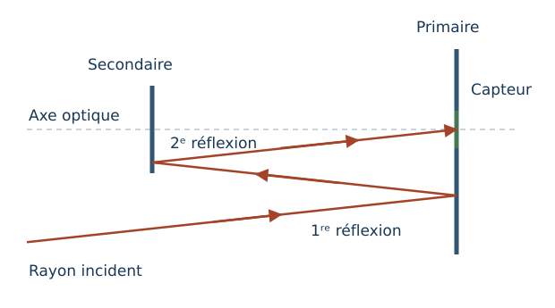
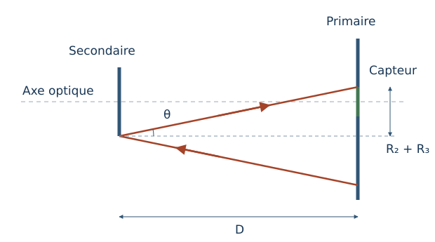

# Centrale-Supélec MPI — Physique-chimie 1 2024 · Corrigé guidé

*Corrigé rédigé par IA, non officiel. Signalez toute erreur.*

## Présentation du sujet

L’épreuve dure quatre heures, calculatrice autorisée. Le télescope James Webb sert à étudier le décalage spectral et la loi de Hubble, l’optique des miroirs et leur rayonnement thermique, puis la stabilité autour du point de Lagrange L₂.

Les Q1–Q8, Q15, Q18–Q22 et Q27–Q34 offrent des points de départ indépendants. Pour Q9–Q14, contrôlez les conversions et séparez incertitude de mesure et dispersion des données. Pour Q24–Q26, surveillez la dépendance en température des bornes réduites. Dans la dernière partie, cherchez un mode croissant avant d’estimer un temps caractéristique.

## I — Voir l’Univers en infrarouge

### I.A — Décalage vers le rouge

### Question 1

> [!INDICATION]
> Calculez le temps de propagation du premier pic dans le référentiel de l’observateur.

#### Solution

Le premier pic est émis à $t=0$ à distance $d$. Il parcourt cette distance à la célérité $c$, indépendamment du mouvement ultérieur de l’émetteur. Ainsi **$t_1=d/c$**.

### Question 2

> [!INDICATION]
> Tenez compte de la nouvelle distance à la date d’émission du second pic.

#### Solution

Le deuxième pic est émis à $T_0$ alors que l’émetteur se trouve à $d+vT_0$. On obtient
$$
\boxed{t_2=T_0+\frac{d+vT_0}{c}.}
$$

### Question 3

> [!INDICATION]
> Évaluez l’écart entre les deux réceptions, puis inversez la période.

#### Solution

La période mesurée vaut $t_2-t_1=T_0(1+v/c)$. Dans le modèle non relativiste de la question, on identifie la période d’émission dans le référentiel de l’observateur à $1/f_0$. Ainsi **$f_{\rm mes}=f_0/(1+v/c)$**.

### Question 4

> [!INDICATION]
> Appliquez $\lambda=c/f$ aux deux fréquences.

#### Solution

Puisque les deux ondes se propagent dans le vide, $\lambda_{\rm mes}/\lambda_0=f_0/f_{\rm mes}$. Donc **$\lambda_{\rm mes}=\lambda_0(1+v/c)$**.

### Question 5

> [!INDICATION]
> Comparez les unités du numérateur et du dénominateur.

#### Solution

Le numérateur et le dénominateur sont des longueurs. Le décalage $z$ est **sans dimension**.

### Question 6

> [!INDICATION]
> Reliez le signe de $v$ à la modification des longueurs d’onde.

#### Solution

Une source qui s’éloigne a $v>0$, d’où $\lambda_{\rm mes}>\lambda_0$. Le spectre se déplace vers les grandes longueurs d’onde, du côté du rouge dans le visible. Une lumière émise dans le visible peut ainsi être observée dans l’infrarouge. La sensibilité de JWST dans cette bande facilite la détection des astres fortement décalés.

### Question 7

> [!INDICATION]
> Reportez la longueur d’onde de Q4 dans la définition de $z$.

#### Solution

On a $z=[\lambda_0(1+v/c)-\lambda_0]/\lambda_0$, donc **$z=v/c$** à cet ordre.

### Question 8

> [!INDICATION]
> Développez les deux facteurs de la racine au premier ordre en $v/c$.

#### Solution

Posons $\beta=v/c$. Alors
$$
1+z=(1+\beta)^{1/2}(1-\beta)^{-1/2}=1+\beta+O(\beta^2).
$$
On retrouve $z\simeq v/c$ pour $|\beta|\ll1$, ce qui correspond à **$|z|\ll1$**.

> [!JURY]
> Le jury attend un développement au premier ordre et un domaine de validité exprimé en fonction de z.

### I.B — Loi de Hubble

### Question 9

> [!INDICATION]
> Distinguez la dispersion des mesures de l’incertitude-type de leur moyenne.

#### Solution

L’estimation de type A donne $u(\overline H)=s/\sqrt{24}$, avec $s=1988{,}8\ \mathrm{km\,s^{-1}\,Mpc^{-1}}$. On obtient $u(\overline H)\simeq406$ dans cette unité. La moyenne vaut $812{,}0$. Une écriture normalisée, à un chiffre significatif sur l’incertitude, est
$$
\boxed{H=(8\pm4)\times10^2\ \mathrm{km\,s^{-1}\,Mpc^{-1}}.}
$$

> [!JURY]
> Le jury distingue l’écart-type des mesures de l’incertitude-type de leur moyenne.

### Question 10

> [!INDICATION]
> Remontez les vitesses de récession actuelles jusqu’à un départ commun dans un modèle uniforme.

#### Solution

Si la vitesse de récession actuelle est extrapolée constante dans le passé, la durée de parcours depuis le départ commun est $t=d/v$. La loi $v=Hd$ donne $t=1/H$ pour toute galaxie. L’inverse de $H$ est ainsi un temps caractéristique d’expansion. Il ne donne l’âge exact que dans le modèle d’expansion uniforme retenu pour cette estimation.

### Question 11

> [!INDICATION]
> Convertissez le mégaparsec en kilomètres avant d’inverser $H$.

#### Solution

Comme $1\ \mathrm{Mpc}\simeq3{,}08\times10^{19}\ \mathrm{km}$, la moyenne historique correspond à $H\simeq2{,}6\times10^{-17}\ \mathrm{s^{-1}}$. D’où **$1/H\simeq3{,}8\times10^{16}\ \mathrm s\simeq1{,}2$ milliard d’années**. Cet âge central est inférieur aux 4,5 milliards d’années du Système solaire, contradiction pour un âge de l’Univers. L’incertitude relative est forte et son inversion ne se traite pas comme un intervalle parfaitement symétrique. Les données historiques ne donnent pas une estimation satisfaisante.

### Question 12

> [!INDICATION]
> Examinez l’effet d’une erreur sur la vitesse d’une galaxie proche lorsqu’on forme $v/d$.

#### Solution

La division par une petite distance amplifie les vitesses particulières et les erreurs de mesure. Les deux valeurs extrêmes du graphe de $v/d$ proviennent ainsi des distances les plus petites. La régression directe de $v$ sur $d$ estime la pente pertinente sans cette division et donne $454\ \mathrm{km\,s^{-1}\,Mpc^{-1}}$.

La cohérence de la méthode se juge par les résidus sur l’ensemble des points et par leur compatibilité avec les incertitudes expérimentales. L’ordonnée ajustée vaut $-41\ \mathrm{km\,s^{-1}}$ environ, alors que le modèle idéal prévoit zéro. Sans son incertitude et sans celles des mesures, on ne peut statuer quantitativement sur cette différence. Un ajustement pondéré serait indiqué si les incertitudes sur les vitesses différaient fortement.

> [!JURY]
> La cohérence des données et des incertitudes compte dans la comparaison des méthodes.

### Question 13

> [!INDICATION]
> Combinez la relation Doppler à faible vitesse et la loi de Hubble.

#### Solution

Pour $|z|\ll1$, $v\simeq cz$. Ainsi **$z\simeq Hd/c$**, soit $d\simeq cz/H$.

### Question 14

> [!INDICATION]
> Comparez les longueurs d’onde de plusieurs raies associées au même élément.

#### Solution

La raie $\mathrm{H\alpha}$ donne $z=(6970{,}19-6562{,}82)/6562{,}82\simeq0{,}0621$. La raie $\mathrm{H\beta}$ donne $0{,}0604$. Les autres raies confirment un ordre de grandeur de $0{,}061$. La distance est
$$
d\simeq\frac{(3{,}00\times10^5)\times0{,}061}{67}\ \mathrm{Mpc}
\simeq2{,}7\times10^2\ \mathrm{Mpc}.
$$
Avec $1\ \mathrm{pc}=3{,}26\ \mathrm{al}$, on obtient **$d\simeq8{,}9\times10^8\ \mathrm{al}$** dans ce modèle.

## II — Les miroirs

### II.A — Optique du télescope

### Question 15

> [!INDICATION]
> Précisez la position des rayons et leur inclinaison par rapport à l’axe.

#### Solution

Dans les conditions de Gauss, les rayons restent proches de l’axe optique et font avec lui de petits angles. On peut alors utiliser l’approximation paraxiale et un stigmatisme approché pour le système centré. Un miroir plan seul est rigoureusement stigmatique pour la conjugaison d’un point et de son symétrique.

### Question 16

> [!INDICATION]
> Placez le secondaire face au primaire, puis construisez deux réflexions successives.

#### Solution

Le miroir primaire et le capteur central sont pris dans un même plan. Le secondaire leur fait face. On choisit un rayon incident oblique arrivant sur le primaire hors de la zone d’ombre du secondaire. Chaque réflexion conserve la composante de direction parallèle au miroir et inverse la composante normale. Le rayon redirigé par le secondaire peut alors atteindre le capteur.

### Question 17

> [!INDICATION]
> Estimez la séparation des miroirs sur la vue de dessus et cherchez les rayons limites dans la géométrie plane.

#### Solution

Sur la figure 7, la distance entre les plans des miroirs représente environ un tiers de la longueur graduée $22\ \mathrm m$, d’où $D\simeq7$ à $8\ \mathrm m$. Dans la géométrie plane, le rayon limite atteint le bord du secondaire d’un côté et le bord du capteur de l’autre côté. Le décalage transversal sur ce trajet est $R_2+R_3=0{,}40\ \mathrm m$. Le prolongement après la première réflexion correspond à un point du primaire à distance $2R_2+R_3=0{,}77\ \mathrm m$ de son centre. Il est dans l’ouverture du primaire. À l’arrivée, ce rayon passe aussi hors de l’ombre du secondaire.

Le demi-angle géométrique vaut $\arctan[(R_2+R_3)/D]$, soit environ $3^\circ$. Le champ total est donc **environ $6^\circ$**, soit quelque $360'$ contre $2{,}2'$ annoncées. Cette ouverture est une estimation géométrique d’acceptation dans le modèle plan. Des miroirs plans ne focalisent pas des rayons parallèles, tandis que le télescope réel comporte une optique focalisante et un champ utile défini par son plan image.

### II.B — Rayonnement thermique des instruments

### Question 18

> [!INDICATION]
> Isolez $u(\nu)$ dans la relation donnant $\mathrm d\mathcal E$.

#### Solution

On divise une énergie par un volume et par une fréquence. L’unité SI est **$\mathrm{J\,m^{-3}\,Hz^{-1}}$**.

### Question 19

> [!INDICATION]
> Reliez le quantum d’énergie à sa fréquence.

#### Solution

La relation de Planck–Einstein donne **$\epsilon=h\nu$**.

### Question 20

> [!INDICATION]
> Inversez les bornes de longueur d’onde lors du passage en fréquence.

#### Solution

La borne basse correspond à $28\ \mathrm{\mu m}$, la borne haute à $0{,}6\ \mathrm{\mu m}$. Ainsi
$$
\begin{aligned}
\nu_1&=c/(28\ \mathrm{\mu m})\simeq1{,}07\times10^{13}\ \mathrm{Hz},\\
\nu_2&=c/(0{,}6\ \mathrm{\mu m})\simeq5{,}00\times10^{14}\ \mathrm{Hz}.
\end{aligned}
$$

### Question 21

> [!INDICATION]
> Intégrez la densité spectrale puis posez $\xi=h\nu/(k_BT)$.

#### Solution

Les bornes deviennent $\xi_i=h\nu_i/(k_BT)$ et $\mathrm d\nu=(k_BT/h)\mathrm d\xi$. Le produit $h\nu^3\mathrm d\nu$ devient $(k_BT)^4\xi^3\mathrm d\xi/h^3$. Ainsi
$$
\boxed{\mathcal E_{12}=V\frac{8\pi k_B^4T^4}{h^3c^3}
\int_{\xi_1}^{\xi_2}\frac{\xi^3\,\mathrm d\xi}{e^\xi-1}.}
$$

### Question 22

> [!INDICATION]
> Convertissez la contribution d’une tranche spectrale en nombre de photons avant d’intégrer.

#### Solution

Dans une tranche de largeur $\mathrm d\nu$, les photons ont une énergie $h\nu$ à l’ordre considéré. Leur nombre est donc $\mathrm dN=V u(\nu)\mathrm d\nu/(h\nu)$. En substituant $\xi=h\nu/(k_BT)$,
$$
\boxed{N_{12}=V\frac{8\pi k_B^3T^3}{h^3c^3}
\int_{\xi_1}^{\xi_2}\frac{\xi^2\,\mathrm d\xi}{e^\xi-1}.}
$$

### Question 23

> [!INDICATION]
> Divisez les deux intégrales, en gardant la dépendance en température de leurs bornes.

#### Solution

On trouve
$$
\boxed{\overline\epsilon=\frac{\mathcal E_{12}}{N_{12}}
=k_BT\,\frac{I_{[\xi_1,\xi_2]}}{J_{[\xi_1,\xi_2]}}.}
$$
Sur tout le spectre, ou à bornes réduites fixes, $I/J$ est constant et l’énergie moyenne croît linéairement avec $T$. Dans la bande physique fixe, les bornes $\xi_i$ sont proportionnelles à $1/T$. La croissance subsiste, mais la proportionnalité exacte disparaît.

En effet, la densité spectrale de photons est pondérée par $w_T(\nu)=\nu^2/(\exp(h\nu/k_BT)-1)$.

Quand $T$ augmente, la dérivée logarithmique $\partial_T\ln w_T=(1/T)\xi/(1-e^{-\xi})$ croît avec $\nu$. Une augmentation de $T$ favorise donc davantage les hautes fréquences et élève la moyenne de $h\nu$.

### Question 24

> [!INDICATION]
> Reliez la puissance émise à l’énergie volumique et examinez sur quelle bande l’intégrale est constante.

#### Solution

À géométrie fixée, un petit orifice laisse fuir une puissance proportionnelle à l’énergie volumique dans la bande. Pour un rayonnement isotrope, la moyenne angulaire du flux sortant donne le facteur $c/4$. D’après Q21, la puissance est donc proportionnelle à
$$
T^4 I_{[\xi_1(T),\xi_2(T)]}.
$$
L’exposant quatre est celui du produit du nombre de photons, en $T^3$, et de l’énergie moyenne, en $T$, lorsque les intégrales réduites sont constantes. C’est exact sur l’ensemble du spectre, ou à bornes réduites fixes. Pour la bande physique fixe de l’énoncé, cette loi fournit l’estimation simplifiée demandée si l’on néglige la variation de $I$. À $39\ \mathrm K$, cette approximation est grossière car $\xi_1$ vaut déjà environ $13$.

> [!JURY]
> Le rapport attend un lien entre le nombre de photons et leur énergie moyenne.

### Question 25

> [!INDICATION]
> Formez le rapport des puissances dans l’approximation en $T^4$, puis vérifiez la portée de ce modèle.

#### Solution

La loi simplifiée donne
$$
\boxed{\frac{P(333\ \mathrm K)}{P(39\ \mathrm K)}
\simeq\left(\frac{333}{39}\right)^4\simeq5{,}3\times10^3.}
$$
Pour la bande instrumentale fixe, le modèle de Planck donne en plus le facteur $I(333)/I(39)$. Les intégrales numériques valent environ $5{,}84$ et $5{,}49\times10^{-3}$, donnant un facteur de réduction dans cette bande de **$5{,}7\times10^6$**. Le refroidissement déplace une grande partie de l’émission au-delà de la bande considérée.

### Question 26

> [!INDICATION]
> Comparez les puissances de $T$ dans le nombre et l’énergie moyenne, puis vérifiez la bande du détecteur.

#### Solution

Dans l’estimation simplifiée, le nombre de photons est réduit d’un facteur $(333/39)^3\simeq620$, contre $333/39\simeq8{,}5$ pour l’énergie moyenne. La baisse du nombre de photons domine.

Dans la bande fixe, le calcul des intégrales donne un rapport d’environ $2{,}8\times10^6$ pour le nombre de photons et d’environ $2{,}0$ pour leur énergie moyenne. Le même mécanisme domine encore plus nettement.

## III — Point de Lagrange L₂

### Question 27

> [!INDICATION]
> Identifiez le référentiel d’origine solaire et d’axes dirigés vers les étoiles lointaines.

#### Solution

$\mathcal R_h$ est le **référentiel héliocentrique**.

### Question 28

> [!INDICATION]
> Donnez un critère inertiel et appliquez-le au repère tournant.

#### Solution

Un référentiel galiléen est un référentiel dans lequel un point isolé est au repos ou en mouvement rectiligne uniforme. $\mathcal R$ tourne par rapport au référentiel héliocentrique supposé galiléen. Cette rotation impose d’introduire des forces d’inertie pour y appliquer la loi de la dynamique. $\mathcal R$ est donc non galiléen.

### Question 29

> [!INDICATION]
> Inventoriez les deux attractions et les forces d’inertie en un point immobile du repère tournant.

#### Solution

Le télescope est immobile dans $\mathcal R$. Sa force de Coriolis est nulle et la force d’inertie d’entraînement pointe vers $+x$. En posant $d=d_{TS}$ et $r=r_{L2}$, la relation vectorielle est
$$
\boxed{-\frac{\mathcal G M_Sm}{(d+r)^2}\vec e_x
-\frac{\mathcal G M_Tm}{r^2}\vec e_x
+m\omega^2(d+r)\vec e_x=\vec0.}
$$

### Question 30

> [!INDICATION]
> Repérez une plage continue où la fonction change de signe.

#### Solution

Balayer des valeurs positives de $R$ en évitant les singularités. Repérer deux valeurs successives pour lesquelles les évaluations de $F$ ont des signes opposés et vérifier que $F$ est continue entre elles. Elles forment un encadrement utilisable par Brent. On peut resserrer le maillage près du changement de signe. Une valeur exactement nulle donne directement une solution.

### Question 31

> [!INDICATION]
> Multipliez la valeur réduite par la distance Terre–Soleil.

#### Solution

En multipliant $R=0{,}009$ par $d_{TS}=1{,}50\times10^8\ \mathrm{km}$, on obtient **$r_{L2}=1{,}35\times10^6\ \mathrm{km}$**.

### Question 32

> [!INDICATION]
> Écrivez la deuxième loi de Newton dans le repère relatif, en incluant les termes d’inertie.

#### Solution

Dans le référentiel tournant, le principe fondamental de la dynamique s’écrit
$$
m\vec a_{\rm rel}=\vec F_S+\vec F_T-m\vec a_{\rm entr}
-2m\vec\omega\times\vec v_{\rm rel}.
$$
La rotation est uniforme et l’origine est fixe dans le référentiel héliocentrique adopté. L’accélération d’entraînement est donc $\vec\omega\times(\vec\omega\times\overrightarrow{SM})$. Le système proposé provient d’une linéarisation des termes spatiaux au premier ordre autour de l’équilibre.

### Question 33

> [!INDICATION]
> Développez le produit vectoriel avec $\vec\omega=\omega\vec e_z$.

#### Solution

La force de Coriolis par unité de masse est $-2\omega\vec e_z\times(\dot\varepsilon_x\vec e_x+\dot\varepsilon_y\vec e_y+\dot\varepsilon_z\vec e_z)$.

Puisque $\vec e_z\times\vec e_x=\vec e_y$ et $\vec e_z\times\vec e_y=-\vec e_x$, ses projections sont **$2\omega\dot\varepsilon_y$** suivant $x$ et **$-2\omega\dot\varepsilon_x$** suivant $y$.

### Question 34

> [!INDICATION]
> Identifiez le comportement de la perturbation verticale et son couplage avec les deux autres composantes.

#### Solution

L’équation verticale $\ddot\varepsilon_z+4\omega^2\varepsilon_z=0$ est indépendante des deux équations horizontales. Ses solutions restent bornées et oscillent à $2\omega$. Elle ne crée donc aucune croissance exponentielle. La recherche de l’instabilité se ramène au système plan, même si une perturbation arbitraire hors du plan engendre un mouvement vertical.

> [!JURY]
> Le rapport distingue un mouvement plan d’une analyse de stabilité qui peut se limiter à la dynamique plane.

### Question 35

> [!INDICATION]
> Remplacez les dérivées d’ordre un et deux par $p$ et $p^2$.

#### Solution

On substitue la forme exponentielle et on simplifie le facteur commun $e^{pt}$. Le système d’amplitudes devient
$$
\boxed{\begin{aligned}
(p^2-9\omega^2) A_x -2\omega p A_y &=0,\\
2\omega p A_x +(p^2+3\omega^2) A_y&=0.
\end{aligned}}
$$

### Question 36

> [!INDICATION]
> Annulez le déterminant, puis résolvez l’équation du second degré en $p^2$.

#### Solution

Pour un mode non trivial, le déterminant s’annule :
$$
(p^2-9\omega^2)(p^2+3\omega^2)+4\omega^2p^2
=p^4-2\omega^2p^2-27\omega^4=0.
$$
Ainsi $p^2/\omega^2=1\pm2\sqrt7$. Les quatre valeurs sont
$$
\boxed{\begin{aligned}
p&=\pm\omega\sqrt{1+2\sqrt7},\\
p&=\pm i\omega\sqrt{2\sqrt7-1}.
\end{aligned}}
$$
La racine réelle positive produit un mode exponentiellement croissant. L’équilibre est **instable**.

### Question 37

> [!INDICATION]
> Déterminez le temps caractéristique du mode croissant à partir de sa racine réelle positive.

#### Solution

La racine positive vaut $p_+=\omega\sqrt{1+2\sqrt7}$. Avec les données, $\omega\simeq2{,}0\times10^{-7}\ \mathrm{s^{-1}}$ et
$$
\boxed{\tau=\frac1{p_+}\simeq2{,}0\times10^6\ \mathrm s\simeq23\ \mathrm{jours}.}
$$
Une perturbation croissante est multipliée par $e$ sur cette durée. Le seuil effectivement retenu dépend de la perturbation initiale et de l’écart admissible, mais l’ordre de grandeur est quelques semaines.

### Question 38

> [!INDICATION]
> Reliez la géométrie du système Soleil–Terre–JWST à la protection thermique.

#### Solution

Vu depuis le voisinage de $L_2$, le Soleil, la Terre et la Lune restent dans un secteur voisin. Le même pare-soleil permet de protéger les instruments de leur rayonnement et de faciliter leur refroidissement. Le télescope accompagne la Terre autour du Soleil, ce qui conserve cette géométrie, même si une orbite autour de $L_2$ nécessite des corrections.

## Bilan

- Comparez les temps de réception pour établir le décalage, puis utilisez la loi de Hubble dans le domaine des faibles décalages. Une régression et une moyenne de rapports ne pondèrent pas les données de la même manière.
- La bande instrumentale fixe des bornes en fréquence. Après changement de variable, leurs valeurs réduites dépendent de la température.
- Dans le référentiel tournant, la dynamique exige les forces d’inertie. Le signe de la partie réelle d’un mode exponentiel détermine son comportement au voisinage de l’équilibre.

FIN
