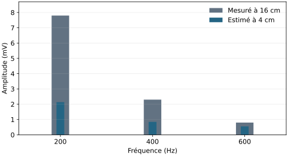
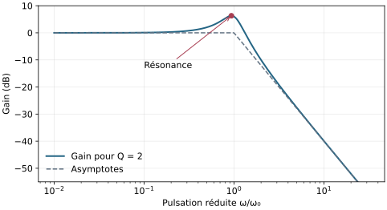
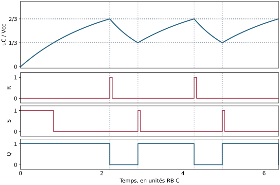

# CentraleSupélec MPI — Physique-Chimie 2 2024 · Corrigé guidé

*Corrigé rédigé par IA, non officiel. Signalez toute erreur.*

## Présentation du sujet

L’épreuve dure quatre heures avec calculatrice. Elle suit le signal d’une guitare électrique depuis l’induction dans le micro jusqu’au traitement numérique, en passant par le filtrage électrique et la propagation dans le câble coaxial. Les figures et la table logique sont intégrées à l’énoncé.

On peut consacrer 65 minutes à l’induction et au spectre, 50 au filtre, 50 au câble et 55 au traitement numérique, puis réserver 20 minutes à la relecture. Q1–Q5, Q15–Q20, Q29–Q31 et Q41–Q45 offrent des entrées proches du cours. Gardez du temps pour les lectures logarithmiques et la séquence de commutation de Q46–Q47.

## I — Microphone

### Question 1

> [!INDICATION]
> Reliez la vibration de la corde à un changement de flux à travers la bobine.

#### Solution

La corde ferromagnétique en mouvement modifie le champ traversant la bobine. Le flux dépend de la position de la corde et varie donc au rythme de sa vibration. Une force électromotrice est alors induite.

### Question 2

> [!INDICATION]
> Fixez l’orientation du circuit avant d’écrire le signe.

#### Solution

Pour un circuit orienté, la force électromotrice induite vaut $e=-\mathrm d\Phi/\mathrm dt$, où $\Phi$ est le flux du champ magnétique à travers une surface bordée par le circuit et orientée par lui. Le signe est celui de la loi de Lenz.

### Question 3

> [!INDICATION]
> Intégrez la composante normale du champ sur la surface d’une spire.

#### Solution

Pour une spire de surface orientée $S$, le flux est $\phi=\iint_S\vec B\cdot\mathrm d\vec S$, en webers.

### Question 4

> [!INDICATION]
> Projetez le champ du dipôle sur la normale à la spire avant d’intégrer sur le disque.

#### Solution

On note $\varrho$ la distance de $P$ à l’axe dans le plan de la spire. Le vecteur qui joint le dipôle à $P$ a une composante verticale $-z$ et une norme $s=\sqrt{\varrho^2+z^2}$. En projetant le champ donné sur $\vec e_z$, on trouve
$$
B_z=\frac{\mu_0 M}{4\pi}\frac{2z^2-\varrho^2}{(\varrho^2+z^2)^{5/2}}.
$$
Pour la spire orientée avec la normale $+\vec e_z$,
$$
\begin{aligned}
\phi&=\frac{\mu_0 M}{2}\int_0^R
\frac{\varrho(2z^2-\varrho^2)}{(\varrho^2+z^2)^{5/2}}\,\mathrm d\varrho\\
&=\frac{\mu_0 M}{2}
\left[\frac{\varrho^2}{(\varrho^2+z^2)^{3/2}}\right]_0^R
 =\frac{\mu_0 M R^2}{2(R^2+z^2)^{3/2}}.
\end{aligned}
$$

### Question 5

> [!INDICATION]
> Appliquez la règle de dérivation composée, puis additionnez les contributions des spires.

#### Solution

Les $N$ spires lient le même flux. Par la loi de Faraday,
$$
e=-N\frac{\mathrm d\phi}{\mathrm dt}
=\frac{3N\mu_0MR^2}{2}\frac{z\dot z}{(R^2+z^2)^{5/2}}.
$$

### Question 6

> [!INDICATION]
> Évaluez le coefficient au point moyen et utilisez l’amplitude de la vitesse.

#### Solution

Pour une vibration de pulsation $\omega=2\pi f$, la vitesse a pour amplitude $\omega z_0\simeq3{,}14\,\mathrm{m\,s^{-1}}$. En évaluant le coefficient de $\dot z$ autour de $z=5\,\mathrm{mm}$, on obtient une amplitude de $8{,}5\times10^{-2}\,\mathrm V$, de l’ordre de $0{,}1\,\mathrm V$.

### Question 7

> [!INDICATION]
> Comparez le coefficient aux deux extrêmes de l’oscillation et à sa valeur centrale.

#### Solution

La réponse exacte est non linéaire, puisque le coefficient de $\dot z$ varie avec $z$. Ici $z$ oscille entre 4 et 6 mm. Sur cet intervalle, ce coefficient varie de moins de 4 % par rapport à sa valeur centrale. Il est stationnaire à $z=R/2=5\,\mathrm{mm}$. Le modèle linéarisé $e\simeq K\dot z$, avec $K$ constant au point moyen, est donc précis pour cette vibration.

### Question 8

> [!INDICATION]
> Pensez à la longueur de l’arc portée par une petite variation angulaire.

#### Solution

L’élément d’aire polaire est $\mathrm dS=r\,\mathrm dr\,\mathrm d\theta$. La surface orientée s’obtient en le multipliant par $\vec e_z$.

### Question 9

> [!INDICATION]
> Écrivez les deux intervalles du disque en coordonnées polaires.

#### Solution

$$
\phi(y)=\int_0^{2\pi}\int_0^R B_z(r,\theta,y)\,r\,\mathrm dr\,\mathrm d\theta .
$$

### Question 10

> [!INDICATION]
> Remplacez l’intégrale par une somme de valeurs représentatives multipliées par les aires élémentaires.

#### Solution

On divise le domaine en petites cellules, on évalue l’intégrande en un point de chaque cellule et on le multiplie par l’aire de cette cellule dans les variables d’intégration. La somme approche l’intégrale. Ici, en variables $(r,\theta)$, le jacobien $r$ est inclus dans l’intégrande. Le choix des milieux évite d’évaluer les extrémités.

### Question 11

> [!INDICATION]
> Construisez une double boucle sur les deux coordonnées. Incluez le facteur géométrique.

#### Solution

Le code utilise le rayon $R$ en mètres et la fonction $B$ fournie. Le résultat est un flux par spire.

```python
from math import pi

def phi(y: float) -> float:
    nr, nt = 80, 160
    dr = R / nr
    dtheta = 2 * pi / nt
    total = 0.0
    for i in range(nr):
        radius = (i + 0.5) * dr
        for j in range(nt):
            theta = (j + 0.5) * dtheta
            total += B(radius, theta, y) * radius
    return total * dr * dtheta
```

### Question 12

> [!INDICATION]
> Générez les abscisses en mètres avant de les passer à la fonction de flux.

#### Solution

Avec la fonction de Q11, on peut tracer la courbe en prenant un pas uniforme en mètres et en convertissant les abscisses à l’affichage.

```python
import numpy as np
import matplotlib.pyplot as plt

positions = np.linspace(-0.01, 0.01, 101)
flux = [phi(float(y)) for y in positions]
plt.plot(100 * positions, flux)
plt.xlabel("y (cm)")
plt.ylabel("Flux par spire (Wb)")
plt.show()
```

### Question 13

> [!INDICATION]
> Comparez le flux à deux instants séparés d’une demi-période en utilisant sa symétrie.

> [!JURY]
> Le rapport 2024 indique que cette question dépasse le programme. La symétrie du flux permet néanmoins de déduire la périodicité du signal.

#### Solution

Pour une vibration centrée en $y=0$, le flux est pair, comme le montre la figure 4. Avec $y(t)=y_0\sin(2\pi f t)$, une demi-période change le signe de $y$ et laisse le flux inchangé. La tension, dérivée du flux, a donc des raies à $2f,4f,6f,\ldots$, sans terme continu. Pour une petite amplitude, le terme quadratique du flux domine et la raie à $400\,\mathrm{Hz}$ est dominante. Un décentrage ferait en général apparaître la fréquence $f$.

### Question 14

> [!INDICATION]
> Comparez la valeur du même mode stationnaire aux deux positions. Examinez les raies compatibles avec le fondamental.

#### Solution

La fréquence fondamentale de la corde lue sur la figure est proche de $200\,\mathrm{Hz}$. Pour chaque mode $n$, la petite vitesse verticale locale est proportionnelle à $\sin(n\pi x/L)$. En supposant les deux micros de même sensibilité, on multiplie l’amplitude mesurée à 16 cm par
$$
\left|\frac{\sin(n\pi\,4/67)}{\sin(n\pi\,16/67)}\right|.
$$
Les raies à 200, 400 et 600 Hz, lues à environ 7,8, 2,3 et 0,8 mV, passent respectivement à 2,1, 0,85 et 0,55 mV. Les petites raies proches de 50 et 150 Hz ne suivent pas la série modale identifiée. Leur évolution ne se déduit pas du modèle de corde.



Le rapprochement d’une attache réduit ici les trois amplitudes, avec un effet plus marqué sur le fondamental. Les fréquences sont conservées et leurs poids relatifs changent, donc le timbre change.

## II — Aspect électrique

### Question 15

> [!INDICATION]
> Remplacez séparément bobine et condensateur par leurs limites à basse et haute fréquence.

#### Solution

À basse fréquence, le condensateur se comporte comme un circuit ouvert et l’inductance comme un fil. Le courant tend vers zéro et $s\simeq e$. À haute fréquence, le condensateur court-circuite la sortie et $s/e\to0$. Le micro réalise un passe-bas.

### Question 16

> [!INDICATION]
> Utilisez les impédances de la maille et repérez le dipôle sur lequel se mesure la sortie.

#### Solution

La sortie est la tension aux bornes du condensateur, dans la maille série. Le diviseur d’impédances donne
$$
H(j\omega)=\frac{1/(j\omega C)}{R+j\omega L+1/(j\omega C)}
=\frac1{1-LC\omega^2+jRC\omega}.
$$

### Question 17

> [!INDICATION]
> Identifiez le terme quadratique et le terme linéaire en pulsation.

#### Solution

L’identification donne $H_0=1$, $\omega_0=1/\sqrt{LC}$ et $Q=\sqrt{L/C}/R$.

### Question 18

> [!INDICATION]
> Cherchez le minimum du carré de l’inverse du gain.

#### Solution

En posant $x=\omega/\omega_0$, le carré de l’inverse du module vaut $(1-x^2)^2+x^2/Q^2$. Sa dérivée est $2x(2x^2-2+1/Q^2)$. Le minimum non nul en fréquence existe si $Q>1/\sqrt2$ et se trouve en
$$
\omega_r=\omega_0\sqrt{1-\frac1{2Q^2}} .
$$

### Question 19

> [!INDICATION]
> Placez le repère de résonance entre les deux comportements asymptotiques et indiquez les axes.

#### Solution

Sur une abscisse logarithmique, le gain $20\log_{10}|H|$ part de $0\,\mathrm{dB}$, atteint un maximum en $\omega_r$ et décroît avec une asymptote de pente $-40\,\mathrm{dB}$ par décade.



### Question 20

> [!INDICATION]
> Mesurez séparément amplitude d’entrée et amplitude de sortie à chaque fréquence.

#### Solution

On applique une entrée sinusoïdale mesurée, on attend le régime établi et on mesure simultanément amplitudes d’entrée et de sortie, ainsi que leur déphasage si nécessaire. On répète l’opération en balayant les fréquences. On reporte $20\log_{10}(A_s/A_e)$ et éventuellement la phase en fonction du logarithme de la fréquence.

### Question 21

> [!INDICATION]
> Demandez-vous comment accéder à la source interne du modèle sans exciter aussi la corde.

#### Solution

La force électromotrice $e$ est produite à l’intérieur du bobinage. On ne dispose ni d’un port séparé où l’imposer avec un générateur, ni d’une mesure indépendante de son amplitude lors d’un balayage. Exciter la corde mesurerait la chaîne mécanique et électromagnétique complète. On caractérise plutôt le dipôle par une mesure d’impédance.

### Question 22

> [!INDICATION]
> Réduisez le circuit au continu et repérez un pont diviseur.

#### Solution

Au continu, $C$ est ouverte et $L$ équivaut à un fil. Il reste un diviseur formé de $R$ en série et de $r$ vers la masse. Le gain statique vaut $r/(R+r)$. Le potentiomètre règle le niveau de sortie et, en chargeant le condensateur, influe aussi sur l’amortissement du pic.

### Question 23

> [!INDICATION]
> Identifiez les deux branches montées en parallèle.

#### Solution

La branche $R+j\omega L$ est en parallèle avec le condensateur. D’où
$$
Z=\frac{R+j\omega L}{1-LC\omega^2+jRC\omega}.
$$

### Question 24

> [!INDICATION]
> Éliminez le courant commun aux deux dipôles.

#### Solution

Le résistor et le micro sont traversés par le même courant complexe $I$, donc $U_Z=ZI$ et $U_r=rI$. Le quotient donne $Z=rU_Z/U_r$.

### Question 25

> [!INDICATION]
> Utilisez le premier plateau de chaque courbe et le facteur de conversion donné par r.

#### Solution

Lorsque $\omega\to0$, l’inductance devient négligeable et le condensateur n’est plus parcouru. Donc $Z\simeq R$. Les plateaux de la figure 8 sont voisins de 1,4 pour Fender et 0,70 pour Dynasonic. Avec $r=10\,\mathrm{k\Omega}$, on lit $R_F\simeq14\,\mathrm{k\Omega}$ et $R_D\simeq7{,}0\,\mathrm{k\Omega}$.

### Question 26

> [!INDICATION]
> Au voisinage de 1 kHz, comparez le module de la branche série à sa partie résistive.

#### Solution

Dans la bande intermédiaire du relevé, $Z\simeq R+j\omega L$, donc $|Z|^2\simeq R^2+\omega^2 L^2$. On en déduit
$$
L\simeq\frac1{2\pi f}\sqrt{\left(r|U_Z/U_r|\right)^2-R^2}.
$$
À $1\,\mathrm{kHz}$, la lecture sur l’axe logarithmique de la figure 8 donne environ 5,7 pour Fender et 1,44 pour Dynasonic. Avec $r=10\,\mathrm{k\Omega}$ et les résistances lues en Q25, on obtient $L_F\simeq8{,}8\,\mathrm H$ et $L_D\simeq2{,}0\,\mathrm H$. Ces valeurs restent indicatives, surtout pour Fender, dont la résonance est assez proche de cette fréquence.

### Question 27

> [!INDICATION]
> Repérez où la partie réelle du dénominateur s’annule, puis convertissez la fréquence en pulsation.

#### Solution

Pour $Q\gg1$ et $\omega$ voisine de $\omega_0$, le numérateur normalisé est dominé par $jQ\omega/\omega_0$. On a alors
$$
Z\simeq\frac{jRQ}{1-(\omega/\omega_0)^2+j\omega/(Q\omega_0)} .
$$
Au sommet, la partie réelle du dénominateur s’annule à l’ordre dominant. En lisant $f_0$ au maximum, on évalue $C=1/[(2\pi f_0)^2L]$. Avec environ 3,1 kHz pour Fender et 24 kHz pour Dynasonic, les estimations sont $C_F\simeq3{,}0\times10^{-10}\,\mathrm F$ et $C_D\simeq2{,}2\times10^{-11}\,\mathrm F$.

### Question 28

> [!INDICATION]
> Comparez les fréquences des deux pics à la limite supérieure audible.

#### Solution

La figure d’impédance permet de repérer la fréquence de résonance du dénominateur commun à $Z$ et à $H$. Le pic Fender est près de $3\,\mathrm{kHz}$, dans les aigus audibles. Le pic Dynasonic est vers $24\,\mathrm{kHz}$, au-delà de la bande auditive usuelle. Le Fender peut donc accentuer des harmoniques hautes encore audibles. La hauteur de la note reste déterminée par la corde.

## III — Transmission dans un câble coaxial

### Question 29

> [!INDICATION]
> Séparez les deux divergences et les deux rotationnels, puis supprimez les termes de sources dans le vide.

#### Solution

En notation locale,
$$
\begin{aligned}
\nabla\cdot\vec E&=\rho/\varepsilon_0,& \nabla\cdot\vec B&=0,\\
\nabla\times\vec E&=-\partial_t\vec B,&
\nabla\times\vec B&=\mu_0\vec j+\mu_0\varepsilon_0\partial_t\vec E .
\end{aligned}
$$
Dans le vide, $\rho=0$ et $\vec j=\vec0$.

### Question 30

> [!INDICATION]
> Prenez le rotationnel de Maxwell–Faraday, puis utilisez la divergence électrique.

#### Solution

On prend le rotationnel de Maxwell-Faraday, puis on emploie Maxwell-Ampère et l’identité du double rotationnel. Dans le vide, $\nabla\cdot\vec E=0$. D’où
$$
\begin{aligned}\Delta\vec E-c^{-2}\partial_t^2\vec E&=\vec0,\\ c&=(\mu_0\varepsilon_0)^{-1/2}.\end{aligned}
$$

### Question 31

> [!INDICATION]
> Substituez la phase harmonique dans les équations du vide et examinez les directions des trois vecteurs.

#### Solution

Les équations de propagation de $\vec E$ et $\vec B$ donnent $k^2=\omega^2/c^2$. Pour une onde avançant vers $+z$, $\vec k=(\omega/c)\vec e_z$.

Les divergences imposent $\vec k\cdot\vec E=\vec k\cdot\vec B=0$. Les rotationnels donnent $\vec B=\vec k\times\vec E/\omega$.

Les champs sont transverses et orthogonaux, avec $B=E/c$ en norme et un transport d’énergie dirigé suivant $\vec k$.

### Question 32

> [!INDICATION]
> Examinez la composante oscillante du champ au sein d’un conducteur parfait.

#### Solution

Dans le modèle de conductivité infinie, le champ électrique interne s’annule pour un courant fini. En régime oscillant, Faraday interdit alors un champ magnétique oscillant dans le métal. Le courant associé à l’onde est porté par la surface séparant le métal du vide. On suppose qu’il n’existe aucun champ statique préexistant dans les parties conductrices du modèle.

### Question 33

> [!INDICATION]
> Choisissez une surface normale à l’axe et examinez le flux de déplacement.

#### Solution

On choisit un cercle centré sur $Oz$, dans un plan de cote $z$ fixé, orienté par $+\vec e_z$. Le théorème de Stokes appliqué à Maxwell-Ampère fait intervenir le courant de conduction traversant le disque et la dérivée du flux électrique. Le champ TEM étant radial, sa composante normale à ce disque est nulle. Ainsi $\oint_{\mathcal C}\vec B\cdot\mathrm d\vec l=\mu_0 i_{\rm enlacé}$.

### Question 34

> [!INDICATION]
> Comptez les intensités enlacées dans chacun des trois domaines de rayon.

#### Solution

Sur le cercle, la composante azimutale est uniforme. Pour $r<a$, aucun courant n’est enlacé. Pour $a<r<b$, seul $i$ est enlacé. Au-delà de $b$, le courant de retour annule le courant total. Ainsi
$$
\vec B=
\begin{cases}
\vec0,&r<a,\\
\dfrac{\mu_0 i_0}{2\pi r}\cos(\omega t-kz)\,\vec e_\theta,&a<r<b,\\
\vec0,&r>b.
\end{cases}
$$

### Question 35

> [!INDICATION]
> Dans Maxwell–Ampère, isolez la composante radiale et distinguez amplitude et signal réel.

#### Solution

La composante radiale de Maxwell-Ampère dans le vide donne $-\partial_z B_\theta=c^{-2}\partial_t E_r$. En représentation complexe, $jkB_0=j\omega E_0/c^2$. Ainsi
$$
\begin{aligned}
E_0(r)&=\frac{k i_0}{2\pi\varepsilon_0 r\,\omega},\\
E_r(r,z,t)&=E_0(r)\cos(\omega t-kz).
\end{aligned}
$$
Le cosinus imprimé dans l’expression demandée correspond au champ réel et ne fait pas partie de l’amplitude $E_0(r)$. Le jury signale cette coquille.

### Question 36

> [!INDICATION]
> Testez l’uniformité sur un plan transverse, puis appliquez Maxwell–Faraday.

#### Solution

Le mode est transverse, mais l’amplitude varie en $1/r$ et les directions radiale et azimutale dépendent du point. Le champ n’est donc pas uniforme sur un plan $z=\mathrm{constante}$ et l’onde n’est pas plane. La composante azimutale de Maxwell-Faraday donne $\partial_zE_r=-\partial_tB_\theta$. D’où $B_\theta=kE_r/\omega$ et $\vec B=\vec k\times\vec E/\omega$.

### Question 37

> [!INDICATION]
> Combinez les relations de structure pour relier k et la pulsation.

#### Solution

En combinant Q35 et Q36, $\omega^2=c^2 k^2$. Dans le sens $+z$, $v_\phi=\omega/k=c$ et ne dépend pas de la fréquence. Ce mode idéal n’est pas dispersif.

### Question 38

> [!INDICATION]
> Revenez aux champs réels pour calculer les produits quadratiques.

#### Solution

En utilisant les champs réels et $B_\theta=E_r/c$,
$$
\begin{aligned}
\vec\Pi&=\frac{E_r^2}{\mu_0 c}\,\vec e_z,\\
u_{\rm em}&=\frac{\varepsilon_0 E_r^2}2+\frac{B_\theta^2}{2\mu_0}=\varepsilon_0 E_r^2 .
\end{aligned}
$$
Ainsi $\vec\Pi=c\,u_{\rm em}\vec e_z$ et l’énergie se propage à la vitesse $c$.

### Question 39

> [!INDICATION]
> Moyennez dans le temps avant d’intégrer sur une section annulaire.

#### Solution

La moyenne temporelle de $\cos^2$ vaut $1/2$. Le flux de Poynting moyen à travers la couronne s’intègre avec $\mathrm dS=2\pi r\,\mathrm dr$. On trouve
$$
\overline{\mathcal P}=\frac{\mu_0 c\,i_0^2}{4\pi}\ln\frac ba .
$$

### Question 40

> [!INDICATION]
> Estimez la profondeur de peau à plusieurs fréquences de la bande audio et comparez aux tailles usuelles.

#### Solution

Dans un bon conducteur non magnétique, en négligeant le courant de déplacement, Maxwell et Ohm donnent une profondeur de peau $\delta=\sqrt{2/(\mu_0\sigma\omega)}$. Avec le cuivre, elle vaut environ $4{,}6\,\mathrm{mm}$ à 200 Hz, $2{,}1\,\mathrm{mm}$ à 1 kHz et $0{,}46\,\mathrm{mm}$ à 20 kHz. Le courant peut être traité comme surfacique si $\delta$ est bien plus petite que le rayon du conducteur intérieur et que l’épaisseur utile du blindage. Les dimensions ne sont pas données. Pour un câble audio de dimensions millimétriques, cette hypothèse n’est pas systématiquement satisfaite, surtout dans les graves. La conductivité élevée n’élimine donc pas les pertes ni la pénétration à basse fréquence.

## IV — Numérisation et traitement du signal

### Question 41

> [!INDICATION]
> Les entrées à haute impédance laissent le courant identique dans toute l’échelle de résistances.

#### Solution

Les entrées des comparateurs prélèvent un courant négligeable. Les quatre résistances identiques sont en série entre masse et $V_{cc}$ et chacune porte une chute $V_{cc}/4$. En partant du bas, on obtient $V_0=V_{cc}/4$, $V_1=V_{cc}/2$ et $V_2=3V_{cc}/4$.

### Question 42

> [!INDICATION]
> Étiquetez les sorties directes et logiques en poids fort et faible avant de construire la table.

#### Solution

Un comparateur délivre $S_i=1$ si $V_e>V_i$. Le fil direct fournit le bit de poids fort $b_1=S_1$. La sortie à droite de la porte OU est le bit de poids faible $b_0=S_2\lor(S_0\land\neg S_1)$. La figure 10 appelle cette seconde sortie $b_2$. On adopte les notations de la table imprimée, comme le permet le rapport.
$$
\begin{array}{c|ccc|cc}
V_e/V_{cc} & S_0&S_1&S_2&b_0&b_1\\ \hline
(0,1/4)&0&0&0&0&0\\
(1/4,1/2)&1&0&0&1&0\\
(1/2,3/4)&1&1&0&0&1\\
(3/4,1)&1&1&1&1&1
\end{array}
$$
Les valeurs exactement aux seuils dépendent de la convention du comparateur.

### Question 43

> [!INDICATION]
> Comptez les seuils nécessaires pour découper la plage d’entrée en tous les codes possibles.

#### Solution

Un flash à $n$ bits distingue $2^n$ intervalles séparés par $2^n-1$ seuils. À raison d’un comparateur par seuil, il en faut $2^{24}-1=16\,777\,215$.

### Question 44

> [!INDICATION]
> Exprimez d’abord le temps de fermeture disponible avant le front descendant.

#### Solution

Interrupteur fermé, le condensateur initialement déchargé vérifie $u_C(t)=V_e(1-e^{-t/(RC)})$ pour une entrée quasi constante. Le temps à 99 % est $t_{99}=RC\ln100\simeq4{,}61RC$. Si $D$ désigne la fraction de période pendant laquelle $K$ est fermé avant le front descendant, il faut
$$
RC<\frac{D}{f_e\ln100}.
$$
Pour une horloge de rapport cyclique 1/2, cette borne vaut $1/(2 f_e\ln100)$.

### Question 45

> [!INDICATION]
> Demandez-vous par où le condensateur pourrait se décharger pendant le maintien.

#### Solution

À l’ouverture, le courant d’entrée du suiveur idéal est nul et le condensateur conserve sa charge. La sortie reste à la dernière valeur de $u_C$ acquise avant l’ouverture. L’échantillonneur-bloqueur fournit ainsi une tension fixe pendant que le convertisseur travaille.

### Question 46

> [!INDICATION]
> Suivez les deux seuils en distinguant charge, mémorisation et décharge.

#### Solution

Sous $V_{cc}/3$, le comparateur inférieur active $S$. Au-dessus de $2V_{cc}/3$, le supérieur active $R$. Entre les seuils, la bascule mémorise son état.

Au démarrage $S=1$ et $Q=1$.

Avec $I$ ouvert, $C$ charge via $R_A+R_B$, franchit $V_{cc}/3$ et continue de charger avec $R=S=0$.

À $2V_{cc}/3$, $R$ passe à 1, $Q$ bascule à 0 et $I$ se ferme. Le condensateur se décharge alors via $R_B$.
Après le franchissement descendant du seuil haut, $R$ repasse à 0.

Au seuil bas, $S$ repasse à 1, $Q=1$ rouvre $I$ et un nouveau cycle commence.
Sur le modèle idéal, les commandes $R$ et $S$ après le démarrage sont des impulsions aux franchissements.



### Question 47

> [!INDICATION]
> Comparez les deux résistances vues pendant la charge et la décharge, puis envisagez l’inversion du signal.

#### Solution

En régime périodique, l’état haut dure $(R_A+R_B)C\ln2$ et l’état bas $R_B C\ln2$. Aucun choix de résistances positives ne rend l’état haut de $Q$ plus court que son état bas. Si l’on inverse la sortie de la bascule, choisir $R_A\gg R_B$ donne une suite de brèves impulsions hautes. Avec une sortie directe, un circuit de charge et de décharge séparées permettrait de choisir une résistance de charge bien plus petite que celle de décharge.

### Question 48

> [!INDICATION]
> Convertissez le décalage temporel en indice réel. Traitez explicitement les indices proches du bord.

#### Solution

On applique le signe de la formule imprimée. À l’indice $n$, l’autre terme s’évalue à l’indice réel $p=n+f_e[\tau+\mathrm{dtau}\sin(\omega n/f_e)]$. On interpole linéairement entre les deux échantillons voisins et on s’arrête lorsque l’enregistrement ne fournit plus la valeur requise. La description d’un retard physique correspondrait à un signe moins et à un traitement du bord initial.

```python
from math import floor, sin

def phaser(e: list, omega: float, tau: float, dtau: float) -> list:
    sortie = []
    dernier = len(e) - 1
    for n, valeur in enumerate(e):
        decalage = fe * (tau + dtau * sin(omega * n / fe))
        p = n + decalage
        if p < 0 or p > dernier:
            break
        k = floor(p)
        if k == dernier:
            seconde = e[k]
        else:
            fraction = p - k
            seconde = e[k] + fraction * (e[k + 1] - e[k])
        sortie.append(valeur + seconde)
    return sortie
```

## Bilan

Le micro convertit la vibration en tension par variation de flux. Sa position modifie le poids relatif des harmoniques et son impédance influence le filtrage. Le câble coaxial idéal guide un mode TEM sans dispersion. Après échantillonnage et maintien, le décalage numérique doit être évalué à un indice compatible avec l’enregistrement. Pour la relecture, vérifiez particulièrement les axes des courbes, la différence entre champ réel et amplitude complexe, ainsi que les conventions des deux sorties logiques.
