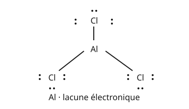
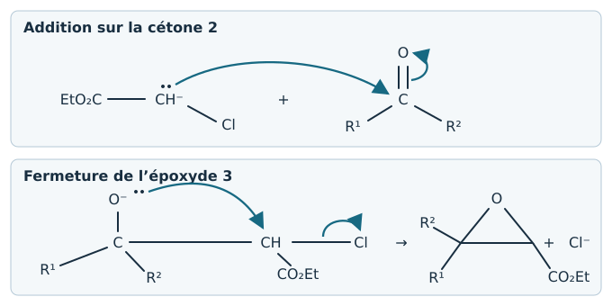
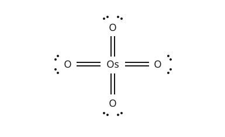
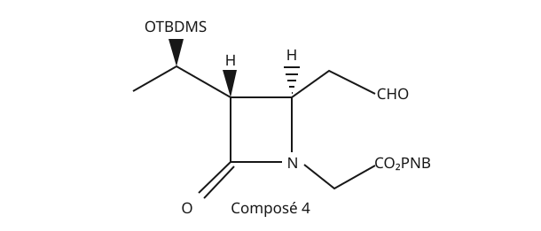

# Centrale-Supélec PC — Chimie 2024 · Corrigé brut

*Corrigé rédigé par IA, non officiel. Signalez toute erreur.*

## Présentation du sujet

L’épreuve de quatre heures avec calculatrice compare deux procédés de fabrication de l’ibuprofène puis étudie son dédoublement, son dosage et sa solubilisation. L’autre volet aborde la stabilité de l’imipénem et la synthèse de la thiénamycine. Les données et le tableau périodique sont intégrés en fin de sujet.

## I.A — Procédé Boots

### Question 1

La polarisation C=O rend chacun des carbones acyles électrophile. Dans l’acide éthanoïque, le doublet de l’oxygène de OH peut se délocaliser vers le carbonyle. Dans l’anhydride, la donation du doublet de l’oxygène pontant est répartie entre deux groupes acyles. Le carbone d’un acyle est davantage électrophile et l’ion éthanoate est en outre un meilleur groupe partant que l’ion hydroxyde.

### Question 2

La formule de Lewis monomère comporte trois liaisons simples Al–Cl et trois doublets libres sur chaque Cl. L’aluminium est entouré de six électrons et possède une lacune dans le modèle de Lewis. L’oxygène carbonylé de l’anhydride donne un doublet à Al. Cette coordination retire de la densité électronique au carbonyle et accroît l’électrophilie de son carbone. Elle facilite la formation d’une espèce acylante apparentée à l’ion acylium.



### Question 3

L’éthanolate arrache un proton en alpha du chloroéthanoate d’éthyle. Son choix préserve le groupe éthoxy de l’ester en cas d’échange. La formation de l’énolate en quantité même limitée suffit car sa réaction ultérieure le consomme.

La forme carbanionique de l’énolate attaque le carbone carbonylé de 2, tandis que la liaison pi du carbonyle se déplace vers O. Le doublet de l’alcoolate attaque ensuite par l’arrière le carbone portant Cl dans une substitution intramoléculaire. Le chlorure part et la liaison O–C ainsi créée ferme le cycle de l’époxyde 3.



### Question 4

L’hydrolyse remplace le groupe $\mathrm{CO_2Et}$ par $\mathrm{CO_2H}$ en préservant l’époxyde. Le O–H du carboxyle est donneur d’une liaison hydrogène. L’oxygène de l’époxyde, adjacent au carbone portant le carboxyle, peut accepter cette liaison par un doublet. La rotation du carboxyle autour de sa liaison avec le cycle permet de rapprocher les partenaires. On peut représenter $\mathrm{O_{acide}{-}H\cdots O_{époxyde}}$.

### Question 5

La HO présente deux lobes de signes contraires de part et d’autre du plan de référence comprenant O et N. Elle est de type $\pi$ relativement à l’axe O–N. La BV présente un recouvrement axial, avec changement de signe entre les centres O et N. C’est une orbitale de type $\sigma$, antiliante pour la liaison O–N.

### Question 6

Le lobe de la HO sur N est le plus développé. En contrôle orbitalaire, l’attaque est donc attendue par N. En contrôle de charge, le seul critère d’électronégativité favorise O, plus électronégatif et susceptible de porter davantage de densité électronique.

### Question 7

L’acide protone l’oxygène de l’aldéhyde. Le doublet de l’azote de $\mathrm{NH_2OH}$ attaque le carbone ainsi activé et la liaison pi se déplace vers O. Une déprotonation de N donne le carbinolamine $\mathrm{RCH(OH)NH{-}OH}$.

Le groupe OH issu du carbonyle est protoné. Un doublet de N forme alors la liaison C=N pendant que l’eau s’élimine. La déprotonation finale donne l’oxime $\mathrm{RCH{=}N{-}OH}$ et régénère l’acide. La formation de la liaison C–N concorde avec un contrôle orbitalaire.

### Question 8

Les réactifs et le milieu sont achiraux. Lors de la création du centre stéréogène, notamment à l’étape de Darzens, deux chemins miroirs ont la même énergie et conduisent à des produits énantiomères en quantités égales. Les transformations ultérieures en milieu achiral ne résolvent pas ces produits. Le procédé donne donc de l’ibuprofène racémique.

## I.B — Dédoublement

### Question 9

Le racémique contient initialement $0{,}050\ \mathrm{mmol}$ de chaque énantiomère. Les quantités restantes après estérification sont $0{,}050-0{,}010=0{,}040\ \mathrm{mmol}$ de R et $0{,}050-0{,}040=0{,}010\ \mathrm{mmol}$ de S.

### Question 10

Il reste $0{,}050\ \mathrm{mmol}$ sur $0{,}100\ \mathrm{mmol}$. Le taux de conversion vaut donc $\tau=0{,}50$. L’excès énantiomérique de l’acide restant vaut $ee=(0{,}040-0{,}010)/(0{,}040+0{,}010)=0{,}60$, en faveur de R.

### Question 11

L’ordre apparent 1 donne $[R]=(C_0/2)e^{-k_Rt}$ et $[S]=(C_0/2)e^{-k_St}$. Après un temps positif, $[R]\geq [S]$. Les définitions de $\tau$ et $ee$ donnent
$$
\begin{aligned}
2[R]/C_0&=(1-\tau)(1+ee),\\
2[S]/C_0&=(1-\tau)(1-ee).
\end{aligned}
$$
Le rapport des logarithmes, S au numérateur, est donc
$$
s=\frac{\ln[(1-\tau)(1-ee)]}{\ln[(1-\tau)(1+ee)]}
=\frac{\ln 0{,}20}{\ln 0{,}80}\simeq7{,}21.
$$

## I.C — Contrôle qualité

### Question 12

La filtration retient les excipients insolubles et les particules d’enrobage. Le filtrat peut être titré sans gêner la mesure à l’électrode. L’ibuprofénate formé, soluble, reste dans le filtrat. Le rinçage permet de récupérer les fractions de solution qui adhèrent au matériel.

### Question 13

En notant $\mathrm{HA}$ l’ibuprofène,
$$
\mathrm{HA+HO^-\longrightarrow A^-+H_2O}.
$$
On obtient $K^\circ=K_a/K_e=10^{14{,}0-4{,}4}\simeq4{,}0\times10^9$. La réaction avec la soude en excès est pratiquement quantitative.

### Question 14

Le premier saut, à environ $V_1=8{,}8\ \mathrm{mL}$, correspond à $\mathrm{HO^-+H_3O^+\to2H_2O}$ pour la soude excédentaire. Le second, à environ $V_2=20{,}5\ \mathrm{mL}$, marque la fin du titrage de l’ibuprofénate par $\mathrm{A^-+H_3O^+\to HA+H_2O}$.

La quantité d’ibuprofène est donc $C_2(V_2-V_1)$. La lecture à la résolution de la figure conduit à **environ $0{,}241\ \mathrm g$**, avec une variation de quelques milligrammes selon la lecture des minima.

### Question 15

Les volumes ci-dessous sont en mL et $M$ est en g par mole. On prend pour chaque volume une demi-largeur uniforme de $0{,}05+0{,}03=0{,}08$ mL, en additionnant les deux tolérances, et on tire les trois entrées indépendamment. Un décalage strictement commun aux deux volumes s’annulerait dans leur différence.

```python
c_sim = rd.uniform(0.99 * C2, 1.01 * C2, N)
a_v = 0.05 + 0.03
v1_sim = rd.uniform(V1 - a_v, V1 + a_v, N)
v2_sim = rd.uniform(V2 - a_v, V2 + a_v, N)
m_sim = M * c_sim * (v2_sim - v1_sim) / 1000
```

Le dernier calcul applique le bilan de la question 14 à l’ensemble des tirages. Avec cette lecture et cette convention, on obtient un écart-type voisin de 1,9 mg.

### Question 16

Avec cette lecture de la figure, la masse est environ $(241{,}3\pm1{,}9)\ \mathrm{mg}$, l’incertitude étant celle du script. Faute d’incertitude indiquée pour la notice, on traite ses 200 mg comme valeur de référence. L’écart normalisé vaut environ $|241{,}3-200|/1{,}9=22$. La mesure est incompatible avec la valeur déclarée dans le modèle de la question 14.

### Question 17

L’acide stéarique est déprotoné par la soude lors de la préparation. Le stéarate est ensuite protoné dans la même zone de pH que l’ibuprofénate, leurs pKa étant voisins. Des ions citrate peuvent également consommer de l’oxonium dans la zone d’équivalence, notamment via le couple de pKa 4,8. La quantité calculée à partir de $V_2-V_1$ attribue ces consommations à l’ibuprofène et surestime sa masse. L’incertitude de la simulation quantifie la variabilité retenue, indépendamment de ce biais chimique.

### Question 18

Les quatre masses de B ont pour moyenne $231{,}5\ \mathrm{mg}$ et pour écart-type expérimental $2{,}89\ \mathrm{mg}$. L’incertitude-type de répétabilité de la moyenne vaut $2{,}89/\sqrt4=1{,}44\ \mathrm{mg}$. En la combinant avec les $1{,}9\ \mathrm{mg}$ de A, l’écart normalisé est environ 4,1. À cette échelle, les mesures diffèrent. Leur surestimation commune par rapport à la notice motive le contrôle des interférences de la question 17.

## II — Génie des procédés

### Question 19

Le débit d’IBB consommé vaut $6\times0{,}85=5{,}10\ \mathrm{mol\,h^{-1}}$. Avec une sélectivité de 81 %, le débit de 4-IBAP vaut $5{,}10\times0{,}81=4{,}13\ \mathrm{mol\,h^{-1}}$. On récupère donc environ **$4{,}1\ \mathrm{mol}$ en une heure**.

### Question 20

Le débit volumique total est $20\ \mathrm{L\,h^{-1}}$, HF compris. Avec l’hypothèse fournie d’une consommation équimolaire des deux réactifs, le débit de sortie de chacun est $6(1-0{,}85)=0{,}90\ \mathrm{mol\,h^{-1}}$. Dans le RPAC, les concentrations sont donc chacune $0{,}045\ \mathrm{mol\,L^{-1}}$, donnant $r=0{,}0324\ \mathrm{mol\,L^{-1}\,h^{-1}}$.

En lisant la loi de vitesse comme celle de formation du 4-IBAP, le bilan $rV=4{,}13\ \mathrm{mol\,h^{-1}}$ donne $V\simeq127\ \mathrm L$ et $V/D_{\mathrm{tot}}\simeq6{,}4\ \mathrm h$. La cinétique des voies secondaires n’est pas donnée. Si $r$ est interprétée comme une vitesse globale de disparition dans un modèle monoproduit, le bilan sur l’IBB donne $V\simeq157\ \mathrm L$ et $7{,}9\ \mathrm h$. Cette seconde lecture utilise toute la conversion comme avancement de la réaction modèle.

### Question 21

Soit $D$ le distillat et $R$ le résidu. En régime permanent, $D=6/3=2\ \mathrm{mol\,h^{-1}}$ et le débit du résidu vaut $R=6-D=4\ \mathrm{mol\,h^{-1}}$.

Le débit de 4-IBAP dans le distillat est $0{,}95D=1{,}90\ \mathrm{mol\,h^{-1}}$. Le débit entrant en 4-IBAP vaut $0{,}85\times6=5{,}10\ \mathrm{mol\,h^{-1}}$. Le résidu en contient donc $3{,}20\ \mathrm{mol}$ en une heure, et le distillat $1{,}90\ \mathrm{mol}$.

### Question 22

Le précatalyseur C1 génère l’espèce palladiée de degré d’oxydation zéro C4, régénérée à chaque tour. C1 vers C2 implique le départ d’un chlorure en milieu acide, C2 vers C3 l’introduction du ligand carboxyle à partir de CO et d’eau, puis C3 vers C4 une décarboxylation accompagnée d’une réduction.

Dans le cycle, C4 vers C5 est l’addition oxydante du dérivé chloré E. C5 vers C6 implique la coordination de CO avec départ de chlorure et l’insertion de CO correspond à la formation du motif acyle palladié. La coordination d’eau mène à C7. La libération de l’acide et la régénération de Pd(0) constituent l’étape réductrice finale. On interprète le cycle par ces transformations, en tenant compte de l’erreur de représentation de C4 signalée par le jury. En amont, B se déshydrate en D qui peut additionner HCl pour donner E.

### Question 23

Avec $\mathrm{Ar}$ le 4-isobutylphényle,
$$
\mathrm{ArCH(OH)CH_3+CO\longrightarrow ArCH(CH_3)CO_2H}.
$$
Le bilan net au niveau des types de liaison retire CO et crée une liaison C=O et une liaison C–C. Les liaisons simples de type C–O et O–H figurent des deux côtés du bilan. L’estimation par enthalpies de liaison donne $\Delta_rH^\circ\simeq1072-799-345=-72\ \mathrm{kJ\,mol^{-1}}$.

### Question 24

La loi de Van ’t Hoff donne $\mathrm d\ln K^\circ/\mathrm dT=\Delta_rH^\circ/(RT^2)<0$. Un refroidissement à composition constante favorise donc la réaction directe à partir d’un équilibre. Une température industrielle élevée accélère en revanche la transformation.

Pour des gaz idéaux à fractions molaires fixées, $Q_r$ est proportionnel à $P^{\Delta\nu}$ avec $\Delta\nu=1-2=-1$. Une compression abaisse donc $Q_r$ sous $K^\circ$ et favorise la formation d’ibuprofène. Cela concorde avec l’emploi industriel d’une forte pression de CO.

### Question 25

Le nickel solide catalyse l’hydrogénation en catalyse hétérogène. Il est séparable et réutilisable, mais les transferts et l’accessibilité des sites peuvent limiter la vitesse.

Dans la carbonylation, le complexe Pd–phosphine est dissous dans la phase de réaction. Cette catalyse homogène permet notamment de régler l’activité et la sélectivité par les ligands. La récupération du palladium peut nécessiter une séparation supplémentaire. Cette qualification concerne l’espèce active, même lorsque le procédé fait aussi intervenir du CO gazeux.

## III — Solubilité

### Question 26

À saturation, $[\mathrm{HA}]=K_sc^\circ$. Avec un pH imposé et en assimilant activités et concentrations rapportées à $c^\circ$, $[\mathrm{A^-}]/[\mathrm{HA}]=10^{\mathrm{pH}-\mathrm pK_a}$. Ainsi
$$
s=K_sc^\circ(1+10^{\mathrm{pH}-\mathrm pK_a}).
$$
Le plateau acide correspond à $K_sc^\circ\simeq1{,}6\times10^{-4}\ \mathrm{mol\,L^{-1}}$, soit $0{,}033\ \mathrm{mg\,mL^{-1}}$ à 298 K. Au-delà du pKa, le terme dû à l’anion domine. Les constantes étant données à 298 K, la comparaison à la courbe à 37 °C est d’abord qualitative.

## IV.A — Structure et stabilité

### Question 27

Le composé est dextrogyre dans les conditions de mesure. Il fait tourner le plan de polarisation de la lumière dans le sens positif, horaire pour l’observateur regardant vers la source. Le signe de cette rotation ne détermine aucun des descripteurs CIP.

### Question 28

Pour la double liaison, S l’emporte sur C sur le carbone du haut. Sur le carbone du bas, N l’emporte sur le carbone du carboxyle. Ces deux substituants prioritaires sont opposés dans le dessin, ce qui donne **E**.

Au carbone étoilé, les priorités décroissantes sont OH, le carbone de la bêta-lactame, le méthyle, puis H. Le carbone de la bêta-lactame devance le méthyle au rang suivant car sa liste contient des carbones là où celle du méthyle ne contient que des hydrogènes. Avec H orienté vers l’arrière, le parcours 1→2→3 est horaire. Le carbone est donc **R**.

### Question 29

On compte trois centres carbonés stéréogènes, les deux carbones saturés du système bicyclique et le carbone du groupe hydroxyéthyle. Il n’y a pas de symétrie interne qui identifie certaines configurations. La double liaison est dans un cycle à cinq chaînons et ne fournit pas un choix supplémentaire de configuration. On obtient donc **$2^3=8$ stéréoisomères**.

### Question 30

Le couple tampon est $\mathrm{H_2PO_4^- / HPO_4^{2-}}$. Les deux formes sont équimolaires et en large excès par rapport à l’imipénem. Le pH reste voisin de $\mathrm pK_{a2}=7{,}2$ dans l’approximation activités égales aux concentrations normalisées. La force ionique élevée peut affecter la précision de ce calcul.

La température est fixée et l’eau sert de solvant en très grand excès. À 300 nm, le produit représenté absorbe très peu par rapport à l’imipénem. On modélise ainsi $A$ par une grandeur proportionnelle à $[\mathrm{Im}]$.

### Question 31

La figure de $\ln A$ en fonction de $t$ est la plus compatible avec un modèle affine. Les points se répartissent autour de la droite à l’échelle des incertitudes, alors que les deux autres tracés présentent une courbure systématique. Si l’ordre apparent vaut 1,
$$
\begin{aligned}
\frac{\mathrm d[\mathrm{Im}]}{\mathrm dt}&=-k[\mathrm{Im}],\\
\ln A&=\ln A_0-kt.
\end{aligned}
$$
La régression donne $k=0{,}0397\ \mathrm{h^{-1}}$ et $A_0=\exp(-0{,}00157)\simeq0{,}998$, cohérent avec la mesure initiale.

### Question 32

En ordre 1, $t_{1/2}=\ln2/k$, indépendamment de la concentration initiale. Pour $3{,}0\times10^{-3}\ \mathrm{mol\,L^{-1}}$ sous les mêmes conditions, **$t_{1/2}\simeq17{,}5\ \mathrm h$**.

## IV.B — Synthèse de la thiénamycine

### Question 33

La liaison C–Cu est polarisée vers C, plus électronégatif. L’organocuprate fournit donc ici un groupe allyle nucléophile. Il remplace le substituant acétoxy sur le carbone électrophile de la bêta-lactame et forme une liaison C–C.

### Question 34

Une base forte et encombrée telle que le diisopropylamidure de lithium déprotone le N–H du lactame. Le lactamate est ensuite opposé au bromoacétate de para-nitrobenzyle $\mathrm{BrCH_2CO_2PNB}$. La substitution nucléophile sur le carbone primaire portant Br installe le groupe $\mathrm{N{-}CH_2CO_2PNB}$.

### Question 35

L’osmium est dans la sixième période, groupe 8. Après le cœur $[\mathrm{Xe}]4f^{14}$, il possède huit électrons de valence, distribués en **$5d^6 6s^2$**.

### Question 36

Le schéma de Lewis a Os au centre, quatre liaisons doubles Os=O et deux doublets non liants sur chacun des quatre O. Il porte des charges formelles nulles. La disposition des quatre oxygènes est tétraédrique dans le modèle usuel.



### Question 37

Le motif $\mathrm{cycle{-}CH_2{-}CH{=}CH_2}$ de 3 devient $\mathrm{cycle{-}CH_2{-}CHO}$. Le carbone terminal fournit du méthanal. La bêta-lactame, le substituant hydroxyéthyle protégé et le groupe $\mathrm{N{-}CH_2CO_2PNB}$ demeurent en place.



### Question 38

La régénération de $\mathrm{OsO_4}$ par le périodate permet de limiter l’emploi d’un réactif coûteux et très toxique. Le procédé en un seul récipient évite d’isoler le diol intermédiaire et réduit le nombre de manipulations.

### Question 39

$\mathrm{B^-}$ arrache un proton au nitrométhane, dont l’anion est stabilisé par délocalisation vers les oxygènes du nitro. Dans sa limite carbanionique, le carbone attaque le carbone de l’aldéhyde de 4 et le doublet pi C=O migre vers O. Le transfert de proton à l’alcoolate, depuis BH ou lors du traitement, fournit le nitroalcool $\mathrm{RCH(OH)CH_2NO_2}$.

### Question 40

Le meilleur choix est la **1,1,3,3-tétraméthylguanidine**. Son acide conjugué a un pKa de 13,6 contre 10,2 pour le nitrométhane. Le transfert de proton est favorable avec une constante d’environ $10^{3{,}4}$. Elle est encombrée, ce qui limite son addition nucléophile concurrente. La pyridine est trop faible et la triéthylamine (pKa de l’acide conjugué 10,3) donnerait un transfert proche de l’équilibre. La soude est nucléophile et peu adaptée au milieu organique anhydre et à la présence de fonctions sensibles à l’hydrolyse.

### Question 41

Le chlorure de méthanesulfonyle convertit l’alcool libre en mésylate, excellent nucléofuge. La pyridine capte l’acidité produite. Le proton en alpha du groupe nitro est particulièrement acide. Son départ permet de former la double liaison conjuguée au nitro, ce qui explique la régiosélectivité. Pour les deux géométries accessibles, le produit E représenté réduit les contacts stériques entre la chaîne et le nitro.

### Question 42

Le LiHMDS, dont l’acide conjugué a un pKa de 30 dans les données, déprotone le méthylène $\mathrm{N{-}CH_2{-}CO_2PNB}$ en alpha de l’ester, donnant un énolate. Le carbone de l’énolate attaque ensuite le carbone bêta du nitroalcène intramoléculaire. Les électrons pi se déplacent vers le carbone alpha du nitro puis se délocalisent vers son oxygène. Cette addition de Michael ferme le second cycle. Le traitement par l’acide éthanoïque protonne le nitronate et donne 7.

### Question 43

Le butyllithium déprotone l’hexaméthyldisilazane.
$$
\mathrm{(Me_3Si)_2NH+nBuLi\longrightarrow (Me_3Si)_2NLi+C_4H_{10}}.
$$
Le LiHMDS obtenu est une base forte encombrée, adaptée à la déprotonation suivante de 7 avec peu d’addition nucléophile parasite.

### Question 44

La saumure augmente la force ionique de la phase aqueuse et favorise le relargage du produit organique vers l’acétate d’éthyle. Pour un coefficient de partage $K=[X]_{\rm org}/[X]_{\rm aq}$ et un volume aqueux $V_a$, une extraction de volume $v$ laisse la fraction $1/(1+Kv/V_a)$.

Deux extractions de volume $v$ laissent $1/(1+Kv/V_a)^2$, moins que $1/(1+2Kv/V_a)$ pour une seule extraction de volume $2v$. La récupération augmente donc à volume total de solvant identique.

### Question 45

On réunit les phases organiques, on les sèche sur sulfate de sodium ou de magnésium anhydre, puis on sépare le desséchant par filtration. L’acétate d’éthyle et les solvants résiduels sont ensuite évaporés, typiquement sous pression réduite. Le brut est disponible pour la chromatographie indiquée.

### Question 46

On dispose de $0{,}427\ \mathrm{mmol}$ de silazane et de $0{,}413\ \mathrm{mmol}$ de butyllithium, donc au plus $0{,}413\ \mathrm{mmol}$ de LiHMDS.

Le composé 7 représente $0{,}400\ \mathrm{mmol}$ et PhSeCl $0{,}470\ \mathrm{mmol}$. Pour les rapports stœchiométriques unitaires, 7 est limitant.

Le composé 8 isolé représente $0{,}184/650{,}1=0{,}283\ \mathrm{mmol}$. Le rendement vaut donc **$0{,}283/0{,}400\simeq71\,\%$**.

### Question 47

Le doublet 1,28 ppm, 3 H, correspond au méthyle du groupe hydroxyéthyle protégé. Son voisin $\mathrm{CH(OTBDMS)}$ donne le signal à 4,31 ppm, couplé au méthyle à 6 Hz et au proton de la jonction qui lui est adjacent à 5,1 Hz.

Ce proton de jonction du côté hydroxyéthyle donne le doublet de doublets à 3,15 ppm, avec 5,1 Hz vers $\mathrm{CH(OTBDMS)}$ et 1,9 Hz vers l’autre jonction. L’autre proton de jonction, porté par le carbone lié à N et voisin du méthylène à protons diastéréotopiques, donne le signal à 4,14 ppm. Les couplages voisins vers ces deux H donnent le triplet apparent, dédoublé par le couplage de 1,9 Hz.

### Question 48

En écrivant le fragment organique protégé $\mathrm{R{-}O{-}SiMe_2tBu}$, on a
$$
\begin{aligned}
\mathrm{ROSiMe_2tBu+F^-+CH_3COOH}
&\longrightarrow\mathrm{ROH+FSiMe_2tBu+CH_3COO^-}.
\end{aligned}
$$
Le fluorure se fixe au silicium et libère l’alcoolate, que l’acide éthanoïque protone. La protection évite l’alkylation concurrente de cet oxygène dans 2→3 et sa mésylation concurrente dans 5→6. Dans cette dernière étape, seul l’alcool nouvellement formé doit devenir un groupe partant.

## Bilan

Les deux sauts du titrage donnent la quantité d’acide estimée, dont l’interprétation dépend des excipients. Le réacteur continu exige de distinguer conversion et sélectivité. Dans la synthèse finale, la protection de l’alcool et le choix d’une base encombrée permettent de privilégier les réactions recherchées.
