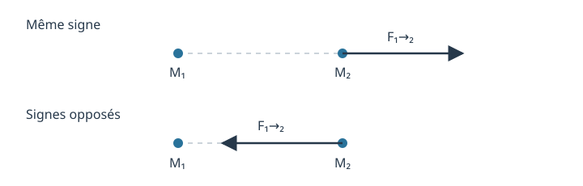
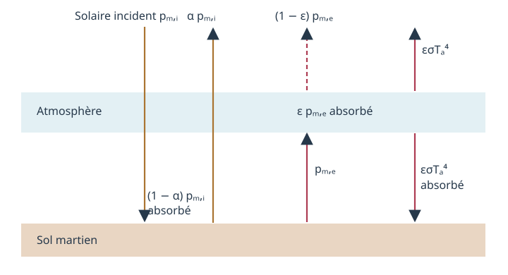
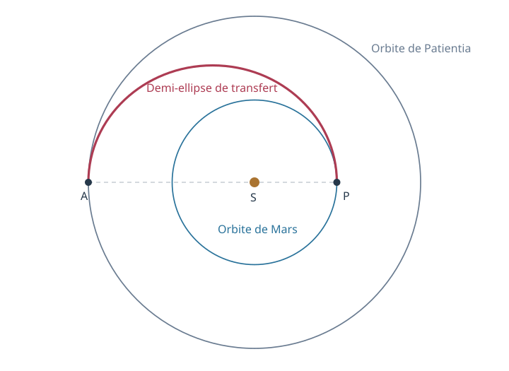

# CentraleSupélec PC — Physique 2 2024 · Corrigé brut

*Corrigé rédigé par IA, non officiel. Signalez toute erreur.*

## I — L’atmosphère de Mars et son échappement

### Question 1

Le champ de pesanteur est celui mesuré dans le référentiel lié au sol martien. Il inclut l’accélération centrifuge due à la rotation de Mars, nulle aux pôles et maximale à l’équateur. L’assimiler au champ gravitationnel revient ici à négliger cette correction.

### Question 2

Avec $\vec u_{12}$ orienté de $M_1$ vers $M_2$, la force exercée sur la seconde charge est
$$
\vec F_{1\to2}=\frac{q_1q_2}{4\pi\varepsilon_0 d^2}\,\vec u_{12}.
$$
Elle est appliquée en $M_2$ et suit $\vec u_{12}$ pour des charges de même signe. Pour des signes opposés, elle pointe vers $M_1$.

### Question 3

On compare les champs créés par une source ponctuelle. Dans $\vec E=q\vec u_r/(4\pi\varepsilon_0 r^2)$, on remplace $q$ par $m$ et $1/(4\pi\varepsilon_0)$ par $-G$ pour retrouver le champ gravitationnel. Le signe traduit l’attraction. Les champs s’additionnent dans les deux cas. Partant de $\oiint_S\vec E\cdot\mathrm d\vec S=Q_{\rm int}/\varepsilon_0$, on obtient, pour toute surface fermée orientée vers l’extérieur,
$$
\oiint_S\vec g\cdot\mathrm d\vec S=-4\pi Gm_{\rm int}.
$$

### Question 4

Tout plan contenant $OM$ est un plan de symétrie de la distribution, donc le champ est radial. L’invariance par rotation autour de $O$ rend sa composante radiale indépendante des angles. Sur la sphère de rayon $r\ge R_m$, le flux vaut $4\pi r^2g_r(r)$ et la masse enfermée vaut $m_m$. Donc
$$
\vec g(M)=-\frac{Gm_m}{r^2}\vec u_r.
$$

### Question 5

$$
\begin{aligned}
g_0&=\frac{Gm_m}{R_m^2}\simeq3{,}73\,\mathrm{m\,s^{-2}},\\
\vec g(M)&=-g_0\left(\frac{R_m}r\right)^2\vec u_r .
\end{aligned}
$$

### Question 6

La résultante des pressions sur les faces d’un petit volume est égale à son volume multiplié par la force volumique $-\nabla P$. Sans accélération, la somme de cette force volumique et de $\mu\vec g$ s’annule. Ainsi $\nabla P=\mu\vec g$, soit $P'=-\mu g_0$ dans le modèle.

### Question 7

Le gaz parfait vérifie $\mu=M_a P/(RT_0)$. L’équation $P'/P=-M_ag_0/(RT_0)$ s’intègre à partir de $P(R_m)=P_0$ :
$$
\begin{aligned}
H&=\frac{RT_0}{M_ag_0},\\
P(r)&=P_0e^{-(r-R_m)/H}=C_0e^{-r/H},\\
C_0&=P_0e^{R_m/H}.
\end{aligned}
$$

### Question 8

Pour une masse totale $m$, le nombre de moles de l’espèce $j$ vaut $w_jm/M_j$, où $w_j$ est sa fraction massique. On obtient donc
$$
\frac1{M_a}=\frac{0{,}96}{44}+\frac{0{,}02}{40}+\frac{0{,}02}{28}
$$
avec les masses molaires en $\mathrm{g\,mol^{-1}}$. Ainsi $M_a\simeq43{,}4\,\mathrm{g\,mol^{-1}}$ et $H\simeq1{,}08\times10^4\,\mathrm m$, soit $10{,}8\,\mathrm{km}$.

### Question 9

L’isothermie donne
$$
\begin{aligned}
\mu_0&=\frac{P_0M_a}{RT_0},\\
\mu(r)&=\mu_0e^{-(r-R_m)/H}.
\end{aligned}
$$

### Question 10

Dans la coque sphérique de rayon $r$ et d’épaisseur $\mathrm dr$, $\mathrm dm=4\pi r^2\mu(r)\mathrm dr$. En posant $u=(r-R_m)/H$,
$$
m_{\rm atm}=4\pi\mu_0 H\int_0^\infty
  (R_m^2+2R_mHu+H^2u^2)e^{-u}\,\mathrm du .
$$
Les intégrales valent respectivement $1$, $1$ et $2$. Comme $\mu_0H=P_0/g_0$,
$$
m_{\rm atm}=\frac{4\pi P_0}{g_0}(R_m^2+2HR_m+2H^2)
 \simeq\frac{4\pi R_m^2P_0}{g_0}
 \simeq2{,}33\times10^{16}\,\mathrm{kg}.
$$
On a $H/R_m\simeq3{,}2\times10^{-3}$. L’estimation est proche des $2{,}5\times10^{16}\,\mathrm{kg}$ annoncés.

### Question 11

Le libre parcours moyen est la distance moyenne parcourue entre deux collisions successives. Au sol, $\ell_0=RT_0/(P_0\mathcal N_a a^2)$. En prenant une taille moléculaire typique $a\simeq0{,}30\,\mathrm{nm}$, on trouve $\ell_0\simeq5{,}4\times10^{-5}\,\mathrm m$. Cette distance dépasse largement la taille moléculaire tout en restant très petite devant $H$.

### Question 12

À l’altitude $z$, la longueur de décroissance de la densité est $H$ et $\ell(R_m+z)=\ell_0e^{z/H}$. L’exobase correspond à $\ell(R_m+e)=H$, d’où
$$
e=H\ln(H/\ell_0)\simeq2{,}1\times10^5\,\mathrm m .
$$
Le modèle retrouve l’ordre de grandeur de l’altitude mesurée, $220\,\mathrm{km}$.

### Question 13

Avec une énergie potentielle nulle à l’infini, la condition d’échappement à partir de $r=R_m+220\,\mathrm{km}$ est $v^2/2-Gm_m/r\ge0$. Elle donne $v_{\rm lib}=\sqrt{2Gm_m/r}\simeq4{,}87\,\mathrm{km\,s^{-1}}$.

À cette abscisse sur la figure 2, la queue de l’hydrogène atomique ($1\,\mathrm{g\,mol^{-1}}$) est de l’ordre de quelques $10^{-3}$. Elle tombe autour de quelques $10^{-6}$ pour $\mathrm H_2$ et de $10^{-11}$ pour l’hélium.

Le graphe de gauche montre aussi que les vitesses typiques de $\mathrm{N_2}$ et de $\mathrm{CO_2}$ sont bien inférieures au seuil. Sur le graphe de droite, les queues correspondant aux masses molaires voisines de $30\,\mathrm{g\,mol^{-1}}$ ou supérieures sortent de l’échelle au voisinage du seuil, sous $10^{-75}$.

Parmi les espèces proposées, l’hydrogène est donc de loin le plus susceptible de s’échapper par ce mécanisme. La rétention des espèces plus lourdes, dont $\mathrm{CO_2}$, $\mathrm{Ar}$ et $\mathrm{N_2}$, est cohérente avec l’atmosphère actuelle. Les abondances relatives de ces espèces nécessitent aussi de connaître leur production et leurs autres pertes.

### Question 14

Le volume moyen par particule est de l’ordre de $d^3$, donc $n^*\sim d^{-3}$. Une particule a pour masse $M_a/\mathcal N_a$, d’où $\mu\sim M_a/(\mathcal N_a d^3)$.

### Question 15

Le profil isotherme donne $d(R_m+z)\sim d_0e^{z/(3H)}$ avec $d_0\sim(RT_0/(\mathcal N_a P_0))^{1/3}\simeq1{,}7\times10^{-8}\,\mathrm m$.

Même à l’exobase, $d$ n’est que de l’ordre de $10^{-5}\,\mathrm m$ pour une échelle $e$ voisine de $2\times10^5\,\mathrm m$. Le critère géométrique $d\ll e$ est donc largement satisfait dans les couches basses et reste peu contraignant en haut.

Pour un modèle hydrodynamique, il faut aussi que $\ell$ soit petite devant l’échelle de variation locale. Ce dernier critère limite son emploi aux couches suffisamment en dessous de l’exobase.

### Question 16

En régime stationnaire le terme $\partial_t\vec v$ s’annule, et pour l’écoulement parfait on néglige le terme visqueux. L’accélération convective radiale vaut $vv'\vec u_r$. La projection donne
$$
\mu v\frac{\mathrm dv}{\mathrm dr}=-\frac{\mathrm dP}{\mathrm dr}-\frac{G\mu m_m}{r^2}.
$$

### Question 17

L’équation d’état donne $P=(RT_0/M_a)\mu$. En posant $c^2=RT_0/M_a$, l’équation devient
$$
v\frac{\mathrm dv}{\mathrm dr}=-c^2\frac1\mu\frac{\mathrm d\mu}{\mathrm dr}-\frac{Gm_m}{r^2}.
$$

### Question 18

En régime stationnaire, sans source de masse entre deux sphères concentriques, le débit massique qui les traverse est le même. Or $\dot m(r)=4\pi r^2\mu(r)v(r)$, donc $\mu v r^2$ est constant.

### Question 19

La dérivée logarithmique de la constante précédente donne $\mu'/\mu=-v'/v-2/r$. En substituant,
$$
\begin{aligned}
\frac{v'}v\left(\frac{v^2}{c^2}-1\right)&=2\left(\frac1r-\frac{r^*}{r^2}\right),\\
c&=\sqrt{\frac{RT_0}{M_a}},\\
r^*&=\frac{Gm_m}{2c^2}.
\end{aligned}
$$

### Question 20

Le quotient $RT_0/M_a$ est une énergie par unité de masse, de dimension $\mathsf L^2\mathsf T^{-2}$. Sa racine est une vitesse. $Gm_m$ a la dimension $\mathsf L^3\mathsf T^{-2}$, donc $r^*$ est une longueur.

On trouve $c\simeq2{,}01\times10^2\,\mathrm{m\,s^{-1}}$ et $r^*\simeq5{,}32\times10^8\,\mathrm m$, soit près de 157 rayons martiens.

### Question 21

En $r=r^*$, le second membre de l’équation s’annule. Pour la branche étudiée, $v'/v$ est non nul à cet endroit. Comme $v>0$, il vient $v(r^*)=c$.

### Question 22

On cherche la branche de vent qui part à vitesse subsonique dans l’atmosphère dense et accélère vers l’extérieur. Posons $y=(v/c)^2$. L’intégration de Q19 avec $y(r^*)=1$ donne
$$
y-\ln y=4\ln(r/r^*)+4r^*/r-3.
$$
Au rayon de mesure $r_0=R_m+150\,\mathrm{km}=3{,}54\times10^6\,\mathrm m$, le second membre vaut environ $578{,}6$. Sur la branche subsonique $y\ll1$, d’où $v(r_0)\simeq c\,\exp(-578{,}6/2)\simeq5\times10^{-124}\,\mathrm{m\,s^{-1}}$. Avec la densité mesurée,
$$
\dot m_{\rm hydro}=4\pi r_0^2\mu(r_0)v(r_0)\sim10^{-119}\,\mathrm{kg\,s^{-1}}.
$$
Face aux $0{,}10\,\mathrm{kg\,s^{-1}}$ de MAVEN, ce modèle prédit une contribution négligeable. La branche transsonique décroissante supposerait au contraire une alimentation supersonique au voisinage de la planète. De plus, le point critique calculé est très au-delà de la zone collisionnelle. Le résultat chiffré indique donc surtout la limite de cette extrapolation isotherme et continue.

## II — Constitution d’une atmosphère martienne

### Question 23

Le Soleil est assimilé à un corps noir sphérique. Sa puissance totale émise vaut $\mathcal P_{s,e}=4\pi R_s^2\sigma T_s^4$.

### Question 24

Au rayon orbital $r_m$, le flux par unité de surface normale aux rayons vaut $\mathcal P_{s,e}/(4\pi r_m^2)$. Mars intercepte ce flux sur sa section $\pi R_m^2$. Moyennée sur tout le sol martien, de surface $4\pi R_m^2$, la puissance surfacique incidente est donc
$$
p_{m,i}=\frac{\mathcal P_{s,e}}{16\pi r_m^2}.
$$

### Question 25

$$
\mathcal P_{m,a}=4\pi R_m^2(1-\alpha)p_{m,i}
=(1-\alpha)\frac{R_m^2}{4r_m^2}\mathcal P_{s,e}.
$$

### Question 26

Assimilé à un corps noir à température uniforme, le sol émet $\mathcal P_{m,e}=4\pi R_m^2\sigma T_m^4$.

### Question 27

À l’équilibre thermique, l’énergie du sol reste constante. Avec pour seuls échanges les rayonnements reçus et émis, $\mathcal P_{m,a}=\mathcal P_{m,e}$. Ainsi
$$
T_m=T_s(1-\alpha)^{1/4}\sqrt{\frac{R_s}{2r_m}}
\simeq210\,\mathrm K.
$$
Cette valeur est proche de la température moyenne fournie. Elle correspond à un bilan global et uniforme, qui laisse de côté la variabilité locale et saisonnière.

### Question 28

La loi de Wien donne $\lambda_s\simeq2{,}90\times10^{-3}/5778\simeq0{,}50\,\mathrm{\mu m}$, dans le visible. Pour le sol martien à environ $210\,\mathrm K$, $\lambda_m\simeq13{,}8\,\mathrm{\mu m}$, dans l’infrarouge thermique.

### Question 29

Le rayonnement solaire traverse la couche atmosphérique. Une fraction $\alpha$ est réfléchie par le sol, qui absorbe le reste. Le sol émet $p_{m,e}=\sigma T_m'^4$. L’atmosphère absorbe $\varepsilon p_{m,e}$ et laisse passer le complément. Dans le modèle de couche grise en infrarouge, son émissivité égale son absorptivité. Elle rayonne donc $\varepsilon\sigma T_a^4$ par face. Le rayonnement descendant est entièrement absorbé par le sol.

### Question 30

Le bilan de l’atmosphère et le bilan du sol donnent
$$
\begin{aligned}
\varepsilon\sigma T_m'^4&=2\varepsilon\sigma T_a^4,\\
\sigma T_m'^4&=(1-\alpha)p_{m,i}+\varepsilon\sigma T_a^4.
\end{aligned}
$$
Si $\varepsilon>0$, on élimine $T_a$ et on obtient
$$
T_m'=\left[\frac{(1-\alpha)\mathcal P_{s,e}}
 {16\pi r_m^2\sigma(1-\varepsilon/2)}\right]^{1/4}
 =\frac{T_m}{(1-\varepsilon/2)^{1/4}}.
$$
Cette expression donne aussi le bon bilan du sol pour $\varepsilon=0$.

### Question 31

Pour $T_m'=298\,\mathrm K$, $\varepsilon=2[1-(T_m/298)^4]\simeq1{,}51$. Le coefficient serait supérieur à 1. Cet objectif dépasse les possibilités du modèle à l’albédo donné.

### Question 32

On augmente la température en diminuant $\alpha$ et en augmentant $\varepsilon$. Le maximum sur $[0,1]^2$ est atteint pour $\alpha=0$ et $\varepsilon=1$ :
$$
T_{\max}=5778\sqrt{\frac{R_s}{2r_m}}\,2^{1/4}\simeq268\,\mathrm K.
$$
La température maximale reste sous $273\,\mathrm K$ et sous les $298\,\mathrm K$ visés, même dans ce cas optimisé.

### Question 33

À $P'_0=10^5\,\mathrm{Pa}$, l’approximation de couche mince de Q10 donne
$$
m'_{\rm atm}\simeq\frac{4\pi R_m^2P'_0}{g_0}\simeq3{,}88\times10^{18}\,\mathrm{kg}.
$$
Une variation raisonnable de $H$ change peu ce résultat tant que $H\ll R_m$.

### Question 34

Pour estimer le besoin, prenons une atmosphère presque entièrement en $\mathrm{CO_2}$ et supposons que tout le carbone des astéroïdes est récupéré et oxydé. Un kilogramme d’astéroïde fournit alors au plus $0{,}02\times44/12\simeq0{,}073\,\mathrm{kg}$ de $\mathrm{CO_2}$, avec un apport suffisant d’oxygène. Il faudrait viser
$$
m_{\rm ast}\simeq\frac{m'_{\rm atm}}{0{,}02\times44/12}
 \simeq5{,}3\times10^{19}\,\mathrm{kg},
$$
soit près de $2\,\%$ de la ceinture. Si le $\mathrm{CO_2}$ constitue une fraction massique $f$ de l’atmosphère, la masse requise dans ce bilan carboné est multipliée par $f$. Les pertes de traitement augmenteraient le besoin.

### Question 35

Le Soleil $S$ est un foyer de l’ellipse. Son aphélie $A$ est sur le cercle extérieur de rayon $r_{\rm ast}$ et son périhélie $P$ sur le cercle martien de rayon $r_m$. La demi-ellipse de transfert est tangente aux deux cercles à ces points.

### Question 36

Le moment cinétique par rapport au centre de force est conservé, car le moment d’une force centrale vaut $\vec r\times\vec F=\vec0$. L’énergie mécanique est conservée, car la force conservative dérive d’une énergie potentielle et $\dot E_c=-\dot E_p$.

### Question 37

Sur l’orbite circulaire, l’accélération radiale centripète donne $v_{\rm circ}^2=Gm_s/r_{\rm ast}$. Avec une énergie potentielle nulle à l’infini,
$$
E_{m1}=\frac12m_pv_{\rm circ}^2-\frac{Gm_pm_s}{r_{\rm ast}}
=-\frac{Gm_pm_s}{2r_{\rm ast}}.
$$

### Question 38

En coordonnées polaires,
$$
\begin{aligned}
\vec v&=\dot r\,\vec u_r+r\dot\theta\,\vec u_\theta,\\
\vec L&=m_pr^2\dot\theta\,\vec u_z=m_p C\,\vec u_z .
\end{aligned}
$$
On prend $C=r^2\dot\theta$, soit deux fois la vitesse aréolaire algébrique.

### Question 39

En éliminant $\dot\theta$ à l’aide de $C$, on obtient
$$
\begin{aligned}
E_m&=\frac12m_p\dot r^2+E_{\rm eff}(r),\\
E_{\rm eff}(r)&=\frac{m_pC^2}{2r^2}-\frac{Gm_pm_s}{r}.
\end{aligned}
$$

### Question 40

Aux deux apsides, $\dot r=0$. L’égalité des énergies effectives aux rayons $r_A=r_{\rm ast}$ et $r_P=r_m$ donne, après division par $1/r_A-1/r_P\ne0$,
$$
\frac{C^2}2\left(\frac1{r_A}+\frac1{r_P}\right)=Gm_s .
$$
En réinjectant $C^2$ dans $E_{\rm eff}(r_A)$ et en utilisant $2a=r_A+r_P$,
$$
E_m=-\frac{Gm_pm_s}{r_A+r_P}=-\frac{Gm_pm_s}{2a}.
$$

### Question 41

Le demi-grand axe de l’ellipse vérifie $a<r_{\rm ast}$. L’énergie $-Gm_pm_s/(2a)$ est donc plus négative que $E_{m1}$. À position inchangée, la baisse d’énergie correspond à une baisse de vitesse. Il faut freiner tangentiellement.

### Question 42

Juste après l’impulsion, à l’aphélie, l’énergie de Q40 donne $v_A=\sqrt{Gm_s(2/r_{\rm ast}-1/a)}$. En définissant $\Delta v=v_A-v_{\rm circ}$,
$$
\Delta v=
\sqrt{\frac{Gm_s}{r_{\rm ast}}}\left(\sqrt{\frac{2r_m}{r_m+r_{\rm ast}}}-1\right)
\simeq-3{,}16\times10^3\,\mathrm{m\,s^{-1}}.
$$
Le freinage a une norme de $3{,}2\,\mathrm{km\,s^{-1}}$.

### Question 43

Pour freiner, l’engin expulse de la masse vers l’avant, tangentiellement. Sur le temps court de la manœuvre, on néglige l’impulsion des forces extérieures. La conservation de la quantité de mouvement lors d’une éjection infinitésimale, à vitesse relative $v_e$, donne $\mathrm d|\Delta v|=-v_e\,\mathrm dm/m$ pour la masse restante $m$. Ainsi
$$
\frac{m_i}{m_f}=\exp(|\Delta v|/v_e)\simeq1{,}37.
$$
Si Patientia reste intact et constitue l’essentiel de la masse finale, il faut donc apporter puis expulser environ $3{,}7\times10^{18}\,\mathrm{kg}$ de propergol. Si la matière éjectée est prélevée sur Patientia, il faudrait en retirer environ $27\,\%$, soit $2{,}7\times10^{18}\,\mathrm{kg}$. Même cette option exige de manipuler et d’accélérer une fraction considérable de l’astéroïde, pour la seule injection sur l’orbite de transfert.
