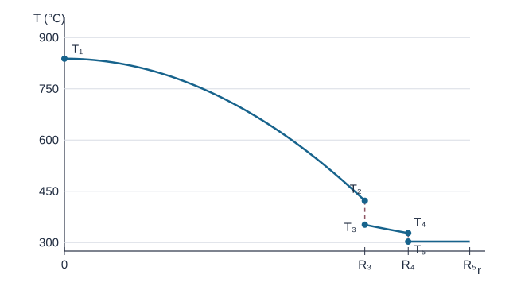
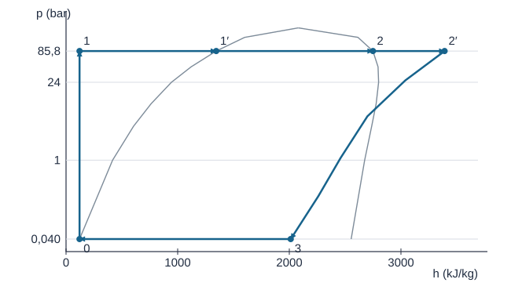
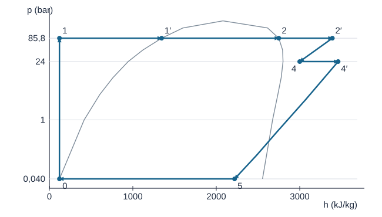
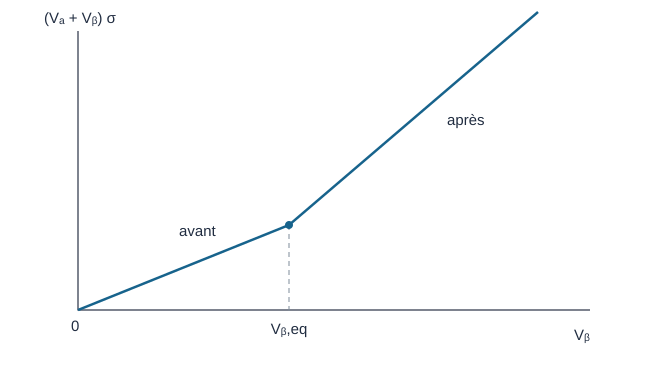

# Centrale-Supélec PSI — Physique-chimie 1 2024 · Corrigé brut

*Corrigé rédigé par IA, non officiel. Signalez toute erreur.*

## I — Étude du circuit primaire

### I.A — Évolution de la température entre le cœur du combustible et le fluide caloporteur

### Question 1

La surface latérale d’un crayon gainé est le produit du périmètre de la section extérieure par la hauteur. Pour les $N$ crayons,
$$\boxed{S_{\mathrm{tot}}=N\pi d H.}$$

### Question 2

Considérons le combustible entre les rayons $r$ et $r+\mathrm dr$, sur la hauteur $NH$. Le volume est $2\pi rNH\,\mathrm dr$ au premier ordre. Notons $\Phi(r)$ la puissance traversant la surface latérale de rayon $r$, comptée positivement vers l’extérieur.

Entre $t$ et $t+\mathrm dt$, le premier principe appliqué à cette portion de solide immobile donne une variation d’énergie interne $\rho c\,2\pi rNH\,\mathrm dr\,\partial_tT\,\mathrm dt$, pour une phase condensée de masse volumique $\rho$ et de capacité thermique massique $c$.

Il n’y a pas de travail mécanique.

La chaleur reçue vaut $[\Phi(r)-\Phi(r+\mathrm dr)]\,\mathrm dt$ et la production volumique libère $P_V\,2\pi rNH\,\mathrm dr\,\mathrm dt$.

En régime stationnaire, $\partial_tT=0$. Après division par $\mathrm dt\,\mathrm dr$, on obtient $\Phi'(r)=2\pi rNH P_V$. La loi de Fourier donne $\Phi(r)=-2\pi rNH\lambda_2T'(r)$. Ainsi
$$\boxed{\begin{aligned}
\frac{\mathrm d}{\mathrm dr}\bigl(rT'(r)\bigr)+Ar&=0,\\
A&=\frac{P_V}{\lambda_2}.
\end{aligned}}$$

### Question 3

En intégrant Q2, $rT'(r)=-P_Vr^2/(2\lambda_2)+C$. Si $C\ne0$, la température contient un terme en $\ln r$ et diverge sur l’axe. La régularité en $0$ impose $C=0$. Avec $T(R_3)=T_2$ côté combustible,
$$\boxed{T(r)=T_2+\frac{P_V}{4\lambda_2}(R_3^2-r^2).}$$

### Question 4

La puissance totale $P_1$ sort intégralement du combustible en régime stationnaire. Elle traverse l’interface sans stockage, du combustible vers la gaine. La loi de Newton donne $P_1=h_2\,2\pi R_3NH(T_2-T_3)$. Comme $2R_3=d-2e$,
$$\boxed{T_3=T_2-\frac{P_1}{h_2\pi(d-2e)HN}.}$$

### Question 5

La gaine ne comporte aucune source. La puissance radiale est donc constante et vaut $P_1$ sur chaque cylindre de rayon $r$. La loi de Fourier donne $-2\pi rNH\lambda_3T'(r)=P_1$. En intégrant à partir du bord extérieur $R_4$, côté gaine, on trouve
$$\boxed{T(r)=T_4+\frac{P_1R_4}{\lambda_3S_{\mathrm{tot}}}\ln\frac{R_4}{r}.}$$

### Question 6

Avec $S_{\mathrm{tot}}=4{,}527\times10^3\,\mathrm{m^2}$, $R_4=4{,}75\,\mathrm{mm}$ et $R_3=4{,}15\,\mathrm{mm}$, on applique la loi de Newton en $R_4$, puis Q5, Q4 et Q3. On obtient
$$\begin{aligned}
T_4&=T_5+\frac{P_1}{h_4S_{\mathrm{tot}}}\simeq327{,}5\,^\circ\mathrm C,\\
T_3&=T_4+\frac{P_1R_4}{\lambda_3S_{\mathrm{tot}}}\ln\frac{R_4}{R_3}\simeq352{,}1\,^\circ\mathrm C,\\
T_2&=T_3+\frac{P_1}{h_2\pi(d-2e)HN}\simeq422{,}3\,^\circ\mathrm C,\\
T_1&=T_2+\frac{P_1}{4\lambda_2N\pi H}\simeq838{,}3\,^\circ\mathrm C.
\end{aligned}$$
Dans la dernière ligne, on a utilisé $P_1=P_VN\pi R_3^2H$.

### Question 7

Le profil est une parabole concave, horizontale à l’origine, dans le combustible.

Il saute de $T_2$ à $T_3$ en $R_3$, puis décroît suivant $-\ln r$ dans la gaine.

Il saute de $T_4$ à $T_5$ en $R_4$ et reste constant jusqu’à $R_5$. La position de $R_5$ sur le schéma est indicative.



### Question 8

À $155\,\mathrm{bar}$, l’eau sature à $345\,^\circ\mathrm C$. Le pressuriseur maintient une pression qui permet au fluide de rester liquide avec une marge sur la température de saturation. Une chute de pression réduit cette marge et peut provoquer une vaporisation préjudiciable au transfert thermique. Dans le modèle, augmenter la surface d’échange permet d’évacuer une puissance plus grande pour un même écart de température, d’après la loi de Newton.

### I.B — Prise en compte de dépendances longitudinales pour la puissance thermique volumique et la température

### Question 9

Le volume de contrôle est l’espace annulaire entre les cotes $z$ et $z+\mathrm dz$. En régime stationnaire, pendant $\mathrm dt$, la masse entrante et la masse sortante valent toutes deux $D_m\mathrm dt$. Le premier principe en écoulement stationnaire relie leur écart d’enthalpie au transfert thermique reçu, puisque le travail utile et la variation d’énergie mécanique sont nuls. Dans le modèle du liquide incompressible et indilatable, avec variation de pression négligée pour ce bilan, l’écart d’enthalpie massique s’écrit $c_5[T(z+\mathrm dz)-T(z)]$.

La chaleur apportée par la portion de crayon de hauteur $\mathrm dz$ est, au premier ordre, $P_V(z)\pi R_4^2\,\mathrm dz\,\mathrm dt$. Elle est entièrement reçue par l’eau, car il n’y a ni stockage ni flux à travers la paroi extérieure. Après division par $\mathrm dt$,
$$\boxed{D_m c_5[T(z+\mathrm dz)-T(z)]=P_V(z)\pi R_4^2\,\mathrm dz.}$$

### Question 10

En posant $u=\pi z/H$, Q9 donne $T'(z)=\pi R_4^2P_0\sin u/(D_m c_5)$. L’intégration à partir de $0$ donne
$$\begin{aligned}
T_s-T_e&=\frac{2R_4^2HP_0}{D_m c_5},\\
T(z)&=T_e+\frac{T_s-T_e}{2}(1-\cos u).
\end{aligned}$$

### Question 11

À la cote $z$, la puissance créée par unité de longueur est $\pi R_4^2P_V(z)$. Elle est égale à $2\pi R_4h_{cc}[T_p(z)-T(z)]$ par conservation du flux stationnaire et loi de Newton. On a donc $T_p-T=P_V(z)R_4/(2h_{cc})$. En utilisant la relation de Q10 pour éliminer $P_0$,
$$\boxed{\begin{aligned}
B&=-1,\\
C&=\frac{D_m c_5}{2Hh_{cc}R_4}.
\end{aligned}}$$

### Question 12

À $z$ fixé, l’absence de conduction axiale permet de refaire le bilan radial de Q2 avec la source $P_V(z)$. La régularité sur l’axe et la condition $T_c(R_4,z)=T_p(z)$ donnent
$$T_c(r,z)=T_p(z)+\frac{P_0}{4\lambda_2}(R_4^2-r^2)\sin u.$$
Les constantes d’intégration éventuelles dépendent de $z$. En divisant par $T_s-T_e$ et en utilisant Q10–Q11, on retrouve la forme demandée avec
$$\boxed{\begin{aligned}
D&=-1,\\
E&=\frac{D_m c_5}{4Hh_{cc}R_4},\\
F&=\frac{D_m c_5}{8H\lambda_2}.
\end{aligned}}$$

### Question 13

Sur l’axe, $r=0$. L’expression de Q12 devient
$$\boxed{\begin{aligned}
T_c(0,z)=T_e+(T_s-T_e)\Bigg[&\frac{1-\cos(\pi z/H)}{2}\\
&+\frac{D_mc_5}{4H}\left(\frac1{h_{cc}R_4}+\frac1{2\lambda_2}\right)\sin(\pi z/H)\Bigg].
\end{aligned}}$$

### Question 14

Posons $a=E+F>0$.

Le terme qui dépend de $u$ est $-\cos u/2+a\sin u$.

Sa dérivée vaut $\sin u/2+a\cos u$.

Elle s’annule une seule fois sur $[0,\pi]$, en $u_*=\pi-\arctan(2a)$, où elle passe de positive à négative.

Le terme atteint alors $\sqrt{a^2+1/4}$.

Ainsi
$$\begin{aligned}
z_*&=\frac{H}{\pi}\bigl[\pi-\arctan(2a)\bigr],\\
T_{\max}&=T_e+(T_s-T_e)\left(\frac12+\sqrt{a^2+\frac14}\right).
\end{aligned}$$
Avec $h_{cc}=33\,\mathrm{kW\,m^{-2}K^{-1}}$, on trouve $a\simeq17{,}58$, puis **$z_*\simeq1{,}86\,\mathrm m$ et $T_{\max}\simeq971\,^\circ\mathrm C$**. Dans le modèle, la température reste inférieure à la température de fusion du combustible, $2800\,^\circ\mathrm C$.

### Question 15

La température de l’eau augmente tout le long du crayon, car le fluide accumule la chaleur reçue. L’écart entre la paroi et l’eau est au contraire proportionnel à la production locale $\sin u$. Il augmente jusqu’à mi-hauteur et décroît ensuite jusqu’à zéro. La température de paroi monte donc d’abord. Son maximum se situe après la mi-hauteur, car l’eau s’y réchauffe encore. Près de la sortie, la baisse de production domine et $T_p$ redescend vers $T_s$.

## II — Étude du circuit secondaire

### II.A — Préliminaire

### Question 16

Sur $\mathrm dt$, prenons le système fermé constitué à l’instant initial du fluide présent dans la machine et de la tranche qui entre. À l’instant final, il est constitué du fluide alors présent dans la machine et de la tranche qui sort.

```text
À t       [tranche entrante] → | volume de contrôle |
À t + dt                       | volume de contrôle | → [tranche sortante]
```

En régime stationnaire, la masse dans le volume de contrôle est constante. Les tranches ont la même masse $\delta m$, et l’énergie stockée dans la machine est inchangée. La variation d’énergie interne du système vaut donc $\delta m(u_s-u_e)$ après négligence des variations d’énergie mécanique.

Les forces pressantes poussent la tranche entrante dans le sens de son déplacement et fournissent $+p_e\delta m v_e$. Elles s’opposent au déplacement de la tranche sortante et fournissent $-p_s\delta m v_s$. Ici $v_e$ et $v_s$ sont les volumes massiques. À ces travaux s’ajoutent $\delta m w_u$ et le transfert thermique $\delta m q$. Le premier principe donne
$$u_s-u_e=p_e v_e-p_s v_s+w_u+q.$$
En regroupant les termes à l’aide de $h=u+pv$, **$h_s-h_e=w_u+q$**.

### II.B — Cycle de Hirn

### Question 17

Dans le modèle liquide incompressible, l’entropie varie avec la température selon $\Delta s=c\ln(T_1/T_0)$. La compression isentropique impose donc $T_1\simeq T_0$. Le travail de pompe négligé, avec une compression adiabatique, donne $h_1\simeq h_0$ par Q16. Le trajet isentropique est ainsi presque vertical dans le domaine liquide du diagramme $(p,h)$.

### Question 18

La branche gauche de la courbe de saturation est la courbe d’ébullition et la branche droite la courbe de rosée. Le dôme contient les états diphasés. Les isobares sont horizontales, les isenthalpes verticales. Les courbes noires repérées par les températures sont les isothermes. Les courbes rouges repérées par $s$ sont les isentropes. Dans le dôme, une isotherme suit l’isobare de saturation correspondante.

Le fluide est comprimé de $0$ à $1$.

À $85{,}8\,\mathrm{bar}$, on le chauffe jusqu’à $1'$ à l’ébullition, puis on le vaporise jusqu’à $2$ sur la rosée, et enfin on le surchauffe jusqu’à $2'$ à $500\,^\circ\mathrm C$.

On suit ensuite l’isentropique $s=6{,}68\,\mathrm{kJ\,kg^{-1}K^{-1}}$ jusqu’à $0{,}040\,\mathrm{bar}$ pour atteindre $3$.

La condensation isobare ferme le cycle de $3$ à $0$.



### Question 19

À l’état $3$, la détente isentropique impose $s_3=s_{2'}$. Le titre massique $x_3$ satisfait $s_3=(1-x_3)s_\ell+x_3s_v$ avec les valeurs saturées à $0{,}040\,\mathrm{bar}$. De même, l’enthalpie massique du mélange vaut $h_3=(1-x_3)h_\ell+x_3h_v$. Ainsi
$$\begin{aligned}
x_3&=\frac{6{,}68-0{,}42}{8{,}47-0{,}42}\simeq0{,}778,\\
h_3&=121+x_3(2554-121)\simeq2013\,\mathrm{kJ\,kg^{-1}}.
\end{aligned}$$
Le point $3$ est donc dans le dôme, sur l’isobare $0{,}040\,\mathrm{bar}$, à $h\simeq2{,}01\,\mathrm{MJ\,kg^{-1}}$.

### Question 20

L’efficacité est le travail utile net livré sur un cycle divisé par la chaleur reçue de la source chaude. La turbine est adiabatique et fournit $h_{2'}-h_3$ par kilogramme, d’après Q16. Le générateur et le surchauffeur reçoivent $h_{2'}-h_1$ en l’absence de travail utile. Le travail de pompe est négligé. Ainsi
$$\boxed{\eta=\frac{h_{2'}-h_3}{h_{2'}-h_1}
\simeq\frac{3391-2013}{3391-121}\simeq0{,}421.}$$

### Question 21

Notons $Q_C>0$ et $Q_F<0$ les chaleurs algébriquement reçues, et $W<0$ le travail algébriquement reçu par le fluide sur le cycle. La chaleur entre depuis la source chaude. La chaleur rejetée et le travail utile sortent vers la source froide et la charge, respectivement.

```text
Source chaude  -- Q_C --> [moteur] -- -Q_F --> source froide
                              |
                              +------ -W ----> charge
```

Les quantités écrites le long des flèches sont positives dans le sens indiqué. Le premier principe donne $W+Q_C+Q_F=0$. Pour le cycle réversible de Carnot, le second principe donne $Q_C/T_C+Q_F/T_F=0$. On en déduit
$$\boxed{\eta_C=-\frac{W}{Q_C}=1-\frac{T_F}{T_C}
\simeq1-\frac{302{,}15}{773{,}15}\simeq0{,}609.}$$
Le cycle de Hirn reçoit une partie de sa chaleur à des températures inférieures à $500\,^\circ\mathrm C$, notamment durant la vaporisation à $300\,^\circ\mathrm C$. Cela explique l’écart avec la référence de Carnot calculée à partir des deux températures extrêmes.

### II.C — Cycle à double surchauffe

### Question 22

On conserve jusqu’à $2'$ le tracé de Q18.

À partir de $2'$ on descend le long de l’isentropique jusqu’à l’isotherme $300\,^\circ\mathrm C$, au point $4$.

Le document réponse donne environ $p_4\simeq24\,\mathrm{bar}$ et $h_4\simeq3{,}00\times10^3\,\mathrm{kJ\,kg^{-1}}$.

La seconde surchauffe à cette pression atteint $4'$ sur l’isotherme $500\,^\circ\mathrm C$.

On lit environ $h_{4'}\simeq3{,}46\times10^3\,\mathrm{kJ\,kg^{-1}}$ et $s_{4'}\simeq7{,}35\,\mathrm{kJ\,kg^{-1}K^{-1}}$.

La seconde détente suit cette isentropique jusqu’à $0{,}040\,\mathrm{bar}$. Les données du tableau donnent $x_5\simeq(7{,}35-0{,}42)/(8{,}47-0{,}42)\simeq0{,}86$ et $h_5\simeq2{,}22\times10^3\,\mathrm{kJ\,kg^{-1}}$. Le point se situe à l’intérieur du dôme, plus près de la rosée que l’état $3$ de Q19. Imposer $x_5=1$ exactement demanderait une entropie $s_{4'}=8{,}47$, incompatible avec les deux températures et l’isobare retenues. La construction conserve les deux détentes isentropiques et interprète le titre donné comme une estimation.



Le fluide est chauffé de $1$ à $2'$ et de $4$ à $4'$, tandis que les turbines fournissent les travaux des deux chutes d’enthalpie. En négligeant toujours le travail de pompe,
$$\boxed{\eta=\frac{(h_{2'}-h_4)+(h_{4'}-h_5)}{(h_{2'}-h_1)+(h_{4'}-h_4)}\simeq0{,}44.}$$
Cette valeur dépend de la précision des lectures graphiques.

### II.D — Cycle réel d’une tranche nucléaire

### Question 23

D’après Q16, la puissance thermique reçue dans les échangeurs vaut $\dot m_{\mathrm{GV}}(h_s-h_e)$. Le débit y vaut $5412{,}1/3{,}6\,\mathrm{kg\,s^{-1}}$, d’où $\dot Q_{\mathrm{GV}}\simeq2776\,\mathrm{MW}$.

Pour chaque turbine adiabatique, la puissance mécanique fournie est le débit d’enthalpie entrant diminué de la somme des débits d’enthalpie sortants. Il faut compter les soutirages en plus de l’échappement. Avec les débits du tableau en $\mathrm{t\,h^{-1}}$, on obtient en mégawatts
$$\begin{aligned}
P_{\mathrm{HP}}={}&\bigl[5001{,}9(2787{,}1)-214{,}3(2682{,}5)-208{,}4(2622{,}6)\\
&\quad-(402{,}1+4177{,}1)(2562{,}8)\bigr]/3600\simeq301,\\
P_{\mathrm{BP}}={}&\bigl[3704(2970{,}4)-281{,}4(2731{,}5)-235{,}4(2538{,}9)\\
&\quad-134{,}2(2377{,}8)-3053(2242{,}2)\bigr]/3600\simeq687.
\end{aligned}$$
On calcule donc **$\eta\simeq35{,}6\,\%$ et $P_{\mathrm{HP}}+P_{\mathrm{BP}}\simeq988\,\mathrm{MW}$** disponibles mécaniquement pour un alternateur idéal. La puissance électrique mesurée peut être inférieure à cause des pertes mécaniques et électriques ainsi que des auxiliaires selon le périmètre de mesure.

## III — Étude de l’alternateur

### Question 24

Le flux extérieur, avec la normale du sens positif du courant, est $\Phi_{\mathrm{ext}}=BS\cos(\omega t)$. Par la loi de Faraday, la force électromotrice due au champ extérieur est $BS\omega\sin(\omega t)$. La loi des mailles dans la spire, modélisée par une résistance et une inductance en série, donne
$$L\frac{\mathrm di}{\mathrm dt}+Ri=BS\omega\sin(\omega t).$$
En régime forcé, l’amplitude est $I_m=BS\omega/\sqrt{R^2+(L\omega)^2}$. Le courant est en retard de $\varphi=\arctan(L\omega/R)$ sur l’excitation. Ces deux relations s’obtiennent en divisant l’amplitude de la force électromotrice par le module de l’impédance $R+\mathrm iL\omega$, et en retranchant son argument à la phase de l’excitation. Ainsi **$i(t)=I_m\sin(\omega t-\varphi)$**.

### Question 25

Le moment magnétique est $iS\vec n$. Avec $\vec n=\cos(\omega t)\vec u_x+\sin(\omega t)\vec u_y$, le couple magnétique vérifie $\Gamma_z=-iSB\sin(\omega t)$. La moyenne du produit des deux sinus est $\cos\varphi/2$, ce qui donne
$$\boxed{\langle\Gamma_z\rangle=-\frac{(BS)^2\omega R}{2[R^2+(L\omega)^2]}.}$$
Le signe est opposé à celui de la rotation. Ce couple résistant traduit la loi de Lenz.

### Question 26

Sans frottement et à vitesse constante, la turbine applique le couple opposé. Sa puissance moyenne vaut $-\omega\langle\Gamma_z\rangle$. Par effet Joule, $\langle P_J\rangle=R\langle i^2\rangle=RI_m^2/2$. Ainsi
$$\boxed{\langle P_{\mathrm{turbine}}\rangle=\langle P_J\rangle
=\frac{R(BS\omega)^2}{2[R^2+(L\omega)^2]}.}$$
L’énergie magnétique de la bobine est périodique et ne reçoit aucune puissance nette en moyenne.

## IV — Contrôle de la concentration en bore dans le circuit primaire

### IV.A — Titrage pH-métrique

### Question 27

En additionnant les deux réactions, on obtient
$$\mathrm{H_3BO_3(aq)}+2\mathrm{M(aq)}\rightleftharpoons
\mathrm{C^-(aq)}+\mathrm{H_3O^+(aq)}+2\mathrm{H_2O(l)}.$$
Les constantes se multiplient. Ainsi **$K=10^{-9{,}25}\times10^5=10^{-4{,}25}\simeq5{,}6\times10^{-5}$**. La réaction est thermodynamiquement peu favorisée dans l’état standard à $25\,^\circ\mathrm C$. Un excès de mannitol peut néanmoins déplacer l’équilibre.

### Question 28

Avec l’activité de l’eau prise égale à un, $K=K_{a,\mathrm{app}}/a_{\mathrm M}^2$. En solution diluée, $a_{\mathrm M}\simeq[\mathrm M]/c^\circ$, donc
$$\boxed{\mathrm{p}K_{a,\mathrm{app}}=\mathrm{p}K-2\log\!\left(\frac{[\mathrm M]}{c^\circ}\right).}$$

### Question 29

Le titrage sans mannitol suit $\mathrm{H_3BO_3}+\mathrm{OH^-}\to\mathrm{B(OH)_4^-}$. En présence de mannitol en excès, le bilan s’écrit $\mathrm{H_3BO_3}+2\mathrm M+\mathrm{OH^-}\to\mathrm{C^-}+3\mathrm{H_2O}$. Ces bilans consomment une mole d’hydroxyde par mole de bore. Les constantes de neutralisation valent $K_a/K_e$ ou $K_{a,\mathrm{app}}/K_e$, très supérieures à un pour les valeurs de pH de demi-équivalence observées.

On lit $V_{B,\mathrm{eq}}\simeq10\,\mathrm{mL}$ au voisinage du point d’inflexion du saut, surtout net pour (c). Donc **$C_0=C_BV_{B,\mathrm{eq}}/(10\,\mathrm{mL})\simeq0{,}10\,\mathrm{mol\,L^{-1}}$**.

À $V_B\simeq5\,\mathrm{mL}$, on lit environ $9{,}25$, $7{,}3$ et $5{,}6$ pour (a), (b) et (c).

À demi-équivalence, les concentrations analytiques d’acide restant et de base formée sont voisines, donc le pH donne le $\mathrm pK_a$ apparent dans le modèle.

La courbe (a) donne le $\mathrm pK_a$ de l’acide seul, donc **$x_a=0$**.

Dans l’approximation d’excès de mannitol, sa concentration est assimilée à $x/(M_D\,0{,}200\,\mathrm L)$ en négligeant la dilution par les $5\,\mathrm{mL}$ titrants et la fraction complexée. Par Q28,
$$x\simeq M_D(0{,}200\,\mathrm L)c^\circ\,10^{(4{,}25-\mathrm pH_{\mathrm{demi}})/2}.$$
Les lectures donnent **$x_b\simeq1{,}1\,\mathrm g$ et $x_c\simeq7{,}7\,\mathrm g$** dans cette approximation.

Tenir compte du volume à demi-équivalence et d’environ $1\,\mathrm{mmol}$ de mannitol lié ajouterait environ $0{,}2\,\mathrm g$ à $x_b$ et $0{,}4\,\mathrm g$ à $x_c$.

### IV.B — Titrage conductimétrique

### Question 30

Posons $n_0=C_AV_A$ et $V_e=n_0/C_B$. Le bilan est $\mathrm{H_3BO_3}+\mathrm{OH^-}\to\mathrm{B(OH)_4^-}$. Le modèle de titrage stœchiométrique néglige l’ionisation initiale de l’acide et l’hydrolyse du borate dans les bilans dominants. Le sodium apporté est spectateur. Avant l’équivalence, les quantités de sodium et de borate sont $C_BV_B$. Après, le borate vaut $n_0$ et l’excès d’hydroxyde vaut $C_BV_B-n_0$.

La loi de Kohlrausch donne, avec les volumes en $\mathrm{m^3}$ et les concentrations en $\mathrm{mol\,m^{-3}}$,
$$\boxed{(V_A+V_B)\sigma=
\begin{cases}
C_B(\lambda_{\mathrm{Na^+}}+\lambda_{\mathrm{B(OH)_4^-}})V_B & (V_B\le V_e),\\
C_B(\lambda_{\mathrm{Na^+}}+\lambda_{\mathrm{OH^-}})V_B+
(\lambda_{\mathrm{B(OH)_4^-}}-\lambda_{\mathrm{OH^-}})n_0 & (V_B\ge V_e).
\end{cases}}$$

### Question 31

Les deux expressions de Q30 coïncident en $V_e$. Les pentes, positives, sont proportionnelles respectivement à $5{,}01+6{,}70=11{,}71$ et $5{,}01+19{,}8=24{,}81$, dans les unités du tableau. La seconde pente est donc plus forte. Leur intersection donne $V_{B,\mathrm{eq}}=C_AV_A/C_B$ et permet d’en déduire la quantité de bore.



## V — Étude de la contamination des circuits par les produits d’activation

### V.A — Préliminaire

### Question 32

Notons $h=[\mathrm{H_3O^+}]/c^\circ=10^{-\mathrm pH}$ et assimilons les activités dissoutes à leurs concentrations divisées par $c^\circ$.

À l’équilibre avec $\mathrm{NiO(s)}$, $[\mathrm{Ni^{2+}}]/c^\circ=K_4h^2$.

À $T=573{,}15\,\mathrm K$, $\mathrm pK_4\simeq-3{,}53$.

Pour $C'_{\mathrm{fr}}/c^\circ=10^{-1}$, la frontière est
$$\boxed{\mathrm pH_{\mathrm{fr}}=\frac{1-\mathrm pK_4}{2}\simeq2{,}26.}$$
Pour un inventaire dissous de référence $C'_{\mathrm{fr}}$, la saturation exige une concentration plus forte en milieu plus acide et le solide peut se dissoudre entièrement. Au-dessus de la frontière, la concentration de saturation devient plus faible et le solide peut subsister.

```text
pH croissant →   Ni²⁺(aq)          │          domaine d’existence de NiO(s)
                                  2,26
```

### Question 33

Des éléments provenant des matériaux du circuit peuvent être transportés ou redéposés. Une exposition au flux de neutrons peut en rendre une fraction radioactive. Le rayonnement émis par ces produits d’activation subsiste lors de la maintenance, même sans flux de neutrons en service. À $300\,^\circ\mathrm C$, la concentration de saturation de $\mathrm{Ni^{2+}}$ selon Q32 décroît d’un facteur $100$ par augmentation d’une unité de pH. Choisir un pH supérieur à $3$ tend donc à limiter la dissolution acide et le transport des produits métalliques dans ce modèle.

### V.B — Modèle de Palmer

### Question 34

La réaction de constante $K_5$ donne $[\mathrm{Ni(OH)_2(aq)}]/[\mathrm{Ni^{2+}}]=K_5/h^2$. L’égalité des concentrations impose $\mathrm pH=\mathrm pK_5/2$. À $573{,}15\,\mathrm K$, $\mathrm pK_5\simeq12{,}05$.

```text
pH croissant →   Ni²⁺(aq)          │          Ni(OH)₂(aq)
                                  6,02
```

### Question 35

À saturation, $[\mathrm{Ni^{2+}}]/c^\circ=K_4h^2$ et $[\mathrm{Ni(OH)_2}]/c^\circ=K_4K_5$. Ainsi $s/c^\circ=K_4(h^2+K_5)$. En ne conservant que l’espèce prédominante, le diagramme de $\log(s/c^\circ)$ s’écrit
$$\boxed{\begin{cases}
-\mathrm pK_4-2\,\mathrm pH\simeq3{,}53-2\,\mathrm pH & (\mathrm pH<6{,}02),\\
-\mathrm pK_4-\mathrm pK_5\simeq-8{,}52 & (\mathrm pH>6{,}02).
\end{cases}}$$
Au raccord exact, les deux contributions sont égales et leur somme ajoute $\log 2$ par rapport aux droites.

### Question 36

Dans l’eau neutre, les concentrations de $\mathrm{H_3O^+}$ et $\mathrm{OH^-}$ sont égales. Ainsi $\mathrm pH_\mathrm{en}=\mathrm pK_e/2=11{,}41/2=5{,}705$ à $300\,^\circ\mathrm C$. Les abondances relatives reprennent les deux termes de Q35.

```python
import numpy as np
import matplotlib.pyplot as plt


def K4(T):
    return 10**(-(6.093 - 5513.46 / T))


def K5(T):
    return 10**(-(-6.09 + 7282.7 / T + 0.009476 * T))


T = 573.15
pHen = 11.41 / 2
N = 1000
pHmin = 3
pHmax = 11
pas = (pHmax - pHmin) / (N - 1)
pH = np.zeros(N)
y1 = np.zeros(N)
y2 = np.zeros(N)

for i in range(N):
    pH[i] = pHmin + i * pas
    h = 10**(-pH[i])
    nickel = K4(T) * h**2
    hydroxyde = K4(T) * K5(T)
    y1[i] = nickel / (nickel + hydroxyde)
    y2[i] = hydroxyde / (nickel + hydroxyde)

plt.figure()
plt.plot(pH, 100 * y1, label="Ni2+")
plt.plot(pH, 100 * y2, linestyle="--", label="Ni(OH)2")
plt.plot([pHen, pHen], [0, 100], linestyle=":", label="Eau neutre")
plt.xlabel("pH")
plt.ylabel("%")
plt.grid()
plt.legend()
plt.show()
```

### V.C — Modèle de Tremaine et Leblanc

### Question 37

À saturation, la nouvelle réaction donne $[\mathrm{Ni(OH)_3^-}]/c^\circ=K_{s3}/h$. Les trois concentrations réduites sont donc $K_4h^2$, $K_4K_5$ et $K_{s3}/h$. Le premier croisement de prédominance est celui de Q34. Le second est obtenu par $K_4K_5=K_{s3}/h$, d’où
$$\mathrm pH=\log(K_4K_5/K_{s3})\simeq9{,}25.$$
Comme le premier terme décroît et le troisième augmente avec le pH, et que l’ordre des deux frontières est $6{,}02<9{,}25$, le terme constant domine entre les deux.

```text
pH croissant →   Ni²⁺(aq)      │      Ni(OH)₂(aq)      │      Ni(OH)₃⁻(aq)
                              6,02                    9,25
```

### Question 38

On minimise $s/c^\circ=K_4h^2+K_4K_5+K_{s3}/h$ pour $h>0$. La dérivée en $h$ vaut $2K_4h-K_{s3}/h^2$. Elle change de négative à positive une seule fois, pour $h_*^3=K_{s3}/(2K_4)$. Le pH correspondant est
$$\boxed{\mathrm pH_*=\frac13\log\left(\frac{2K_4}{K_{s3}}\right).}$$
Avec la loi de $\mathrm pK_4(T)$ et $K_{s3}$ supposée constante, on trouve **$\mathrm pH_*\simeq7{,}20$ à $300\,^\circ\mathrm C$ et $\simeq9{,}05$ à $90\,^\circ\mathrm C$**.

### Question 39

À $300\,^\circ\mathrm C$, choisir un pH proche de $7{,}2$ minimise la solubilité du nickel dans ce modèle et limite la remise en circulation des espèces qui en proviennent. La température d’arrêt déplace le minimum vers un pH proche de $9{,}1$. Si l’eau reste à son pH de fonctionnement en puissance, la solubilité à froid est plus grande et des produits d’activation peuvent se retrouver davantage dans l’eau ou se redéposer ailleurs. Les intervenants peuvent alors subir une irradiation externe et, en cas de transfert de matière radioactive vers les personnes, une contamination.
