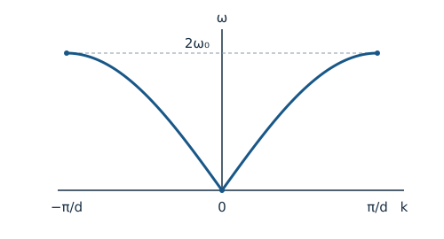
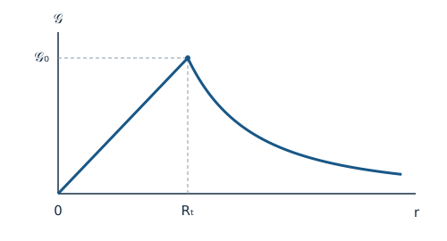
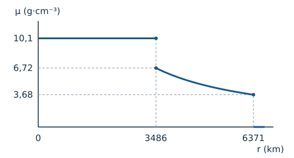
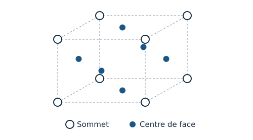

# Centrale-Supélec PSI — Physique-chimie 2 2024 · Corrigé brut

*Corrigé rédigé par IA, non officiel. Signalez toute erreur.*

## I — Des informations sur la structure de la Terre issues des ondes

### I.A — Modèles d’ondes longitudinales et transversales

**I.A.1 — Ondes longitudinales dans les fluides et solides homogènes**

### Question 1

La conservation de la masse donne $\partial_t\mu_1+\partial_x((\mu_0+\mu_1)v_1)=0$. La masse volumique $\mu_0$ est uniforme et $\mu_1v_1$ est d'ordre deux. Au premier ordre,

$$
\boxed{\partial_t\mu_1+\mu_0\partial_x v_1=0.}
$$

### Question 2

La seule force volumique retenue est celle de pression. En projetant la dynamique sur $\vec e_x$ et en utilisant l'uniformité de $P_0$,

$$
(\mu_0+\mu_1)(\partial_t v_1+v_1\partial_xv_1)=-\partial_xP_1.
$$

Les termes $v_1\partial_xv_1$ et $\mu_1\partial_tv_1$ sont au moins d'ordre deux. Au premier ordre, **$\mu_0\partial_t v_1=-\partial_xP_1$.**

### Question 3

L'évolution étant isentropique, la définition de $\chi_s$ à l'équilibre donne $\mu_1=(\partial\mu/\partial P)_{S,0}P_1$. Ainsi **$\mu_1=\mu_0\chi_sP_1$**.

### Question 4

On reporte Q3 dans Q1, puis on dérive cette équation en temps. Dans le terme en $\partial_t\partial_xv_1$, on utilise Q2 dérivée en espace. On obtient

$$
\boxed{\begin{aligned}
\partial_t^2P_1-c^2\partial_x^2P_1&=0,\\
c&=\frac1{\sqrt{\mu_0\chi_s}}.
\end{aligned}}
$$

### Question 5

Pour une particule de gaz parfait de composition et de $\gamma$ constants, supposée en évolution isentropique, la loi de Laplace donne $P\mu^{-\gamma}=\mathrm{constante}$. Par différentiation, $\chi_s=1/(\gamma P_0)$. L'équation d'état donne $P_0/\mu_0=RT_0/M_{\rm air}$. Ainsi,

$$
\boxed{c_1=\sqrt{\frac{\gamma RT_0}{M_{\rm air}}}
\simeq 343\ \mathrm{m\,s^{-1}}.}
$$

La masse molaire utilisée vaut $29{,}0\times10^{-3}\ \mathrm{kg\,mol^{-1}}$.

### Question 6

Avec les valeurs de $\mu_0$ et $\chi_s$ de l'eau,

$$
\boxed{c_2=(\mu_0\chi_s)^{-1/2}
\simeq 1{,}43\times10^3\ \mathrm{m\,s^{-1}}.}
$$

### Question 7

Notons $u(x,t)$ le déplacement longitudinal.

Pour un segment de longueur initiale $\mathrm dx$, la déformation relative vaut $\partial_xu$.

La loi d'Young linéarisée donne $T_c=E\partial_xu$.

La résultante des tractions sur le segment est $\Sigma\,\mathrm dx\,\partial_x T_c$ et sa masse au premier ordre vaut $\mu\Sigma\,\mathrm dx$.

Ainsi $\mu\partial_t^2u=E\partial_x^2u$ et

$$
\boxed{c_\ell=\sqrt{E/\mu}\simeq4{,}99\times10^3\ \mathrm{m\,s^{-1}}}
$$

pour le fer dans les conditions indiquées.

### Question 8

La célérité varie comme la racine du rapport entre raideur et masse volumique. À raideur fixée, une masse volumique plus élevée augmente l'inertie et ralentit la propagation. Ici la raideur augmente davantage que l'inertie de l'air vers l'eau puis le fer. Ainsi le module acoustique de l'eau vaut $1/\chi_s\simeq2{,}04\ \mathrm{GPa}$, et le module d'Young du fer vaut $196\ \mathrm{GPa}$. **La plus forte rigidité explique l'ordre $c_1<c_2<c_\ell$.**

**I.A.2 — Ondes transversales dans un solide homogène**

### Question 9

Les forces des deux ressorts sur le plan $n$, projetées sur $Oz$, valent $C(\xi_{n-1}-\xi_n)$ et $C(\xi_{n+1}-\xi_n)$. Leur résultante donne

$$
\boxed{m\ddot\xi_n=C(\xi_{n+1}+\xi_{n-1}-2\xi_n).}
$$

### Question 10

Les facteurs reliant les amplitudes de deux plans successifs sont $e^{\pm ikd}$. La phase $nkd$ décrit la propagation selon $Ox$, tandis que $\xi_n$ est un déplacement selon $Oz$. La mention $\vec k=k\vec e_z$ de l'énoncé est donc incompatible avec cette phase. L'équation de Q9 donne

$$
\omega^2=\frac{2C}{m}(1-\cos kd).
$$

En posant $\omega_0=\sqrt{C/m}$, **$\omega=2\omega_0|\sin(kd/2)|$** sur la branche positive.

### Question 11

La courbe est paire. Elle décroît de $2\omega_0$ à zéro de $k=-\pi/d$ à $k=0$, puis croît symétriquement jusqu'à $2\omega_0$ à $k=\pi/d$, les extrémités étant comprises comme des limites sur l'intervalle demandé.

La relation de dispersion impose $\omega\le2\omega_0$ pour tout $k$ réel. Au-delà, aucun mode propagatif à $k$ réel n'existe. **La pulsation de coupure vaut $\omega_c=2\omega_0$.**

### Question 12

Sur $]0,\pi/d[$, le sinus de $kd/2$ est positif. Ainsi,

$$
\begin{aligned}
v_\varphi=\frac{\omega}{k}
&=\frac{2\omega_0}{k}\sin(kd/2),\\
v_g=\frac{\mathrm d\omega}{\mathrm dk}
&=\omega_0d\cos(kd/2).
\end{aligned}
$$

### Question 13

La condition $\lambda\gg d$ implique $|k|d\ll1$. Sur la branche $k>0$, $\omega\simeq \omega_0dk$. Les deux vitesses de Q12 ont la même limite. **La célérité dans le milieu continu est $c_t=d\sqrt{C/m}$.**

### Question 14

Le résultat microscopique donne $c_t^2=d^2C/m$.

Pour une aire de section effective $\Sigma$, la masse volumique du modèle est $\mu=m/(\Sigma d)$, et la raideur élastique effective par cisaillement doit satisfaire $L=Cd/\Sigma$.

En effet le déplacement relatif de deux plans, divisé par $d$, donne la déformation de cisaillement, et la force correspondante divisée par $\Sigma$ donne la contrainte.

Ainsi $\sqrt{L/\mu}$ coïncide avec la célérité de Q13.

Pour le fer,

$$
\boxed{c_t=\sqrt{0{,}4E/\mu_{\rm Fe}}\simeq3{,}2\times10^3\ \mathrm{m\,s^{-1}}.}
$$

### I.B — Ondes P et S dans la Terre et modèle PREM

### Question 15

Dans un solide, $v_P^2-v_S^2=(K+L/3)/\mu>0$. Dans le liquide, le module de cisaillement est nul à ce niveau de modélisation, donc $v_S=0$ tandis que $v_P>0$. **La courbe en tirets est celle de $v_P$ et la courbe en pointillés celle de $v_S$.**

Sur la figure 3, $v_S$ est non nulle dans la graine, s'annule entre environ $1\,200$ et $3\,500\ \mathrm{km}$ du centre, puis redevient non nulle dans le manteau.

La figure 1 place les limites correspondantes à $R_1\simeq1\,216\ \mathrm{km}$ et $R_2\simeq3\,486\ \mathrm{km}$.

Les deux discontinuités de $v_P$, dont celle d'environ $8$ à $14\ \mathrm{km\,s^{-1}}$ en franchissant $R_2$ vers l'extérieur, confirment la structure en couches.

**L'extinction des ondes S dans le noyau externe confirme son caractère liquide.**

## II — Étude d’un modèle gravimétrique de la Terre

### II.A — Préliminaire, analogie électrostatique-gravitation

### Question 16

Au champ coulombien d'une charge $q$, égal à $q\vec e_r/(4\pi\varepsilon_0r^2)$, correspond le champ newtonien d'une masse $m$, égal à $-Gm\vec e_r/r^2$.

Par superposition, la correspondance est $\rho_e\mapsto\mu$ et $1/(4\pi\varepsilon_0)\mapsto -G$.

L'équation électrostatique $\operatorname{div}\vec E=\rho_e/\varepsilon_0$ devient **$\operatorname{div}\vec{\mathcal G}=-4\pi G\mu$**.

Le théorème de la divergence donne, pour toute surface fermée $\mathcal S$ orientée vers l'extérieur,

$$
\boxed{\oiint_{\mathcal S}\vec{\mathcal G}\cdot \mathrm d\vec S
=-4\pi G M_{\rm int},}
$$

où $M_{\rm int}$ est la masse contenue dans le volume délimité par $\mathcal S$.

### II.B — Un premier modèle gravimétrique fruste de la Terre

### Question 17

La distribution de masse est invariante par rotation autour de $O$.

Les symétries par les plans contenant le rayon excluent des composantes tangentielles.

Le champ s'écrit donc $\mathcal G_r(r)\vec e_r$ en coordonnées sphériques.

Sur une sphère de rayon $r>0$, le flux vaut $4\pi r^2\mathcal G_r(r)$.

La masse intérieure vaut $M_T(r/R_T)^3$ pour $r\le R_T$, puis $M_T$ pour $r\ge R_T$.

Par Q16,

$$
\boxed{\vec{\mathcal G}_{T_h}(r)=
\begin{cases}
-\dfrac{GM_T}{R_T^3}\,r\,\vec e_r & (0<r\le R_T),\\
-\dfrac{GM_T}{r^2}\,\vec e_r & (r\ge R_T).
\end{cases}}
$$

Au centre, le champ est nul par symétrie et continuité.

### Question 18

La norme part de zéro, croît linéairement jusqu'à $GM_T/R_T^2$ à $R_T$, puis décroît en $r^{-2}$ vers zéro. Elle est continue à $R_T$.

### Question 19

À la surface, **$\mathcal G_0=GM_T/R_T^2=9{,}81\ \mathrm{m\,s^{-2}}$**.

### II.C — Un second modèle gravimétrique (noyau et manteau) de la Terre

### Question 20

À $r=R_T$, une sphère de Gauss entoure toujours la masse totale $M_T$. La symétrie sphérique permet d'exprimer le flux comme en Q17, quelle que soit la répartition radiale intérieure. **$\mathcal G_0=GM_T/R_T^2$ reste inchangée.**

### Question 21

D'après la figure 4, la norme vaut $\mathcal G_0 r/R_2$ dans le noyau et $\mathcal G_0$ dans le manteau. La composante radiale est l'opposé de la norme, car le champ est dirigé vers le centre. En appliquant Q16 et la divergence radiale du formulaire,

$$
\mu(r)=\frac{1}{4\pi Gr^2}\frac{\mathrm d}{\mathrm dr}\bigl(r^2\mathcal G_T(r)\bigr).
$$

Comme $\mu_0=3M_T/(4\pi R_T^3)$, on en déduit

$$
\boxed{\mu(r)=
\begin{cases}
\mu_0 R_T/R_2 & (0\le r<R_2),\\
M_T/(2\pi R_T^2r) & (R_2<r<R_T),\\
0 & (r>R_T).
\end{cases}}
$$

Le champ est continu en $R_2$ et à la surface. Il n'y a donc pas de masse surfacique dans ce modèle.

### Question 22

Avec $\mu_0=5{,}51\ \mathrm{g\,cm^{-3}}$ et $R_2=3\,486\ \mathrm{km}$, les valeurs remarquables sont

$$
\begin{aligned}
\mu(R_2^-)&\simeq 10{,}1\ \mathrm{g\,cm^{-3}},\\
\mu(R_2^+)&\simeq 6{,}72\ \mathrm{g\,cm^{-3}},\\
\mu(R_T^-)&\simeq 3{,}68\ \mathrm{g\,cm^{-3}}.
\end{aligned}
$$

Comme dans PREM, le profil saute à la discontinuité de Gutenberg, puis décroît dans le manteau. Le noyau du modèle est homogène, tandis que la figure 3 du sujet montre une diminution d'environ $13$ à $10\ \mathrm{g\,cm^{-3}}$ et un saut à $R_1$. Au départ du manteau, PREM donne environ $5{,}6\ \mathrm{g\,cm^{-3}}$, contre $6{,}72$ ici. Le modèle ne restitue pas non plus les changements de pente plus superficiels.

## III — Composition chimique de la graine

### Question 23

**La cohésion du cristal est due à la liaison métallique.** Les électrons de valence délocalisés assurent la cohésion des cœurs ioniques.

### Question 24

Une maille cubique à faces centrées comporte un atome à chacun des huit sommets et au centre de chacune des six faces.

La maille contient en propre $8/8+6/2=4$ atomes. Le contact s'effectue sur une diagonale de face, donc $a\sqrt2=4r$ pour une arête $a$ et un rayon atomique $r$. La compacité vaut

$$
\boxed{\frac{4(4\pi r^3/3)}{a^3}=\frac{\pi}{3\sqrt2}\simeq0{,}740.}
$$

### Question 25

La masse volumique vaut $\mu_\gamma=d_{\rm Fe\gamma}\mu_{\rm eau}=7{,}87\times10^3\ \mathrm{kg\,m^{-3}}$. La masse de la maille est $4M_{\rm Fe}/N_A$, donc $a=(4M_{\rm Fe}/(N_A\mu_\gamma))^{1/3}$. Q24 conduit à

$$
\boxed{r_{\rm Fe\gamma}=
\frac{\sqrt2}{4}\left(\frac{4M_{\rm Fe}}{N_A\mu_\gamma}\right)^{1/3}
\simeq 128\ \mathrm{pm}.}
$$

### Question 26

À $330$–$350\ \mathrm{GPa}$, la figure 6 donne pour le fer pur $K$ entre $1\,500$ et $1\,600\ \mathrm{GPa}$.

Le module de cisaillement $L$ est compris entre environ $570$ et $610\ \mathrm{GPa}$.

Pour la phase solide aux températures proches de celles de la graine, la lecture de densité donne un ordre de grandeur de $13{,}3$ à $13{,}7\ \mathrm{g\,cm^{-3}}$.

Par les expressions des vitesses données dans I.B, avec une masse volumique de référence $1{,}35\times10^4\ \mathrm{kg\,m^{-3}}$,

$$
\begin{aligned}
v_P&=\sqrt{\frac{K+4L/3}{\mu}}\simeq13\ \mathrm{km\,s^{-1}},\\
v_S&=\sqrt{\frac{L}{\mu}}\simeq6{,}6\ \mathrm{km\,s^{-1}}.
\end{aligned}
$$

Dans la graine, la figure 3 donne environ $11\ \mathrm{km\,s^{-1}}$ pour $v_P$, $3{,}5$ à $3{,}7\ \mathrm{km\,s^{-1}}$ pour $v_S$.

La masse volumique est comprise entre $12{,}8$ et $13{,}2\ \mathrm{g\,cm^{-3}}$.

Le fer pur prédit des célérités trop élevées, surtout pour les ondes S, et une masse volumique un peu plus forte aux températures pertinentes.

**Ces écarts excluent un modèle de graine en fer pur.** Des éléments plus légers permettent d'expliquer le déficit de masse volumique et modifient les propriétés élastiques de l'alliage.

### Question 27

Par Q25, $r_{\rm Fe}\simeq128\ \mathrm{pm}$. Le nickel, de rayon $125\ \mathrm{pm}$, a une taille très proche et peut occuper les sites du fer par substitution. Le silicium, de rayon $110\ \mathrm{pm}$, présente un écart relatif d'environ $14\,\%$, qui rend une substitution géométriquement plus plausible que pour l'oxygène de rayon $60\ \mathrm{pm}$.

Pour l'insertion, le site octaédrique au centre du cube est distant de $a/2$ des centres des atomes les plus proches. Le site tétraédrique situé à $(a/4,a/4,a/4)$ est distant de $\sqrt3\,a/4$ de ses quatre voisins. Avec $a=2\sqrt2\,r_{\rm Fe}$, les rayons libres sont

$$
\begin{aligned}
r_{\rm oct}&=(\sqrt2-1)r_{\rm Fe}\simeq53\ \mathrm{pm},\\
r_{\rm tet}&=(\sqrt{6}/2-1)r_{\rm Fe}\simeq29\ \mathrm{pm}.
\end{aligned}
$$

Ces valeurs valent aussi pour les sites de l'hexagonal compact selon l'énoncé et les rapports de rayons sont conservés sous compression isotrope. Même l'oxygène ne tient dans aucun de ces sites sans déformation, et sa taille est très éloignée de celle du fer pour une substitution. **L'exclusion préférentielle de certains éléments légers, notamment l'oxygène, est donc cohérente avec la géométrie de la maille et peut enrichir le liquide résiduel.** La géométrie seule ne fixe pas les coefficients de partage.

## IV — Aspects thermiques au sein du noyau de la Terre

### IV.A — Transferts thermiques dans le noyau externe

### Question 28

La loi de Fourier donne une densité de flux $\vec j_Q=-\lambda(\mathrm dT/\mathrm dr)\vec e_r$. Elle est uniforme sur la sphère de rayon $r$ et sa normale extérieure est $\vec e_r$. Le flux sortant vaut donc

$$
\boxed{\Phi_{\rm th}(r)=-4\pi r^2\lambda\,\frac{\mathrm dT}{\mathrm dr}(r).}
$$

### Question 29

En régime stationnaire, une coquille entre deux rayons du noyau externe n'accumule pas d'énergie. Les sources volumiques y sont négligeables à cette échelle, les contributions radioactives ne représentant qu'environ $0{,}06\,\%$ du flux profond. Le flux entrant est donc égal au flux sortant et vaut $\Phi_{\rm th,pr}$. D'après Q28, l'intégration entre $R_1$ et $R_2$ donne

$$
T_1-T_2=\frac{\Phi_{\rm th,pr}}{4\pi\lambda}
\left(\frac1{R_1}-\frac1{R_2}\right).
$$

Ainsi **$\lambda=\dfrac{\Phi_{\rm th,pr}}{4\pi(T_1-T_2)}\left(\dfrac1{R_1}-\dfrac1{R_2}\right)$.**

### Question 30

La figure 1 donne $R_1=1{,}216\times10^6\ \mathrm m$, $R_2=3{,}486\times10^6\ \mathrm m$ et $T_1-T_2=1\,200\ \mathrm K$. Pour $\Phi_{\rm th,pr}\simeq10^{13}\ \mathrm W$, Q29 donne **$\lambda\simeq3{,}6\times10^2\ \mathrm{W\,m^{-1}\,K^{-1}}$**.

### Question 31

La conductivité nécessaire au modèle purement conductif est environ $3{,}6$ fois la borne expérimentale de $10^2\ \mathrm{W\,m^{-1}\,K^{-1}}$. À différence de température imposée, le flux étant proportionnel à $\lambda$ d'après Q29, la conduction seule transporterait au plus environ $28\,\%$ du flux profond dans ce modèle. **Un transport supplémentaire est nécessaire, notamment par convection dans le noyau externe liquide.**

### IV.B — Croissance de la graine

### Question 32

Au premier ordre, la masse solidifiée pendant $\mathrm dt$ vaut $\mathrm dm=4\pi R_1^2\mu_N\,\mathrm dr$. À pression constante, la variation d'enthalpie de cette masse est $\Delta_{\rm sol}h\,\mathrm dm$, négative pour une solidification exothermique. La chaleur libérée vers l'extérieur est $\Phi_{\rm th,d}\,\mathrm dt=-\Delta_{\rm sol}h\,\mathrm dm$. En divisant par $\mathrm dt$,

$$
\boxed{\tau=-\frac{\Phi_{\rm th,d}}{4\pi R_1^2\mu_N\Delta_{\rm sol}h}.}
$$

### Question 33

Le taux $0{,}3\ \mathrm{mm\,an^{-1}}$ vaut environ $9{,}5\times10^{-12}\ \mathrm{m\,s^{-1}}$. On isole l'enthalpie dans Q32 et on utilise $\Phi_{\rm th,d}\simeq10^{12}\ \mathrm W$.

$$
\boxed{\Delta_{\rm sol}h=-\frac{\Phi_{\rm th,d}}{4\pi R_1^2\mu_N\tau}
\simeq-5{,}7\times10^2\ \mathrm{kJ\,kg^{-1}}.}
$$

Le signe négatif est celui d'une solidification exothermique. La valeur absolue est environ $2{,}1$ fois celle de référence pour le fer, du même ordre de grandeur. La différence est compatible avec les conditions très différentes de pression et de température et avec le caractère estimatif des paramètres du modèle.

## V — Coefficient de partage et type de volcanisme

### V.A — Loi de Rayleigh

### Question 34

Chaque masse d'élément est la masse de la phase multipliée par sa fraction massique. En formant les produits, il faut prendre les fractions sans dimension. Lorsque $w$ est donné par son nombre en ppm, on multiplie celui-ci par $10^{-6}$.

$$
\begin{aligned}
m_L^i(t)&=w_L^i(t)m_L(t),\\
m_L^i(t+\mathrm dt)&=w_L^i(t+\mathrm dt)m_L(t+\mathrm dt),\\
m_S^i(t+\mathrm dt)&=w_S^i(t+\mathrm dt)\,\mathrm dm_S.
\end{aligned}
$$

### Question 35

La conservation de la masse totale donne $\mathrm dm_L=-\mathrm dm_S$. Celle de l'élément $i$ dans l'ensemble liquide et solide s'écrit $\mathrm d(w_L^i m_L)=-w_S^i(t+\mathrm dt)\,\mathrm dm_S$. Au premier ordre, en utilisant $w_S^i(t+\mathrm dt)=D_i w_L^i(t)$,

$$
m_L\,\mathrm dw_L^i+w_L^i\,\mathrm dm_L
=D_iw_L^i\,\mathrm dm_L.
$$

Donc $\mathrm dw_L^i/w_L^i=(D_i-1)\mathrm dm_L/m_L$. Pour un coefficient constant et une fraction initiale non nulle, l'intégration depuis $m_{L,0}$ donne

$$
\boxed{\begin{aligned}
w_L^i&=w_{L,0}^i f^{D_i-1},\\
\beta&=w_{L,0}^i.
\end{aligned}}
$$

### V.B — Validation de l’hypothèse d’un processus de cristallisation fractionnée

### Question 36

La formule de Q35 donne

$$
\frac{w_L^i}{w_L^j}
=\frac{w_{L,0}^i}{w_{L,0}^j}f^{D_i-D_j}.
$$

Au premier ordre du modèle où l'on néglige les deux coefficients devant $1$, les fractions s'enrichissent comme $f^{-1}$. **Le rapport est alors constant, égal au rapport initial.** Plus précisément, l'approximation est valable tant que $|(D_i-D_j)\ln f|\ll1$. La constance exacte pour tout $f$ exige $D_i=D_j$.

### Question 37

Chaque répétition de la boucle simule un nouveau jeu de mesures pour les deux éléments. Pour chaque point, la ligne 25 tire une teneur en Th suivant une loi normale de moyenne égale à la mesure et d'écart-type égal à son incertitude-type. La liste « X » rassemble ces abscisses simulées pour une répétition. Le code construit de même les ordonnées de Rb dans « Y ».

La ligne 31 calcule la pente « a » et l'ordonnée à l'origine « b » de la droite d'ajustement sur ce jeu. La liste « A » contient les $10\,000$ pentes simulées. La ligne 36 calcule leur moyenne « am ». La ligne 38 calcule « u_a », la racine carrée de la moyenne des carrés moins le carré de la moyenne. **C'est l'écart-type des pentes simulées et donc l'estimation de l'incertitude-type sur la pente.**

### Question 38

Pour deux éléments très incompatibles, Q36 prévoit des teneurs à peu près proportionnelles. Sur la figure 10, la droite modélise le nuage à l'échelle des barres d'incertitude. La pente estimée est $0{,}139$ avec une incertitude-type proche de $0{,}005$. L'ordonnée à l'origine estimée est $0{,}30\ \mathrm{ppm}$ avec $u_b\simeq0{,}35\ \mathrm{ppm}$. L'intervalle élargi $b\pm2u_b$ vaut environ $[-0{,}40;1{,}00]\ \mathrm{ppm}$ et contient zéro. **Les résultats sont donc compatibles avec une proportionnalité entre Rb et Th et confortent l'hypothèse de cristallisation fractionnée.**

### V.C — Caractérisation du type de volcanisme de la Chaine des Puys

### Question 39

Dans la figure 12 à gauche, il faut lire les axes en puissances de dix. À diamètre fixé, le côté strombolien correspond à des vitesses de remontée plus faibles que le côté hawaïen. Par exemple pour un diamètre de $0{,}1\ \mathrm m$, la séparation se trouve vers $10^{-1}\ \mathrm{m\,s^{-1}}$. À vitesse fixée, les diamètres inférieurs à la courbe se trouvent dans le domaine strombolien, les diamètres supérieurs dans le domaine hawaïen. La taille de transition diminue quand la remontée s'accélère. Dans la zone de transition, on passe d'un diamètre de l'ordre du mètre pour des remontées de quelques $10^{-2}\ \mathrm{m\,s^{-1}}$ à un diamètre de l'ordre du millimètre vers $1\ \mathrm{m\,s^{-1}}$. La taille des bulles seule ne fixe donc pas le régime.

Dans la figure de droite, à fraction de gaz fixée, **le régime strombolien occupe la zone des remontées lentes et le régime hawaïen celle des remontées rapides**. Par exemple, pour $0{,}5\,\%$ de gaz, les valeurs de transition sont de l'ordre de $10^{-2}$ à $10^{-1}\ \mathrm{m\,s^{-1}}$. À vitesse fixée, augmenter la fraction massique de gaz déplace la situation vers le domaine strombolien. Les deux graphiques délimitent des régimes en fonction de paramètres combinés.

### Question 40

D'après l'énoncé, le retrait des cristaux d'olivine enrichit progressivement le liquide en silice, ce qui augmente sa viscosité. À forçage comparable, un magma visqueux remonte moins vite et les bulles s'en échappent moins facilement. Avec la fraction élevée de gaz dissous indiquée pour la Chaine des Puys, ces conditions déplacent le système vers la zone strombolienne de la figure 12. **Dans la typologie proposée, ces volcans se rattachent au régime explosif.** Un magma moins visqueux, qui remonte rapidement et libère plus facilement ses gaz, favorise le régime effusif.
