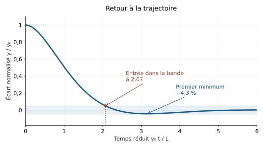
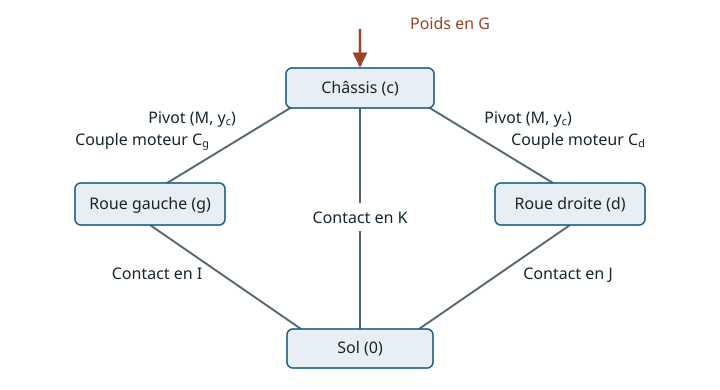
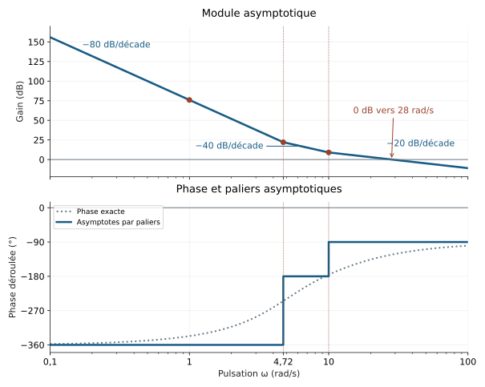
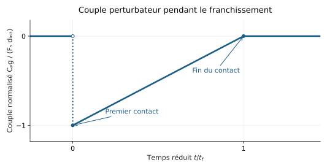

# Centrale-Supélec PSI — Sciences industrielles 2024 · Corrigé brut

*Corrigé rédigé par IA, non officiel. Signalez toute erreur.*

## I — Modélisation linéaire du suivi de la trajectoire

### I.A — Géométrie du suivi « pure pursuit »

### Question 1

Le point visé est l’intersection en avant de la droite du segment et du cercle de centre $M$ et de rayon $L$. Cette intersection exige $L\ge\|MP_{\mathrm{proj}}\|$. L’écart maximal autorisé est de $5\ \mathrm{cm}$ d’après l’annexe A, donc **$L_{\min}=0{,}05\ \mathrm m$**.

La borne supérieure empêche que l’anticipation dépasse la longueur du plus court segment. Après un changement de segment, l’algorithme peut ainsi prendre en compte chacun des segments prévus. L’annexe A conduit à **$L_{\max}=1\ \mathrm m$**. La borne inférieure sature au cas de tangence, où les deux intersections coïncident.

### Question 2

Dans la configuration dessinée, $\widehat{CMP_{\mathrm{LA}}}=\pi/2-\alpha$. Les angles en $M$ et en $P_{\mathrm{LA}}$ sont égaux, d’où **$\widehat{MCP_{\mathrm{LA}}}=2\alpha$** dans cette configuration. La corde vaut $2\rho\sin\alpha$ et $y_{\mathrm{LA}}=L\sin\alpha$.

Pour couvrir les virages des deux côtés, on utilise le rayon signé. L’égalité $CM^2=CP_{\mathrm{LA}}^2$ s’écrit alors $\rho^2=L^2-2\rho y_{\mathrm{LA}}+\rho^2$. Ainsi **$\rho=L^2/(2y_{\mathrm{LA}})$**. Lorsque $y_{\mathrm{LA}}=0$, la courbure et la consigne de lacet sont nulles.

### I.B — Modèle linéaire sur un segment

### Question 3

Le segment est porté par l’axe des abscisses. La projection de $M$ a donc pour coordonnées $(x,0)$. Le point visé est sur cet axe, en avant du projeté, à distance $\sqrt{L^2-y^2}$ de celui-ci. On en déduit, dans la base terrestre,
$$
\begin{aligned}
\overrightarrow{MP_{\mathrm{proj}}}&=-y\vec y,\\
\overrightarrow{MP_{\mathrm{LA}}}&=\sqrt{L^2-y^2}\,\vec x-y\vec y,\\
y_{\mathrm{LA}}&=-\sqrt{L^2-y^2}\sin\theta-y\cos\theta .
\end{aligned}
$$
Pour les faibles angles, le dernier résultat devient $-\sqrt{L^2-y^2}\,\theta-y$. Avec $|y|/L\le0{,}1$, remplacer la racine par $L$ introduit sur ce facteur un écart relatif à $L$ d’au plus $1-\sqrt{0{,}99}\simeq0{,}5\,\%$. On retrouve (I.3).

### Question 4

Le déplacement relatif à la position initiale vérifie $p[Y(p)-Y_{\mathrm{ini}}(p)]=v_0\Theta(p)$. Le bloc $H_2$ vaut donc $v_0/p$. D’après les relations (I.1) à (I.3), la consigne de lacet vaut approximativement $2v_0(-y-L\theta)/L^2$. Le schéma multiplie la somme de l’erreur latérale et de la contribution angulaire par $K_1$. On identifie
$$
\boxed{\begin{aligned}
H_2(p)&=\frac{v_0}{p},\\
K_1&=\frac{2v_0}{L^2},\\
K_2&=L.
\end{aligned}}
$$

### Question 5

La chaîne directe de la boucle interne de la figure 4 est $K_{s1}/[p(1+\tau_1p)]$. En fermant le retour unitaire négatif, on obtient
$$
H_\Delta(p)=\frac{1}{1+p/K_{s1}+(\tau_1/K_{s1})p^2}
=\frac{1}{1+\dfrac{2\xi}{\omega_0}p+\dfrac{p^2}{\omega_0^2}}.
$$
Le gain statique est $1$. En utilisant les valeurs de $K_{s1}$ et $\tau_1$ données,
$$
\boxed{\begin{aligned}
\omega_0&=\sqrt{2}\,v_0/L,\\
\xi&=1/\sqrt{2}\simeq0{,}707.
\end{aligned}}
$$
La réponse indicielle est sous-amortie mais son premier dépassement relatif vaut $e^{-\pi}\simeq4{,}3\,\%$. Il reste donc dans la bande à $5\,\%$.

### Question 6

La figure 4 donne $Y=\Delta Y+Y_{\mathrm{ini}}$ et $\Delta Y=H_\Delta(Y_{\mathrm{cons}}-Y_{\mathrm{ini}})$. Avec $Y_{\mathrm{cons}}=0$, **$Y/Y_{\mathrm{ini}}=1-H_\Delta$**. Pour $a=v_0/L$ et $Y_{\mathrm{ini}}=y_0/p$,
$$
Y(p)=y_0\frac{p+2a}{(p+a)^2+a^2}.
$$
On en déduit **$y(t)=y_0e^{-at}[\cos(at)+\sin(at)]$**. La courbe part de $y_0$ avec une tangente horizontale, s’annule pour $at=3\pi/4$ et atteint au premier minimum $-y_0e^{-\pi}$. Les oscillations suivantes sont amorties.



$$
\begin{array}{l|l}
\text{Stabilité} & \text{Pôles } -a\pm ja,\ a>0\\
\text{Précision} & \text{Écart permanent nul}\\
\text{Rapidité} & t_{5\,\%}\simeq2{,}072L/v_0
\end{array}
$$
Le premier passage à $0{,}05y_0$ se produit à $at\simeq2{,}072$. Les extrema ultérieurs restent dans la bande.

À vitesse fixée, **seule la rapidité dépend de $L$** parmi ces performances.

### I.C — Simulation et choix de la distance de visée

### Question 7

La deuxième ligne de (I.6) impose que la dérivée de la deuxième composante soit la troisième composante. La dernière ligne doit produire $C_1\ddot y+C_2\dot y+y=0$. Puisque le dernier coefficient de $M_0$ est fixé à zéro, le terme $C_2\dot y$ est écrit via la deuxième composante de $\dot X$.

```python
# Ligne 22
M1 = np.array([[1, 0, 0], [0, 1, 0], [0, C2, C1]])
# Ligne 24
M0 = np.array([[0, 0, 0], [0, 0, -1], [0, 1, 0]])
```

### Question 8

L’Euler explicite utilise la pente à l’instant courant. On pose $\dot X(t)\simeq[X(t+T_e)-X(t)]/T_e$. L’équation (I.6) donne la pente $M_1^{-1}(F-M_0X(t))$. D’où la ligne 40.

```python
X[:, i + 1] = X[:, i] + Te * invM1.dot(F - M0.dot(X[:, i]))
```

### Question 9

Sur la figure 5, le troisième tracé représente **dix fois** l’écart entre les modèles.

- Pour $L=0{,}5\ \mathrm m$, les deux trajectoires se superposent presque. Le tracé d’écart amplifié atteint environ 1 mm, soit un écart réel de l’ordre de 0,10 mm. Les deux trajectoires rejoignent la bande de convergence vers $x=1\ \mathrm m$.
- Pour $L=0{,}05\ \mathrm m$, le tracé amplifié atteint environ 2 cm, soit un écart réel d’environ 2 mm. Les traces restent du même ordre, mais diffèrent pendant la convergence. L’écart initial est alors du même ordre que $L$, hors de la condition de linéarisation.

Le modèle linéaire offre donc un critère de réglage fiable dans son domaine, en particulier autour de $L=0{,}5\ \mathrm m$.

### Question 10

L’écart maximal de 5 cm impose $L\ge0{,}50\ \mathrm m$ pour respecter la condition de linéarisation. Cette valeur reste sous la borne fixée par la longueur minimale d’un segment. La distance de convergence vaut $v_0t_{5\,\%}\simeq2{,}072L$ et croît avec $L$. Le choix le plus rapide dans ce modèle est **$L=0{,}50\ \mathrm m$**.

À 6 km/h, il correspond à environ $0{,}62\ \mathrm s$ et $1{,}04\ \mathrm m$. L’exigence fixe une distance aussi courte que possible et ce choix est optimal parmi les réglages compatibles avec la linéarisation. La distance calculée est légèrement supérieure à la longueur nominale du plus court segment. Le retour à 2,5 mm sur chaque segment d’un mètre avant une nouvelle transition n’est donc pas garanti.

## II — Conception de la commande du droïde

### II.A — Modèle dynamique

### Question 11

Le théorème de l’énergie cinétique fournit une équation scalaire. Le problème comporte deux évolutions indépendantes à déterminer, la variation de la vitesse d’avance et celle de la vitesse de lacet. Une seule équation de puissance ne suffit donc pas à les déterminer séparément. On utilisera des projections distinctes des théorèmes de la résultante et du moment dynamiques.

### Question 12

Le graphe fait apparaître les contacts ponctuels en $I$, $J$ et $K$, et les pivots du châssis avec les deux roues. Les couples $C_g$ et $C_d$ sont des actions du châssis sur les roues, suivant l’axe des pivots. Les poids des roues sont négligés avec leur masse.



On isole la roue gauche. Les actions extérieures sont celles du pivot, le couple moteur et le glisseur de contact en $I$. Au point $M$, le pivot parfait ne transmet pas de moment suivant $\vec y_c$.

Dans le moment du glisseur, seule la contribution de $X_g\vec x_c$ projetée sur cet axe subsiste. Comme $\overrightarrow{MI}=l\vec y_c-R\vec z_c$, cette contribution est $-RX_g$. L’inertie de la roue étant négligée, le théorème du moment dynamique donne $C_g-RX_g=0$.

Pour la roue droite, $\overrightarrow{MJ}=-l\vec y_c-R\vec z_c$, d’où une contribution projetée $-RX_d$. On obtient de même $C_d-RX_d=0$. Ainsi
$$
\boxed{\begin{aligned}
X_g&=C_g/R,\\
X_d&=C_d/R.
\end{aligned}}
$$

### Question 13

Les produits d’inertie impliquant $y_c$ sont nuls. Une hypothèse qui explique cette forme est une symétrie matérielle du corps chargé par rapport au **plan passant par $G$ de normale $\vec y_c$**, soit $(G,\vec x_c,\vec z_c)$. Pour une charge aléatoire, cela revient à la supposer disposée symétriquement ou à remplacer sa distribution par une modélisation symétrique. Le produit d’inertie associé au couple d’axes $(\vec x_c,\vec z_c)$ peut rester non nul.

### Question 14

En appliquant l’inertie en $G$ au vecteur rotation $\dot\theta\vec z_c$, puis en dérivant dans le référentiel terrestre, on obtient
$$
\begin{aligned}
\vec\sigma_{G,c/\mathcal R}&=-E\dot\theta\,\vec x_c+C\dot\theta\,\vec z_c,\\
\vec\delta_{G,c/\mathcal R}&=-E\ddot\theta\,\vec x_c-E\dot\theta^2\,\vec y_c+C\ddot\theta\,\vec z_c.
\end{aligned}
$$
On a utilisé $\dot{\vec x}_c=\dot\theta\vec y_c$ et $\dot{\vec z}_c=\vec0$. Le transport de la vitesse de $M$ à $G$ utilise $\overrightarrow{MG}=-a\vec x_c-h\vec z_c$. En dérivant ensuite et en posant $\omega=\dot\theta$,
$$
\boxed{\begin{aligned}
\vec v_{G,c/\mathcal R}&=v_0\vec x_c-a\omega\vec y_c,\\
\vec\Gamma_{G,c/\mathcal R}&=(\dot v_0+a\omega^2)\vec x_c+(v_0\omega-a\dot\omega)\vec y_c .
\end{aligned}}
$$

### Question 15

On isole l’ensemble $\{c,g,d\}$ dans le référentiel galiléen lié au sol. Les actions extérieures sont le poids en $G$, le glisseur vertical en $K$, et les glisseurs du sol sur les roues motrices en $I$ et $J$. Les actions de liaison et les couples moteurs entre le châssis et ses roues sont internes. Les masses et inerties des roues sont négligées.

Le théorème de la résultante dynamique, projeté sur les deux axes horizontaux, donne
$$
\begin{aligned}
m(\dot v_0+a\omega^2)&=X_g+X_d,\\
m(v_0\omega-a\dot\omega)&=Y_g+Y_d .
\end{aligned}
$$
Pour le théorème du moment dynamique en $G$ projeté sur $\vec z_c$, le poids et les réactions verticales n’interviennent pas.

Les bras de levier horizontaux de $I$ et $J$ ont pour coordonnées $(a,l)$ et $(a,-l)$. Le moment dynamique projeté vaut $C\dot\omega$ d’après Q14. Il vient
$$
\boxed{C\dot\omega=a(Y_g+Y_d)+l(X_d-X_g).}
$$

### Question 16

On remplace les efforts longitudinaux par les relations de Q12. Pour éliminer les efforts latéraux, on introduit leur somme donnée par la deuxième équation de Q15 dans le moment dynamique. On obtient
$$
\begin{aligned}
\dot v_0+a\omega^2&=\frac{C_d+C_g}{mR},\\
(C+ma^2)\dot\omega+ma\omega v_0&=\frac{l}{R}(C_d-C_g).
\end{aligned}
$$
Par identification à (II.1),
$$
\boxed{\begin{aligned}
\lambda_1&=a,&
\lambda_2&=\frac{l}{R(C+ma^2)},\\
\lambda_3&=\frac{1}{mR},&
\lambda_4&=\frac{ma}{C+ma^2}.
\end{aligned}}
$$


### II.B — Commande de la vitesse de lacet

### Question 17

Le roulement et les obstacles peuvent imposer un couple perturbateur différentiel à l’entrée de la dynamique de lacet de la figure 8. Le tableau 2 exige le retour à la trajectoire sans écart permanent. Un correcteur proportionnel seul a besoin d’une erreur non nulle pour maintenir le courant qui compense un couple perturbateur constant.

Avec le PI, l’intégrateur peut maintenir le courant de compensation alors que l’erreur est revenue à zéro. En effet, si $G_\Omega$ est la plante entre courant différentiel et lacet, elle comporte un intégrateur. Pour une perturbation équivalente ramenée à son entrée, la fonction de transfert de perturbation à sortie est $G_\Omega/(1+P I_\Omega G_\Omega)$. Pour une boucle stable, son gain statique est nul puisque $P I_\Omega$ diverge à basse fréquence.

Sur un segment rectiligne, en régime établi, le robot est orienté selon le segment, donc $\theta=0$, et $\omega=\omega_{\mathrm{cons}}=0$. La loi de guidage I.3 donne alors $y=0$. Le réglage de l’action proportionnelle permet ensuite de maîtriser le transitoire.

### Question 18

Dans la phase $i_g=-i_d$, la sortie du correcteur de lacet, $(i_d-i_g)/2$, est $i_d$. Pour un échelon d’erreur d’amplitude $\omega_e=|\omega_{\mathrm{cons}}|_{\max}$ et un intégrateur initialement au repos,
$$
pI_d(p)=K_{p\Omega}\omega_e\,\frac{1+T_{i\Omega}p}{T_{i\Omega}p}.
$$
Le théorème de la valeur initiale donne $|i_d(0^+)|=K_{p\Omega}\omega_e$. Comme $\omega_e=2v_0|\sin\alpha|_{\max}/L$, la condition nécessaire est
$$
\boxed{K_{p\Omega}\le\frac{|i_m|_{\max}L}{2v_0|\sin\alpha|_{\max}}.}
$$
Avec les données nominales suivantes, le maximum calculé vaut environ $37{,}4$. Le choix $37$ donne un courant différentiel initial proche de $24{,}7\ \mathrm A$ pour ce scénario.

### Question 19

Le schéma de la figure 9 est ouvert à l’entrée du correcteur. Avec $S$ comme entrée injectée et $E$ comme signal de retour, les relations sont
$$
\begin{aligned}
\Omega&=\frac{2\lambda_2K_mK_r}{p}\,P I_\Omega S,\\
\Theta&=\frac{\Omega}{p},\\
Y&=\frac{v_0}{p^2}\Omega,\\
E&=-\Omega-\frac{2v_0}{L^2}(Y+L\Theta).
\end{aligned}
$$
Le transfert de boucle ouverte est donc
$$
-\frac ES
=\frac{2\lambda_2K_mK_rK_{p\Omega}}{T_{i\Omega}p^2}
(1+T_{i\Omega}p)\left(1+\frac{2v_0}{Lp}+\frac{2v_0^2}{L^2p^2}\right).
$$
En mettant la parenthèse sur le dénominateur $p^2$ puis en normalisant son numérateur, on retrouve la forme demandée avec
$$
\boxed{\begin{aligned}
K_{\mathrm{BO}}&=\frac{4\lambda_2K_mK_rK_{p\Omega}v_0}{L^2},\\
\omega_0&=\sqrt2\,v_0/L,\\
\xi&=1/\sqrt2 .
\end{aligned}}
$$

### Question 20

Les quatre pôles à l’origine donnent une pente initiale de $-80\ \mathrm{dB}$ par décade et une phase déroulée de $-360^\circ$.

Les zéros du deuxième ordre apportent $+40\ \mathrm{dB}$ par décade au-delà de $4{,}72\ \mathrm{rad\,s^{-1}}$, et une avance totale de $180^\circ$. Le zéro réel ajoute $+20\ \mathrm{dB}$ par décade au-delà de $10\ \mathrm{rad\,s^{-1}}$, et une avance totale de $90^\circ$.

En pulsations exprimées en rad/s, les pentes et paliers sont donc
$$
\begin{array}{c|r|r}
\omega & \text{dB par décade} & \text{phase par paliers}\\ \hline
0{,}1<\omega<4{,}72 & -80 & -360^\circ\\
4{,}72<\omega<10 & -40 & -180^\circ\\
10<\omega<100 & -20 & -90^\circ
\end{array}
$$

Le gain asymptotique vaut $20\log_{10}(6300)\simeq76\ \mathrm{dB}$ à $1\ \mathrm{rad\,s^{-1}}$. Il vaut environ $22\ \mathrm{dB}$ à la première cassure et $9\ \mathrm{dB}$ à la seconde. La droite finale traverse l’axe à $0\ \mathrm{dB}$ vers $28{,}3\ \mathrm{rad\,s^{-1}}$. La phase exacte évolue progressivement autour des cassures.



### Question 21

Dans l’annexe C à $T_{i\Omega}=0{,}1\ \mathrm s$, les tracés avec et sans couplage sont pratiquement superposés, en particulier au voisinage de la coupure vers $30\ \mathrm{rad\,s^{-1}}$. La marge de phase y est voisine de $59^\circ$ et dépasse les $50^\circ$ exigés. Le modèle sans couplage suffit ainsi à dimensionner le correcteur autour du point étudié.

À $v_0$ fixé, réduire $L$ augmente la pulsation de la paire de zéros $\omega_0$. Près de la coupure, cette paire a alors fourni une avance de phase plus faible. Dans les conditions étudiées, la coupure varie peu puisque le gain à haute fréquence est principalement réglé par le gain proportionnel du correcteur et la plante de lacet. Pour illustrer l’ordre de grandeur, passer de 0,50 m à 0,40 m dans le modèle sans couplage fait passer la marge d’environ $58^\circ$ à $55^\circ$. Une visée plus courte peut donc améliorer la réactivité du suivi géométrique tout en réduisant la marge de stabilité du lacet.

### Question 22

$T_I$ est la composante tangentielle de l’action de contact sur la roue gauche dans le plan de la roue au niveau de l’arête. Au point $J$, $T_J$ est la composante tangentielle longitudinale de la force du sol sur la roue droite. $Y_J$ est la composante tangentielle transversale de ce contact.

Pour l’ensemble isolé, les trois équations de résultante et les trois équations de moment fournissent au plus six relations indépendantes. Les trois composantes possibles en $I$, les trois en $J$ et la normale en $K$ donneraient sept inconnues de contact. Fixer la composante latérale en $I$ à zéro ramène leur nombre à six et retire cette indétermination du comptage. Les données de contact sont ensuite estimées expérimentalement dans la suite du sujet.

### Question 23

Le couple perturbateur est la composante en $\vec y_c$ du moment en $M$ de la force $F_s\vec z_c$.

La projection de $\overrightarrow{MI}$ sur $\vec x_c=\vec x$ vaut $d$. Comme $\vec x_c\wedge\vec z_c=-\vec y_c$,
$$
\boxed{C_{pg}=-F_s d.}
$$
L’arête est fixe pendant le contact et $M$ avance à la vitesse $v_0$. Donc $d=d_{\mathrm{init}}-v_0t$ et, tant que $I$ reste en avant de l’aplomb de l’axe,
$$
\boxed{C_{pg}(t)=-F_s(d_{\mathrm{init}}-v_0t).}
$$

### Question 24

La perturbation est nulle avant le contact, saute à $-F_sd_{\mathrm{init}}$ à $t=0^+$, puis remonte linéairement avec une pente $F_sv_0$. Elle s’annule à $t_f=d_{\mathrm{init}}/v_0$ et reste nulle ensuite dans ce modèle.

Pour $d_{\mathrm{init}}=0{,}20\ \mathrm m$ et $v_0=1{,}67\ \mathrm{m\,s^{-1}}$, **$t_f\simeq0{,}12\ \mathrm s$**. La figure 10 donne le module du couple, avec le signe opposé sur la durée du contact.



### Question 25

Les lectures de l’annexe C et de la figure 10 donnent les ordres de grandeur suivants.

$$
\begin{array}{c|c|c}
T_{i\Omega}\ (\mathrm{s}) & \text{Marge de phase} & \text{Écart maximal}\\ \hline
0{,}01 & 23^\circ & 0{,}20\ \mathrm{cm}\\
0{,}1 & 59^\circ & 1{,}2\ \mathrm{cm}\\
1 & 75^\circ & 2{,}3\ \mathrm{cm}\\
5 & 76^\circ & 2{,}5\ \mathrm{cm}
\end{array}
$$

Le réglage **$T_{i\Omega}=0{,}1\ \mathrm s$** vérifie simultanément la marge supérieure à 50° et le maximum latéral de 1,5 cm. La courbe revient vers la trajectoire après la perturbation, conformément à l’action intégrale. Le choix $K_{p\Omega}=37$ respecte le contrôle de courant initial de Q18, environ 24,7 A dans le scénario différentiel nominal. Les tracés fournis ici représentent la réponse latérale et le couple perturbateur. La limitation du courant moteur pendant tout le transitoire relève de la saturation de la commande et demanderait les courbes de courant correspondantes pour être vérifiée sur cet essai.

## III — Planification de la tournée

### III.A — Matrice des coûts

### Question 26

La valeur infinie représente un trajet direct non autorisé dans le graphe. Il peut exister un itinéraire indirect via d’autres points. En lisant le sens des flèches de la figure 11,
$$
\boxed{\begin{aligned}
\texttt{cout[3,4]}&=3,\\
\texttt{cout[2,3]}&=4,\\
\texttt{cout[2,1]}&=+\infty.
\end{aligned}}
$$
Une voie à sens unique explique l’absence d’une liaison dans un sens. Une pente peut aussi rendre l’énergie de la montée différente de celle de la descente sur un trajet autorisé dans les deux sens.

### III.B — Relation de récurrence

### Question 27

Si $P$ est non vide, tout itinéraire admissible choisit d’abord un point $j$ dans $P$, paie $\mathrm{cout}_{ij}$, puis réalise une tournée optimale depuis $j$ avec les autres points restant à visiter. Minimiser sur le premier choix donne
$$
\boxed{E(i,P)=\min_{j\in P}\bigl[\mathrm{cout}_{ij}+E(j,P\setminus\{j\})\bigr]\qquad (P\ne\varnothing).}
$$
La condition de base $E(i,\varnothing)=\mathrm{cout}_{i0}$ compte le retour au dépôt. Les arcs interdits restent de coût infini. Le graphe routier de la figure 11 contient des cycles, alors que la récurrence sur les états $(i,P)$ est acyclique puisque $|P|$ décroît.

### III.C — Implémentation et résultat

### Question 28

À la ligne 25, $e$ est le coût optimal depuis $j$ après le retrait de $j$ de la liste des points restants. Il faut ajouter le coût de l’arc courant avant la comparaison. La ligne 26 s’écrit

```python
if cout[i, j] + e < e_mini:
```

La comparaison stricte garde le premier minimiseur rencontré en cas d’égalité.

### Question 29

La ligne 32 crée le dictionnaire de mémoïsation. On part du dépôt avec tous les points de livraison à visiter. Pour reconstruire la tournée, on lit dans $E(i,P)$ le coût restant et le meilleur successeur $j$. On note le coût total au premier appel depuis le dépôt. À chaque étape, on ajoute $j$ à la tournée, on le retire de l’ensemble des points à livrer et on se place en $j$.

```python
# Ligne 40
tr_opt.append(j)
# Ligne 41
P = soustraction(P, j)
```

Une fois $P$ vide, la condition de base renvoie $j=0$ et ajoute le retour final. Retirer cet indice reste sans effet, car $P[0]$ vaut déjà zéro.

### Question 30

L’ordre optimal produit est **$0\to4\to1\to2\to3\to0$**. Le droïde part du dépôt, livre les quatre points une seule fois et revient au dépôt.

Les coûts des arcs dans cet ordre sont $3$, $4$, $5$, $4$ et $2$, soit un total **$18$ unités de coût énergétique**. Le calcul interprète un indicateur d’énergie fourni par le graphe. L’énoncé ne donne pas sa conversion physique en joules.

## IV — Synthèse

### Question 31

L’angle entre les segments successifs est déterminant. Plus le changement de direction est marqué, plus le point de visée s’écarte de l’axe instantané du droïde. La consigne de lacet et la commande différentielle augmentent alors. Dans la figure 13, la trajectoire coupe plus nettement les virages près de $P_3$ et de $P_4$ qu’au voisinage de $P_1$. On observe simultanément des pics de courant et des plateaux proches de $-25\ \mathrm A$, ainsi qu’un écart de l’ordre de 10 cm près de $P_4$. La figure 14 accentue ce phénomène.

Un angle plus marqué peut porter $|\sin\alpha|_{\max}$ au-dessus de la valeur de $0{,}1$ retenue au réglage nominal. La borne de Q18 sur $K_{p\Omega}$ diminue donc à rapport $v_0/L$ fixé. Conserver un gain trop élevé, ou un rapport trop grand, sature la commande et peut ralentir le virage. Limiter le rapport $v_0/L$ près de ces changements de direction permet de conserver davantage de réserve de courant.

### Question 32

Les **figures 13 et 15** ont pratiquement le même rapport $v_0/L$, environ $3{,}3\ \mathrm{s^{-1}}$. Près de $P_4$, la commande différentielle atteint des niveaux voisins, avec notamment une saturation négative proche de 25 A en valeur absolue. Avec $L=0{,}1\ \mathrm m$ et la vitesse plus faible de la figure 15, le virage est suivi de plus près. L’écart d’environ 10,4 cm en figure 13 est ramené à environ 2,0 cm près de $P_4$ en figure 15, et le transitoire occupe moins de distance parcourue.

Dans la **figure 14**, la vitesse reste la même que dans la figure 13 et $L$ diminue. Le rapport passe à environ $4{,}2\ \mathrm{s^{-1}}$. La saturation se prolonge et l’écart près de $P_4$ atteint environ 15,7 cm. Réduire $L$ seul à vitesse élevée peut donc dégrader le suivi.

À rapport fixé, passer de $6$ à $1{,}2\ \mathrm{km\,h^{-1}}$ multiplie par environ cinq le temps de déplacement sur une même distance. Le rapport ne détermine donc pas à lui seul la durée. Le choix doit préserver un rapport compatible avec le suivi dans les virages tout en maintenant une vitesse élevée là où le parcours le permet.

### Question 33

La géométrie de la route étant connue, on peut régler $L$ et $v_0$ par portion. Sur les segments assez longs et peu courbés, on roule près de la vitesse maximale autorisée et on choisit un $L$ compatible avec la carte. À l’approche d’un virage serré, on réduit la distance de visée pour limiter la coupe du virage et on réduit aussi la vitesse pour respecter le courant. Une borne initiale est
$$
\frac{v_0}{L}\le\frac{|i_m|_{\max}}{2K_{p\Omega}|\sin\alpha|_{\max}}
$$
dans le scénario différentiel de Q18. On valide ensuite les deux courants moteurs, l’écart à la route et la marge de phase avec le modèle global. La planification déclenche la décélération avant le virage et reprend une vitesse élevée après celui-ci. Parmi les profils compatibles avec les contraintes et les possibilités d’accélération, on minimise la durée de déplacement en évitant les ralentissements sur les tronçons où ils sont inutiles.

FIN
