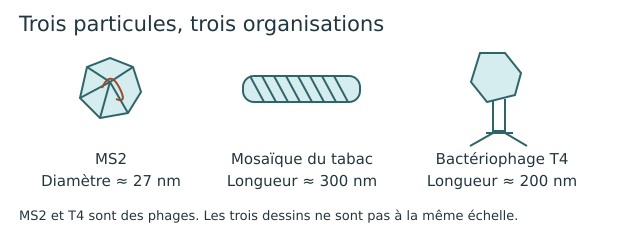
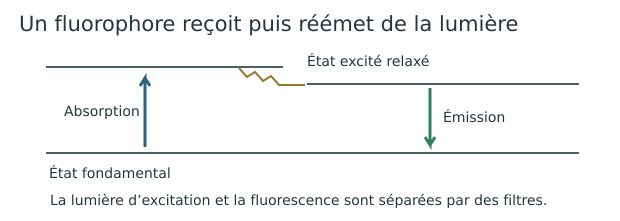
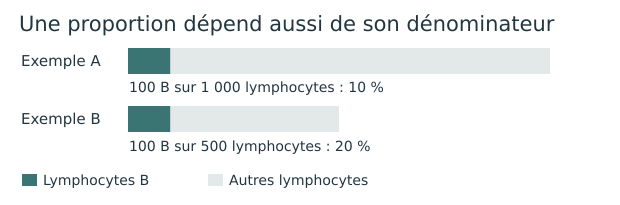
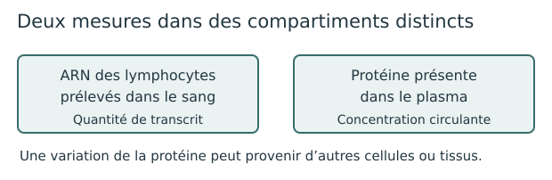

# ENS de Lyon — Second concours · Biologie-biochimie 2024 · Corrigé partiel brut

*Corrigé rédigé par IA, non officiel.*

**Rédaction (tour 1)** · GPT-6.2 Astra Ultra · vitesse non renseignée

**Révision (tour 1)** · GPT-6.2 Astra Ultra · vitesse non renseignée

**Périmètre.** La synthèse et les Q1, 5 et 11 à 18 sont traitées. La Q6 couvre les rôles de l’actine et du témoin de comparaison. L’attribution du fragment en Q6 et les expériences des Q2 à 4 et 7 à 10 restent hors couverture.

## I — Synthèse sur la diversité des virus

Un virion de bactériophage peut montrer au microscope une tête et une queue. Une particule du virus de la mosaïque du tabac ressemble à un bâtonnet, et de nombreux virus animaux présentent un contour arrondi. Ces différences de forme recouvrent-elles la même organisation du vivant ? Un virus est une entité biologique dont le génome, ADN ou ARN, se perpétue grâce à une cellule hôte. Le **virion** est une particule qui protège et véhicule ce génome. La diversité peut se décrire à plusieurs échelles, de la construction de la particule aux relations que le virus entretient avec son hôte.

### Une même dépendance cellulaire, plusieurs architectures

Le virion est acellulaire. Il ne contient ni cytoplasme comparable à celui d’une cellule ni appareil de traduction autonome. Le génome renferme de l’information héréditaire. Il est habituellement protégé par des protéines dont l’assemblage constitue une **capside**. Une enveloppe lipidique existe chez certains virus et manque chez d’autres. Son origine membranaire ne la rend pas assimilable à une membrane de cellule autonome. La taille typique se compte en dizaines ou centaines de nanomètres, avec des exceptions plus grandes. Une levure mesure plusieurs micromètres. Les deux objets ne se placent donc pas à la même échelle d’observation.

Chez le bactériophage MS2, la capside, d’environ 27 nm de diamètre, présente une symétrie icosaédrique. Ses sous-unités protéiques répétées forment une coque compacte autour d’un ARN. Une capside à symétrie icosaédrique portée par un génome à ARN n’est qu’une des combinaisons possibles. Le phage ΦX174 présente lui aussi une particule d’allure icosaédrique, mais son génome est un ADN simple brin circulaire. La forme externe ne révèle donc pas à elle seule la chimie du génome.

Le virus de la mosaïque du tabac illustre une tout autre symétrie. Les sous-unités de sa capside se répètent en hélice autour de l’ARN. L’ensemble dessine un cylindre d’environ 300 nm de long et 18 nm de diamètre. Chez T4, bactériophage à ADN double brin, une tête de symétrie apparentée à l’icosaèdre et une queue forment deux parties distinctes. Le virion entier est long d’environ 200 nm. Représenter systématiquement un virus par une sphère couverte de pointes ferait disparaître ces deux architectures.

### Plusieurs formes d’information doivent donner accès à un ARN messager

Une cellule traduit une séquence portée par un ARN messager. Chez les virus, le génome initial peut être un ADN simple ou double brin, ou un ARN simple ou double brin. Il peut être linéaire ou circulaire et tenir sur une molécule ou être réparti sur plusieurs segments. La taille d’un segment et le nombre de segments sont deux caractères différents. Une même forme de particule peut accueillir des génomes distincts, et deux virus réunis par un caractère ne partagent pas nécessairement tous les autres.

La classification de Baltimore pose une question précise : par quelle grande voie l’information du génome devient-elle lisible comme un ARN messager ? Elle distingue sept groupes. Les groupes I et II possèdent respectivement un ADN double et simple brin. Le groupe III possède un ARN double brin. Dans le groupe IV, un ARN simple brin de polarité positive a la même orientation qu’un messager. Dans le groupe V, l’ARN simple brin est de polarité négative et sa séquence complémentaire correspond au message. Les groupes VI et VII se distinguent par une étape de transcription inverse : respectivement génome à ARN avec intermédiaire ADN et génome à ADN avec intermédiaire ARN. Cette classification décrit la circulation de l’information et ne constitue pas une généalogie complète des virus.

MS2 et le virus de la mosaïque du tabac appartiennent au groupe IV malgré leurs hôtes et leurs formes très différents. T4 relève du groupe I et ΦX174 du groupe II. Ces exemples expliquent pourquoi observer une capside ou identifier l’hôte ne suffit pas à classer un génome. Les ribosomes qui lisent les messagers sont toujours ceux d’un système cellulaire. Même un virion qui emporte certaines enzymes ne dispose pas pour autant d’une biosynthèse autonome de ses protéines.

### Les organismes hôtes et les effets biologiques sont eux aussi divers

Les virus concernent les bactéries, les archées et les eucaryotes. Les phages illustrent leurs relations avec les bactéries ; les virus des plantes, des animaux ou des champignons rappellent que les eucaryotes hébergent aussi une grande diversité virale. Dire qu’un virus est un parasite intracellulaire obligatoire précise une dépendance biologique. Cela ne préjuge ni d’un symptôme, ni d’une maladie grave, ni même de l’organisation physique de son génome.

À l’échelle d’une cellule, la présence d’un virus peut s’accompagner d’une modification de l’activité cellulaire ou de la destruction de la cellule. À l’échelle d’un organisme pluricellulaire, une infection peut rester sans manifestation évidente. Entre ces échelles s’interposent les tissus, les défenses de l’hôte et la durée de l’observation. À l’échelle écologique, les virus des microorganismes participent au renouvellement des populations, notamment dans les milieux aquatiques. Le nombre de particules présentes dans un milieu, la proportion d’hôtes concernés et l’importance des effets observés sont trois quantités distinctes.

**Conclusion.** Le virion protège une information dont l’expression dépend d’une cellule. Les comparaisons entre phages et virus végétal montrent l’indépendance relative des caractères de forme, de génome et d’hôte. Deux capsides voisines peuvent protéger des acides nucléiques différents ; deux ARN de même polarité peuvent se trouver dans des particules de formes opposées. Pour décrire un exemple, il faut donc préciser simultanément l’échelle, l’architecture, la nature du génome et l’organisme concerné.

## II — Fluorescence et données cliniques

Les documents cliniques comparent 15 patients présentant une forme modérée (M), 17 une forme sévère (S) et 18 une forme critique (C), à 18 témoins sains (T). Chaque barre désigne une moyenne et chaque point une personne.

### Question 1

Une molécule fluorescente absorbe un photon dont l’énergie correspond à une transition électronique. Après une relaxation partiellement non radiative, elle revient vers l’état fondamental en émettant un photon. L’énergie émise est en général plus faible que l’énergie absorbée. Comme $E=hc/\lambda$, l’émission se situe alors à une longueur d’onde plus grande. C’est le décalage de Stokes.

La GFP émet dans le vert. L’iodure de propidium lié aux acides nucléiques émet dans le rouge. Pour les distinguer, il faut examiner les bandes d’excitation, les bandes d’émission, les sources lumineuses et les filtres disponibles dans chaque canal. Un témoin pour chaque fluorophore vérifie le passage éventuel de son signal dans l’autre canal, et un témoin sans fluorophore donne le bruit de fond. Une même zone est observée avec les deux jeux de filtres sans saturer le détecteur. La fluorescence rouge indique ici la perte d’intégrité membranaire permettant l’accès du marqueur aux acides nucléiques.

### Question 5

Les protéines de chaque échantillon sont extraites et solubilisées. On les dénature en présence de SDS, puis on les sépare par électrophorèse sur gel de polyacrylamide. La migration, comparée à celle d’un marqueur de masse, renseigne sur leur **masse moléculaire apparente**. On transfère les protéines séparées sur une membrane et l’on bloque les sites de fixation non spécifique. Un anticorps primaire reconnaît la protéine recherchée. Après lavage, un anticorps secondaire marqué permet habituellement de révéler les bandes. Un primaire directement marqué convient aussi. Une référence de charge permet de vérifier la comparabilité des pistes avant de discuter les intensités.

### Question 6 — éléments de réponse

L’actine a ici une expression supposée constante. Des bandes d’actine d’intensités comparables étayent la comparabilité de la quantité totale de protéines déposées et du transfert. Le vecteur vide sert de référence pour la contribution du matériel ajouté. Il permet de comparer des conditions qui comprennent un apport analogue de vecteur et de distinguer cet effet de celui du produit supplémentaire étudié. La question sur l’identité du fragment détecté reste hors couverture.

### Question 11

Dans les dix premiers jours de symptômes, les moyennes du nombre total de lymphocytes chutent d’environ 1 200 par mm³ dans le groupe modéré à environ 700 dans les deux groupes de plus grande gravité (6A). Les deux comparaisons avec le groupe modéré sont signalées significatives. Le nombre de cellules T CD3 positives suit le même sens (6B), passant d’environ 750 à 400 par mm³ des cas modérés aux cas critiques. Il existe donc une lymphopénie circulante, particulièrement marquée pour les cellules T.

La fraction de T parmi les lymphocytes (6C) est plus faible dans le groupe sévère que dans le groupe témoin et le groupe modéré selon les comparaisons indiquées. Le panneau ne montre pas une diminution monotone significative à chaque degré de gravité. La fraction de B CD19 positifs (6D) est plus élevée dans les groupes sévère et critique que chez les témoins. Une augmentation de ce pourcentage est compatible avec une baisse plus importante des T ; elle ne démontre pas une hausse du nombre absolu de B. Les IgG plasmatiques totales (6E) ne montrent aucune différence signalée comme significative. Elles ne mesurent pas spécifiquement les anticorps dirigés contre un antigène particulier.

Les mesures portent sur le sang. Une redistribution de lymphocytes vers les tissus ou une modification de la production ou de la survie sont des explications possibles de la lymphopénie. Des numérations sanguines isolées ne départagent pas ces hypothèses.

### Question 12

Pour un ensemble prescrit de gènes, un profil d’expression peut être obtenu par RT-qPCR ou par un comptage multiplexé de transcrits. Un séquençage des ARN convient à une analyse plus large. On isole les ARN des cellules sanguines et l’on vérifie que leur qualité permet la comparaison. En RT-qPCR, les ARN sont convertis en ADN complémentaire, puis leur quantité initiale est déduite de l’amplification des cibles humaines. Avec un séquençage, on compte les lectures attribuées à chaque transcrit. Un comptage direct par sondes peut, lui, mesurer les ARN sans transcription inverse.

On normalise les résultats. L’énoncé précise que les profils ont été rapportés à des gènes d’expression stable. Une référence qui varierait elle-même avec la gravité déplacerait artificiellement les rapports. Les cellules comparées doivent aussi être de composition suffisamment proche : un changement de proportion de populations lymphocytaires peut faire varier une moyenne globale, même si chaque cellule d’un type donné conserve son expression. Les unités normalisées et la légende de la figure 7 ne désignent pas une technique unique.

### Question 13

Sur le panneau 7A, la moyenne d’expression des gènes inflammatoires et immunitaires augmente des témoins jusqu’aux groupes sévère et critique. Sur le panneau 7B, les gènes de cytokines et de réponse aux cytokines montrent aussi une moyenne croissante, avec une progression plus faible entre les deux derniers groupes. Les ordonnées sont normalisées ; il ne s’agit pas de concentrations plasmatiques. La légende demande de lire la moyenne noire et de ne pas interpréter les liaisons grises. La figure ne fournit pas ici de test permettant de qualifier chaque écart comme significatif. En 7C, la moyenne des gènes de réponse à l’interféron monte fortement de T à M, puis s’infléchit de M à S et de S à C. Elle reste au-dessus de celle des témoins. Le maximum en M distingue ce profil de la hausse plus régulière de l’ensemble des gènes inflammatoires en A. Ce sont des comparaisons entre groupes de gravité, pas le devenir successif d’une même personne.

### Question 14

Le panneau 8A ne montre pas de hausse établie des ARNm des deux cytokines dans les lymphocytes. Les valeurs de l’ARN d’IL-6 se situent au-dessous du seuil pointillé de détection. Pour le TNF, les groupes se recouvrent et aucune différence significative n’est indiquée. Un signal sous le seuil ne permet pas de fixer la quantité réelle à zéro.

Dans le plasma (8B), les concentrations d’IL-6 sont au contraire plus élevées dans les trois groupes de patients que chez les témoins. Leur moyenne s’élève encore avec la gravité. L’axe logarithmique est important : on passe de l’ordre du pg/mL ou moins chez les témoins à des dizaines voire des centaines de pg/mL chez certains patients. Le TNF plasmatique augmente également par rapport aux témoins, sur une échelle de quelques pg/mL. Les étoiles comparent les groupes reliés par un trait. Elles ne prouvent pas que tous les groupes de patients diffèrent les uns des autres.

La protéine plasmatique peut être sécrétée par d’autres cellules sanguines ou par des tissus qui n’ont pas fourni l’ARN mesuré. Une différence de temps entre transcription et sécrétion, ou de vitesse de disparition de la protéine circulante, peut aussi dissocier les deux mesures. Ce sont des hypothèses ; les deux panneaux n’identifient pas le tissu producteur.

### Question 15

En 9B, les valeurs moyennes d’ARNm d’IFNA2 dans les cellules sanguines augmentent de T à C, sans différence signalée comme significative. Le groupe critique ne présente donc pas de diminution établie de cet ARN. En 9C, l’IFN-α2 plasmatique est plus élevé en M qu’en T (***). Il est plus faible en C qu’en M (*), avec un groupe S intermédiaire. L’échelle est logarithmique et les valeurs individuelles se recouvrent.

L’énoncé indique par ailleurs que les gènes de la voie de réponse à l’interféron restent exprimés. C’est donc la **disponibilité de la protéine IFN-α2 circulante**, en amont de la réponse à ce signal, qui paraît surtout affectée chez les patients critiques. Une production ou une sécrétion moins soutenue est compatible avec les observations. Un dosage plasmatique intègre aussi la disparition de la protéine. Ces mesures ne permettent pas d’identifier à elles seules une étape moléculaire défectueuse.

### Question 16

Le panneau 10A apporte une dimension temporelle. Entre les jours 8–10, 11–13 et 14–17, les moyennes plasmatiques d’IFN-α2 restent de l’ordre de quelques milliers de fg/mL chez les patients modérément atteints. Chez les patients sévères, la moyenne diminue de quelques milliers à quelques dizaines de fg/mL. Chez les patients critiques, elle est déjà plus basse dans la première fenêtre. Les dernières fenêtres ne comportent que peu de mesures. Aucun test n’est fourni pour A et ces groupes de points ne démontrent pas la trajectoire individuelle de chaque patient.

Vers le dixième jour, les valeurs nasales de Ct se recouvrent largement entre M, S et C (10B), sans différence significative indiquée. Le panneau 10C présente une observation différente dans le plasma. Un ARN y est détecté chez 0 % des témoins, 60 % des patients M, 76 % des S et 88 % des C. Les concentrations en copies/mL sont plus élevées en S et en C qu’en M dans les comparaisons marquées d’une étoile. Aucune comparaison S–C significative n’est indiquée. La détection d’un ARN dans un prélèvement ne renseigne pas, à elle seule, sur la présence de particules infectieuses.

### Question 17

Parmi les paramètres inflammatoires et hématologiques étudiés, la numération lymphocytaire absolue et les concentrations plasmatiques d’IL-6 et de TNF méritent d’être explorées en complément de l’état clinique. La concentration totale d’IgG sépare mal les groupes sur la figure 6E. Les quantités d’ARN d’IL-6 mesurées dans les lymphocytes ne remplacent pas les concentrations de cytokines circulantes. La plupart des distributions se recouvrent.

Un marqueur mesuré le même jour que la sévérité peut lui être associé sans prédire une aggravation future. Il faudrait une cohorte indépendante, des prélèvements à des délais comparables et une évaluation de la sensibilité et de la spécificité avant de fixer un seuil individuel. À dix jours des premiers symptômes, une concentration plasmatique plus basse d’IFN-α2 et un ARN plasmatique plus souvent détecté et plus abondant caractérisent les formes graves par comparaison aux formes modérées. Ces mesures peuvent compléter le bilan d’admission. Le Ct nasal ne discrimine guère les trois groupes. La date du prélèvement compte pour l’IFN-α2, dont les valeurs en S évoluent selon la fenêtre considérée.

### Question 18

L’augmentation des protéines inflammatoires circulantes motive l’hypothèse qu’un traitement diminuant une réponse inflammatoire excessive pourrait bénéficier à certains patients gravement atteints. La comparaison devrait porter sur des groupes comparables recevant les soins usuels, avec ou sans l’intervention étudiée, et des critères cliniques comme le recours à une assistance respiratoire ou la mortalité. Une baisse d’un marqueur isolé ne démontrerait pas à elle seule un bénéfice clinique. La vaccination relève de la prévention avant la maladie. Elle ne répond pas à la même situation que le traitement d’une forme grave déjà déclarée. La baisse de l’IFN-α2 circulant chez certains patients suggère aussi de tester, dans un essai distinct, l’intérêt d’un apport d’interféron. Le délai depuis les premiers symptômes et la gravité initiale devraient être documentés. Ces résultats de cohorte ne fixent ni indication thérapeutique ni moment optimal.
