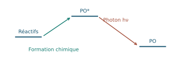
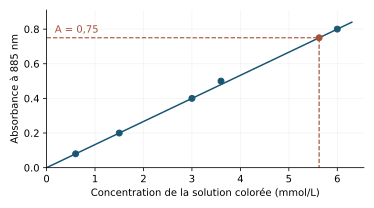
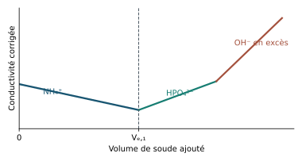
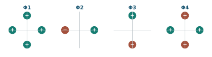
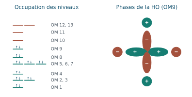
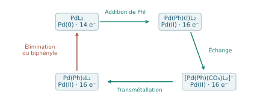
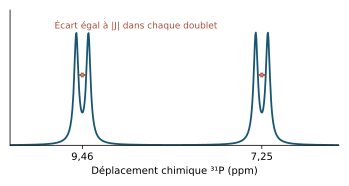
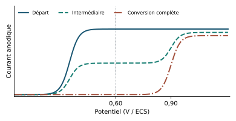
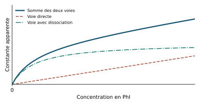

# ENS de Lyon — Second concours · Chimie 2024 · Corrigé partiel guidé

*Corrigé rédigé par IA, non officiel.*

**Rédaction** · modèle exact non renseigné (famille GPT-6) · effort non renseigné · vitesse non renseignée

**Couverture de l’épreuve (58 questions).** Les questions 1–38, 47, 49, 51–54 et 57 sont corrigées intégralement (45 questions). Les questions 39, 42, 44–46, 50, 55–56 et 58 sont traitées partiellement (9 questions) sous l’angle des familles de réactions, de la spectroscopie et de la stéréochimie. Les questions 40, 41, 43 et 48, consacrées à la construction d’intermédiaires de l’achaetolide, restent hors du corrigé. Le sujet ne précise pas le volume de prise nécessaire à la valeur numérique unique demandée en Q15.

## I.1 — Phosphore solide et thermochimie

Une convention de référence fixe les enthalpies de formation. La stabilité relative des formes solides dépend de leurs potentiels chimiques. Le cycle de Hess utilise les énergies de liaison en phase gazeuse.

### Question 1

> [!INDICATION]
> Repérer l’enthalpie standard de formation fixée à zéro dans le tableau 6.

#### Solution

Le phosphore blanc solide est l’état de référence choisi dans le tableau. Son enthalpie standard de formation à 298 K y est nulle. Pour le rouge, la valeur est $-17{,}6\ \mathrm{kJ\,mol^{-1}}$.

### Question 2

> [!INDICATION]
> À température et pression fixées, la forme thermodynamiquement favorisée est celle de plus faible potentiel chimique.

#### Solution

Le tableau donne $\mu^\circ_{\rm rouge}=-24$ et $\mu^\circ_{\rm blanc}=-12\ \mathrm{kJ\,mol^{-1}}$. La transformation du blanc en rouge a donc un $\Delta_rG^\circ$ de $-12\ \mathrm{kJ\,mol^{-1}}$ sur la base molaire du tableau. La forme rouge est plus stable dans ces conditions. Le choix conventionnel de la forme blanche comme référence historique reste compatible avec sa métastabilité.

### Question 3

> [!INDICATION]
> La somme des degrés d’oxydation d’une molécule neutre est nulle.

#### Solution

Les dix O sont au degré $-II$, donc $4x+10(-2)=0$ et chaque phosphore de $\mathrm{P_4O_{10}}$ a le degré d’oxydation $+V$. La structure compte six oxygènes pontants et quatre terminaux.

### Question 4

> [!INDICATION]
> Suivre les électrons célibataires figurés par des points dans le schéma.

#### Solution

Le premier acte fait apparaître des espèces radicalaires à partir des réactifs écrits : c’est l’**initiation**. Les oxygénations successives du fragment phosphoré constituent la **propagation**. Les étapes qui produisent deux radicaux à partir d’un radical sont plus précisément des ramifications dans l’écriture simplifiée du sujet. La fixation du radical O sur $\mathrm{O_2}$ conduit à l’ozone et constitue une **terminaison** pour le porteur radicalaire représenté. Cette classification suit les points de la figure 2.

### Question 5

> [!INDICATION]
> Identifier la source d’énergie de l’espèce excitée avant l’émission.

#### Solution

Une réaction chimique forme $\mathrm{PO^*}$ dans un état électronique excité. Lors de la relaxation radiative $\mathrm{PO^*\to PO}+h\nu$, le photon emporte la différence d’énergie $h\nu=E^*-E$. Une fraction de l’énergie chimique est ainsi émise sous forme de lumière. C’est la chimiluminescence.

### Question 6

> [!INDICATION]
> Employer les états de référence des deux éléments et former exactement une mole de produit.

#### Solution

L’équation de formation est $\mathrm{C(graphite,s)+\tfrac12 O_2(g)\rightarrow CO(g)}$. À 298 K, $\Delta_fH^\circ(\mathrm{CO})=-110\ \mathrm{kJ\,mol^{-1}}$ avec les données arrondies du tableau 6.

### Question 7

> [!INDICATION]
> Construire le cycle de Hess en phase gazeuse pour les énergies de liaison, puis évaluer la variation de capacité thermique.

> [!INDICATION]
> Compter les ponts P–O–P une seule fois, à raison de deux liaisons simples par pont.

#### Solution

On suit les états de l’équation imprimée. Le passage de l’oxyde solide à la molécule gazeuse ajoute $92\ \mathrm{kJ\,mol^{-1}}$. La figure 1 comporte douze liaisons P–O simples et quatre P=O, contre six liaisons P–P pour le tétraèdre élémentaire. Le cycle de Hess à 298 K donne, en $\mathrm{kJ\,mol^{-1}}$,
$$\Delta_rH^\circ_{298}=92+12(335)+4(535)-6(209)-5(497)+10(-110)=1413.$$
Les entropies donnent $\Delta_rS^\circ_{298}=280+10(198)-229-10(5{,}7)=1974\ \mathrm{J\,mol^{-1}\,K^{-1}}$. De même $\Delta_rC_p^\circ=67+10(29)-212-10(8{,}5)=60\ \mathrm{J\,mol^{-1}\,K^{-1}}$. En prenant ces capacités constantes et en gardant les états du bilan, les relations de Kirchhoff donnent
$$\Delta_rH^\circ_{1000}=1413+0{,}060(1000-298)\simeq1455\ \mathrm{kJ\,mol^{-1}},$$
$$\Delta_rS^\circ_{1000}=1974+60\ln(1000/298)\simeq2047\ \mathrm{J\,mol^{-1}\,K^{-1}}.$$
Cette extrapolation à état solide imposé est une convention de l’exercice. La température de fusion annoncée pour l’oxyde est inférieure à 1000 K et les données de changement de phase nécessaires à un calcul avec les phases stables sont incomplètes.

### Question 8

> [!INDICATION]
> Passer par l’énergie libre de réaction et convertir les entropies dans les bonnes unités.

#### Solution

Pour le modèle de Q7, $\Delta_rG^\circ_{1000}=\Delta_rH^\circ-1000\Delta_rS^\circ\simeq-5{,}92\times10^2\ \mathrm{kJ\,mol^{-1}}$. Ainsi $\ln K^\circ=-\Delta_rG^\circ/(RT)\simeq71{,}2$ et $K^\circ\simeq8\times10^{30}$, sans dimension. La précision est celle d’un calcul à partir d’énergies de liaison moyennes et de capacités thermiques constantes.

## I.2 — Analyse d’un engrais

La teneur en phosphore est obtenue grâce à une gamme étalon, celle en azote à partir de la quantité de soude à la première équivalence. Il faut remonter des prises d’essai distinctes au lot initial.

### Question 9

> [!INDICATION]
> Le second nombre du marquage NPK représente une teneur équivalente en oxyde.

#### Solution

Sept kilogrammes de $\mathrm{P_2O_5}$ équivalent contiennent $7\times 2(31)/(2\times31+5\times16)=3{,}06\ \mathrm{kg}$ de P. Le marquage 15-7-7 annonce donc $\boxed{3{,}06\,\%}$ de phosphore élémentaire en masse et $15\,\%$ d’azote élémentaire.

### Question 10

> [!INDICATION]
> Tous les mélanges étalons ont le même volume final. Relier la concentration des ions phosphate à celle du chromophore bleu.

#### Solution

Le réactif molybdique transforme le phosphate en un hétéropolyanion qui, après réduction par l’acide ascorbique, donne du bleu de molybdène. La même coloration est développée pour les étalons et pour l’échantillon. Pour un étalon, $C_i=C_MV_M/(10{,}0\ \mathrm{mL})$. Après soustraction d’un blanc contenant les réactifs, l’absorbance à 885 nm vérifie la loi de Beer–Lambert $A=mC_i$. L’interpolation de l’inconnue dans cette gamme donne la concentration en P du mélange coloré.

### Question 11

> [!INDICATION]
> Dénombrer les atomes de phosphore dans un ion hydrogénophosphate.

#### Solution

Chaque $\mathrm{HPO_4^{2-}}$ contient un atome de P. Si les phosphates de l’engrais sont exprimés en quantité totale d’hydrogénophosphate, $n(\mathrm P)=n(\mathrm{HPO_4^{2-}})$. Les équilibres de protonation conservent le nombre total d’atomes P.

### Question 12

> [!INDICATION]
> Remonter successivement la dilution de 7,5 à 10 mL, puis la dilution d’un facteur dix.

> [!INDICATION]
> La droite est étalonnée en concentration dans le mélange coloré, après ajout des deux réactifs.

#### Solution

Le point $(6{,}0\ \mathrm{mmol\,L^{-1}},0{,}80)$ fixe une pente d’environ $0{,}133$ unité d’absorbance par $\mathrm{mmol\,L^{-1}}$. Pour $A=0{,}75$, le mélange coloré contient environ $5{,}6\ \mathrm{mmol\,L^{-1}}$ de P. La solution $S'$ vaut $5{,}6\times10/7{,}5\simeq7{,}5\ \mathrm{mmol\,L^{-1}}$, puis $S$ vaut environ $75\ \mathrm{mmol\,L^{-1}}$. Dans les 100 mL préparés avec 2,5 g d’engrais, on a donc $\boxed{n(\mathrm P)\simeq7{,}5\ \mathrm{mmol}}$.

### Question 13

> [!INDICATION]
> Comparer deux fractions massiques exprimées toutes deux en phosphore élémentaire.

#### Solution

La masse de P trouvée est $0{,}0075\times31\simeq0{,}23\ \mathrm g$. Sa fraction massique est $0{,}23/2{,}5\simeq9{,}3\,\%$. Cela correspondrait à environ $21\,\%$ de $\mathrm{P_2O_5}$ équivalent, bien au-dessus des $7\,\%$ de l’étiquette. Le facteur d’environ trois dépasse l’incertitude de lecture. La composition annoncée et les données expérimentales de l’exercice ne concordent pas ; ces seules données ne permettent pas d’en identifier la cause.

### Question 14

> [!INDICATION]
> Comparer les acidités de l’ion ammonium et de l’hydrogénophosphate avant de choisir la rupture de pente.

#### Solution

Prélever à la pipette un volume **mesuré** $V_p$ de $S$, ajouter si besoin de l’eau pour immerger la cellule, agiter et ajouter progressivement la soude de concentration connue. Relever la conductivité après chaque ajout. La réaction de dosage de l’ammonium est $\mathrm{NH_4^++OH^-\to NH_3+H_2O}$, de constante $10^{14-9{,}2}\simeq6{,}3\times10^4$. Pour $\mathrm{HPO_4^{2-}+OH^-\rightleftharpoons PO_4^{3-}+H_2O}$, $K\simeq10^{14-12{,}4}\simeq40$. La première neutralisation est donc préférentielle ; les équilibres se recouvrent en pratique à proximité de la rupture.

Tracer $\sigma(V)(V_0+V)/V_0$ pour corriger la dilution, $V_0$ étant le volume initial dans le bécher. Avant la première équivalence, $\mathrm{NH_4^+}$ est essentiellement remplacé par $\mathrm{Na^+}$ moins conducteur, d’où une décroissance. Après consommation préférentielle de l’ammonium, la branche de neutralisation du phosphate peut être distincte ; loin après les deux neutralisations, l’excès de $\mathrm{Na^+}$ et $\mathrm{OH^-}$ donne une forte pente positive. On lit $V_E$ à la première rupture et $n_p(\mathrm{NH_4^+})\simeq C_BV_E$. Le second régime dépend de la concentration en phosphate et de sa conductivité ionique.

### Question 15

> [!INDICATION]
> Le volume de soude donne d’abord la quantité d’azote du prélèvement, puis le volume pipeté fixe le facteur de retour à l’échantillon.

> [!INDICATION]
> La solution de dosage optique est une dilution de la solution mère, et la prise pour la conductimétrie n’est pas identifiée au prélèvement optique.

#### Solution

Dans le prélèvement, $n_p(\mathrm N)=0{,}100\times0{,}0032=3{,}2\times10^{-4}\ \mathrm{mol}$ et $m_p(\mathrm N)=4{,}48\ \mathrm{mg}$. Avec 100 mL de $S$ et un prélèvement de $V_p$ mL, la teneur de l’échantillon de 2,5 g vaut
$$w_{\rm N}(\%)=\frac{100\times0{,}00448}{2{,}5}\frac{100}{V_p}=\frac{17{,}92}{V_p},\qquad V_p\text{ exprimé en mL}.$$
Le volume de prise pour la conductimétrie n’est indiqué ni dans la question ni dans le document 3. La valeur de 7,5 mL y concerne le dosage spectrophotométrique de $S'$. Par exemple, une prise de 1,00 mL de $S$ conduirait à $17{,}9\,\%$ et le titrage des 100 mL entiers à $0{,}179\,\%$. La teneur annoncée de $15\,\%$ correspondrait à une prise de $1{,}19\ \mathrm{mL}$ ; elle ne détermine pas ce qui a été effectivement prélevé.

## II.1 — Orbitales du complexe de palladium

Les quatre groupes donneurs de doublets se combinent avec les orbitales de symétrie compatible du fragment métallique. Le sujet impose une géométrie plan carré pour construire ce diagramme.

### Question 16

> [!INDICATION]
> Repérer le doublet non liant du phosphore d’une phosphine.

#### Solution

Dans $\mathrm{PR_3}$, P utilise trois de ses cinq électrons de valence dans les liaisons P–C et conserve un doublet libre. Il peut donner ce doublet à une orbitale disponible du métal et former une liaison de coordination $\sigma$. Les substituants alkyle favorisent la densité électronique sur P. Chaque phosphine neutre est un ligand L à deux électrons.

### Question 17

> [!INDICATION]
> Le palladium neutre est une exception au remplissage élémentaire en $5s^24d^8$.

#### Solution

Pour $Z=46$, la configuration fondamentale est $[\mathrm{Kr}]\,4d^{10}5s^0$. Les dix électrons $4d$ sont les électrons de valence de l’atome. Les orbitales $5s$ et $5p$ disponibles interviennent aussi dans le diagramme du complexe.

### Question 18

> [!INDICATION]
> Faire agir les opérations sur $x,y,z,xy,xz,yz,x^2-y^2,2z^2-x^2-y^2$. Lire sur la figure 5 l’axe de chaque combinaison de fragments.

> [!INDICATION]
> Si une rotation envoie une orbitale vers une autre, on ne peut lui attribuer une seule parité pour cette rotation.

#### Solution

Les combinaisons $\Phi_2,\Phi_3$ portent leurs lobes sur $x,y$ respectivement. S et A désignent un vecteur propre de signe $+$ ou $-$. M signifie que la transformation échange deux membres d’une paire à un signe près. Par exemple, une rotation directe d’un quart de tour envoie $p_x$ sur $p_y$ et $p_y$ sur $-p_x$.

| Orbitale | $\sigma_{xy}$ | $\sigma_{yz}$ | $\sigma_{xz}$ | $C_{4z}$ |
|---|---|---|---|---|
| $5s,4d_{z^2},\Phi_1$ | S | S | S | S |
| $4d_{x^2-y^2},\Phi_4$ | S | S | S | A |
| $5p_x,\Phi_2$ | S | A | S | M |
| $5p_y,\Phi_3$ | S | S | A | M |
| $5p_z$ | A | S | S | S |
| $4d_{xy}$ | S | A | A | A |
| $4d_{xz}$ | A | A | S | M |
| $4d_{yz}$ | A | S | A | M |

$4d_{z^2}$ désigne l’harmonique proportionnelle à $2z^2-x^2-y^2$. L’arrangement plan carré est le modèle imposé pour cette étude.

### Question 19

> [!INDICATION]
> Un recouvrement avec un ligand doit rester invariant lors de chacune des opérations de symétrie.

#### Solution

$\Phi_1$ peut interagir avec $5s$ **et** $4d_{z^2}$ ; $\Phi_2$ avec $5p_x$ ; $\Phi_3$ avec $5p_y$ ; $\Phi_4$ avec $4d_{x^2-y^2}$. Les orbitales $5p_z,4d_{xy},4d_{xz},4d_{yz}$ restent non liantes dans le modèle $\sigma$. Par exemple une réflexion dans le plan moléculaire fait changer de signe $5p_z$ mais laisse invariant tout le fragment $\sigma$.

### Question 20

> [!INDICATION]
> Identifier d’abord les trois niveaux rouges de l’annexe, puis les niveaux restés aux énergies métalliques.

#### Solution

Selon la numérotation ascendante des treize OM, on trouve les affectations suivantes. L’ordre à l’intérieur d’une dégénérescence est conventionnel.

| Niveaux | Orbitales du métal et des ligands |
|---|---|
| OM1, OM8, OM11 | Trois combinaisons de $5s,4d_{z^2},\Phi_1$ ; niveaux rouges de l’annexe |
| OM2, OM3 | Combinaisons liantes de $5p_x,\Phi_2$ et $5p_y,\Phi_3$ |
| OM4 | Combinaison liante de $4d_{x^2-y^2}$ avec $\Phi_4$ |
| OM5, OM6, OM7 | $4d_{xy},4d_{xz},4d_{yz}$ non liantes, à l’énergie $4d$ |
| OM9 | Combinaison antiliante de $4d_{x^2-y^2}$ avec $\Phi_4$ |
| OM10 | $5p_z$ non liante, à l’énergie $5p$ |
| OM12, OM13 | Partenaires antiliantes de OM2, OM3 |

On retrouve les $9+4=13$ orbitales du métal et du fragment ligand.

### Question 21

> [!INDICATION]
> Additionner les dix électrons du Pd(0) et les quatre doublets apportés par les phosphines.

> [!INDICATION]
> L’occupation de la combinaison antiliante est possible dans ce complexe riche en électrons.

#### Solution

Le complexe contient 18 électrons de valence. Chaque niveau de OM1 à OM9 reçoit deux électrons. La **HO est OM9**, combinaison antiliante de $d_{x^2-y^2}$ et $\Phi_4$. La **BV est OM10**, orbitale $5p_z$ métallique non liante. Pour dessiner la HO, mettre les lobes $d$ sur $\pm x$ en phase entre eux et en opposition avec ceux sur $\pm y$. Les contributions des quatre ligands sont en opposition de phase avec le lobe métallique qui leur fait face.

## II.2 — Couplage de Suzuki

Le comptage électronique distingue les substitutions de ligands des étapes où le degré d’oxydation du métal varie.

### Question 22

> [!INDICATION]
> Additionner les étapes en éliminant les intermédiaires au palladium.

#### Solution

La liaison créée unit les deux groupes phényle, et le produit organique est le biphényle. En gardant les espèces carbonatées formelles de la figure 6, le bilan s’écrit
$$\mathrm{PhI+PhB(OH)_2+2CO_3^{2-}\longrightarrow Ph{-}Ph+I^-+[B(OH)_2(CO_3)_2]^{3-}}.$$
Un carbonate active le borane, l’autre apparaît à l’étape d’échange de ligand. Le catalyseur actif $\mathrm{Pd(PPh_3)_2}$ est régénéré.

### Question 23

> [!INDICATION]
> En méthode ionique, un phényle ou un halogénure lié à Pd est un ligand X. Une phosphine apporte deux électrons.

#### Solution

Notons $L=\mathrm{PPh_3}$. Dans le modèle de la figure, le carbonate est monodentate.

| Étape | Description | Complexe obtenu | État du Pd | Électrons |
|---|---|---|---|---|
| Départ | Précurseur | $\mathrm{PdL_4}$ | 0, $d^{10}$ | 18 |
| 1 | Dissociation de deux phosphines | $\mathrm{PdL_2}$ | 0, $d^{10}$ | 14 |
| 2 | Addition oxydante de PhI | $\mathrm{Pd(Ph)(I)L_2}$ | +II, $d^8$ | 16 |
| 3 | Substitution de l’iodure par le carbonate | $[\mathrm{Pd(Ph)(CO_3)L_2}]^-$ | +II, $d^8$ | 16 |
| 4 | Transmétallation de B vers Pd | $\mathrm{Pd(Ph)_2L_2}$ | +II, $d^8$ | 16 |
| 5 | Élimination réductrice du biphényle | $\mathrm{PdL_2}$ | 0, $d^{10}$ | 14 |

L’élimination réductrice réunit deux groupes aryle cis. Les dessins de cycles peuvent omettre la réorganisation géométrique préalable.

### Question 24

> [!INDICATION]
> L’eau dissout les sels, tandis que les partenaires arylés ont une affinité élevée pour un milieu organique.

#### Solution

Le bromure de tétrabutylammonium apporte le cation amphiphile $\mathrm{Bu_4N^+}$. Il peut former des paires d’ions avec des espèces anioniques et facilite leur transfert à l’interface avec les réactifs organiques. Il joue ainsi un rôle d’agent de transfert de phase dans ce couplage en milieu aqueux.

### Question 25

> [!INDICATION]
> Rapporter une quantité de produit à la quantité de catalyseur introduite.

#### Solution

Le nombre de rotations est $\mathrm{TON}=n(\text{biphényle formé})/n(\text{Pd introduit})=2941$. Cela représente en moyenne 2941 molécules de biphényle par atome de Pd initialement engagé. La vitesse de ces cycles serait décrite par une fréquence de rotation, qui nécessite une durée.

## II.3 — Chélation, RMN et cinétique

La RMN renseigne sur les environnements des deux P du chélate. Le courant anodique renseigne sur la quantité du complexe réactif. Deux voies d’addition oxydante expliquent la dépendance en concentration de PhI.

### Question 26

> [!INDICATION]
> Identifier les éléments de chiralité dans les squelettes carbonés, puis compter les atomes donneurs.

#### Solution

Le DIOP dessiné possède deux centres stéréogènes carbonés dans le cycle dioxolane. Le BINAP possède une chiralité axiale par rotation entravée autour de la liaison entre les deux noyaux naphtyle, conduisant à deux atropisomères. Les deux ligands sont des diphosphines chélatantes neutres. Ils peuvent coordonner le même Pd par leurs deux atomes P, en mode $\kappa^2$-P,P, et donner quatre électrons au total.

### Question 27

> [!INDICATION]
> Combiner abondance naturelle, sensibilité magnétique et sélectivité pour l’élément observé.

#### Solution

$^{31}\mathrm P$ est de spin $1/2$ et d’abondance naturelle voisine de 100 %, contre 1,07 % pour $^{13}\mathrm C$. Son rapport gyromagnétique ($108{,}3\times10^6\ \mathrm{rad\,s^{-1}\,T^{-1}}$) dépasse celui de $^{13}\mathrm C$ ($67{,}3\times10^6$), mais reste inférieur à celui du proton ($267{,}5\times10^6$). L’avantage sur $^1\mathrm H$ ici est la simplicité du spectre. Seuls les environnements phosphorés apparaissent, et le déplacement chimique des P varie nettement à la coordination. On suit ainsi le ligand libre et les complexes sans la superposition des nombreux protons aromatiques.

### Question 28

> [!INDICATION]
> Utiliser les deux équivalents de ligand apportés et l’absence de phosphine libre au déplacement donné.

#### Solution

Avec deux équivalents de DIOP, le spectre (a) présente un seul signal proche de 0 ppm et aucun signal du ligand libre à $-22{,}39\ \mathrm{ppm}$. L’attribution attendue est $\mathrm{[Pd(DIOP)_2]}$. Deux diphosphines chélatent Pd(0), soit quatre P équivalents à l’échelle de la RMN et un complexe à 18 électrons. Cette saturation rend compte de l’inactivité observée vis-à-vis de PhI dans les conditions de l’expérience.

### Question 29

> [!INDICATION]
> Comparer les deux atomes P dans l’environnement créé par la coordination d’une double liaison de dba.

#### Solution

Dans $\mathrm{[Pd(dba)(DIOP)]}$, DIOP chélate par ses deux P et dba coordonne par une double liaison $\eta^2$. Les deux extrémités de cette double liaison sont différentes, côté phényle et côté carbonyle conjugué. L’orientation de dba rompt l’équivalence des deux P à l’échelle de la RMN, même si ce sont les deux bras d’un même chélate. Les deux environnements donnent les signaux à 7,25 et 9,46 ppm.

### Question 30

> [!INDICATION]
> Le noyau voisin $^{31}\mathrm P$ a un spin $1/2$ et une abondance naturelle proche de 100 %.

#### Solution

Les deux P non équivalents sont couplés scalairement à travers le palladium ($^2J_{\rm PP}$). Chaque P voit les deux états du spin de l’autre et son signal se dédouble. Dans l’approximation du premier ordre, les deux doublets ont le même écartement $|J_{\rm PP}|$ en hertz et des composantes 1:1.

### Question 31

> [!INDICATION]
> Commencer par la perte de dba demandée, puis distinguer la fixation d’un donneur et la fermeture du chélate.

#### Solution

Une séquence compatible est
$$\mathrm{Pd(dba)_2\rightleftharpoons Pd(dba)+dba},$$
$$\mathrm{Pd(dba)+DIOP\rightleftharpoons Pd(dba)(\kappa^1\!{-}DIOP)},$$
$$\mathrm{Pd(dba)(\kappa^1\!{-}DIOP)\rightleftharpoons Pd(dba)(\kappa^2\!{-}DIOP)}.$$
Les deux dernières étapes correspondent à la coordination du premier P, puis à la fermeture intramoléculaire du chélate. Les molécules de solvant susceptibles d’occuper provisoirement des sites sont omises. Le spectre confirme la présence du produit, sans imposer à lui seul une voie unique.

### Question 32

> [!INDICATION]
> Un potentiostat contrôle le potentiel d’une électrode par rapport à une référence et mesure le courant vers une auxiliaire.

#### Solution

On utilise une cellule à trois électrodes. Une électrode de travail inerte, par exemple de carbone vitreux, est maintenue à $+0{,}60\ \mathrm V$ par rapport à l’électrode au calomel saturée (ECS). Une contre-électrode inerte ferme le circuit du courant. Le potentiostat mesure $i(t)$ après ajout de PhI. Un électrolyte support limite la migration. Une agitation ou une rotation reproductible impose un transport de matière constant afin que le courant limite soit proportionnel à la concentration.

### Question 33

> [!INDICATION]
> Additionner les vagues d’oxydation des deux complexes, dont les hauteurs limites suivent leurs concentrations.

> [!INDICATION]
> Comparer les hauteurs à potentiel fixé, en gardant l’électrode de référence identique.

#### Solution

Au départ seul le complexe réactif donne une vague dont le palier inclut $0{,}60\ \mathrm V$. À un instant intermédiaire, la première vague diminue tandis qu’une seconde apparaît vers $0{,}90\ \mathrm V$ avec le produit. À conversion complète, seule demeure la seconde vague. Au potentiel de mesure, le courant du produit est encore négligeable. Les hauteurs totales des deux vagues n’ont pas à être identiques si les coefficients de diffusion ou le nombre d’électrons diffèrent. Un réactif restant à la fin conserverait une partie de la première vague.

### Question 34

> [!INDICATION]
> Intégrer la loi de disparition de premier ordre en complexe et utiliser deux fois la proportionnalité du courant à sa concentration.

#### Solution

À conditions de milieu fixées, $-dC_{\rm Pd}/dt=k_{\rm app}C_{\rm Pd}$, d’où $C_{\rm Pd}(t)=C_0e^{-k_{\rm app}t}$ et $i/i_0=C_{\rm Pd}/C_0$. Ainsi $\ln(i_0/i)=k_{\rm app}t$. La figure 9a présente des droites de pentes positives différentes. Pour une loi puissance simple en PhI, $k_{\rm app}=k[\mathrm{PhI}]^\alpha$ lorsque cette concentration est pratiquement constante. Plus généralement, Q36 détermine la fonction effective de [PhI] pour deux voies parallèles.

La légende imprime $2\ \mathrm{mol\,L^{-1}}$ de complexe pour $0{,}05$ à $0{,}4\ \mathrm{mol\,L^{-1}}$ de PhI. Prises littéralement, ces valeurs ne réalisent pas un excès de PhI et ne permettraient pas la disparition complète du complexe. L’exploitation en pseudo-premier ordre suppose PhI quasi constant sur la fenêtre étudiée.

### Question 35

> [!INDICATION]
> Examiner si la pente de la courbe de $k_{\rm app}$ reste la même à toutes les concentrations en PhI.

#### Solution

$k_{\rm app}$ augmente avec [PhI]. La courbe de la figure 9b n’est pas une droite passant par l’origine sur tout le domaine et sa pente apparente diminue. On ne peut attribuer un ordre global unique en PhI à partir de ce tracé. Le modèle de Q36 associe une contribution linéaire et une contribution qui se sature, et explique l’ordre apparent variable.

### Question 36

> [!INDICATION]
> Écrire le bilan de formation et de consommation du complexe sans dba. Les deux voies forment le même produit.

> [!INDICATION]
> La quantité de B produite par dissociation est répartie entre recombinaison et réaction avec PhI.

#### Solution

Posons $A=\mathrm{[Pd(dba)(DIOP)]}$, $B=\mathrm{[Pd(DIOP)]}$ et $X=\mathrm{PhI}$. La voie directe fournit le produit à $k_0[A][X]$. L’autre voie comporte la dissociation de A à $k_1[A]$, la recombinaison à $k_{-1}[B][\mathrm{dba}]$ et l’addition de X à $k_2[B][X]$. Après le transitoire, l’AEQS donne
$$0\simeq k_1[A]-(k_{-1}[\mathrm{dba}]+k_2[X])[B],\qquad [B]\simeq\frac{k_1[A]}{k_{-1}[\mathrm{dba}]+k_2[X]}.$$
En additionnant les deux contributions à $v=k_0[A][X]+k_2[B][X]=k_{\rm app}[A]$, il vient
$$\boxed{k_{\rm app}=k_0[X]+\frac{k_2k_1[X]}{k_{-1}[\mathrm{dba}]+k_2[X]}}.$$
À [dba] fixé, la seconde contribution tend vers $k_1$ quand [X] devient grand, tandis que la première continue à augmenter.

### Question 37

> [!INDICATION]
> Les temps de demi-réaction sont directement comparables car les conditions sont identiques.

#### Solution

Le complexe au DIOP a un temps de demi-réaction de 34 s, contre 16 300 s avec BINAP, soit un facteur $16300/34\simeq480$. La réaction est donc beaucoup plus rapide avec DIOP. Les valeurs tabulées de $k_0$ et de $k_1$ sont respectivement 12 et 5 fois plus grandes pour DIOP. Les seules bornes inférieures de $k_{-1}$ et $k_2$ ne donnent pas des rapports mesurés. Le squelette biaryle rigide et encombré de BINAP peut modifier l’accessibilité du métal et le coût de réorganisation. Cette interprétation stérique est plausible. Les données ne séparent pas ses effets de ceux de l’angle de chélation ou de l’électronique du ligand.

## III — Questions de chimie organique

La dernière partie examine la convergence, les fonctions organiques et les sources de sélectivité. Les questions qui reçoivent une réponse partielle sont repérées dans leur titre.

### Question 38

> [!INDICATION]
> Dessiner les opérations de synthèse sous forme d’un arbre et repérer à quel moment les branches se rejoignent.

#### Solution

Une synthèse est convergente si deux fragments préparés séparément sont réunis dans une étape ultérieure. Chaque fragment peut être élaboré en parallèle. Pour deux branches de trois étapes, suivies d’un couplage, la plus longue séquence linéaire compte quatre étapes. Cette organisation réduit les pertes cumulées sur une même branche et facilite le travail sur des sous-ensembles de la molécule.

### Question 39 — éléments de réponse

> [!INDICATION]
> Un peracide possède une liaison peroxyde. Identifier le type de fonction qu’il forme sur une double liaison isolée.

#### Solution

En chimie des alcènes, un peracide carboxylique de formule $\mathrm{R{-}C(O){-}OOH}$ peut transférer l’oxygène terminal sur les deux carbones de la double liaison. La nouvelle fonction est un époxyde, éther cyclique à trois chaînons. L’addition concertée conserve la disposition relative des substituants portés par l’alcène initial.

### Question 42 — éléments de réponse

> [!INDICATION]
> Comparer les constantes cinétiques de deux énantiomères face à un catalyseur chiral.

#### Solution

Une résolution cinétique consiste à faire réagir un mélange racémique avec un réactif ou catalyseur chiral. Les deux énantiomères passent par des états de transition diastéréoisomères, dont les énergies peuvent différer. À conversion partielle, l’énantiomère le plus lent s’enrichit dans le substrat restant. En l’absence de racémisation, le rendement maximal idéal de récupération d’un énantiomère pur du substrat est de 50 %. L’ouverture hydrolytique d’un époxyde donne en général un diol vicinal.

### Question 44 — éléments de réponse

> [!INDICATION]
> Comparer les bandes IR qui renseignent directement sur la présence d’un groupe hydroxy libre.

#### Solution

La bande large vers $3500\ \mathrm{cm^{-1}}$ indique un alcool avec des liaisons hydrogène. Sa disparition dans la lactone est cohérente avec la consommation du OH libre. Une lactone est un ester cyclique, dont la liaison carbonyle donne une bande IR intense. Ces indices établissent un changement de fonction mais, isolément, ne fixent ni la taille du cycle ni la stéréochimie.

### Question 45 — éléments de réponse

> [!INDICATION]
> Séparer les notions de régiosélectivité, de chimiosélectivité et de stéréosélectivité.

#### Solution

Une addition syn fixe deux substituants sur la même face d’une double liaison ; une addition anti les fixe sur des faces opposées. Une réaction est stéréospécifique lorsque la géométrie du substrat impose la relation stéréochimique des produits. La préférence pour une face plutôt que l’autre en présence d’un centre déjà chiral est une diastéréosélectivité. La chimiosélectivité concerne le choix d’une fonction parmi plusieurs.

### Question 46 — éléments de réponse

> [!INDICATION]
> Distinguer phosphine, sel de phosphonium, ylure et oxyde de phosphine.

#### Solution

Dans une oléfination de Wittig, le doublet de la phosphine lui permet de former un sel de phosphonium. Sa forme déprotonée est un ylure, décrit par les formes $\mathrm{Ph_3P^+{-}C^-R_2\leftrightarrow Ph_3P{=}CR_2}$. Le carbone nucléophile de l’ylure se lie au carbone d’un carbonyle. L’oxaphosphétane résultant se fragmente en alcène et $\mathrm{Ph_3P{=}O}$. La formation de la liaison forte entre P et O contribue à la force motrice.

### Question 47

> [!INDICATION]
> Distinguer l’extraction, qui récupère le soluté recherché, et les lavages, qui enlèvent des impuretés.

#### Solution

L’addition d’eau et de dichlorométhane crée deux phases : les composés organiques neutres se répartissent préférentiellement dans le solvant organique, les sels dans l’eau. Réextraire la phase aqueuse améliore la récupération selon le coefficient de partage. On réunit les phases organiques. Le lavage acide dilué protonne les impuretés basiques extractibles. Le lavage à l’eau enlève notamment l’acide et les sels hydrosolubles, puis la saumure facilite la séparation et retire une partie de l’eau dissoute dans la phase organique. Le sulfate de sodium anhydre fixe l’eau résiduelle. La filtration élimine le desséchant et l’évaporation sous pression réduite retire le solvant volatil.

### Question 49

> [!INDICATION]
> Employer les deux couples dont l’un fournit le proton et dont l’autre le reçoit.

> [!INDICATION]
> Pour un transfert de proton, utiliser le pKa de l’acide formé moins celui de l’acide consommé.

#### Solution

L’équilibre est $\mathrm{ClO_2^-+H_2PO_4^-\rightleftharpoons HClO_2+HPO_4^{2-}}$. Sa constante vaut $10^{\mathrm pK_a(\mathrm{HClO_2})-\mathrm pK_a(\mathrm{H_2PO_4^-})}=10^{2{,}0-7{,}2}\simeq6{,}3\times10^{-6}$. La fraction d’acide chloreux est donc faible à activités comparables ; sa consommation dans une étape ultérieure peut déplacer cet équilibre.

### Question 50 — éléments de réponse

> [!INDICATION]
> Comparer l’état d’oxydation du carbone aldéhydique et celui du carbone carboxylique.

#### Solution

Dans une oxydation de Pinnick, le bilan de fonctions est $\mathrm{RCHO+HClO_2\longrightarrow RCOOH+HOCl}$. Le carbone de l’aldéhyde subit une oxydation à deux électrons. Le chlore passe du degré $+III$ à $+I$. Le mécanisme usuel comporte une addition sur le carbonyle activé, puis la fragmentation d’un adduit hydroxychlorite qui conduit à l’acide carboxylique. Ce bilan s’applique à un aldéhyde générique.

### Question 51

> [!INDICATION]
> Le doublet π d’une double liaison peut réagir avec le chlore électrophile de HOCl.

#### Solution

Le 2-méthylbut-2-ène capte HOCl sous forme de chlorhydrine. L’orientation usuelle d’ouverture du chloronium place OH sur le plus substitué des deux carbones. Le bilan majoritaire s’écrit $\mathrm{(CH_3)_2C{=}CHCH_3+HOCl\to (CH_3)_2C(OH){-}CH(Cl)CH_3}$. L’ouverture est anti. L’alcène sacrificiel consomme l’acide hypochloreux et réduit les réactions secondaires d’oxydation ou de chloration des autres espèces organiques.

### Question 52

> [!INDICATION]
> Préciser quelle fonction est directement reconnue par l’oxydant discuté dans l’énoncé.

#### Solution

Un alcool primaire et un acide carboxylique sont séparés par deux oxydations successives à deux électrons. Le premier niveau est l’aldéhyde, le second l’acide. L’oxydation de Pinnick agit sur l’aldéhyde. S’arrêter d’abord à ce niveau d’oxydation, puis employer cette réaction sélective, permet de ménager d’autres groupes sensibles.

### Question 53

> [!INDICATION]
> Exploiter la symétrie du motif azo flanqué de deux carbamates et suivre le doublet de la phosphine.

#### Solution

En notant $E=\mathrm{CO_2iPr}$, le DIAD est $\mathrm{E{-}N{=}N{-}E}$. Les deux azotes azo sont équivalents. Les substituants électroattracteurs favorisent l’attaque d’un de ces N par le doublet de $\mathrm{PPh_3}$. Le doublet π se déplace vers l’autre N. La bétaïne obtenue s’écrit $\mathrm{E{-}N(P^+Ph_3){-}N^-{-}E}$. Les carbonyles sont aussi polarisés, mais l’addition qui conduit à cet intermédiaire porte sur N=N.

### Question 54

> [!INDICATION]
> Identifier ce que devient la double liaison azo dans le bilan donné.

#### Solution

Le DIAD est l’accepteur d’hydrogène et d’électrons du système de Mitsunobu. La bétaïne formée avec $\mathrm{PPh_3}$ participe aux transferts de protons et à l’activation de l’alcool. Le DIAD est réduit en hydrazinedicarboxylate. L’alcool activé peut être substitué par le nucléophile, avec inversion au carbone porteur lorsque l’attaque est de type $\mathrm S_N2$. Le DIAD est consommé.

### Question 55 — éléments de réponse

> [!INDICATION]
> Comparer l’affinité du fluorure pour le silicium et la sensibilité acide des acétals.

#### Solution

Le fluorure attaque le silicium d’un éther silylé. L’intermédiaire hypercoordonné se fragmente avec formation d’une liaison Si–F et libération d’un alcoolate, protoné ensuite en alcool. Cette déprotection permet de conserver un acétal acidolabile présent dans la même molécule. Un milieu fortement acide risquerait de retirer les deux protections.

### Question 56 — éléments de réponse

> [!INDICATION]
> Un catalyseur de Grubbs permet l’échange de partenaires entre doubles liaisons.

#### Solution

La réaction générale est une métathèse cyclisante. Deux doubles liaisons terminales d’une même molécule peuvent donner une double liaison dans un cycle et de l’éthène $\mathrm{CH_2{=}CH_2}$ comme petit coproduit. Les deux géométries $E$ et $Z$ de la double liaison interne peuvent devenir distinctes selon la taille et les contraintes du cycle.

### Question 57

> [!INDICATION]
> L’inversion de géométrie d’une seule double liaison conserve la connectivité et les autres centres stéréogènes.

#### Solution

Les formes $E$ et $Z$ sont des **diastéréoisomères géométriques**. Elles peuvent avoir des propriétés physiques différentes, même dans un environnement achiral. Une chromatographie sur une phase stationnaire achirale ou une HPLC préparative peut les séparer si les temps de rétention sont suffisamment différents ; l’isolement et l’identification des fractions s’appuient ensuite sur des données spectrales.

### Question 58 — éléments de réponse

> [!INDICATION]
> Distinguer l’introduction d’information chirale, son transfert et la séparation des géométries d’une double liaison.

#### Solution

Une résolution cinétique peut fournir un premier fragment énantioenrichi. La différenciation ultérieure de deux faces diastéréotopiques permet de fixer la configuration relative de centres supplémentaires. Une substitution stéréospécifique peut transmettre l’information en inversant un centre existant. Séparer des isomères $E/Z$ trie une géométrie de double liaison et ne suffit pas à garantir à elle seule la pureté énantiomérique.

## Bilan

Les deux dosages montrent pourquoi il faut suivre séparément le volume de dilution et celui du prélèvement. Pour le palladium, les niveaux orbitalaires du complexe plan carré, les environnements mesurés en RMN et les deux voies cinétiques décrivent trois expériences différentes. Dans la partie organique, l’existence d’un centre chiral, l’inversion d’un centre déjà formé et la séparation de géométries E/Z répondent à trois questions stéréochimiques distinctes.
