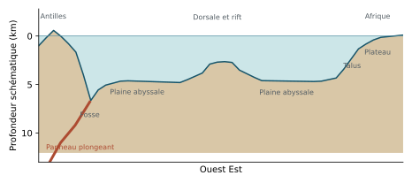
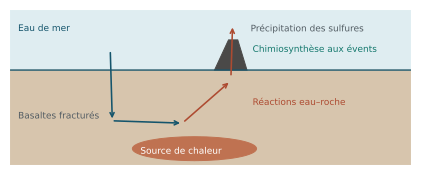
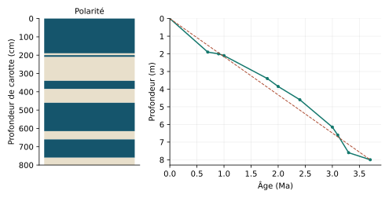
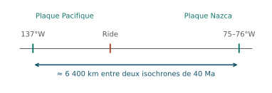
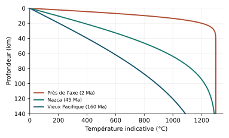
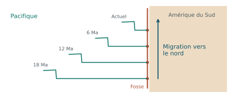
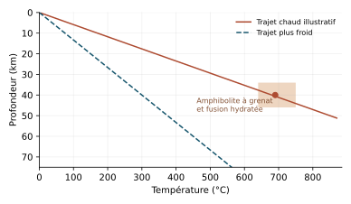

# ENS de Lyon — Second concours · Géosciences 2024 · Corrigé brut

*Corrigé rédigé par IA, non officiel.*

**Rédaction** · modèle exact non renseigné (famille GPT-6) · effort non renseigné · vitesse non renseignée

**Révision (tour 1)** · GPT-6.2 Astra Ultra · vitesse non renseignée

**Révision (tour 2)** · GPT-6.2 Astra Ultra · vitesse non renseignée

Voyage d’une lithosphère océanique de la ride à la fosse. Épreuve écrite de trois heures. [Sujet et annexes](https://banques-ecoles.fr/cms/wp-content/uploads/2024/08/24_2cc_sujet_ST.pdf) · [Rapport du jury](https://banques-ecoles.fr/cms/wp-content/uploads/2024/08/24_2cc_rap_eST.pdf)

## A — Morphologie des bassins océaniques

### Question 1

Dans les Petites Antilles, la lithosphère océanique atlantique plonge **vers l’ouest** sous la plaque Caraïbe. D’ouest en est, on rencontre l’arc volcanique et la marge active, le prisme d’accrétion et la fosse à l’est de l’arc, une plaine abyssale, la dorsale médio-atlantique surélevée avec son rift axial, une autre plaine abyssale, puis le glacis, le talus et le plateau continental ouest-africains. La marge africaine est passive. Les plaines abyssales sont souvent vers 4–5 km de profondeur et la crête de la dorsale vers 2–3 km. Ces valeurs indicatives donnent une échelle au croquis.

### Question 2

Une **marge passive** correspond à une ancienne zone de rifting désormais solidaire de la même plaque que le plancher océanique voisin. On peut y trouver une croûte étirée, des blocs basculés, une épaisse couverture sédimentaire subsidente et un plateau puis un talus. La sismicité y est relativement faible. Une **marge active de subduction** coïncide avec une limite convergente. Fosse, prisme d’accrétion ou érosion tectonique, séismes dont les foyers suivent un plan plongeant et arc magmatique en retrait en sont les indices. D’autres marges actives sont transformantes et ne possèdent pas toute cette association.

### Question 3

| Critère | Dorsale rapide, exemple est-Pacifique | Dorsale lente à ultralente, exemples Atlantique et Sud-Ouest indien |
|---|---|---|
| Accrétion | Apport magmatique fréquent et relativement continu | Extension davantage accommodée par les failles, apport magmatique discontinu |
| Croûte | Basaltes en coussins ou en coulées, filons doléritiques, gabbros ; manteau péridotitique sous le Moho | Succession souvent incomplète et latéralement variable ; basaltes et intrusions gabbroïques discontinus, affleurements possibles de péridotites serpentinisées |
| Relief axial | Bombement axial étroit, sans large vallée axiale permanente | Vallée de rift bordée de grands escarpements ; parfois complexes de cœur océanique exhumés par détachement |
| Segmentation | Accrétion organisée en segments et discontinuités, relief globalement plus régulier | Segments magmatiques séparés de domaines plus tectoniques, relief contrasté |
| Épaisseur | Couramment 6–7 km de croûte magmatique | Plusieurs kilomètres dans les segments bien alimentés, mais croûte très amincie ou localement absente dans les domaines pauvres en magma |

Ces deux colonnes sont des pôles. Une dorsale lente possède aussi des segments magmatiques et l’épaisseur **crustale** ne mesure pas celle de toute la lithosphère refroidie.

## B — Échanges hydrothermaux à la ride

### Question 4

L’eau de mer s’infiltre par les fractures, se réchauffe au contact des roches chaudes et circule par convection. Les réactions eau–roche modifient sa composition et celle du plancher. En remontant, le fluide chaud, réduit et chargé en métaux se mélange à l’eau froide et oxygénée. Les sulfures métalliques précipitent en particules sombres et construisent les cheminées des fumeurs noirs (A, B). L’hydratation des péridotites peut former des serpentinites (D). Les basaltes en coussins fragmentés par trempe produisent des hyaloclastites ; les fluides peuvent cimenter les brèches avec des zéolites (E).

Des microorganismes chimio-litho-autotrophes tirent leur énergie de couples redox, par exemple de l’oxydation des sulfures ou du dihydrogène, et fixent le carbone minéral. Ils alimentent les réseaux trophiques des évents, directement ou par symbiose. La photo C de crustacés sur sulfures témoigne de cette faune. La photosynthèse locale n’est pas nécessaire à cette production primaire.

Dans le panneau A de l’annexe D, le claste de basalte chloritisé conserve la trace d’une transformation de la roche. Les annotations distinguent la pyrite des oxydes de fer (hématite et magnétite). Le dépôt métallique de l’évent B et l’altération du basalte A enregistrent ainsi deux étapes complémentaires de la circulation.

## C — Sédimentation, ouverture et refroidissement

### Question 5

En partant du sommet actuel, la base du premier intervalle normal est à 190 cm et correspond à 0,7 Ma dans l’échelle donnée. Les petits intervalles normaux 200–210 cm puis 340–385 cm correspondent ainsi à Jaramillo (0,9–1,0 Ma) et Olduvai (1,8–2,0 Ma). En poursuivant l’appariement, 460, 615, 660 et 760 cm correspondent respectivement à 2,4 ; 3,0 ; 3,1 et 3,3 Ma. À 800 cm commence la polarité normale de Cochiti, à **3,7 Ma** sur cette échelle simplifiée.

La vitesse moyenne de sédimentation conservée dans la carotte est $v_s=8000\ \mathrm{mm}/3700\ \mathrm{ka}\simeq\boxed{2{,}16\ \mathrm{mm/ka}}$, soit $2{,}16\ \mathrm{m/Ma}$. Les intervalles individuels ne donnent pas tous cette vitesse. Hiatus éventuels et compaction limitent la portée d’une extrapolation.

Les limites successives permettent de tester l’hypothèse de vitesse constante. Entre 0 et 0,7 Ma, les 1,90 m supérieurs donnent environ $2{,}7\ \mathrm{mm/ka}$. Entre 0,9 et 1,0 Ma, les 10 cm de la bande de Jaramillo donnent environ $1\ \mathrm{mm/ka}$. La valeur de $2{,}16\ \mathrm{mm/ka}$ doit être calculée par épaisseur totale divisée par durée totale. Une moyenne arithmétique non pondérée des vitesses de chaque bande surreprésenterait les courts épisodes.

### Question 6

Au large de l’Atacama, la bande voisine de la fosse correspond à environ **40–50 Ma** sur la figure 2. Au taux pélagique de Q5, on attend $H=v_st\simeq2{,}16(40\text{ à }50)=86$ à $108\ \mathrm m$, donc environ **100 m**. La carotte contient argiles et boues siliceuses, alimentées notamment par les poussières, les particules fines et les restes d’organismes planctoniques.

Près d’un continent, les apports fluviaux, côtiers et turbiditiques peuvent augmenter le taux. Au nord du Chili, l’hyperaridité du désert d’Atacama limite ruissellement et apports fluviaux. Le modèle pélagique est donc plus plausible ici qu’au sud humide, sans être exactement constant dans le temps ou dans l’espace. Les vents et les événements rares peuvent encore transporter du matériel terrigène.

### Question 7

L’isochrone de **40 Ma**, à la limite des bandes 30–40 et 40–50 Ma, coupe approximativement le parallèle vers **137°W** à l’ouest et **75–76°W** à l’est. L’écart est d’environ $61$ à $62^\circ$. Sur un parallèle, $s=R\cos\varphi\,\Delta\lambda$ avec l’angle en radians. On obtient $s\simeq6371\cos20^\circ\times61{,}5\pi/180\simeq6420\ \mathrm{km}$. La vitesse d’ouverture totale est donc $6420/40\simeq160\ \mathrm{km/Ma}$, soit $\boxed{16\ \mathrm{cm/an}}$, à environ 1–2 cm/an près pour cette lecture.

On a mesuré **les deux flancs** ; il ne faut pas doubler de nouveau cette valeur. Le partage de l’ouverture entre les deux plaques peut être asymétrique. L’Atlantique médian s’ouvre typiquement de quelques centimètres par an, souvent 2 à 4 cm/an en vitesse totale. Le vaste système de subductions du Pacifique entretient une forte traction des panneaux plongeants. L’équilibre entre cette traction, la poussée gravitaire et les résistances aux limites de plaques diffère de l’Atlantique.

L’échelle de l’annexe A place 40 Ma à l’Éocène, entre les repères 33,9 et 55,8 Ma de la colonne Gradstein–Ogg imprimée. La date de la paire d’isochrones fixe la durée du calcul. Utiliser l’intégralité de la durée de l’Éocène donnerait une autre vitesse.

### Question 8

À l’axe, l’asthénosphère chaude est proche du fond et la circulation hydrothermale exporte de la chaleur. En s’éloignant, la plaque perd de la chaleur par sa surface. La conduction fait descendre progressivement les isothermes internes, avec une échelle de longueur proportionnelle à $\sqrt{\kappa t}$. Dans les premiers kilomètres, le géotherme jeune a un gradient plus fort. À profondeur égale, la plaque âgée est généralement plus froide. La limite thermique de la lithosphère, souvent repérée par une isotherme voisine de 1300 °C, s’approfondit.

La croûte magmatique garde approximativement son épaisseur initiale ; la lithosphère s’épaissit surtout par refroidissement du manteau supérieur. La contraction augmente la densité moyenne, provoque une subsidence progressive du fond et favorise la flottabilité négative d’une lithosphère ancienne à l’entrée d’une subduction.

### Question 9

Pour 45 Ma, $t=45\times10^6\times365{,}25\times86400\simeq1{,}42\times10^{15}\ \mathrm s$. L’équation imposée donne $h=\sqrt{10^{-6}t}\simeq3{,}77\times10^4\ \mathrm m$, soit **38 km**, avec environ 36–40 km pour 40–50 Ma. Cette échelle de diffusion n’est pas une définition universelle de l’épaisseur jusqu’à une isotherme précise. Un autre seuil thermique donnerait un préfacteur différent.

À 20°S, le géotherme de Nazca se place entre celui de l’axe et celui du Pacifique occidental ancien. Le plancher des Mariannes, d’ordre 150–170 Ma, a refroidi plus longtemps. Le même modèle donne environ 69–73 km pour cet âge, donc un manteau lithosphérique plus froid et une zone refroidie plus profonde.

Le demi-espace conducteur donne un sens précis à la profondeur calculée. Pour une plaque initialement à $T_m$ et une surface maintenue à $T_s$, $(T-T_s)/(T_m-T_s)=\mathrm{erf}[z/(2\sqrt{\kappa t})]$. À la profondeur $h=\sqrt{\kappa t}$ demandée par le sujet, ce rapport vaut $\mathrm{erf}(0{,}5)\simeq0{,}52$. L’isotherme correspondant à 90 % de l’écart thermique se trouve à $z\simeq2{,}33h$, soit près de 88 km à 45 Ma. Les 38 km calculés et une épaisseur lithosphérique définie par une isotherme élevée correspondent donc à deux conventions de profondeur.

## D — Du prisme d’accrétion à la subduction de la ride

### Question 10

La figure 3 est multimodale : on lit des populations paléozoïques de quelques centaines de Ma, un groupe important vers 1,0–1,2 Ga, et des grains beaucoup plus anciens allant jusque vers 3,7 Ga. Un seul centre volcanique jeune ou la seule lithosphère océanique arrivant aujourd’hui dans la fosse ne peuvent fournir toute cette diversité. Les zircons indiquent une composante **continentale**, dont du matériel cratonique ancien, éventuellement recyclé par plusieurs cycles sédimentaires. Des apports d’arcs plus jeunes peuvent s’y ajouter.

Les grains détachés du continent sont transférés vers la fosse puis incorporés au prisme par raclage. Une distribution relative d’âges ne donne pas un débit massique absolu. Le résultat complète Q6 : l’ordre de grandeur pélagique est pertinent comme fond dans le nord aride, tandis que le prisme sud-chilien reçoit une alimentation détritique continentale plus importante.

La légende du diagramme circulaire permet de préciser la provenance. La classe 4 (1,4–1,2 Ga) représente 29 % des zircons et la classe 1 (plus de 2,5 Ga) environ 5 %. Le sommet le plus étroit de l’histogramme se situe vers 1,1 Ga. Le pourcentage d’une large classe et la hauteur d’un pic sont donc deux lectures distinctes.

### Question 11

Dans l’Atacama, les pluies rares limitent l’érosion par ruissellement et le transport fluvial. La fosse septentrionale est peu alimentée et le prisme d’accrétion réduit. En Patagonie, précipitations, cours d’eau, glaciers et déglaciations érodent efficacement reliefs et substrats anciens, transportant des sédiments jusqu’à la marge. En partie raclés sur le panneau plongeant, ils peuvent édifier un prisme de plusieurs kilomètres. La part de sédiment réellement accrétée dépend aussi de la géométrie de la marge et de l’érosion tectonique.

### Question 12

Les positions successives à 18, 12 et 6 Ma puis aujourd’hui montrent une migration générale du **point triple vers le nord**, jusqu’au voisinage de la péninsule de Taitao vers $46$–$47^\circ\mathrm S$. La subduction successive de segments de la ride séparés par des failles transformantes explique une migration discontinue par sauts possibles.

### Question 13

Dans la subduction ordinaire, la déshydratation du panneau plongeant libère des fluides et abaisse le solidus du coin mantellique, alimentant le magmatisme calco-alcalin d’arc. Lorsqu’une ride entre en subduction, deux plaques divergentes continuent à s’écarter et leur géométrie peut laisser une **fenêtre asthénosphérique**. Une asthénosphère plus chaude peut remonter et fondre par décompression, donnant des liquides basaltiques dont la signature ressemble à celle des MORB. La coexistence régionale des deux familles reflète donc la superposition d’un contexte d’arc et de l’effet thermique de la ride ; le magmatisme inhabituel peut apparaître plus près de la fosse.

### Question 14

Une lecture d’ordre de grandeur place une source basaltique chaude à environ $650$–$750\ ^\circ\mathrm C$ sous $1{,}0$–$1{,}4\ \mathrm{GPa}$, près de la limite de fusion hydratée et à pression suffisante pour stabiliser le grenat. Par exemple $P=1{,}2\ \mathrm{GPa}$ et $T=690\ ^\circ\mathrm C$ donnent, avec $\rho\simeq3000\ \mathrm{kg/m^3}$ et $g\simeq10\ \mathrm{m/s^2}$, $z=P/(\rho g)\simeq40\ \mathrm{km}$. Le gradient moyen apparent vaut alors $G\simeq690/40\simeq\boxed{17\ ^\circ\mathrm C/km}$, d’ordre 15–20 °C/km selon le point choisi. La grille est une grille de faciès, pas un thermobaromètre unique.

À l’inverse, un vieux panneau froid comme aux Mariannes suit un trajet haute pression–basse température, souvent d’ordre 5–10 °C/km, avec des schistes bleus puis des éclogites. Dans ce cas, la croûte océanique se déshydrate souvent avant de fondre. À Taitao l’âge très jeune du plancher et la subduction de la ride permettent de porter la croûte basaltique au-delà de son solidus à moindre profondeur.

### Question 15

Sur la figure 5, les TTG archéennes et les adakites ont des spectres globalement décroissants. En forte affinité avec le grenat, les terres rares lourdes restent préférentiellement dans le résidu, et les liquides en sont appauvris par rapport aux éléments plus incompatibles. Le profil du liquide expérimental est compatible avec ce contraste. La ressemblance appuie un modèle possible de genèse des TTG par **fusion partielle de croûte basaltique hydratée en présence d’un résidu à grenat**, comparable sur ce point aux adakites de Taitao. La figure seule ne permet pas d’imposer une géométrie tectonique unique pour toutes les TTG.

Dans la Terre archéenne plus chaude, des conditions de type haute température à pression modérée ont pu être plus fréquentes. Le refroidissement séculaire favorise aujourd’hui, dans les subductions de lithosphère âgée, des gradients plus faibles et des assemblages HP–BT ; l’arc calco-alcalin est alors surtout nourri par la fusion hydratée du coin mantellique. Le point triple actuel fournit un analogue local et transitoire de conditions chaudes.

La lecture de l’axe logarithmique donne pour Yb, à droite de la figure 5, environ 1 fois le manteau primitif pour la TTG et 2 fois pour l’adakite, contre environ 15 fois pour le plagiogranite océanique. Une concentration normalisée voisine de 1 reste compatible avec un fort appauvrissement relatif aux éléments de gauche, souvent à plusieurs dizaines de fois la référence.
