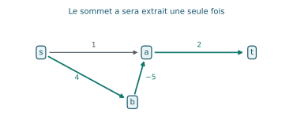
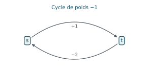
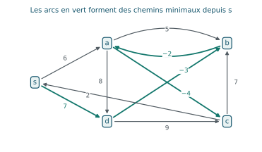
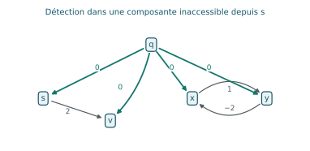
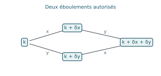
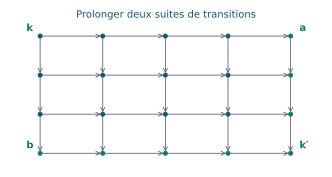
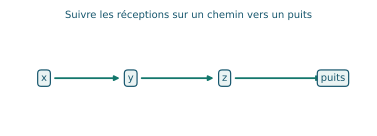

# ENS de Lyon — Second concours · Informatique 2024 · Corrigé brut

*Corrigé rédigé par IA, non officiel.*

**Rédaction** · modèle exact non renseigné (famille GPT-6) · effort non renseigné · vitesse non renseignée

**Révision** · GPT-6.2 Astra Ultra · vitesse non renseignée · 24 novembre 2026

## I — Structure et complexité de Dijkstra

### Question 1

À l'initialisation $F=S$. Chaque passage extrait un sommet encore dans $F$, le retire de $F$ et ne l'y réintroduit jamais. L'entier $|F|$ décroît de 1 à chaque itération. La boucle effectue exactement $n=|S|$ passages, y compris pour les sommets inaccessibles dont l'étiquette vaut $+\infty$. Chaque liste de voisins est finie. La terminaison ne fait pas intervenir le signe des poids.

### Question 2

Initialement $E=\varnothing$ et $F=S$. L'unique modification transfère le même sommet de $F$ vers $E$. Ainsi $F=S\setminus E$ à tout instant. Le booléen `fixe[u]` suffit, vrai pour $u\in E$, faux pour $u\in F$. Pour extraire un minimum, parcourir les $n$ sommets en mémorisant le meilleur candidat non fixé. Si les étiquettes restantes sont toutes infinies, retenir le premier candidat. Au plus $n$ tests de présence et $n-1$ comparaisons d'étiquettes par extraction, pour $n$ extractions, donnent $O(n^2)$ opérations.

### Question 3

On compte une lecture ou écriture de tableau, une comparaison et une addition comme des opérations élémentaires de coût constant. L'initialisation coûte $O(n)$. Les extractions par balayage du tableau prennent $O(n^2)$ opérations en tout. Pour chaque sommet extrait, on lit les $n$ entrées de sa ligne de matrice pour trouver ses voisins. Les $n$ lignes donnent exactement $n^2$ tests de présence d'arc. Chacun des $m=|A|$ arcs déclenche au plus une addition, une comparaison et une mise à jour d'étiquette. On obtient $\Theta(n^2+m)=\Theta(n^2)$, car $m\le n(n-1)$. La matrice occupe $\Theta(n^2)$ cases.

### Question 4

Des listes d'adjacence stockent, pour chaque sommet, ses couples (voisin, poids). Elles permettent de parcourir les $m$ arcs une seule fois. Pour $F$, un tas binaire indexé par sommet, avec tableau de positions mis à jour lors des échanges, effectue chaque extraction du minimum et chaque diminution de clé en $O(\log n)$. Les $n$ extractions et au plus $m$ diminutions donnent $O((n+m)\log n)$ pour une mémoire $O(n+m)$. Un booléen indique les sommets fixés.

Dans le cadre de poids réels arbitraires, un tas de Fibonacci améliore cette borne classique à $O(m+n\log n)$ amorti. La diminution de clé lui coûte $O(1)$ amorti et l'extraction $O(\log n)$ amorti. Pour un graphe dense, le tableau non trié de la question 3 donne déjà un coût quadratique.

## II — Poids négatifs, relâchements et chemins minimaux

### Question 5

Considérons les seuls arcs $s\to a$ de poids 1, $s\to b$ de poids 4, $a\to t$ de poids 2 et $b\to a$ de poids $-5$. Ce graphe est sans cycle. Les extractions ont lieu dans l'ordre $s,a,t,b$. À la sortie de $s$, $D[a]=1,D[b]=4$. À la sortie de $a$, $D[t]=3$. Après l'extraction de $t$, puis celle de $b$, le relâchement de $b\to a$ abaisse $D[a]$ à $-1$. Le sommet $a$ a déjà été extrait et son arc vers $t$ n'est plus examiné. L'algorithme renvoie $D[t]=3$ alors que le chemin $s,b,a,t$ a pour poids $4-5+2=1$, minimal. Une exécution qui ignorerait les destinations déjà fixées échouerait également.



### Question 6

Prendre deux sommets $s,t$ avec $p(s,t)=1$ et $p(t,s)=-2$. Pour tout entier $k\ge0$, parcourir $k$ fois $s,t,s$, puis emprunter $s\to t$, donne un chemin de poids $1-k$. Le sommet $t$ est accessible, mais l'ensemble des poids n'est pas minoré. Il n'existe donc aucun chemin de poids minimal de $s$ à $t$.



### Question 7

Écrivons $d(x)=D_{\min}(x)$. Pour tout arc $(u,v)$, prolonger un chemin minimal de $s$ à $u$ donne $d(v)\le d(u)+p(u,v)$. Si $v\ne s$, un chemin minimal vers $v$ a un dernier arc $(u,v)$. Son préfixe de $s$ à $u$ a nécessairement le poids $d(u)$, puisqu'un meilleur préfixe réduirait le poids total. L'égalité est donc atteinte pour ce prédécesseur. Ainsi
$$d(v)=\min_{(u,v)\in A}\bigl(d(u)+p(u,v)\bigr)\quad(v\ne s).$$
Le chemin sans arc en $s$ a le poids 0. Tout chemin revenant à $s$ se décompose en cycles de poids non négatifs, donc $d(s)=0$. L'énoncé suppose ici les sommets accessibles. La convention $d(v)=+\infty$ étend le résultat aux autres sommets, avec un minimum vide égal à $+\infty$.

### Question 8

Les arcs de la figure 3 sont $s\to a:6$, $s\to d:7$, $a\to b:5$, $b\to a:-2$, $a\to d:8$, $a\to c:-4$, $d\to b:-3$, $d\to c:9$, $c\to b:7$, $c\to s:2$. On lit ci-dessous une exécution autorisée, dans l'ordre de coordonnées $(s,a,b,c,d)$.

| Étape | Arc relâché | $D[s]$ | $D[a]$ | $D[b]$ | $D[c]$ | $D[d]$ |
|---:|---|---:|---:|---:|---:|---:|
| 0 | Initialisation | 0 | $+\infty$ | $+\infty$ | $+\infty$ | $+\infty$ |
| 1 | $s\to a$ | 0 | 6 | $+\infty$ | $+\infty$ | $+\infty$ |
| 2 | $a\to b$ | 0 | 6 | 11 | $+\infty$ | $+\infty$ |
| 3 | $a\to c$ | 0 | 6 | 11 | 2 | $+\infty$ |
| 4 | $s\to d$ | 0 | 6 | 11 | 2 | 7 |
| 5 | $d\to b$ | 0 | 6 | 4 | 2 | 7 |
| 6 | $b\to a$ | 0 | 2 | 4 | 2 | 7 |
| 7 | $a\to c$ | 0 | 2 | 4 | $-2$ | 7 |

Aucun arc ne permet ensuite une amélioration stricte. Les quatre arcs $s\to d\to b\to a\to c$ réalisent les valeurs finales pour tous les sommets.



### Question 9

Initialement seule l'étiquette de $s$ est finie, à 0. Chaque nouvelle étiquette finie est le poids d'un chemin réel de $s$ à sa destination, obtenu en prolongeant celui de $u$. On a donc toujours $D[v]\ge d(v)$ et $D[s]=0$ en l'absence de cycle négatif.

À l'arrêt, pour chaque arc $(u,v)$, $D[v]\le D[u]+p(u,v)$. Ces inégalités se somment sur n'importe quel chemin de $s$ à $v$, ce qui donne $D[v]\le p(\text{chemin})$, puis $D[v]\le d(v)$ pour un chemin minimal. Ainsi $D=d$, et la question 7 assure que le vecteur renvoyé vérifie l'équation demandée. La preuve utilise l'invariant « poids d'un chemin » pour identifier le point fixe effectivement calculé.

### Question 10

À chaque instant, conservons pour chaque étiquette finie $D[u]$ un chemin témoin **simple**, dont chaque préfixe arrivant en $w$ a un poids au moins égal à l'étiquette actuelle $D[w]$. Initialement le témoin de $s$ est le chemin réduit à $s$. Les étiquettes ne font que décroître, donc un témoin conservé continue de vérifier l'inégalité sur ses préfixes.

Lors d'un relâchement strict de $(u,v)$, prolongeons le témoin de $u$. Si $v$ figurait déjà sur ce témoin, le segment entre ses deux occurrences serait un circuit de poids non négatif. Le poids du chemin prolongé serait alors au moins celui du préfixe s'arrêtant au premier $v$, lui-même au moins $D[v]$. Cela contredit l'amélioration stricte. Le témoin prolongé est donc simple, et son nouveau préfixe terminal a exactement le poids de la nouvelle étiquette.

Dans un graphe fini, chaque sommet n'admet qu'un nombre fini de chemins simples depuis $s$. L'étiquette parcourt strictement une suite décroissante parmi leurs poids, après une éventuelle première valeur infinie. Elle ne change ainsi qu'un nombre fini de fois. Chaque passage de boucle change une étiquette, donc la boucle se termine, même pour des poids réels.

### Question 11

Initialiser `pred[v] = None` pour tout $v$. Lors d'une amélioration stricte $D[v]\gets D[u]+p(u,v)$, assigner aussi `pred[v] = u`. Une fois l'algorithme terminé, remonter de chaque destination accessible jusqu'à $s$ en suivant `pred`, puis inverser la liste obtenue. Pour $s$, le chemin comporte le seul sommet $s$.

Pour justifier la terminaison de cette remontée même en présence d'arcs de poids nul ou négatif, dater chaque dernière modification. Si $u=\mathrm{pred}[v]$, l'étiquette de $u$ n'a plus diminué depuis l'affectation finale de $v$. Sinon l'arc $(u,v)$ serait encore améliorant à l'arrêt. Les dates décroissent donc strictement en remontant les parents jusqu'à $s$. Sur chaque arc de la chaîne, $D[v]=D[u]+p(u,v)$, d'où un chemin de poids $D[v]$. Un sommet inaccessible garde $D[v]=+\infty$ et n'a pas de chemin.

### Question 12

Après $i$ balayages, $D[v]$ est au plus le poids de tout chemin de $s$ à $v$ de longueur au plus $i$. Au rang 0, le chemin vide en $s$ suffit. Pour l'hérédité, un tel chemin de longueur $i+1$ se décompose en un préfixe de longueur $i$ puis un arc $(u,v)$. Dès le début du balayage suivant, $D[u]$ est au plus le poids du préfixe. Lorsque l'arc est traité, $D[v]$ devient au plus le poids du chemin entier. Les mises à jour en place ne peuvent qu'améliorer cette borne.

En l'absence de cycle négatif, on peut supprimer les cycles d'un chemin optimal et obtenir un chemin simple optimal d'au plus $n-1$ arcs. Après $n-1$ passes, $D[v]\le d(v)$, et l'invariant de la question 9 donne l'égalité. Chaque passe coûte $O(m)$ avec une liste des arcs. Le temps total est $O(n+nm)$, donc $O(nm)$ dès que $m\ge1$, et la mémoire supplémentaire est $O(n)$. Cette version est l'algorithme de Bellman–Ford.

### Question 13

Si un cycle négatif est accessible depuis $s$, des tours supplémentaires sur ce cycle abaissent indéfiniment le poids vers ses sommets. La boucle sans borne de la figure 2 ne peut s'arrêter. En effet, des étiquettes finies satisfaisant $D[v]\le D[u]+p(u,v)$ sur toutes les arêtes du cycle conduiraient, par sommation, à $0\le p(\text{cycle})$, contradiction. Un cycle inaccessible depuis $s$ ne déclenche en revanche aucune amélioration dans cette exécution.

Pour le contrat « détecter un cycle absorbant **partout** », commencer par une passe de détection globale de Bellman–Ford. Initialiser $B[v]=0$ pour **tout** sommet, ce qui équivaut à ajouter une super-source de poids d'accès nul. Effectuer $n-1$ balayages des arcs, puis tester si un arc est encore améliorant. Si oui, répondre « cycle absorbant ». En l'absence de cycle négatif, tout meilleur chemin depuis un point de départ libre peut être simplifié en au plus $n-1$ arcs du graphe initial, donc le test ne signale rien. En présence d'un cycle négatif, aucun potentiel fini ne peut respecter toutes ses inégalités, donc le test réussit.

Si aucun cycle n'est signalé, réinitialiser les distances à $+\infty$ sauf $D[s]=0$, puis appliquer la question 12 pour renvoyer les distances demandées depuis $s$. Les deux phases restent en $O(n+nm)$. Si le graphe entier est accessible depuis $s$, le simple test d'un arc encore améliorant après les passes depuis $s$ suffit.

Voici une implémentation pour des sommets numérotés de $0$ à $n-1$. La liste `arcs` contient les triplets (origine, destination, poids). Une passe sans amélioration permet de s’arrêter plus tôt.

```python
def distances_ou_cycle(n, arcs, s):
    def balayer(d):
        for _ in range(n - 1):
            change = False
            for u, v, poids in arcs:
                candidat = d[u] + poids
                if candidat < d[v]:
                    d[v] = candidat
                    change = True
            if not change:
                break

    potentiel = [0] * n
    balayer(potentiel)
    if any(potentiel[u] + p < potentiel[v] for u, v, p in arcs):
        return "cycle absorbant"

    distances = [float("inf")] * n
    distances[s] = 0
    balayer(distances)
    return distances
```

Par exemple, si $s$ est isolé et que les deux autres sommets forment un circuit de poids total $-1$, la première phase signale le cycle. Si ce poids total vaut zéro, la seconde phase renvoie $0$ pour $s$ et $+\infty$ pour ses deux destinations inaccessibles.



## III — Éboulements sur un graphe

### Question 14

Si $x\ne y$ sont éligibles dans $k$, l'éboulement de $x$ ajoute 0 ou 1 au nombre de grains de $y$ et ne change pas son degré. Le sommet $y$ reste donc éligible. Réciproquement, $x$ reste éligible après l'éboulement de $y$. Les deux suites aboutissent à
$$k+\delta_x+\delta_y=k+\delta_y+\delta_x,$$
car les effets sont des fonctions additives fixes. Les états intermédiaires peuvent différer.



### Question 15

Notons $R$ un pas d'éboulement **ou** l'identité. Si $u\,R\,v$ et $u\,R\,w$, il existe $t$ tel que $v\,R\,t$ et $w\,R\,t$. Pour deux sommets distincts, c'est le carré de la question 14. Si les deux éboulements sont identiques, choisir $t=v=w$. Si l'un des pas est une identité, appliquer l'autre pas à la branche restée sur place.

Plaçons les $m$ pas de $k$ vers $a$ sur le bord supérieur d'une grille, et les $n$ pas de $k$ vers $b$ sur le bord gauche. Quand les deux arêtes issues du coin supérieur gauche d'une case sont connues, la propriété précédente en construit le coin opposé et les deux arêtes qui y arrivent. On remplit les cases ligne par ligne. Le coin inférieur droit est une configuration $k'$ accessible en au plus $n$ pas depuis $a$ et en au plus $m$ pas depuis $b$. En supprimant les identités, on obtient $a\to^*k'$ et $b\to^*k'$. Aucun argument de terminaison n'est requis.



### Question 16

Prendre les arcs $x\to y$ et $y\to x$. Les deux sommets ont degré sortant 1. À partir de $(k(x),k(y))=(1,0)$, on peut ébouler $x$, puis $y$, puis recommencer. Les configurations $(1,0)$ et $(0,1)$ alternent indéfiniment.

### Question 17

Comme le graphe est fini et sans cycle, la longueur maximale $r(x)$ d'un chemin partant de $x$ est finie. Pour tout voisin $y$ de $x$, $r(y)\le r(x)-1$. Au puits, $r=0$. Prenons le potentiel entier positif ou nul
$$\Phi(k)=\sum_{x\in S} k(x)r(x).$$
Un éboulement en $x$ modifie ce potentiel de $\sum_{x\to y}(r(y)-r(x))\le -d^+(x)\le-1$. Une suite infinie donnerait une suite strictement décroissante d'entiers positifs ou nuls. Elle est donc impossible.

### Question 18

Le nombre total de grains $N=\sum_x k(x)$ est conservé à chaque éboulement. Chaque sommet contient toujours entre 0 et $N$ grains. Supposons une suite infinie. Comme le graphe est fini, un certain sommet $x$ s'éboule une infinité de fois. Chaque voisin $y$ de $x$ reçoit alors une infinité de grains au fil du temps. Pour que son stock reste borné, $y$ doit en perdre une infinité et donc s'ébouler une infinité de fois lui aussi. Si $y$ est un puits, c'est immédiatement impossible.

Cette propriété se propage le long de tout chemin issu de $x$. Par hypothèse, l'un de ces chemins aboutit à un puits. Celui-ci recevrait une infinité de grains sans pouvoir en céder, en contradiction avec la conservation de $N$. Aucune hypothèse d'équité sur la manière de choisir les sommets à ébouler n'est nécessaire.



### Question 19

À partir de $k$, choisir successivement un sommet éligible tant qu'il en existe. La question 18 exclut une suite infinie, donc ce procédé atteint une configuration stable $\widehat k$ en un nombre fini d'étapes. Si $a,b$ sont deux configurations stables accessibles depuis $k$, la question 15 fournit un descendant commun $k'$. Aucun pas ne pouvant partir de $a$ ni de $b$, ce descendant vérifie $k'=a=b$. La configuration stable atteinte est donc unique et indépendante de l'ordre des éboulements.
