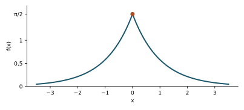
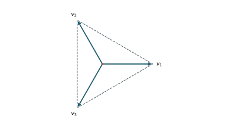

# ENS de Lyon, second concours — Mathématiques 2024 · Corrigé brut

*Corrigé rédigé par IA, non officiel. Signalez toute erreur.*

**Rédaction** · GPT-6.2 Astra Ultra · vitesse non renseignée

**Révision** · GPT-6.2 Astra Ultra · vitesse non renseignée · 26 novembre 2026

Le sujet réunit une intégrale de Fourier, les moments de la loi de Poisson et un problème sur les matrices de Gram. La numérotation reprend celle des trois exercices.

## Exercice 1 · Une fonction définie par une intégrale

### Question 1

Pour tout $x$, l’intégrande est continue en $t$ et majorée en module par $1/(1+t^2)$, intégrable sur $[0,+\infty[$. L’intégrale converge absolument. Le cosinus est pair en $x$, donc $f$ l’est. Pour $x_j\to x$, les intégrandes convergent ponctuellement et la même majorante permet d’appliquer la convergence dominée. Ainsi $f$ est continue, et $f(0)=[\arctan t]_0^{+\infty}=\pi/2$.

### Question 2

Pour $x>0$, intégrons par parties sur $[0,R]$ en prenant $\sin(tx)/x$ comme primitive du cosinus. Le terme de bord en zéro est nul et celui en $R$ est majoré par $1/(x(1+R^2))$. Il vient
$$f(x)=\frac1x\int_0^\infty\frac{2t\sin(tx)}{(1+t^2)^2}\,dt.$$
Le poids positif a pour intégrale $1$ par une primitive. Ainsi $|f(x)|\le1/x$ et $f(x)\to0$ en $+\infty$.

### Question 3

En utilisant $|\cos(tx)|\le1$ et $e^{-t/n}\le1$, on trouve
$$\sup_{x\in\mathbb R}|f_n(x)-f(x)|\le\int_0^\infty\frac{1-e^{-t/n}}{1+t^2}\,dt.$$
L’intégrande de droite tend vers zéro pour tout $t$ et est dominé par $1/(1+t^2)$. La convergence dominée fait tendre ce majorant indépendant de $x$ vers zéro. La convergence est uniforme sur toute la droite.

### Question 4

Pour $j=0,1,2$, les dérivées d’ordre $j$ par rapport à $x$ sont continues et majorées par $t^je^{-t/n}/(1+t^2)$, intégrable sur la demi-droite. Le théorème de dérivation sous l’intégrale donne $f_n\in C^2(\mathbb R)$. Avec $c=1/n$,
$$f_n''(x)-f_n(x)=-\int_0^\infty e^{-ct}\cos(tx)\,dt
=-\Re\frac1{c-ix}=-\frac{n}{1+n^2x^2}.$$
L’intégrale complexe s’évalue car la partie réelle de $-c+ix$ est strictement négative.

### Question 5

Pour $x\ge a>0$, la question 4 donne
$$|f_n''(x)-f(x)|\le\|f_n-f\|_\infty+\frac{n}{1+n^2a^2}\le\|f_n-f\|_\infty+\frac1{na^2}.$$
Les deux termes tendent vers zéro par 3. Ceci établit la convergence uniforme demandée.

### Question 6a

Pour $c=1/n$, une primitive en $t$ est
$$H_{n,x}(t)=-\frac{e^{-ct}}{c^2+x^2}\big(c\sin(tx)+x\cos(tx)\big).$$
La dérivation donne $e^{-ct}\sin(tx)$. À $x>0$ fixé, $|H_{n,x}(t)|\le1/\sqrt{c^2+x^2}\le1/x$ et $H_{n,x}(t)\to-\cos(tx)/x$ à chaque $t$.

### Question 6b

Posons $w(t)=t/(1+t^2)$. Alors $f_n'(x)=-\int_0^\infty w(t)H'_{n,x}(t)\,dt$. Par parties sur un segment puis passage à la limite, les termes de bord sont nuls car $w(0)=0$, $w(+\infty)=0$ et $H_{n,x}$ est bornée. Il reste $f_n'(x)=\int_0^\infty w'(t)H_{n,x}(t)\,dt$. Or $w'(t)=(1-t^2)/(1+t^2)^2$ est absolument intégrable. Pour tout $x>0$, la convergence dominée avec majorante $|w'|/x$ fournit
$$f_n'(x)\longrightarrow -\frac1x\int_0^\infty w'(t)\cos(tx)\,dt.$$

### Question 7

Fixons $0<a<b$. La suite $f_n'(a)$ converge vers un nombre $L_a$ par 6b et $f_n''\to f$ uniformément sur $[a,b]$ par 5. L’identité $f_n'(x)=f_n'(a)+\int_a^x f_n''$ montre la convergence uniforme vers $g(x)=L_a+\int_a^x f(t)\,dt$. Ainsi $g'=f$. De même, dans $f_n(x)=f_n(a)+\int_a^x f_n'(t)\,dt$, les passages à la limite donnent $f(x)=f(a)+\int_a^x g(t)\,dt$. Donc $f'=g$ et $f''=f$ à l’intérieur. Tout point de $]0,+\infty[$ appartient à un tel intervalle et $f$ y est de classe $C^2$.

### Question 8

Sur $]0,+\infty[$, la solution générale de $f''-f=0$ est $Ae^x+Be^{-x}$. La limite nulle en $+\infty$ impose $A=0$. La continuité en zéro donne $B=f(0)=\pi/2$. Par parité,
$$\boxed{f(x)=\frac\pi2 e^{-|x|}\quad(x\in\mathbb R).}$$
Les dérivées à droite et à gauche en zéro sont respectivement $-\pi/2$ et $\pi/2$.

## Exercice 2 · Les partitions et les moments de Poisson

### Question 1

Pour un élément il n’y a qu’un bloc, donc $\alpha_1=1$. Pour deux éléments, on prend le bloc de deux ou les deux singletons, donc $\alpha_2=2$. Pour trois éléments, il y a un bloc de trois, trois choix de singleton dans une partition de type $2+1$, ou trois singletons. Ainsi $\alpha_3=1+3+1=5$.

### Question 2

Dans une partition de $\{1,\ldots,n+1\}$, soit $k$ le nombre d’éléments extérieurs au bloc contenant $n+1$. Ils forment un sous-ensemble de $\{1,\ldots,n\}$ choisi de $\binom nk$ façons. On les partitionne de $\alpha_k$ façons. Tous les autres éléments, avec $n+1$, forment l’unique bloc restant. La construction est réversible, y compris pour $k=0$ par $\alpha_0=1$. D’où $\alpha_{n+1}=\sum_{k=0}^n\binom nk\alpha_k$.

### Question 3

Dans chaque bloc, rangeons les éléments dans l’ordre croissant et formons le cycle correspondant. Le produit de ces cycles disjoints est une permutation. Les supports de ses cycles, points fixes compris, restituent la partition. Ainsi cette application est injective dans les $n!$ permutations, et $\alpha_n\le n!$. La convention $\alpha_0=0!=1$ traite l’ensemble vide.

### Question 4

Pour $|x|<1$, on a $|\alpha_nx^n/n!|\le|x|^n$ d’après 3. La série de droite converge. Le rayon de convergence de la série génératrice exponentielle est donc au moins $1$.

### Question 5

Écrivons ici $F(x)=\sum_{n\ge0}\alpha_nx^n/n!$. Sur $]-1,1[$, les séries convergent absolument et on peut dériver la série entière terme à terme. Le coefficient de $x^n$ dans $e^xF(x)$ est
$$\sum_{k=0}^n\frac{\alpha_k}{k!(n-k)!}=\frac{\alpha_{n+1}}{n!},$$
par 2. Il coïncide avec celui de $F'$. Donc $F'=e^xF$. En dérivant $e^{-e^x}F(x)$ on trouve zéro. Comme $F(0)=1$, il vient $\boxed{F(x)=\exp(e^x-1)}$.

### Question 6

Pour $X\sim\mathcal P(1)$, $\mathbb P(X=k)=e^{-1}/k!$, donc $\mathbb E[e^{xX}]=e^{-1}\sum_{k\ge0}e^{kx}/k!=\exp(e^x-1)$. Pour tout $r>0$, la somme des modules du développement double aux $|x|\le r$ est majorée par $e^{-1}\sum_{k\ge0}e^{kr}/k!<\infty$. En intervertissant les deux sommes, $\mathbb E[e^{xX}]=\sum_{n\ge0}\mathbb E[X^n]x^n/n!$. L’unicité des coefficients d’une série entière égale à $F$ au voisinage de zéro donne $\alpha_n=\mathbb E[X^n]$ pour tout $n\ge0$, avec $X^0=1$.

## Exercice 3, partie I · Matrices de Gram

### Question 1

La matrice $G$ est réelle symétrique, car $\langle v_i,v_j\rangle=\langle v_j,v_i\rangle$. Le théorème spectral assure sa diagonalisation dans une base orthonormée réelle.

### Question 2a

Pour $X=(x_i)_{1\le i\le k}$, la bilinéarité donne
$$X^TGX=\sum_{i,j}x_ix_j\langle v_i,v_j\rangle=\left\|\sum_{i=1}^k x_i v_i\right\|^2.$$

### Question 2b

Le carré est positif ou nul pour tout $X$, donc $G\in S_k^+(\mathbb R)$. Il est strictement positif pour tout $X\ne0$ exactement lorsque $\sum_i x_iv_i=0$ implique que tous les $x_i$ sont nuls. C’est la définition de la liberté de la famille.

### Question 3

Avec $\mathbf1=(1,\ldots,1)^T\in\mathbb R^{n+1}$, on a $M(a,b)=(a-b)I+b\mathbf1\mathbf1^T$. Sur la droite de $\mathbf1$, la valeur propre est $a+nb$. Sur $\mathbf1^\perp$, de dimension $n$, c’est $a-b$. Ces deux espaces sont supplémentaires. Si $b\ne0$, les valeurs sont distinctes et leurs multiplicités sont $1$ et $n$. Si $b=0$, l’unique valeur est $a$, de multiplicité $n+1$.

### Question 4a

Puisque les vecteurs sont unitaires, pour $i\ne j$ on a $|\alpha|=|\langle v_i,v_j\rangle|\le\|v_i\|\|v_j\|=1$.

### Question 4b

Les $n+1$ vecteurs sont liés dans $\mathbb R^n$. Il existe une colonne $c\ne0$ telle que $\sum_j c_jv_j=0$. Le produit scalaire avec $v_i$ donne $(Gc)_i=0$ pour tout $i$. La matrice de Gram a donc un noyau non nul.

### Question 4c

La matrice de Gram est $M(1,\alpha)$. D’après 3, son déterminant vaut $(1-\alpha)^n(1+n\alpha)$. Or elle est singulière et $\alpha\ne1$ par hypothèse. Nécessairement $\boxed{\alpha=-1/n}$.

### Question 4d

Prenons $v_1=(1,0)$, $v_2=(-1/2,\sqrt3/2)$ et $v_3=(-1/2,-\sqrt3/2)$. Leurs normes sont un et leurs trois produits scalaires valent $-1/2$. C’est la valeur obtenue pour $n=2$.

### Question 4e

Supposons construits $v_1,\ldots,v_{n+1}$ dans $\mathbb R^n$, avec produits deux à deux $-1/n$. Posons $b=-1/(n+1)$, $a=\sqrt{1-b^2}$ et définissons dans $\mathbb R^{n+1}$
$$w_i=(av_i,b)\ (1\le i\le n+1),\qquad w_{n+2}=(0,\ldots,0,1).$$
Tous sont unitaires. Le produit avec le dernier vaut $b$. Pour $i\ne j\le n+1$, le produit vaut $-a^2/n+b^2=-1/n+(1+1/n)/(n+1)^2=-1/(n+1)$. Le cas initial est 4d, ce qui établit l’existence par récurrence.

## Exercice 3, partie II · Distances entières impaires

### Question 1

Pour $v_i=\overrightarrow{A_1A_{i+1}}$, la polarisation donne
$$2\langle v_i,v_j\rangle=\|v_i\|^2+\|v_j\|^2-\|v_i-v_j\|^2.$$
Les trois normes sont des distances entre les points de l’énoncé, ou zéro pour le dernier terme lorsque $i=j$. Les carrés sont des entiers, donc la différence l’est aussi.

### Question 2a

Pour tout entier impair $2m+1$, son carré vaut $1+4m(m+1)\equiv1\pmod8$. Sur la diagonale de $G=2G(v_1,\ldots,v_{n+1})$, on obtient $2\|v_i\|^2\equiv2$. Hors diagonale, les trois distances de 1 sont impaires et la combinaison de leurs carrés vaut $1+1-1\equiv1$. Ainsi $G\equiv M(2,1)\pmod8$ coefficient par coefficient.

### Question 2b

La formule de Leibniz conserve cette congruence après prise du déterminant. Par I.3, les valeurs propres de $M(2,1)$ sont $1$ de multiplicité $n$ et $n+2$ de multiplicité un. Ainsi $\det G\equiv n+2\pmod8$, non nul modulo $8$ puisque $n\not\equiv6\pmod8$. Le déterminant est alors non nul dans $\mathbb R$. Pourtant les $n+1$ vecteurs de $\mathbb R^n$ sont liés, et I.4b donne la singularité de leur matrice de Gram ainsi que de son double. La contradiction exclut une telle configuration.

En dimension $n=2$, le déterminant hypothétique est congru à 4 modulo 8. Il serait donc un entier de la forme $8k+4$, nécessairement non nul. Cette valeur illustre pourquoi il suffit de travailler avec le déterminant entier : la classe 4 admet pourtant des diviseurs de zéro modulo 8. Pour $n\equiv6\pmod8$, la congruence obtenue ne décide rien sur la nullité du déterminant entier.

### Question 3

Pour les $n+1$ vecteurs de I.4, et pour $i\ne j$, $\|v_i-v_j\|^2=2-2(-1/n)=2(n+1)/n$. Posons $A_i=\sqrt{n/(2(n+1))}\,v_i$. Toutes les distances entre points distincts valent alors $1$, un entier impair. Cette construction convient à chaque $n\ge2$. En dimension un, deux points à distance un fournissent aussi l’exemple.
