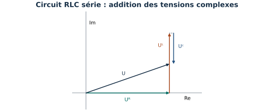
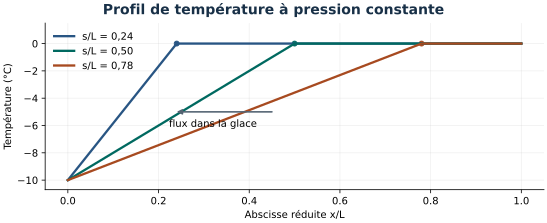
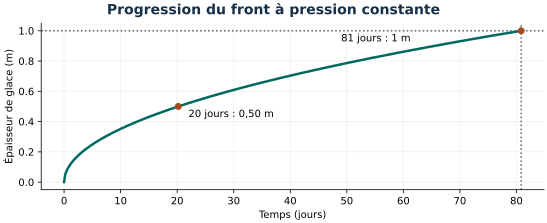
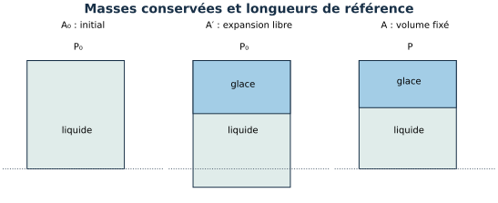
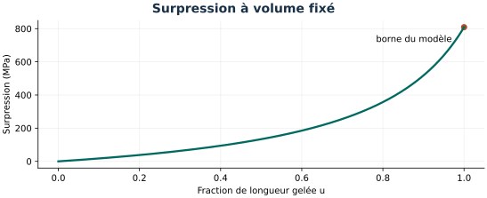
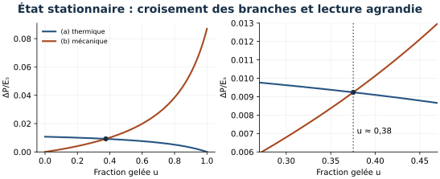

# ENS de Lyon, second concours universitaire — Physique 2024 · Corrigé brut

*Corrigé rédigé par IA, non officiel. Signalez toute erreur.*

**Rédaction** · modèle exact non renseigné (famille GPT-6) · effort non renseigné · vitesse non renseignée

**Révision** · modèle exact non renseigné (famille GPT-6) · effort non renseigné · vitesse non renseignée

**Révision (tour 2)** · GPT-6.2 Astra Ultra · vitesse non renseignée

**Révision (tour 3)** · GPT-6.2 Astra Ultra · vitesse non renseignée · 26 novembre 2026

[Sujet et figures officiels](https://banques-ecoles.fr/cms/wp-content/uploads/2024/07/24_2c_lyon_sujet_phy.pdf) · [Rapport du jury de l’écrit](https://banques-ecoles.fr/cms/wp-content/uploads/2024/10/24_2cc_rap_ePhy.pdf)

La garde de la composition de trois heures autorise la calculatrice et annonce que le questionnaire aurait le poids le plus élevé. Le rapport écrit du jury précise le barème effectivement appliqué, avec 20 % pour ce questionnaire.

## Partie A — Questionnaire de physique

### Question A1

Les rayons restent au voisinage de l’axe optique et sont faiblement inclinés sur lui. On peut utiliser les relations de l’optique paraxiale au premier ordre.

### Question A2

En mécanique quantique, une particule a une probabilité de transmission non nulle à travers une barrière de potentiel même lorsque son énergie est inférieure à la hauteur de la barrière.

### Question A3

Deux points d’un champ lumineux sont spatialement cohérents si leur différence de phase reste suffisamment stable pour que leur superposition produise des franges de contraste durable.

### Question A4

Pour un système fermé, $\Delta S=S_{\rm éch}+S_{\rm créée}$ avec $S_{\rm créée}\ge0$, nulle pour une évolution réversible. Pour un système isolé, $\Delta S\ge0$.

### Question A5

Pour $\partial_tu=D\Delta u$ et une dépendance $e^{i(\mathbf k\cdot\mathbf r-\omega t)}$, la relation est **$\omega=-iDk^2$**. À $k$ réel, le mode décroît comme $e^{-Dk^2t}$.

### Question A6

Dans le référentiel tournant à la vitesse angulaire $\boldsymbol\Omega$, la force d’inertie de Coriolis est $\mathbf F_C=-2m\boldsymbol\Omega\times\mathbf v_{\rm rel}$.

### Question A7

Au sommet de l’atmosphère à la distance de la Terre, une surface perpendiculaire aux rayons reçoit environ $1{,}36\times10^3\,\mathrm{W\,m^{-2}}$, soit un ordre de grandeur de $10^3\,\mathrm{W\,m^{-2}}$. Moyennée sur la sphère terrestre entière, l’irradiance incidente vaut environ $340\,\mathrm{W\,m^{-2}}$.

### Question A8

Le gaz doit présenter des transitions qui absorbent et émettent dans l’infrarouge thermique terrestre. Une vibration moléculaire qui modifie le moment dipolaire électrique peut porter de telles transitions.

### Question A9

Pour un fluide parfait incompressible en écoulement permanent, dans le champ de pesanteur uniforme et sans machine entre les points, $p+\rho v^2/2+\rho gz$ est constant le long d’une ligne de courant. La constante est commune aux lignes si l’écoulement est irrotationnel.

### Question A10

En convention récepteur $e^{i\omega t}$, $\underline U_R=R\underline I$, $\underline U_L=i\omega L\underline I$, $\underline U_C=-i\underline I/(\omega C)$ et $\underline U=\underline U_R+\underline U_L+\underline U_C$. Dans le plan complexe, les deux tensions réactives sont opposées et perpendiculaires à $\underline U_R$.

## Partie B — Évolution d’un front de solidification

### Front à pression constante

#### Question B1

La chaleur se propage dans le solide par conduction thermique. La loi de Fourier donne le flux surfacique $\mathbf j=-\lambda_s\nabla T$.

#### Question B2

Dans un liquide en mouvement, la convection est généralement importante. La conduction existe aussi et devient le mécanisme de transfert si le mouvement du liquide est supprimé ou négligé.

#### Question B3

Dans le modèle à $P_0$, l’interface est à $T_c=0\,{}^\circ\mathrm C$. Le profil part de $T_f$ à $x=0$ et croît dans la glace jusqu’à $T_c$ à $x=s(t)$. Dans le liquide supposé isotherme, il reste à $T_c$ jusqu’à $L$. La pente est positive dans la glace et nulle dans le liquide. Le profil dans la glace devient linéaire sous l’hypothèse de la question 5.

#### Question B4

Lors d’une avancée $ds>0$, la masse de glace formée est $dm=\rho_sS\,ds$, et elle libère $\Delta H^0dm$ avec $\Delta H^0>0$ pour la fusion. Le liquide n’échange aucun flux thermique avec le front. Sur la face solide, $j_x=-\lambda_s\partial_xT(s^-,t)<0$, donc la puissance qui quitte le front vers $x=0$ vaut $-S j_x$. Le bilan donne
$$\rho_s\Delta H^0\dot s=\lambda_s\partial_xT(s^-,t).$$

#### Question B5

En régime quasi stationnaire, $\partial_x^2T\simeq0$ dans la glace, avec $T(0)=T_f$ et $T(s)=T_c$. Le profil est
$$T(x,t)\simeq T_f+(T_c-T_f)\frac{x}{s(t)},\qquad 0\le x\le s(t).$$
Il est affine en espace pour chaque position du front.

#### Question B6

L’équation du front devient $\rho_s\Delta H^0\dot s=\lambda_s\Delta T/s$. Intégrer $s\,ds=(\lambda_s\Delta T/(\rho_s\Delta H^0))dt$ depuis $s(0)=0$ donne
$$s(t)=\sqrt{At},\qquad A=\frac{2\lambda_s\Delta T}{\rho_s\Delta H^0}.$$
$A$ est en $\mathrm{m^2\,s^{-1}}$. La couche de glace épaissie oppose une résistance thermique croissante, ce qui ralentit le front.

#### Question B7

Dans cette première modélisation, $s(\tau)=L$. On trouve
$$\tau=\frac{L^2}{A}=\frac{\rho_s\Delta H^0L^2}{2\lambda_s\Delta T}=6{,}98\times10^6\,\mathrm s\simeq81\,\mathrm{jours}.$$
Avec $L=1\,\mathrm m$ et un seul côté refroidi, la durée est de plusieurs mois. Elle concerne le modèle préliminaire à pression constante.

#### Question B8

Un même accroissement $ds$ forme une masse de glace proportionnelle à $S$, tandis que la puissance évacuée $\lambda_s S\Delta T/s$ est elle aussi proportionnelle à $S$. Les deux facteurs se simplifient dans l’équation de $\dot s$.

### Validité du régime quasi stationnaire

#### Question B9

Sur une distance $s$, $\partial_tT$ est d’ordre $\Delta T/\tau_{\rm diff}$ et $\partial_x^2T$ d’ordre $\Delta T/s^2$. D’où $\tau_{\rm diff}\sim s^2/D_s$ avec $D_s=\lambda_s/(\rho_sc_s)\simeq1{,}14\times10^{-6}\,\mathrm{m^2\,s^{-1}}$.

#### Question B10

Le temps écoulé pour que le front atteigne $s$ est $\tau_s=s^2/A$. Une autre définition locale, $s/\dot s$, donne $2s^2/A$. Ces deux échelles caractérisent la même évolution à un facteur numérique deux près.

#### Question B11

L’hypothèse quasi stationnaire requiert $\tau_{\rm diff}\ll\tau_s$. Avec $\tau_s=s^2/A$, le rapport vaut
$$\frac{\tau_{\rm diff}}{\tau_s}\sim\frac A{D_s}=\frac{2c_s\Delta T}{\Delta H^0}\ll1.$$
Avec la convention locale $s/\dot s$, le facteur deux disparaît. Dans les deux cas, la chaleur sensible nécessaire pour faire varier la température de la glace doit être petite devant la chaleur latente de fusion.

On peut mesurer l’erreur du profil quasi stationnaire dans le modèle à une phase. Pour un front $s=2\eta\sqrt{D_st}$, l’équation de diffusion admet dans la glace $T=T_f+(T_c-T_f)\,\mathrm{erf}(x/(2\sqrt{D_st}))/\mathrm{erf}(\eta)$. Le bilan latent à l’interface impose $\eta e^{\eta^2}\mathrm{erf}(\eta)=\mathrm{Ste}/\sqrt\pi$, où $\mathrm{Ste}=c_s(T_c-T_f)/\Delta H^0$. Ici $\mathrm{Ste}=0{,}0629$ et $\eta\simeq0{,}1755$. Le rapport entre l’épaisseur exacte et l’épaisseur quasi stationnaire de Q6 vaut $\sqrt2\,\eta/\sqrt{\mathrm{Ste}}\simeq0{,}990$. Le front approché est ainsi trop avancé d’environ 1 % dans ce modèle.

#### Question B12

$c_s\Delta T/\Delta H^0=2{,}1\times10/334\simeq0{,}063$. Avec le temps d’atteinte, le rapport vaut environ $0{,}13$. La diffusion dans la glace est ainsi environ huit fois plus rapide que l’évolution du front selon cette définition. L’hypothèse est raisonnable pour une première approximation.

### Compression à volume fixé

#### Question B13

À $P_0$, une masse de glace occupe davantage de volume que la même masse d’eau liquide. Si le tube étanche reste plein et rigide, la solidification comprime donc les phases et augmente leur pression. L’équilibre de fusion de la glace ordinaire se déplace vers une température plus basse, ce qui peut arrêter le front avec du liquide encore présent.

#### Question B14

À section identique $S$, la masse initiale est $\rho_lSL$. Dans $A'$, elle est $\rho_sSs'+\rho_lS(L'-s')$. En divisant par $\rho_lS$, on obtient
$$L'-L=(1-k)s',\qquad k=\rho_s/\rho_l.$$

#### Question B15

Le sujet demande d’utiliser comme longueurs de référence celles de l’état $A$, à savoir $s$ et $L-s$. La baisse de pression de $P$ à $P_0$ produit alors un allongement relatif de signe positif. La loi linéaire donne dans les deux phases
$$\Delta P=E_s\frac{s'-s}{s}=E_l\frac{(L'-s')-(L-s)}{L-s}.$$
Les expressions s’appliquent pour $0<s<L$. Aux extrémités, on prend leurs prolongements par continuité.

#### Question B16

Posons $Y=\Delta P/E_s$. La glace donne $s'=s(1+Y)$ ; le liquide donne $L'-s'=(L-s)(1+\alpha Y)$ avec $\alpha=E_s/E_l$. En remplaçant $L'$ par $L+(1-k)s'$, on obtient
$$s'=s\frac{s+\alpha(L-s)}{ks+\alpha(L-s)},\qquad \frac{s'}s=\frac{\alpha+(1-\alpha)u}{\alpha+(k-\alpha)u},\qquad u=s/L.$$

#### Question B17

Puisque $Y=s'/s-1$, la simplification du résultat précédent donne
$$\Delta P=E_s\frac{(1-k)s}{ks+\alpha(L-s)},\qquad Y=\frac{(1-k)u}{(k-\alpha)u+\alpha}.$$
La pression augmente dès qu’une épaisseur non nulle de glace s’est formée.

#### Question B18

Pour $k=0{,}92$ et $\alpha=4{,}65$, $D(u)=\alpha+(k-\alpha)u$ est positif. $Y'=(1-k)\alpha/D^2>0$ et $Y''=2(1-k)\alpha(\alpha-k)/D^3>0$. La courbe est croissante, convexe, et relie $Y(0)=0$ à $Y(1)=(1-k)/k$. Les contraintes sont proportionnelles à des déformations relatives, inchangées lorsque toutes les longueurs sont multipliées par le même facteur.

#### Question B19

Le maximum du modèle mécanique correspond à $u=1$. Avec $E_s=9{,}3\,\mathrm{GPa}$,
$$\Delta P_{\max}=E_s\frac{1-k}{k}\simeq8{,}1\times10^8\,\mathrm{Pa},\qquad F_{\max}=S\Delta P_{\max}\simeq8{,}1\times10^5\,\mathrm N,$$
car $S=10\,\mathrm{cm^2}=10^{-3}\,\mathrm{m^2}$. L’effort axial est très élevé. Cette borne extrapole la solidification complète ; le bilan thermique de la fin du sujet arrête le front bien avant.

#### Question B20

On a $\epsilon=(L'-L)/L=(1-k)s'/L=(1-k)u(1+Y)$. D’où
$$\epsilon=(1-k)u\,\frac{\alpha+(1-\alpha)u}{\alpha+(k-\alpha)u}.$$
C’est l’allongement global qu’aurait le mélange à la pression initiale pour les mêmes masses de solide et de liquide.

#### Question B21

Les facteurs $u$ et $1+Y$ croissent sur $[0,1]$. Donc $\epsilon_{\max}=(1-k)/k\simeq0{,}087$, soit $8{,}7\,\%$. Au voisinage de cette limite, la déformation n’est plus très petite : l’emploi d’une loi de Hooke linéaire sur tout l’intervalle ne garantit qu’une estimation. Dans les premiers stades, les déformations sont plus faibles. Pour mesurer ce que subit chaque phase à l’état final calculé en B24, on trouve $\Delta P/E_s\simeq0{,}0092$ pour la glace et $\Delta P/E_l\simeq0{,}043$ pour l’eau liquide. La linéarisation du liquide est alors la moins favorable des deux.

### État stationnaire du système diphasique

#### Question B22

Le point triple vaut $(273{,}16\,\mathrm K,611{,}7\,\mathrm{Pa})$ et le point de fusion sous une atmosphère $(273{,}15\,\mathrm K,101\,325\,\mathrm{Pa})$. La pente estimée est négative :
$$a=-\frac{dP}{dT}\simeq\frac{101\,325-612}{0{,}01}\simeq1\times10^7\,\mathrm{Pa\,K^{-1}}.$$
En prenant $P_0\simeq1$ atmosphère et $T_c=273{,}15\,\mathrm K$, la droite locale de coexistence s’écrit $\Delta P=a[T_c-T(s)]$. L’écart de température de seulement un centième de kelvin limite la précision de cette lecture.

#### Question B23

Les trois inconnues sont $u=s/L$, $\Delta P$ et $T_i=T(s)$. Les trois équations sont
$$\frac{\Delta P}{E_s}=\frac{(1-k)u}{(k-\alpha)u+\alpha},\qquad \Delta P=a(T_c-T_i),\qquad \frac{\lambda_s(T_i-T_f)}{s}=\frac{\lambda_l(T_c-T_i)}{L-s}.$$
La dernière équation exprime la continuité du flux conductif. Les profils sont affines dans chaque phase. La chaleur fournie par le thermostat chaud traverse le liquide et la glace, puis rejoint le thermostat froid.

#### Question B24

La branche (a) décroît de $e=a\Delta T/E_s$ à zéro : c’est $Y_1$. La branche (b) part de zéro et croît : c’est $Y_2$. La figure donne **$u\simeq0{,}38$ et $\Delta P/E_s\simeq0{,}009$**, donc $s\simeq0{,}38\,\mathrm m$ et une surpression voisine de $8{,}5\times10^7\,\mathrm{Pa}$. En posant $\beta=\lambda_s/\lambda_l$, la continuité du flux donne
$$q=\frac{T_c-T_i}{\Delta T}=\frac{\beta(1-u)}{u+\beta(1-u)}\simeq0{,}86.$$
La lecture du croisement des deux polylignes du PDF donne $u=0{,}375$ et $\Delta P/E_s=0{,}00924$. À cette abscisse, les deux expressions du flux conduisent au même module $\lambda_s[T(s)-T_f]/s=\lambda_l[T_c-T(s)]/(L-s)\simeq8{,}25\,\mathrm{W\,m^{-2}}$, dirigé vers le thermostat froid. La température du front est donc voisine de $-8{,}6\,{}^\circ\mathrm C$. Plus de la moitié du tube reste liquide. La plus grande part de la chute de température se fait dans ce liquide, plus long et moins conducteur que la glace.

#### Question B25

La relation donnée conduit à
$$a=-\frac{dP}{dT}=\frac{\Delta H^0}{T(1/\rho_s-1/\rho_l)}=\frac{334\,000}{273{,}15(1/920-1/1000)}\simeq1{,}4\times10^7\,\mathrm{Pa\,K^{-1}}.$$
La pente de la ligne de fusion est négative, de valeur absolue voisine de $10\,\mathrm{MPa\,K^{-1}}$. Cela concorde à un chiffre significatif avec l’estimation graphique. La pente issue de Clapeyron est plus précise que la différence de deux températures très voisines et arrondies.

La position d’équilibre est sensible à la pente de coexistence. Avec $\alpha=4{,}65$, $k=0{,}92$, $\beta=2{,}2/0{,}6$ et $a=10\ \mathrm{MPa\,K^{-1}}$ lu à la question 22, résoudre $Y_1=Y_2$ donne $u=0{,}375$ et $\Delta P/E_s=0{,}00924$, en accord avec la figure. Avec $a=14{,}1\ \mathrm{MPa\,K^{-1}}$ obtenu par Clapeyron, le même modèle donne $u\simeq0{,}455$ et $\Delta P/E_s\simeq0{,}0123$. Les valeurs du dessin correspondent donc à la première estimation de pente.
