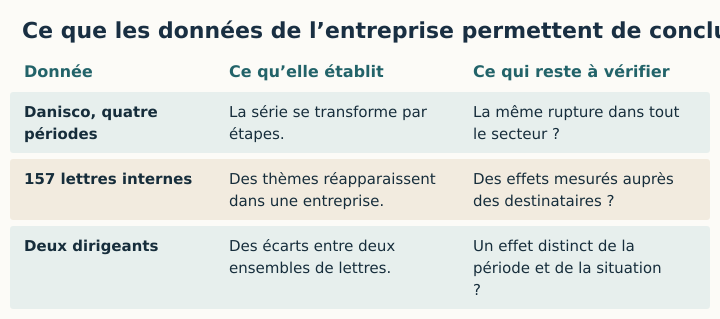

# ENS Paris-Saclay · Cycle master anglais · Dossier thématique A 2024 — Corrigé brut partiel

*Corrigé rédigé par IA, non officiel. Signalez toute erreur.*

**Rédaction** · GPT-6.2 Astra Ultra · vitesse non renseignée

## Genres professionnels et communication d’entreprise

Le dossier public donne les consignes et les références de trois adaptations, sans leurs passages. Le rapport du jury précise la place de la diachronie, des genres et de leurs buts. La synthèse s’appuie sur les résumés des deux articles de Yates et Orlikowski et de Ditlevsen, ainsi que sur le texte du chapitre de Hendriks et van Mulken. Les phrases retenues et les coupes des trois feuillets de concours restent inconnues.

[Sujet officiel, deux pages](https://ens-paris-saclay.fr/sites/default/files/CONCOURS/ANNALES_2C/2C_Anglais/2024_Sujet_2A%20anglais_%C3%A9preuve%20th%C3%A9matique_sujet%20A.pdf) · [Rapport commun du jury, mai 2024](https://ens-paris-saclay.fr/sites/default/files/CONCOURS/ANNALES_2C/2C_Anglais/2024_Rapport_2A%20anglais_%C3%A9preuve%20th%C3%A9matique.pdf)

## Exposé de synthèse

Un salarié ouvre un fichier PDF joint à un courriel. Il sait qu’il va lire la lettre que la direction adresse périodiquement au personnel. Le même matin, une analyste financière télécharge le rapport annuel de l’entreprise. Deux fichiers, peut-être le même écran, et pourtant deux attentes de lecture. Qui parle, à qui s’adresse-t-on, pourquoi maintenant et que pourra faire le destinataire après avoir lu ? Ces questions permettent d’identifier un genre professionnel. Elles permettent aussi de comprendre comment un genre peut se transformer alors même que son nom reste pratiquement inchangé.

Le dossier invite à suivre ce changement à trois échelles. À l’échelle d’une organisation, les usages répétés donnent aux documents une forme reconnaissable. À l’échelle d’une histoire d’entreprise, cette forme se modifie avec les obligations, les lecteurs et les circonstances. À l’échelle d’une relation professionnelle, le même dirigeant peut devoir produire des effets différents selon qu’il prend la parole devant les investisseurs ou devant le personnel. Ces échelles se complètent à condition de distinguer ce que chacune permet de prouver.

### Un genre est une manière reconnue d’agir au sein d’une organisation

La perspective de JoAnne Yates et Wanda Orlikowski permet de partir d’un geste banal. Recevoir une note de service, c’est déjà savoir quelque chose de la situation avant d’en avoir parcouru tous les mots. On anticipe des responsabilités, un degré de formalité, une suite possible. Cette anticipation ne naît pas des rubriques ou de l’en-tête pris isolément. Elle s’est formée à mesure que des personnes ont employé des formes semblables pour accomplir des actes comparables dans des situations récurrentes. La forme du document et la nature de son contenu deviennent des indices d’une pratique collective. Une réunion, qui n’est pas nécessairement un document écrit, peut elle aussi constituer un genre organisationnel.

Le terme de *structuration* éclaire le lien entre pratique et convention. La convention préexiste au nouvel employé qui rédige sa première note. Elle lui fournit des ressources pour parler de façon reconnaissable et rend certains écarts surprenants. Cependant, elle continue d’exister parce que des personnes l’emploient. Si elles modifient leur pratique, et si leurs destinataires reconnaissent et reprennent cette modification, la convention peut évoluer. Ce raisonnement explique à la fois la stabilité du genre et la possibilité de son changement. Une innovation isolée constitue un essai. Sa reprise dans la communauté lui donne un autre statut.

La lettre interne étudiée par Berna Hendriks et Margot van Mulken donne une application précise à cette distinction. Le dirigeant adresse régulièrement une lettre au personnel sous la forme d’un PDF transmis par courriel. Le support facilite la diffusion. La relation reconnaissable demeure celle d’une direction qui explique l’état de l’entreprise et cherche à entraîner ses collaborateurs. Un message électronique annonçant une panne de réseau emprunterait le même canal et accomplirait un autre acte. Il serait tout aussi hâtif de conclure que le support n’a aucun effet. Il peut transformer les délais, les destinataires atteints et les usages possibles en retour. Il faut alors observer lesquels de ces possibles deviennent de véritables pratiques.

### Pour mesurer le changement, il faut une unité de comparaison

Marianne Grove Ditlevsen suit les rapports annuels de l’entreprise danoise Danisco de 1935 à l’exercice 2007–2008. Son objet est pertinent parce que le nom du document et son existence réglementaire lui donnent une certaine continuité. Cette continuité permet de comparer ce que chaque génération de rédacteurs en fait. L’étude porte sur la structure d’ensemble et sur les éléments visuels. Reléguer les images au rang d’ornements ferait donc perdre une partie de la démonstration. La place accordée à un contenu, la façon de l’introduire et les éléments que le lecteur voit simultanément contribuent à la représentation de l’entreprise.

Deux visées coexistent. Le rapport doit rendre fidèlement compte de la situation de la société. Il contribue également à en donner une image favorable. La première relève notamment d’une obligation institutionnelle. La seconde suppose d’anticiper sur l’attention et le jugement de lecteurs qui disposent d’autres sources d’information. Rien n’oblige à supposer que ces visées s’excluent à chaque phrase. Rendre un tableau plus lisible peut servir les deux. Une sélection de faits donne en revanche lieu à une question critique. Lesquels sont mis au premier plan et lesquels faut-il aller chercher ailleurs ? On peut le vérifier sur des documents, à condition de comparer des éléments qui occupent une fonction comparable.

Ditlevsen distingue quatre périodes. La première va de 1935 à 1958, la deuxième de 1959 à 1988, la troisième de 1989–1990 à 2005–2006 et la dernière de 2006–2007 à 2007–2008. Ces bornes ont une valeur méthodologique. Elles montrent qu’on peut chercher des moments de changement dans une série, au lieu de présumer une évolution régulière de la première à la dernière année. Dans le cas étudié, les changements propres à l’organisation ont des effets plus immédiats sur les rapports que d’autres facteurs contextuels. La prudence tient à ces derniers mots, *dans le cas étudié*. Une entreprise observée longtemps rend certaines transformations visibles. Une série plus vaste d’entreprises serait nécessaire pour déterminer si elles se produisent simultanément dans tout un secteur.

### La relation au lecteur fait partie de ce qu’on étudie

Hendriks et van Mulken étudient 157 lettres adressées au personnel d’une même multinationale des semi-conducteurs. Deux dirigeants, l’un néerlandais et l’autre américain, y ont pris la parole avec l’aide du même responsable de la communication. Ce détail compte. L’entreprise et une partie du dispositif rédactionnel sont communs aux deux périodes. Il devient possible de comparer les lettres sans attribuer d’emblée chaque différence à deux cultures nationales. La signature engage la fonction de dirigeant. Elle ne renseigne pas à elle seule sur les étapes de rédaction.

Les chercheuses distinguent deux opérations. Elles classent les sujets abordés et comparent leurs fréquences. Elles examinent ensuite qualitativement le langage de la motivation. Plus de 65 % des lettres contiennent au moins un élément consacré au moral du personnel. Il s’agit de la proportion des **lettres qui en contiennent**, et non de la proportion du texte consacrée à cette fonction. Une même lettre peut faire place aux résultats commerciaux, aux produits et à un encouragement. Le codage donne une prise sur une hypothèse de genre. Dans un document interne, l’avenir de l’entreprise doit être rendu intelligible à des personnes que la direction veut aussi mobiliser.

Comment ces catégories ont-elles été construites ? Trois personnes ont d’abord annoté séparément un petit nombre de lettres. Elles ont confronté les mots qu’elles avaient inscrits en marge et affiné les critères de classement. De nouveaux textes ont ensuite servi à éprouver ces critères. Au terme de quatre réunions, les catégories communes étaient stabilisées. Une règle de décision est particulièrement instructive. Quand plusieurs thèmes coexistent dans le même paragraphe, seul le thème dominant y est retenu. Les neuf grands thèmes utilisés pour l’ensemble du corpus sont donc le produit documenté d’une lecture, avec ses décisions et ses limites. Si une félicitation adressée à une équipe reste secondaire dans un paragraphe consacré aux résultats d’un projet, ce paragraphe peut contribuer à la catégorie des résultats. Expliquer cette règle donne plus de poids au chiffre que la simple annonce d’un pourcentage.

La comparaison avec des travaux antérieurs sur les lettres aux actionnaires permet un retour vers Danisco. Hendriks et van Mulken observent que certaines catégories attendues dans un rapport annuel, notamment la politique à long terme, apparaissent bien moins souvent dans leurs lettres internes que dans l’un des corpus externes qu’elles citent. Quelle conclusion peut-on en tirer ? Une question sur l’avenir demeure pertinente pour plusieurs publics, mais cet avenir peut être construit à des échelles différentes. À l’investisseur qui cherche à juger la trajectoire d’une entreprise, le rédacteur peut présenter des orientations de longue durée. Au personnel qui doit comprendre l’état d’un projet avant le mois suivant, il peut proposer des priorités rapprochées. Il s’agit d’une interprétation à vérifier sur les textes comparés, car ni la période ni les entreprises ne sont exactement les mêmes. On comprend ainsi ce que gagne une recherche à définir soigneusement le destinataire et la cadence de publication.

Deux précautions empêchent de transformer cette observation en psychologie des salariés. D’une part, une marque d’encouragement dans un texte atteste un usage discursif. Pour savoir si les destinataires ont effectivement été encouragés, il faudrait des traces de réception, par exemple des entretiens. D’autre part, des écarts entre deux dirigeants n’isolent pas un effet national. L’état de l’entreprise, la période, l’équipe qui rédige et la situation à laquelle répond telle lettre sont aussi susceptibles d’intervenir. L’intérêt du cas tient précisément à la possibilité de formuler ces explications concurrentes.

Les trois études éclairent ainsi le travail de l’angliciste de spécialité. Une discipline ou une profession ne se réduit pas à un répertoire de mots techniques. On y apprend aussi les occasions de prendre la parole, les personnes à qui il faut rendre des comptes et les manières acceptables de le faire. Une communauté donne sa forme au genre. En retour, lorsqu’elle habitue un salarié à se reconnaître dans le destinataire d’une lettre, ou un investisseur à attendre certains renseignements à date fixe, elle se constitue aussi à travers ses genres. Pour observer cette relation réciproque, il faut pouvoir passer des traits visibles du texte à l’organisation qui les rend attendus, puis revenir aux pièces qui permettent de vérifier l’interprétation.

## Trois relances possibles de l’entretien

**Une lettre publiée dans un rapport annuel et une lettre interne signée du même président relèvent-elles du même genre ?** La signature et certaines formes peuvent être communes. Je comparerais la personne à qui chaque lettre demande quelque chose. Le lecteur externe attend, entre autres, une présentation crédible de l’état de la société. Le personnel doit pouvoir situer ce que la direction dit dans son propre travail. Il peut donc s’agir de genres apparentés dont les visées et les conditions de diffusion diffèrent.

**Comment étudieriez-vous l’effet d’une fusion sur les rapports annuels ?** Je réunirais des rapports antérieurs et postérieurs, en relevant séparément leur structure, leurs publics affichés et la place de l’image. Je comparerais les changements à d’éventuelles modifications des obligations légales au même moment. Si l’accès à l’entreprise le permet, les consignes adressées aux rédacteurs aideraient à départager ce qui vient de la fusion et ce qui tient à un changement de règle commun au secteur.

**Pourquoi parler ici d’anglais des affaires si l’entreprise n’est pas nécessairement britannique ou américaine ?** Un texte en anglais peut circuler entre des lecteurs de plusieurs langues premières au sein d’une même entreprise. Le rapport entre langue choisie, appartenance professionnelle et situation de communication devient lui-même un objet d’enquête. Le lieu du siège et la nationalité du signataire ne suffisent pas à décrire le public réel.

## Sources et périmètre de lecture

Les exemples historiques et les résultats chiffrés se rapportent aux travaux publiés. Le courriel annonçant une panne est un exemple construit pour expliquer la différence entre genre et canal.

[JoAnne Yates et Wanda J. Orlikowski, Genres of Organizational Communication (1992), notice et résumé des auteures](https://doi.org/10.5465/amr.1992.4279545)

[Marianne Grove Ditlevsen, Telling the Story of Danisco’s Annual Reports (2012), résumé de la publication](https://doi.org/10.1177/1050651911421132)

[Berna Hendriks et Margot van Mulken, Dear Worker (2012), notice du dépôt de l’université Radboud](https://repository.ubn.ru.nl/handle/2066/101632)

[Dear Worker, texte du chapitre rendu disponible par les auteures](https://www.academia.edu/2529200/Dear_worker_A_corpus_analysis_of_internal_ceo_letters)
