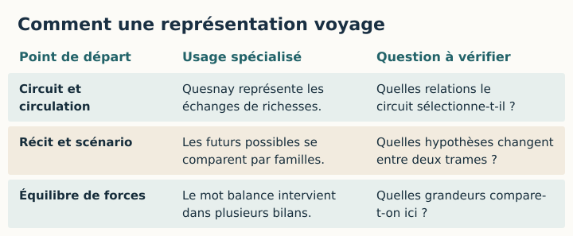
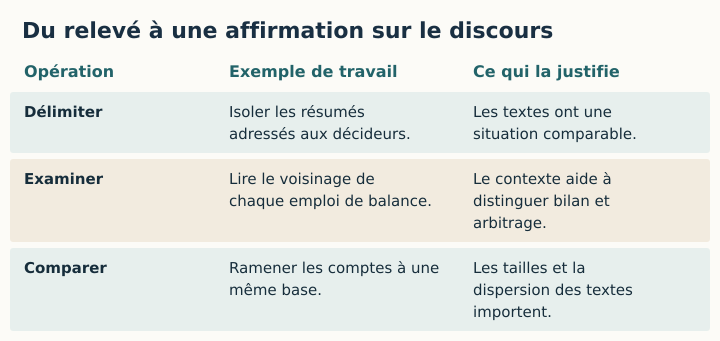

# ENS Paris-Saclay · Cycle master anglais · Dossier thématique B 2024 — Corrigé guidé partiel

*Corrigé rédigé par IA, non officiel. Signalez toute erreur.*

**Rédaction** · GPT-6.2 Astra Ultra · vitesse non renseignée

## Métaphores et construction des savoirs spécialisés

Le dossier public donne les consignes et les références de trois adaptations, sans leurs passages. Le rapport du jury précise le rôle de la métaphore et des approches quantitatives et qualitatives. La synthèse s’appuie sur les articles de Resche et de Fries et sur l’ouverture du chapitre de Semino, p. 463. Les résultats de son étude de cas sur l’expression de la douleur et le contenu exact des trois extraits adaptés restent hors de la couverture.

[Sujet officiel, deux pages](https://ens-paris-saclay.fr/sites/default/files/CONCOURS/ANNALES_2C/2C_Anglais/2024_Sujet_2A%20anglais_%C3%A9preuve%20th%C3%A9matique_sujet%20B.pdf) · [Rapport commun du jury, mai 2024](https://ens-paris-saclay.fr/sites/default/files/CONCOURS/ANNALES_2C/2C_Anglais/2024_Rapport_2A%20anglais_%C3%A9preuve%20th%C3%A9matique.pdf)

## Préparer une synthèse que l’on puisse défendre à l’oral

Sur les deux heures de préparation, réservez vingt minutes à une lecture où vous entourez trois types de traces. Dans la marge, notez un emploi linguistique, le problème que le spécialiste veut résoudre et le type de document qui vous le fait connaître. Sur la ligne « circulation des richesses », inscrivez par exemple « circuit », « suivre les passages d’un groupe à l’autre » et « histoire des modèles économiques ». Pour *balance*, notez séparément ce qu’en révèle une concordance et ce qu’il faudrait encore connaître du passage pour l’interpréter. Au concours, faites ce relevé sur les extraits effectivement distribués. La version publique en donne les références.

Consacrez ensuite trente minutes à deux rapprochements. Faites travailler Resche avec Fries autour de la question « Que conserve une image lorsqu’elle passe d’un domaine à l’autre ? » Faites travailler Fries avec Semino autour de « Quelles observations permettent de l’affirmer ? » Une même étude apparaît ainsi dans deux moments du raisonnement avec deux fonctions différentes. Les quarante minutes suivantes serviront à organiser l’introduction, les exemples et les transitions. Gardez trente minutes pour un essai à voix haute de vingt minutes puis pour reprendre l’exemple ou la réponse restée imprécise. Ces durées de préparation constituent une proposition.

### Un exercice de concordance à petite échelle

Voici trois phrases construites pour s’exercer. Elles ne proviennent pas des articles ni des feuillets de 2024.

- *The team studies the water balance of this valley.*
- *The committee must balance two policy objectives.*
- *The empty container remains in balance on the scale.*

Posez une première question de grammaire. Le mot recherché est-il partout un nom ? La deuxième phrase emploie un verbe. Une recherche limitée aux noms l’écarterait. Examinez les relations ensuite. Dans la première phrase, quels flux entrent dans un bilan ? Dans la deuxième, qui juge de la valeur respective de deux objectifs ? Dans la troisième, de quel objet physique décrit-on l’état ? Ces questions n’appellent pas le même savoir. Traduire les trois occurrences par un substantif français identique ferait disparaître cette différence. Essayez « bilan hydrique », « concilier » et « rester en équilibre ». La traduction devient ici un moyen de vérifier l’analyse du contexte. Elle ne décide pas à elle seule de l’existence d’une métaphore.

### Justifier ce que vous comptez

Reprenez les deux nombres relevés par Fries. Quel est leur périmètre ? Des termes identifiés dans des résumés destinés aux décideurs. Quel renseignement manque si l’on veut comparer deux collections de longueurs différentes ? Le nombre de mots de chacune, la distribution entre documents et des critères de repérage communs. Pour un exercice chiffré distinct des données de l’article, imaginez 20 emplois dans une collection de 10 000 mots et 45 dans une collection de 50 000. La première présente 2 emplois pour 1 000 mots, la seconde 0,9. Le classement change quand on tient compte de la taille. Avant d’en tirer une conclusion, vérifiez encore si les 20 emplois sont répartis ou rassemblés dans une unique citation répétée.

### Répondre à « Et si le mot avait perdu son image ? »

Commencez par reconnaître le problème. Un terme lexicalisé peut être utilisé sans que le locuteur pense consciemment à son domaine d’origine. Formulez alors deux questions distinctes. L’histoire du terme montre-t-elle un transfert documentable ? Son usage présent organise-t-il encore une inférence observable ? Les réponses peuvent différer. Revenez à la place qu’occupe le *scénario* dans la comparaison des futurs et à l’histoire du circuit chez Quesnay. Vous aurez apporté une réponse discutable sur pièces. Pour prolonger à l’entretien, indiquez comment vous mettriez votre lecture à l’épreuve, par exemple en étudiant ce que les auteurs font réellement varier lorsqu’ils passent d’un scénario au suivant.

## Exposé de synthèse

Que promet-on quand on parle d’un *scénario* climatique ? Un lecteur peut s’attendre à apprendre comment une histoire va finir. Une équipe de recherche peut lui présenter plusieurs histoires dont les hypothèses de départ diffèrent. Le mot relie donc deux façons d’ordonner les événements. Comprendre le travail que ce mot accomplit demande trois opérations. Il faut reconstruire la relation empruntée à un autre domaine, observer ce que les spécialistes en font et déterminer quels documents permettent de le prouver. En menant ces opérations ensemble, on peut expliquer comment certaines métaphores donnent accès à une spécialité et comment elles contribuent à la construire.

### Ce qui passe d’un domaine à l’autre

Une métaphore linguistique se repère dans un emploi contextualisé. Dans *la circulation de la richesse*, on peut reconnaître une relation entre deux façons de comprendre la circulation. Le domaine source fournit un réseau de déplacements, de points de passage et de retours. Le domaine cible est économique. On peut y suivre ce qui passe entre plusieurs groupes d’acteurs. La correspondance est partielle. Elle met en valeur les relations entre ces groupes et invite à poser une question précise, celle de la continuité du circuit. Elle laisse ouvertes des questions différentes, notamment celles des décisions ou des institutions qui règlent les échanges.

Ce rapprochement a une histoire. Catherine Resche rappelle que François Quesnay était médecin et qu’il représentait la circulation des richesses en circuit fermé dans son *Tableau économique*. La physiologie qu’il connaissait interprétait elle-même certaines relations dans le corps en termes de mécanique des fluides. Il serait difficile d’assigner l’image à une seule famille, « le vivant » ou « la machine ». Les deux traditions se sont déjà rencontrées dans le savoir disponible pour Quesnay. L’étymologie d’un seul mot renseignerait peu sur cette rencontre. Il faut relier les emplois aux modèles, aux lectures et aux problèmes que les auteurs cherchaient à résoudre.

L’exemple de la machine hydraulique de Phillips permet de comprendre ce que *constitutif* ajoute à cette analyse. Pour figurer des relations économiques, un dispositif fait effectivement circuler de l’eau. L’analogie sélectionne des grandeurs que l’on peut représenter et dont on peut suivre les dépendances. La représentation permet au chercheur d’explorer ce qui se passe lorsqu’une de ces relations change. Elle donne aussi prise à la critique. Est-ce que la relation ainsi matérialisée a un équivalent dans l’économie ? À quelles conditions ? Une expression métaphorique peut donc désigner un phénomène, faciliter son explication ou participer à la formulation d’un problème scientifique. Pour soutenir cette dernière interprétation, il faut montrer le travail qu’elle rend possible.

On peut préciser ce que l’expérience donnait à voir. Dans la machine de Phillips, un liquide coloré circule dans un ensemble de réservoirs et de tuyaux. Une vanne rend possible la variation d’une grandeur, et des traceurs laissent une inscription lorsque les niveaux se stabilisent. Le modèle donne une forme saisissable à une idée d’interdépendance. Une modification locale a des conséquences observables ailleurs dans le dispositif. Il propose également des questions à l’historien de l’économie. Quelles relations les concepteurs ont-ils choisi de rendre variables ? Quelles relations ont-ils fixées à l’avance dans les tubes ? Appliquées à la langue, ces questions changent aussi la manière d’entendre *capital inflows* ou *liquid assets*. Leur proximité avec le modèle hydraulique mérite une enquête. L’usage de ces expressions en anglais ne prouve cependant pas que chaque locuteur ait vu la machine ni qu’il adopte toutes les hypothèses de sa construction.

La *veille métaphorique* recommandée par Resche prend ici un sens pratique. Lorsqu’une famille d’images paraît aller de soi, on peut inventorier les autres modèles auxquels elle est liée et les circonstances dans lesquelles ces liens se transforment. Si deux textes évoquent le même « flux », l’un peut présenter une circulation entretenue par un mécanisme réglable, l’autre une circulation qui possède sa dynamique propre. Le mot isolé ne permet pas de choisir. Les verbes qui l’accompagnent, les agents qui y interviennent et le modèle explicité dans le voisinage permettent de départager les interprétations. Cette enquête qualitative donne une destination précise au relevé lexical que propose un corpus.

### Une métaphore se transforme au cours de ses déplacements

Marie-Hélène Fries étudie des métaphores qu’elle appelle *nomades*. Le domaine qui fournit une ressource à une discipline peut l’avoir lui-même reçue d’une autre. Dans les résumés du GIEC destinés aux décideurs, le scénario arrive notamment par les pratiques de l’économie. Son histoire remonte aussi au récit et au cinéma. Sous la plume des spécialistes du climat, l’organisation en familles de scénarios et en trames permet d’énoncer plusieurs futurs conditionnels. Modifier les hypothèses sur l’évolution des sociétés ou sur les priorités environnementales conduit à examiner des futurs distincts. Le mot conserve la possibilité d’une histoire ordonnée et acquiert un usage méthodique. Il faut donc demander, à chaque étape de son parcours, quelles propriétés de l’emploi précédent demeurent disponibles.

On saisit là un enjeu de communication. Un décideur doit pouvoir comparer des possibilités soumises à des hypothèses. Un citoyen qui lit « c’est le scénario retenu » peut comprendre qu’on lui annonce une prévision unique. Reconnaître ce risque d’interprétation ne permet pas de l’attribuer à un lecteur particulier. Il indique ce qu’une enquête sur la réception devrait vérifier. L’analyse de la langue spécialisée éclaire ainsi la relation entre un document, les personnes à qui il s’adresse et l’usage qu’elles sont censées en faire. La même communauté peut souhaiter à la fois calculer, expliquer et rendre une décision possible.

Un deuxième exemple de Fries permet de tester ce raisonnement. Dans les résumés qu’elle étudie, l’équilibre peut concerner l’énergie, l’eau ou des intérêts économiques et environnementaux à concilier. Une recherche du mot *balance* donne accès à ces emplois divers. L’expression *water balance* invite à examiner des entrées et des sorties. Dans un arbitrage entre objectifs, *balance* renvoie à une pondération dont les critères doivent être discutés. Si l’on regroupe toutes les occurrences sans examiner les mots voisins, on perd une partie du travail conceptuel. Il devient alors tentant de conclure à l’unité de la pensée d’après la seule unité du vocabulaire.

Le rapprochement entre Resche et Fries nous permet de préciser ce qu’est ici le style spécialisé. Ce sont entre autres des choix récurrents qui signalent les activités, les objets et les visées d’une communauté. Pour mettre en évidence cette fonction, nous pouvons demander ce qui se passerait si l’on remplaçait une expression. Remplacer *scénario* par *prédiction* dans la présentation d’une famille de futurs modifie le statut de la conclusion. Le lecteur risque de perdre la condition « si l’on retient telles hypothèses ». Le test porte sur le raisonnement et sur la situation de communication. Il ne suffit pas de noter qu’une image est familière ou frappante.

### Comment établir la portée d’une interprétation ?

Elena Semino part d’une difficulté que les deux autres études rencontrent. Si l’on affirme que la métaphore est fréquente dans la langue ordinaire ou spécialisée, comment étayer ce jugement ? Un corpus est un ensemble organisé de textes authentiques accessibles à l’analyse. Sa composition détermine ce que l’on mesure. Les résumés du GIEC adressés aux décideurs constituent un ensemble approprié pour examiner un genre d’interface entre spécialistes et responsables politiques. Le même corpus renseigne beaucoup moins directement sur un échange entre deux chercheurs au laboratoire ou sur la façon dont un journal rapporte ces résultats.

L’outil informatique aide à retrouver des occurrences, à en présenter les contextes sous forme de concordance et à réitérer une recherche. L’interprétation d’une relation entre domaines demande ensuite d’examiner ces contextes. Dans les résumés considérés par Fries, l’étude donne 881 occurrences pour le scénario et 49 pour l’équilibre. Ces chiffres décrivent la place de deux ressources dans ce corpus. Ils ne donnent pas une mesure immédiate de leur importance théorique. Une image employée une seule fois pour construire un modèle pourrait en organiser tout le développement. Inversement, une expression devenue habituelle peut se répéter presque automatiquement. On vérifierait son rôle en examinant les raisonnements dans lesquels elle entre, les termes qui l’accompagnent et sa dispersion entre textes.

Cette articulation entre quantitatif et qualitatif joue dans l’autre sens. Si l’on ne recherche que les mots déjà relevés, on risque de trouver précisément les images qu’on avait apportées à l’enquête. Une lecture ouverte d’un échantillon peut en faire découvrir d’autres. On pourra ensuite les chercher sur l’ensemble, en vérifiant les emplois littéraux et en documentant les cas ambigus. Semino annonce aussi une étude de la manière dont des personnes parlent de l’expérience de la douleur. Le déplacement de l’objet rappelle qu’une question de corpus commence par « qui parle à qui, et dans quelles circonstances ? » Le langage de personnes qui décrivent une expérience ne se confond pas avec la terminologie employée pour la classer. L’ouverture du chapitre permet d’établir l’existence de cette étude de cas. Elle ne permet pas ici d’en détailler les résultats.

En définitive, la métaphore est une voie d’accès au spécialisé parce qu’elle permet de suivre comment une communauté nomme un problème et quels raisonnements cette dénomination soutient. Pour le montrer sur le *Tableau économique*, il faut étudier l’histoire des savoirs. Pour comprendre la famille des scénarios, il faut examiner l’usage qu’en font les spécialistes et les destinataires qu’ils visent. Pour évaluer une régularité linguistique, il faut documenter le choix, la taille et la diversité des textes. Ces démarches se rejoignent sur une exigence. Une expression ouvre une piste d’enquête et c’est la confrontation des usages qui permet d’en mesurer la portée.

## Trois relances possibles de l’entretien

**Comment décider qu’une métaphore est constitutive ?** Je chercherais d’abord une opération intellectuelle que l’expression rend possible. Pour le scénario, c’est la comparaison de futurs construits à partir de trames et d’hypothèses distinctes. Je vérifierais ensuite sur des documents que les spécialistes accomplissent bien cette opération et quels termes ils emploient pour en rendre compte. Une ressemblance qui me viendrait à l’esprit sans appui textuel pourrait servir d’hypothèse, mais aucune attribution aux auteurs ne serait encore justifiée.

**Que vous apprendrait un corpus plus grand ?** Cela dépend de ce que j’y ajoute. Dix rapports supplémentaires du même genre pourraient améliorer l’observation de changements au fil du temps. Si je mélange ces rapports à des articles de presse sans garder leur origine, une différence de fréquence deviendra difficile à interpréter. Je conserverais donc les dates, les genres, les auteurs institutionnels et les publics visés, puis je comparerais les sous-ensembles sur une base commune.

**Une expression très conventionnelle peut-elle guider le raisonnement ?** Oui. Son caractère familier peut même rendre sa contribution difficile à apercevoir. Je proposerais de reformuler la phrase qui l’accueille en précisant les relations entre les objets. Si la reformulation fait apparaître des hypothèses sur le fonctionnement du domaine, on a une raison de les examiner. Il faudra ensuite vérifier qu’elles se retrouvent dans les pratiques des spécialistes.

## Sources et périmètre de lecture

La notice de Cambridge attribue la direction du Cambridge Handbook of Cognitive Linguistics à Barbara Dancygier. La liste de responsables éditoriaux donnée dans le sujet B pour le chapitre de Semino correspond au collectif de 2012 cité dans le sujet A. Le titre, l’auteure et les pages 463–476 du chapitre permettent de l’identifier.

[Catherine Resche, Termes métaphoriques et métaphores constitutives de la théorie dans le domaine de l’économie (2016), article intégral](https://doi.org/10.3917/lf.189.0103)

[Marie-Hélène Fries, Métaphores constitutives des théories et style spécialisé (2023), article](https://doi.org/10.4000/esa.5001)

[Fries, version intégrale communiquée par l’auteure](https://www.researchgate.net/publication/370349225_Metaphores_constitutives_des_theories_et_style_specialise)

[Elena Semino, Corpus Linguistics and Metaphor (2017), Cambridge University Press](https://doi.org/10.1017/9781316339732.029)
