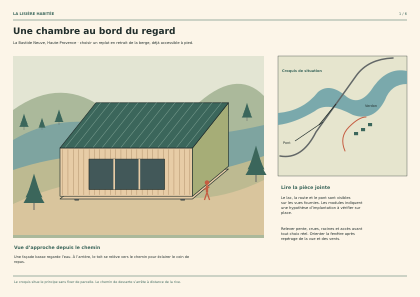
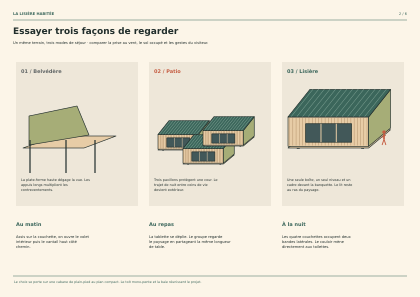
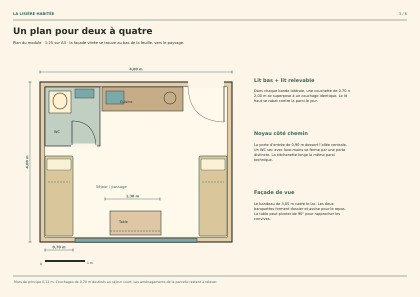
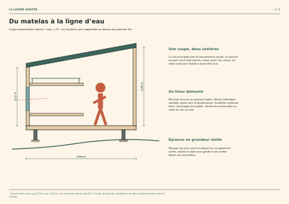
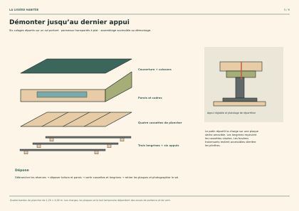
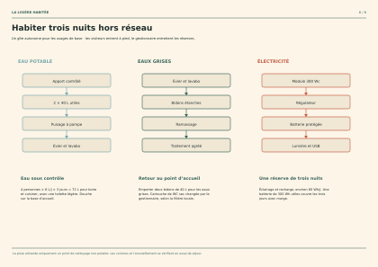

# ENS Paris-Saclay — Design d'espace 2024 · Corrigé guidé

*Corrigé rédigé par IA, non officiel.*

**Rédaction** · GPT-6.2 Astra Ultra · vitesse non renseignée

La lisière habitée accueille deux à quatre visiteurs dans un module réversible de 19,20 m² sur un replat en Haute-Provence. La coupe fait de la vue depuis le lit le point de départ du plan. Les 6 planches numérotées et anonymes sont au format 420 × 297 mm. Les échelles indiquées valent pour une planche seule imprimée sur A3 à 100 %.

## Planche 1 — Une chambre au bord du regard

> [!INDICATION]
> Repérer le pont sur les deux vues puis la berge sur la carte. Séparer les observations du choix d’implantation.

Depuis le pont, les photographies de l’annexe montrent une berge boisée et un plan d’eau qui se resserre. La carte nomme le Verdon et la Bastide Neuve. Le visiteur suit un chemin existant et trouve, du côté des terres, une porte sous le haut du toit. Un seul bandeau de vitrage assis cadre l’eau à travers les arbres. L’auvent qui se déploierait devant la façade a été écarté pour conserver la végétation et garantir la même emprise dans tous les états. Le site précis exige un relevé de terrain et du niveau des eaux. Le transfert à un autre lieu conserve le noyau de services, puis adapte les appuis et la façade de vue.

## Planche 2 — Essayer trois façons de regarder

> [!INDICATION]
> Dessiner une personne à la même échelle dans les essais, puis tracer son trajet nocturne.

La première idée place l’œil au-dessus du couvert. Sa stabilité dépend étroitement de la pente. La seconde distribue le séjour autour d’une cour. Le nombre de parois à transporter augmente vite. La troisième place le confort dans le cadrage du paysage depuis une banquette. Un seul plancher de 4,80 × 4,00 m, soit 19,20 m², réunit les activités et laisse 5,80 m² de marge sous le plafond de l’épreuve. La toiture affleure le nu extérieur dans cette hypothèse. Au jour, la table rabattable libère le passage. Le soir, deux paires de couchages accueillent deux adultes et deux compagnons.

## Planche 3 — Un plan pour deux à quatre

> [!INDICATION]
> Reporter chaque couchage à l’échelle sur le plan et vérifier que la porte ouvre dans les deux configurations.

La largeur intérieure vaut environ 4,56 m et la profondeur environ 3,76 m avec des parois de 12 cm. Les lits longitudinaux ont 2 m de longueur et 70 cm de largeur. Chaque côté reçoit deux lits superposables. L’échelle amovible et le garde-corps du lit haut se rangent du côté cloison. La table rabattue ouvre le corridor vers la baie. Les WC secs occupent une cabine proche de 1,38 × 1,48 m, accessible depuis la pièce. Le meuble sous évier collecte les eaux usées. Un réchaud adapté à un local habité, muni d’une coupure et d’une ventilation dédiée, assure la cuisine. Ces dimensions décrivent une solution pour un séjour bref. Une version accessible exigerait de réétudier les dégagements, le seuil et les couchages.

## Planche 4 — Du matelas à la ligne d’eau

> [!INDICATION]
> Tracer d’abord le plancher et une silhouette de 1,70 m, puis tracer les rives du toit et la visée d’un œil assis.

La sous-face de toiture s’élève de 2,12 à 2,85 m. La baie basse donne la priorité aux personnes assises et la ventilation traversante fonctionne quand l’ouvrant opposé est ouvert. Le toit descend vers une gouttière. Avant de bâtir, essayer en carton le seuil du regard depuis chaque couchette, ajuster l’allège et éprouver l’ouverture en cas de pluie. Le module est prévu pour une saison tempérée. Le comportement au vent, au feu et en période froide dépend d’une étude du site et du matériau de couverture.

## Planche 5 — Démonter jusqu’au dernier appui

> [!INDICATION]
> Remonter la construction sur le dessin en sens inverse. Vérifier qu’un outil pourra atteindre chaque fixation.

Le plancher se divise en quatre cassettes de 1,20 × 4,00 m. Pour une masse hypothétique de 28 kg/m², une cassette approche 134 kg. Un petit engin de levage et un véhicule autorisé sur la desserte sont donc nécessaires. Les parois sont subdivisées en panneaux manuportables ou levables après pesée. Le gabarit maximal du chargement est à comparer à la voie d’accès. Les six plaques sur lit de protection amovible ne nécessitent ni décaissement ni béton. Un sol trop meuble ou une résistance insuffisante au soulèvement conduit à changer de replat ou à dimensionner un lest démontable. Pour contenir le coût, répéter les mêmes quatre largeurs de panneau, concentrer l’eau dans une paroi et prévoir les rechanges de ferrures. Demander séparément les devis de panneaux, de vitrage et de levage.

## Planche 6 — Habiter trois nuits hors réseau

> [!INDICATION]
> Prendre le cas de quatre personnes pendant trois nuits, puis refaire les comptes sans soleil et sans pluie.

Une hypothèse de sobriété à 6 L par personne et par jour donne 72 L pour trois jours à quatre. Les deux réservoirs de 40 L couvrent ce volume avec 8 L de marge. Le service d’accueil renouvelle l’eau potable et récupère les eaux grises et le contenu des toilettes sèches par filière adaptée. Une douche plus gourmande est proposée à la base d’accueil. Les eaux pluviales servent au nettoyage extérieur sur un circuit repéré. Un éclairage de 12 W pendant trois heures et 24 Wh de recharge demandent environ 60 Wh par jour. Avec 300 Wh utilisables, trois journées sans production consomment 180 Wh. Pour deux heures solaires équivalentes et 70 % de rendement global, 300 Wc fourniraient environ 420 Wh par jour. Ces chiffres de conception se vérifient par mesure sur le prototype, avec ombres portées, été sec et jours couverts.

[Énoncé et annexes du concours](https://ens-paris-saclay.fr/sites/default/files/CONCOURS/ANNALES_1C/1C_Design/2024_sujet%20design%201A_Espaces.pdf)
