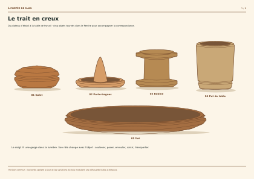
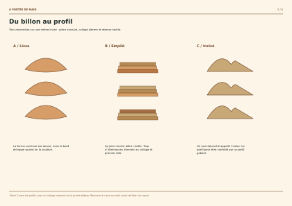
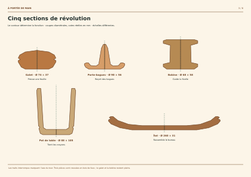
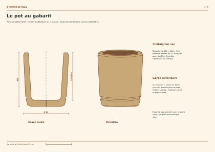
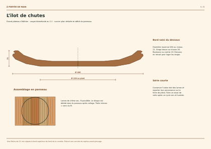
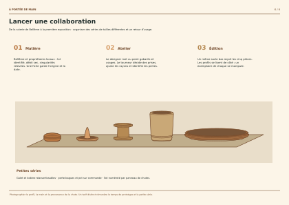

# ENS Paris-Saclay — Design de produit 2024 · Corrigé brut

*Corrigé rédigé par IA, non officiel.*

**Rédaction** · GPT-6.2 Astra Ultra · vitesse non renseignée

À portée de main est une première collection de cinq objets de correspondance pour un designer du Perche et un tourneur sur bois. La gorge devient un signe de famille et une prise adaptée au geste. Les 6 planches numérotées et anonymes sont au format 420 × 297 mm. Les échelles indiquées valent pour une planche seule imprimée sur A3 à 100 %.

## Planche 1 — Le trait en creux

La collection réunit un presse-papiers, un porte-bagues, une bobine à ficelle, un pot à crayons et un grand plateau vide-poches. En rentrant, on pose une bague avant de prendre la plume. La ficelle ferme un paquet, le galet retient ses feuilles et le plateau rassemble les outils en fin de journée. Un profil tourné capte la lumière au bord de chaque objet. Une gorge sert de prise, un raccord concave reçoit le fil ou le bijou. Les parties tournées gardent leur symétrie de révolution. Papier, crayons, bagues et fil restent des accessoires amovibles.

## Planche 2 — Du billon au profil

L’annexe 8 oppose une pièce massive à un assemblage dont les joints restent lisibles. L’annexe 9 propose diverses finitions et montre l’ébonisation. Les essais dessinés isolent une variable à la fois. Le bois massif autorise une continuité visuelle. Les collages permettent de valoriser de petites sections et de changer d’échelle. Une gorge de quelques millimètres donne une prise sans exiger de bois foncé. Sur éprouvette, comparer une huile dure incolore à une cire et vérifier que le crayon, le papier et la peau restent propres après séchage. Une reprise trop vive au bord de la gorge accrocherait la fibre.

## Planche 3 — Cinq sections de révolution

Le galet de 74 mm de diamètre se tire par sa gorge. Une estimation de 100 cm³ dans un chêne de densité 0,7 donnerait environ 70 g, à peser sur prototype. Le porte-bagues ménage une cuvette périphérique pour les petits bijoux et un relief central assez long pour plusieurs anneaux. La bobine porte le fil sur un noyau de 40 mm et protège ses spires entre deux joues. Le pot donne 93 mm de profondeur utile à des crayons courants. Le plateau de 260 mm se prend à deux mains sous le listel. Dessinés en coupe, les profils livrent au tourneur le pied, le creux et les sections minimales à éprouver.

## Planche 4 — Le pot au gabarit

Pour le pot, le tourneur sélectionne une ébauche de châtaignier sèche et stable, repère le fil puis choisit sa prise de mandrin. La mise au rond précède le façonnage extérieur. Le creusage en bout conserve 12 mm au fond et une paroi renforcée près de la gorge. Une reprise permet de terminer le dessous. Le designer fournit un gabarit de demi-profil et conserve une légère variation du fil et de la nuance. Le diamètre maximal de 88 mm est atteint vers le haut du corps. Le pied plan de 60 mm se vérifie sur une plaque plane. Mesurer l’équilibre sur le prototype en retirant les crayons successivement.

## Planche 5 — L’îlot de chutes

Le plateau valorise des chutes locales de même essence, sélectionnées par humidité voisine et disposées à fil parallèle. Un assemblage mêlant bois de bout et bois de fil risquerait de fortes différences de retrait. Préparer un panneau de chêne d’environ 285 × 285 × 38 mm, tracer l’ébauche circulaire puis la débiter. La prise sur la seule poupée fixe laisse accessible la face pour le creusage. Le tourneur choisit le montage et la surépaisseur appropriés à sa machine, puis reprend le pied de 150 mm. Limer ou poncer les raccords sans effacer la gorge. Le test de stabilité porte à la fois sur le balancement du pied et le voile possible du grand diamètre.

## Planche 6 — Lancer une collaboration

La scierie de Bellême, les propriétaires de parcelles et les interlocuteurs de l’ONF cités dans le sujet peuvent alimenter des lots selon disponibilité. Un bordereau documente essence, humidité et provenance. Le premier lot proposé comprend douze galets, huit bobines, quatre porte-bagues, quatre pots et deux plateaux. Ces quantités sont un choix d’édition à tester avec l’atelier. Pour chaque objet, estimer le bois réellement débité, les pertes, le temps de tournage, le séchage de la finition, l’emballage et la commission du lieu. La galerie présente les plateaux singuliers, une boutique peut réassortir les petites pièces. Une courte séquence filmée rapproche chute, profil et main. Le retour du public portera sur la prise, la stabilité et l’envie d’utiliser chaque pièce, puis le prix et les volumes seront ajustés avec l’artisan.

[Énoncé et annexes du concours](https://ens-paris-saclay.fr/sites/default/files/CONCOURS/ANNALES_1C/1C_Design/2024_sujet%20design%201A_Produits.pdf)
