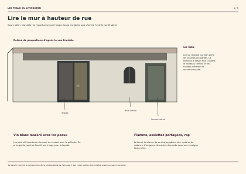
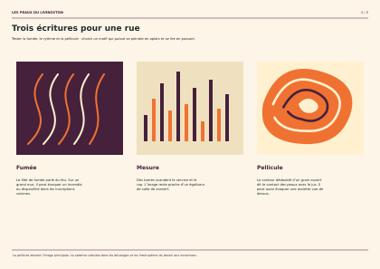
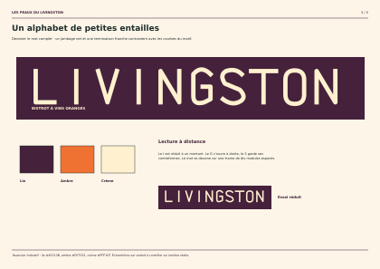
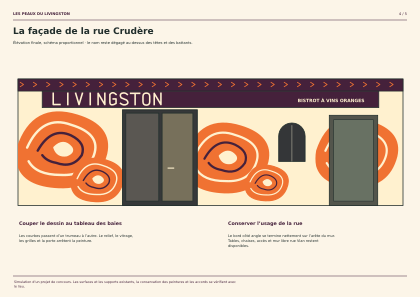
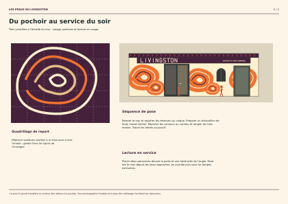

# ENS Paris-Saclay — Design graphique 2024 · Corrigé guidé

*Corrigé rédigé par IA, non officiel.*

**Rédaction** · GPT-6.2 Astra Ultra · vitesse non renseignée

Les peaux du Livingston transpose la macération du raisin en un motif mural pour le bistrot marseillais. Le nom se lit sur le bandeau de la rue Crudère et le mur de la rue Vian reste libre. Les 5 planches numérotées et anonymes sont au format 420 × 297 mm. Les échelles indiquées valent pour une planche seule imprimée sur A3 à 100 %.

## Planche 1 — Lire le mur à hauteur de rue

> [!INDICATION]
> Placer les vides avant de dessiner la moindre image. Quel élément restera visible lorsque les tables seront occupées ?

Les photographies de l’annexe 1 rapprochent le chef, une table servie et les usages du quartier. Celles de l’annexe 2 donnent une vue de biais avec la terrasse et une vue de face. Elles montrent une partie haute continue, une entrée décentrée, une petite ouverture cintrée puis un retrait à droite. Les circulations et ouvrants restent utilisables. Depuis l’angle de la rue Vian, un passant voit d’abord le haut de la façade, puis la porte. Le mur libre de la rue Vian conserve son usage d’expression. L’intervention durable occupe exclusivement la face de la rue Crudère, en dessous du premier étage.

## Planche 2 — Trois écritures pour une rue

> [!INDICATION]
> Lire les trois études d’abord à bout de bras, puis de près. Réserver un signe à l’identification et un autre à l’ambiance.

La flamme rendrait le mode de cuisson immédiat, mais un dessin de fumée ne dit rien du vin. Le rythme vertical fait écho au rap et au service rapide. Il laisse le restaurant difficile à distinguer d’un lieu de concert. La pellicule donne son idée au troisième dessin. Le vin orange provient de raisins blancs en contact avec leurs parties solides. Trois contours irréguliers rappellent les peaux, l’assiette de partage et la tranche de fruit. La lecture reste ouverte à distance. Le nom et la mention du bistrot précisent le sens en arrivant à l’entrée.

## Planche 3 — Un alphabet de petites entailles

> [!INDICATION]
> Vérifier au petit format les deux I, l’ouverture du G et l’espace entre le dernier O et le N.

Le lettrage dessiné assemble dix signes sur une trame régulière. Les fûts du L, du I et du T reprennent le trait droit du bandeau. Les courbes du O, du S et du G répondent aux pellicules. La mention « Bistrot à vins oranges » est plus petite, avec une hauteur et un contraste à régler sur place. Le crème sur lie donne la lecture principale à l’ombre de l’enseigne. L’ambre anime le mur. Ces trois couleurs peuvent être appliquées au rouleau ou à la brosse. Avant commande, regarder un échantillon sec sur l’enduit de la rue, au soleil puis le soir, et faire lire le nom depuis le trottoir opposé.

## Planche 4 — La façade de la rue Crudère

> [!INDICATION]
> Suivre la ligne de la frise, puis le motif à hauteur de marche. Identifier ce que voit le passant lorsque la porte est ouverte.

Le mot s’inscrit sur la bande existante, lu d’abord depuis l’angle. Une frise fine accompagne le débord supérieur. Les grands contours d’ambre et de lie se coupent au droit des tableaux de baie. Leur échelle accepte qu’une table, un convive ou une porte ouverte masque une partie de la peinture. Les grilles, la ventilation, les luminaires et les passages gardent leur dégagement. Les proportions viennent du cliché en façade et les arbitrages entre les peintures actuelles et le projet se font avec l’équipe et les artistes concernés. Les deux rues se rencontrent sur une arête franche. Le projet s’arrête à cette arête.

## Planche 5 — Du pochoir au service du soir

> [!INDICATION]
> Choisir un carré du motif et le redessiner au double. Simuler un ouvrant et une table avant de valider l’implantation.

Accorder avec le restaurateur le droit d’intervenir et le traitement des œuvres déjà présentes. Relever précisément enduit, propriétés des supports et limites de lot, puis poser les gabarits à sec. Le peintre nettoie le support selon essai, masque équipements et tableaux, applique un fond compatible et reporte les masses par quadrillage. Un poncif conserve la précision de l’enseigne. Une intervention par travée permet de garder la porte utilisable. Budgéter la préparation, le nombre de teintes, la main-d’œuvre de lettrage et une retouche future à partir des teintes conservées. Depuis la rue Vian, la face tournée vers Crudère demeure le seul signal fixe. En usage, on vérifie que les convives masquent uniquement des fragments de la fresque et que le nom reste lisible.

[Énoncé et annexes du concours](https://ens-paris-saclay.fr/sites/default/files/CONCOURS/ANNALES_1C/1C_Design/2024_sujet%20design%201A_Graphique.pdf)
