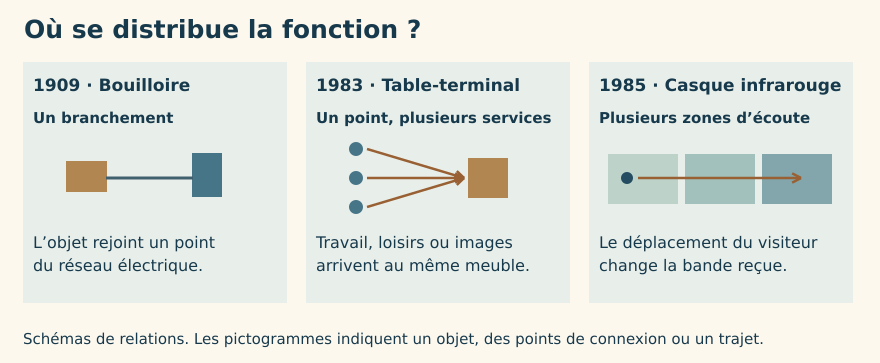
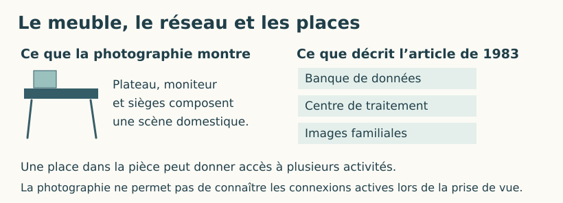

# ENS Paris-Saclay · Design — Histoire de l’art 2024 · Corrigé brut

*Corrigé rédigé par IA, non officiel. Signalez toute erreur.*

**Rédaction** · GPT-6.2 Astra Ultra · vitesse non renseignée

**Autocontrôle** · GPT-6.2 Astra Ultra · vitesse non renseignée

**Révision (tour 1)** · GPT-6.2 Astra Ultra · vitesse non renseignée · 26 novembre 2026

## Sujet de la session

Matérialité et immatérialité des productions industrielles : du Deutscher Werkbund à l’exposition « Les Immatériaux » (1907-1985).

« Avec un ou plusieurs terminaux, […] une nouvelle typologie environnementale fait son apparition ; l’espace, dès lors, se caractérise par les fonctions qui y prennent place : information (terminal relié à plusieurs banques de données), loisirs (jeux électroniques), mémoire familiale (enregistrement d’images et d’événements se rapportant à l’histoire de la famille), travail (connexion avec les centres de traitement), activité culturelle (théâtre, film…), etc. Et le vieux salon ? Il restera probablement comme il est, à l’image d’un lieu qui n’est plus habité, mais conservé en souvenir du rituel. »

Ugo La Pietra, « Le tout-confort télématique », Architecture intérieure – Créé, n°94, 1983.

Vous analyserez et discuterez cet extrait de Ugo La Pietra en vous appuyant sur votre connaissance du programme et selon un propos argumenté.

Le catalogue de Paris-Saclay ne répertorie aucun rapport écrit pour la filière Design en 2024. [Annales de la session](https://ens-paris-saclay.fr/admission/concours/concours-pre-master/annales-concours-pre-master?field_orientation_1c_target_id%5B%5D=293&field_year_target_id%5B%5D=589)

## Que reste-t-il du salon ?

Dans le salon qu’évoque Ugo La Pietra en 1983, aucun meuble n’a besoin de disparaître pour que la pièce change de sens. On peut y conserver un canapé, des fauteuils et une table basse et avoir transporté ailleurs ce qui faisait de lui un lieu de séjour. Le diagnostic ne porte donc pas simplement sur l’arrivée des écrans. Il annonce une transformation de ce qui permet de distinguer les lieux dans la maison. Les connexions rendraient accessibles en un même point des activités auparavant distribuées entre le bureau, la salle de spectacle et la demeure. Mais l’adverbe « probablement » suspend la certitude du futur « restera ». Le meuble pourrait garder la trace d’un rite dont l’usage s’efface. À quelles conditions les réseaux de l’industrie peuvent-ils changer le sens d’un espace dont le mobilier et les usages ont une histoire plus longue qu’eux ?

## L’industrie équipe la maison avant d’y distribuer l’information

Le Deutscher Werkbund, créé en 1907, pose dès le début du programme la question des rapports entre production industrielle et qualité de la vie matérielle. La bouilloire électrique dessinée par Peter Behrens pour AEG en 1909 offre un précédent instructif. Un récipient de métal et une anse subsistent, mais leur usage suppose un raccordement au réseau électrique. Le service du thé peut quitter la proximité du foyer. Une limite matérielle est remplacée par une autre, celle du point d’alimentation. De plus, le modèle conservé au MoMA appartient à une offre qui coûtait alors davantage qu’une bouilloire ordinaire et ne chauffait pas plus vite. L’intérêt de l’objet ne se déduit donc pas d’une supériorité technique sur tous les critères. L’apparence et le lieu de la préparation peuvent compter dans la décision de l’adopter.

Dans la cuisine de Francfort que Margarete Schütte-Lihotzky conçoit en 1926 pour les logements du Nouveau Francfort, les gestes sont étudiés pour en réduire la longueur et la fatigue. Le rangement intégré, le siège pivotant et la planche à repasser rabattable rassemblent des opérations dans un petit volume. Une activité spécialisée donne à la pièce sa configuration. Le corps doit se déplacer de telle distance, atteindre tel récipient, ranger tel outil. La promesse d’une organisation rationnelle touche ainsi la personne à qui revient le travail domestique. Le projet veut soulager ce travail, mais la distribution spatiale peut aussi maintenir la personne qui l’accomplit à l’écart de ceux qui attendent le repas. Déjà, la fonction que l’industrie inscrit dans une pièce ne suffit pas à décrire la relation qui s’y installe.

À première vue, La Pietra ne fait que généraliser cette définition fonctionnelle des lieux. En réalité, il en inverse une condition. Dans la cuisine de Francfort les fonctions sont attribuées à des emplacements différents, rapprochés selon la succession des gestes. Avec le terminal, un même emplacement peut devenir successivement plusieurs lieux. L’organisation passe du parcours du corps à la sélection d’un service.

## Le terminal cumule des lieux sans en abolir les supports

Le mot « terminal » est précis. Ce qui se trouve chez soi constitue une extrémité du système. Les données ou les activités de traitement auxquelles on accède dépendent d’installations éloignées. Il devient possible de travailler depuis la maison sans que le travail soit une activité autonome du foyer. Le rapprochement spatial apparent s’accompagne d’une dépendance accrue à distance. De même, voir un film et consulter des enregistrements familiaux sur le même appareil rapproche deux positions auparavant différentes, celle du public d’une œuvre distribuée et celle de la personne qui conserve un souvenir.

La suite des cinq fonctions fait varier les gestes de l’habitant. Demander une information à une banque de données suppose une requête. Jouer suppose d’agir sur le déroulement de la partie. Revoir une image familiale suppose que quelqu’un l’ait enregistrée et choisie. Le travail relie le foyer à un centre de traitement, tandis que la diffusion d’un film ou d’un spectacle déplace une activité culturelle jusqu’à lui. L’écran commun recouvre donc plusieurs relations, et ces relations donnent au même emplacement des durées et des publics différents.

En 1983, La Pietra réalise à la Foire de Milan, avec Gianfranco Bettetini et Aldo Grasso, l’exposition *La casa telematica*. Les archives du projet désignent notamment un objet comme table-terminal. Une table a une hauteur, une surface sur laquelle on pose les coudes et un emplacement autour duquel plusieurs personnes peuvent s’asseoir. Le projet retient ces conditions matérielles tout en greffant au meuble un usage de communication. Ses archives continuent d’ailleurs à distinguer cuisine, salle à manger, chambre et séjour. L’exposition met à l’essai une contamination entre les deux organisations. Elle ne constitue pas une enquête établissant que les logements milanais ordinaires auraient déjà changé de la même manière.

Deux photographies conservées par le designer donnent à cette proposition une forme observable. Dans celle du *soggiorno*, plusieurs petits écrans lumineux se détachent sur des volumes garnis d’un motif répétitif. La lumière bleue de l’installation et la répétition des motifs font encore voir un ensemble mobilier. La photographie légendée *tavolo/terminale* isole une autre situation. Un moniteur repose à une extrémité du plateau et les sièges restent visibles de part et d’autre. Le meuble peut orienter un regard vers l’écran tout en maintenant la possibilité de se tourner vers quelqu’un. Les photographies attestent cette disposition. Le texte, lui, énumère les liaisons et les services qu’elle pourrait accueillir.

L’exposition *Les Immatériaux* au Centre Pompidou en 1985 permet de préciser le paradoxe. Le casque sans fil remis au visiteur reçoit par infrarouge les bandes-son réparties en trente et une zones. Les contours d’un lieu entendu ne se confondent plus nécessairement avec ceux d’une salle murée. Lorsqu’un corps se déplace, les informations changent autour de lui. Or cette apparente immatérialité mobilise un casque, des émetteurs et un parcours aménagé. L’analogie a une limite qui la rend féconde. Le musée distribue chaque écoute en fonction de la position du visiteur. Le terminal domestique permet au contraire de changer de service sans quitter son fauteuil. Dans les deux cas, l’industrie dessine bien des lieux par leurs fonctions, mais les architectures techniques qui y parviennent divergent.

## Les rites ne se laissent pas tous convertir en services

Le salon classique a pour fonction de recevoir. Pourtant recevoir quelqu’un n’équivaut pas à obtenir une catégorie d’informations. Cela demande de libérer du temps, de proposer une place, parfois de suspendre une activité pour tenir compte d’une présence. Un écran installé au salon peut concurrencer ce rite, soutenir une séance regardée à plusieurs ou demeurer éteint à l’arrivée d’un ami. Le même raccordement ne permet pas de déduire laquelle de ces situations prévaudra. L’appel à la mémoire familiale dans le texte en donne une autre preuve. Une image enregistrée demeure matériellement disponible, mais devient souvenir commun à la faveur d’un récit, d’une sélection ou du désaccord de deux spectateurs sur l’événement montré.

Enfin, les pièces qu’une habitation garde « en souvenir » ne cessent pas pour autant de produire des différences sociales. Pouvoir conserver une pièce rarement utilisée suppose de disposer d’espace. Transformer le salon en bureau peut être un choix ou la conséquence du manque de place. L’exposition rend pensable une nouvelle typologie, tandis que son adoption dépend des ressources du foyer, de l’offre industrielle et des arrangements entre ses habitants.

## Conclusion

La Pietra saisit donc une rupture historique dans le lieu où se distribuent les activités. Le terminal rassemble des fonctions autrefois séparées et étend l’espace domestique jusqu’aux centres qui le desservent. La permanence du vieux salon met cependant à l’épreuve la limite de cette logique. Une architecture de connexions peut organiser l’accès à des services. Pour expliquer comment une pièce devient effectivement un lieu habité, il faut encore regarder qui s’y tient, avec qui, à quel moment et pour quel usage.

[Sujet officiel](https://ens-paris-saclay.fr/sites/default/files/CONCOURS/ANNALES_1C/1C_Design/2024_Histoire%20de%20l%27Art_Design1A.pdf) · [Archive du projet de La Pietra](https://www.ugolapietra.com/anni-80/la-casa-telematica/) · [MoMA, bouilloire de Behrens, 1909](https://www.moma.org/collection/works/2190) · [MoMA, cuisine de Francfort](https://www.moma.org/collection/works/126451) · [Centre Pompidou, casque des Immatériaux](https://www.centrepompidou.fr/fr/ressources/oeuvre/t4l0b27)
