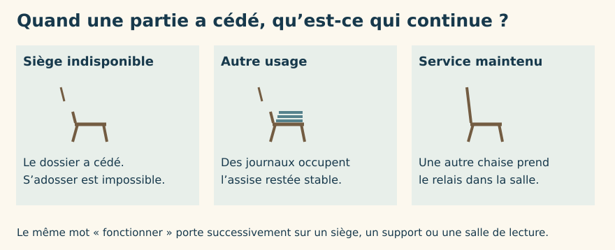

# ENS Paris-Saclay · Design — Philosophie de l’art 2024 · Corrigé guidé

*Corrigé rédigé par IA, non officiel. Signalez toute erreur.*

**Rédaction** · GPT-6.2 Astra Ultra · vitesse non renseignée

**Autocontrôle** · GPT-6.2 Astra Ultra · vitesse non renseignée

Le sujet invite à discuter, pour la pratique du design, la validité de la formule de Sohn-Rethel sur la technique napolitaine et sur « ce qui est cassé » qui « fonctionne ».

## Tester le paradoxe sur un même objet

Inscrivez sur une feuille trois indications, « pour qui ? », « à quelle fin ? », « à quelle échelle ? ». Leur variation explique comment la même chaise peut être inutilisable pour s’adosser, disponible comme support et provisoirement remplacée dans une salle de lecture.

**Quelle différence entre l’analyse de Heidegger et l’exemple napolitain ?** L’indisponibilité de l’outil rend visible un ensemble d’usages dont il dépendait. Cette découverte peut laisser l’objet inutilisable. Sohn-Rethel invite à examiner une opération supplémentaire, la découverte d’une nouvelle activité effective dans ce qui paraissait hors service.

**Où faire intervenir le design ?** Le produit modulaire fait passer du constat rétrospectif de l’ingéniosité à un choix préalable du concepteur. Suivez la chaîne jusqu’à la pièce de rechange. La seule présence d’un assemblage accessible ne dit pas encore si la réparation est praticable dans la durée.

**Quelle objection résiste à la fin ?** Une capacité réinventée peut profiter à quelqu’un d’autre que la personne privée du service promis. C’est une raison pour réserver une place à la fiabilité et à la responsabilité dans une réflexion sur la liberté d’usage.

## À quoi reconnaît-on qu’une chose fonctionne ?

Le dossier d’une chaise a cédé. Elle ne soutient plus la personne qui comptait s’y adosser. Placée dans l’entrée sans qu’on invite quiconque à s’y asseoir, elle peut encore servir de support à une pile de journaux. En quel sens dire qu’elle fonctionne ? Si l’on entend seulement qu’une chose quelconque peut toujours servir de quelque façon, la formule d’Alfred Sohn-Rethel perd toute force. Elle porte pourtant sur l’« essence de la technique » et tire sa conviction d’une observation située de la vie napolitaine. Elle laisse entendre que l’écart entre le service promis et le service obtenu donne accès à quelque chose que l’objet en parfait état dissimule. Le designer doit-il dès lors produire des choses qui fonctionnent sans incident, ou ménager les conditions pour que leur usage puisse reprendre après un incident ? La réponse dépend de ce que l’on choisit comme unité du fonctionnement.

## La panne rend perceptible une relation technique

Tant que la chaise me porte, je peux m’intéresser entièrement à la conversation. Je ne considère ni sa stabilité ni le rapport entre sa hauteur et celle de la table. Dès qu’elle vacille, mon attention revient vers ce qui devait soutenir une autre activité. Dans *Être et temps*, l’analyse heideggérienne de l’outil indisponible éclaire ce retour de l’attention. Ce n’est pas seulement la pièce abîmée qui se signale. D’autres choses viennent à manquer avec elle, une place où recevoir, une table autour de laquelle on peut réunir le groupe prévu. L’outil avait sa place dans un ensemble de renvois. L’accident rend sensible cette inscription que le succès du geste laissait souvent inaperçue.

Cette révélation ne suffit toutefois pas à justifier le présent de l’indicatif chez Sohn-Rethel. Une panne peut instruire et pourtant laisser l’usage entièrement suspendu. Nous aurions alors compris ce qui fonctionnait avant la rupture, sans pouvoir dire que ce qui est cassé fonctionne encore. La proposition napolitaine est plus radicale. Dans les scènes que décrit l’auteur, des composants industriels continuent d’avoir une activité à la faveur d’un nouvel agencement. Le moteur dont la chaleur sert à faire du café illustre ce déplacement de finalité. Selon la mesure du constructeur, une production de chaleur excessive représente une perte. Dans l’usage rapporté, cette même propriété devient une ressource. Il n’y a pas contradiction à condition de préciser ce qu’on évalue. Le fonctionnement n’est plus rapporté exclusivement au programme d’origine.

## Rendre une prise à l’usager

Le geste technique se déplace ainsi du fabricant vers l’usager. Il faut percevoir dans ce qui arrive une propriété qui pourra répondre à une autre situation. Le produit fini demeure matériellement contraignant. On ne tire pas n’importe quelle opération de n’importe quel reste. Mais sa description par le catalogue n’épuise pas ses dispositions réelles. Le design aurait donc tort de penser que sa tâche prend fin lorsque le service prévu se déclenche pour la première fois. La question de ce qui restera accessible plus tard fait partie de la conception.

Le Fairphone 2, lancé en 2015, constitue une épreuve de cette idée. Son architecture sépare certains composants en modules remplaçables. Si l’écran est endommagé, les parties intactes conservent une valeur d’usage pour un appareil remis en service. Elles ne la conserveraient pas aussi facilement si le démontage détruisait l’ensemble. Cette fois, le but du téléphone demeure identique. L’agencement initial rend possible une reprise qui exige l’action d’une autre personne, ainsi que l’existence d’une pièce disponible. On peut distinguer cette réparation du détournement napolitain. Là, la finalité changeait. Ici, elle demeure, mais le titulaire de la capacité technique change en partie. Le concepteur prévoit qu’une personne extérieure à l’usine puisse contribuer à la continuité de l’objet.

Il existe aussi des cas où l’objet ne fonctionne qu’à plusieurs échelles différentes. Si une bibliothèque offre une chaise de remplacement, le service de lecture continue pendant la réparation de la première. Le siège individuel demeure indisponible et l’institution a pourtant rempli sa fonction. Ce serait une erreur de compter la continuité du service comme la preuve que la rupture est insignifiante. Quelqu’un a dû constater le problème, trouver une autre place et consacrer du temps au mobilier abîmé. Toute célébration de l’ingéniosité doit rendre ce travail visible. Le regard extérieur posé sur Naples risque à cet égard de convertir le coût d’une pénurie pour les habitants en qualité pittoresque d’une ville.

## Concevoir la continuité sans souhaiter la casse

Un designer peut ainsi tirer une leçon de ce que la panne révèle sans souhaiter qu’elle se produise. Il doit d’abord définir les usages auxquels on peut promettre une fiabilité durable. Une rampe d’accès qui ne permet plus de franchir un seuil a manqué sa destination pour une personne qui doit passer. La possibilité qu’un autre usager s’en serve pour poser un sac ne compense rien à cette échelle. Le caractère ouvert d’une chose est une qualité supplémentaire lorsqu’il élargit une liberté effective. Il ne libère pas le fabricant de ses engagements envers les personnes qui dépendent de l’usage initial.

Il faut ensuite distinguer ce qui est offert à l’initiative et ce qui est laissé à la charge de quelqu’un. Documenter les pièces d’un meuble, garantir leur disponibilité, choisir des assemblages accessibles et organiser un service de réparation constituent des décisions de conception. Affirmer que tout utilisateur inventera bien quelque solution élude au contraire la question de son temps, de ses ressources et de son expérience. La réparabilité se juge jusque dans l’organisation collective qui permet de se procurer une pièce ou de faire intervenir un professionnel.

La formule de Sohn-Rethel vaut pour le design comme déplacement du regard. Elle révèle qu’un objet demeure technique par les relations de matière, de savoir et de coopération qui peuvent reprendre après la défaillance d’une de ses parties. Prise comme loi universelle du bon objet, elle confondrait la possibilité d’un nouvel usage avec l’accomplissement de la première promesse. Un design attentif à cette distinction associe trois exigences, tenir sa promesse initiale, permettre sa reprise et laisser à ceux qui le souhaitent une marge pour inventer un autre service.

[Sujet officiel](https://ens-paris-saclay.fr/sites/default/files/CONCOURS/ANNALES_1C/1C_Design/2024_Philosophie%20de%20l%27Art_Design1A.pdf) · [Étude historique de Sohn-Rethel à Naples](https://journals.sagepub.com/doi/10.1177/13675494251336604) · [Stanford Encyclopedia of Philosophy, l’outil chez Heidegger](https://plato.stanford.edu/archives/spr2022/entries/heidegger/) · [Fairphone, conception modulaire du deuxième modèle](https://www.fairphone.com/resources/pdf/Fairphone-factsheet_EN.pdf)
