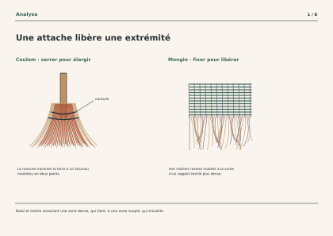
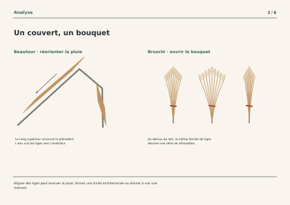
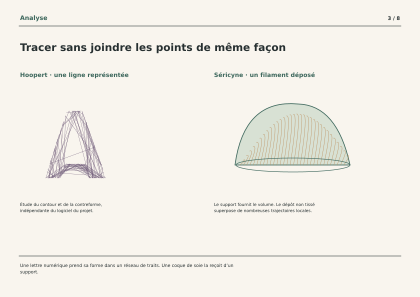
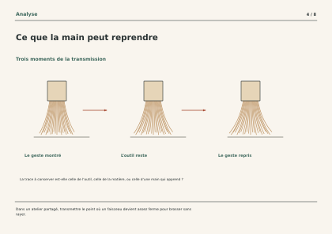
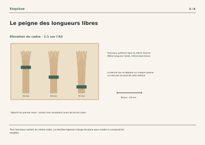
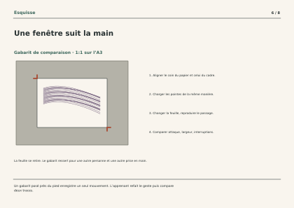
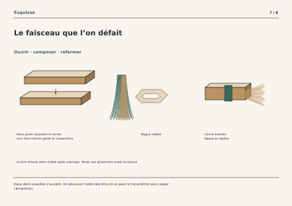
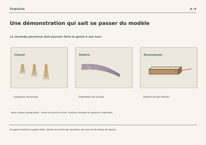

# ENS Paris-Saclay — Design, Techno-design 2024 · Corrigé brut

*Corrigé rédigé par IA, non officiel.*

**Rédaction** · GPT-6.2 Astra Ultra · vitesse non renseignée

**L’empreinte du geste.** Un atelier de brosses conserve des gestes de fabrication et d’entretien à travers des échantillons que les mains peuvent reprendre sur place. La proposition occupe 8 planches A3 paysage autonomes. Les quatre premières développent l’analyse et les quatre suivantes l’esquisse. Chaque fichier de planche mesure 420 × 297 mm. Imprimé seul sur A3 à 100 %, il garde ce format, tandis que les plans reproduits dans le livret sont réduits.

## Analyse — Une attache libère une extrémité · planche 1/8

Chez **Jean-Marc Coulom à Grisolles**, la photographie de l’atelier montre le poste de ligature et deux balais aux manches de couleurs différentes. Le sujet situe l’origine du bois dans les Landes et celle de la paille en Camargue. L’artisan précise qu’il travaille la paille de sorgho. Disposer les fibres autour du manche, les maintenir, comprimer et coudre le faisceau, puis égaliser l’extrémité donne au balai sa largeur et son élasticité. Les coutures déplacent la frontière entre la partie tenue et la partie qui fléchit. Un même geste assez souple pour balayer s’exerce sur une forme suffisamment stable pour être reproduite. L’atelier conserve un savoir-faire industriel jadis partagé par de nombreux ateliers de la ville. [Présentation de l’atelier Coulom](https://www.balaispaillecoulom.com/a-propos/)

**Antonin Mongin** fait entrer cheveux, crins et autres fibres dans des surfaces textiles. Les vues de son compte d’atelier opposent des mèches libres aux parties incorporées à la matière, et des éléments linéaires enroulés ou assemblés. La disposition des fibres influence le reflet et le sens du toucher. La légende désigne plusieurs matières pour l’ensemble des images. Elle ne permet pas d’attribuer une origine précise à chaque brin photographié. Le tri par longueur et couleur et le temps consacré à préparer les mèches font partie du prix d’une telle pièce. Dans les deux cas, la qualité du bord libre dépend d’un ancrage presque invisible. [Présentation du designer, Bureau du Design, de la Mode et des Métiers d’Art](https://www.bdmma.paris/accompagnement/incubateur/antonin-mongin/)

## Analyse — Un couvert, un bouquet · planche 2/8

Le centre de découverte de **Beautour**, conçu par **Guinée*Potin** pour la Région des Pays de la Loire, a été étudié à partir de 2010 et livré en 2013–2014 selon le sujet. La photographie de chantier montre l’application du chaume sur la toiture. Les vues suivantes le font descendre sur la façade et tourner au droit d’une ouverture. Un recouvrement serré et une orientation cohérente rejettent l’eau vers l’extérieur. Le support et les attaches restent en retrait de la surface d’usure. Le matériau évoque un paysage local tout en enveloppant un équipement scientifique contemporain. Il faut entretenir les bords exposés et rendre l’accès possible au chaumier. [Centre Beautour, Observatoire des CAUE](https://www.caue-observatoire.fr/ouvrage/centre-beautour-de-decouverte-de-culture-scientifique-de-recherche-lenvironnement-biodiversite/)

Les **Bouquets de moisson** d’**Emma Bruschi**, présentés en autoédition en 2023, passent du champ photographié aux variations isolées sur fond clair de sa boutique. Des tiges sont réunies, pliées, tressées ou liées. Selon l’endroit du lien, les épis s’ouvrent en éventail, forment une boucle ou restent alignés. Cette série rattache un savoir agricole et ornemental à une vente contemporaine en petite quantité. Une ressource saisonnière et un temps de main constituent ici la forme autant que le dessin. Changer d’échelle change aussi la mesure de la réussite. Une enveloppe doit tenir dans la durée, un bouquet peut rendre sensible un moment de la récolte. [Bouquets et objets, Emma Bruschi](https://emmabruschi.fr/fr/shop)

## Analyse — Tracer sans joindre les points de même façon · planche 3/8

Dans **Mesh** de **Dan Hoopert** (2013), des figures de plus en plus denses aboutissent à un alphabet. Le gros plan du dossier fait voir des traits fins traversant la lettre et son voisinage. Le fil apparent est ici une représentation numérique. Il est possible d’étudier la lisibilité en associant des points sur un contour, en variant la densité des liaisons et en réservant une contreforme. Ce schéma explique le phénomène visible sans attribuer au créateur un algorithme ou un logiciel précis. La reproduction d’une image tire parti de la même géométrie d’un exemplaire à l’autre.

**Séricyne**, à Monoblet, guide le dépôt des filaments de soie sur des supports de forme déterminée. Les photographies rapprochent coupelles translucides, volume éclairé et geste de manipulation. À l’échelle du filament, il s’agit d’un dépôt non tissé. Un tissage au métier supposerait deux directions entrecroisées et une armure. Le support donne une géométrie macroscopique tandis que l’animal produit le fil et son parcours local. La mise au point d’un support réutilisable permet des petites séries, sans abolir les variations du matériau ni le travail de contrôle. Le procédé industriel et vivant a un contexte économique propre aux objets et aux emballages de soie. [Présentation du procédé, Séricyne](https://sericyne.fr/a-propos/)

Dans un cas la ligne donne l’illusion d’une matière, dans l’autre la matière dessine une surface. La différence ouvre une question d’apprentissage. Un dessin peut transmettre l’ordre d’un mouvement, mais il ne dit pas à la main à quel moment le faisceau résiste.

## Analyse — Ce que la main peut reprendre · planche 4/8

Un atelier de fabrication et d’entretien de brosses accueille chaque semaine un nouveau groupe. Quand l’artisan s’éloigne de la table, la photo du produit fini reste disponible mais le réglage du geste disparaît. Les participants ont besoin de savoir où placer le lien, quelle longueur laisser libre et jusqu’où courber la fibre. L’enjeu se prête au dessin et au toucher. Il ne suppose ni d’imiter le balai de Grisolles ni de conserver des échantillons fragiles hors d’usage.

La recherche part de trois observations matérielles. Le lien de Coulom organise un seuil de souplesse. La photographie de Hoopert le rendrait discret si tous les traits avaient la même densité. Les échantillons de Mongin et les bouquets de Bruschi rendent perceptibles des orientations différentes d’une même famille de fibres. Dans *On Weaving* (1965), **Anni Albers** réunit structure textile, manipulation des matières et formation de la sensibilité tactile. Cette référence encourage à placer la comparaison au bout des doigts. **Comment garder la trace d’un geste de brossier tout en laissant chacun le régler à nouveau ?** On évaluera la réponse dans un passage de main en main. [On Weaving, Fondation Josef et Anni Albers](https://www.albersfoundation.org/alberses/teaching/anni-albers/on-weaving)

## Esquisse — Le peigne des longueurs libres · planche 5/8

**Hypothèse 1.** Un petit cadre de hêtre de récupération, de 180 × 115 mm, porte trois faisceaux remplaçables provenant de la même réserve de sorgho. Leurs diamètres et nombres de brins sont comparables. Trois bandes de toile immobilisent fermement leur pied. La longueur libre mesurée depuis la dernière retenue est respectivement de 30, 50 et 70 mm. L’apprenant fléchit dans le même sens chaque extrémité sur une bande de carton témoin. La ligature est contrastée pour que les doigts et l’œil identifient le départ du mouvement.

Un schéma idéal de brin encastré prédit, à faible flèche, une raideur variant comme l’inverse du cube de la longueur libre, toutes choses égales. On attend donc un ordre tactile net, mais les brins du faisceau réel frottent, glissent et ont des sections différentes. Les sensations restent à éprouver. Une attache à reprise manuelle permet de déplacer le dernier lien sur le faisceau médian et de chercher la transition entre caresser, frotter et marquer.

## Esquisse — Une fenêtre suit la main · planche 6/8

**Hypothèse 2.** Une plaque de carton gris de 160 × 120 mm comporte une fenêtre centrale de 100 × 70 mm. Une feuille mince interchangeable en ferme le fond et deux repères alignent son coin sur la table. À gauche, l’artisan réalise un passage avec une petite brosse dont les pointes ont touché une encre lavable. À droite, l’apprenant recommence avec la même brosse sur une seconde feuille. Les deux cartes, superposées à la fenêtre ou posées côte à côte, donnent à voir l’attaque, la largeur de la trace et les manques. Un trait imprimé sur le cadre situe le début du mouvement.

La comparaison peut-elle transmettre l’appui du poignet ? Une trace élargie peut venir de plus de pression, mais aussi d’une brosse plus chargée ou d’un support humide. On prépare deux bandes du même papier et on adopte un nombre convenu de passages sur le tampon. Au dos, on note la matière des brins et la longueur libre du jour. Une trace intéressante peut ensuite servir d’amorce à une lettre, comme dans l’alphabet de Hoopert, sans confondre visibilité du résultat et réussite technique.

## Esquisse — Le faisceau que l’on défait · planche 7/8

**Hypothèse 3.** Un manche d’exercice est formé de deux joues en bois arrondies au toucher. Une bague coulissante maintient leurs extrémités. L’apprenant fait reculer la bague, sépare les joues, dispose un petit lit de fibres fines entre deux lits plus fermes et referme le tout. Un repère sur la bague indique la position de travail. Une fente en bout laisse passer le faisceau ; une empreinte aveugle reçoit son pied. Une rondelle de liège remplacée si elle s’écrase répartit le serrage.

Une première maquette en carton enroulé et baguettes fera vérifier si la bague revient au même cran et si un brin marqué se retire trop facilement. On compare ensuite le passage d’une brosse souple en périphérie à celui d’une brosse souple au centre. Les doigts peuvent explorer l’assemblage avant de voir le résultat sur un papier. L’échantillon devient un outil que deux personnes peuvent recomposer, mais son épaisseur peut gêner les petites mains. Une version courte, posée dans un étau de table, constituerait une variante d’apprentissage.

## Esquisse — Une démonstration qui sait se passer du modèle · planche 8/8

Premier essai, faire classer les trois longueurs libres sans lire les cotes. Repérer les hésitations et les mots employés pour décrire la flexion. Deuxième essai, passer une carte témoin à une autre personne qui refait le geste sans démonstration. Comparer largeur, orientation, dépassements et nombre de passages. Troisième essai, démonter puis remonter la coquille avec un brin repère marqué. Contrôler sa position et comparer la prise en main avant et après. Pour chaque essai, noter la matière nécessaire pour remplacer seulement la partie usée et le temps de préparation de l’artisan.

Je retiens le **peigne des longueurs libres** comme première pièce de la table. L’apprentissage y porte sur une variable à la fois et chacun peut ajuster le lien pour produire une quatrième sensation. Les cartes conserveraient une trace transportable de la séance, tandis que la coquille pourrait prolonger le travail à l’étape du montage. Si les participants confondent régulièrement longueur et quantité de fibres, la prochaine maquette séparera la mesure de la saillie du comptage de brins. Le dossier formule des essais réalisables ; aucun résultat expérimental n’est présenté comme acquis.

[Sujet officiel de l’ENS Paris-Saclay](https://ens-paris-saclay.fr/sites/default/files/CONCOURS/ANNALES_1C/1C_Design/2024_Techno-Design_Design1A.pdf)
