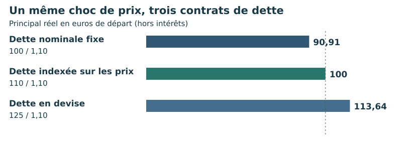

# ENS Paris-Saclay · Analyse macroéconomique 2024 — corrigé brut

*Corrigé rédigé par IA, non officiel. Signalez toute erreur.*

**Rédaction** · GPT-6.2 Astra Ultra · vitesse non renseignée · 26 novembre 2026

## Sujet

Les dettes face à l’inflation

## Dissertation

À partir de juillet 2022, la Banque centrale européenne relève ses taux directeurs pour répondre à une inflation élevée. Un ménage français qui avait déjà emprunté à taux fixe pouvait continuer à payer la même échéance, tandis qu’un nouvel acquéreur devait accepter un crédit plus cher ou renoncer au logement envisagé. Pour les finances publiques aussi, des prix plus élevés peuvent grossir rapidement les recettes nominales alors que le coût des obligations anciennes reste provisoirement fixé. Dans le même temps, le coût d’un emprunt nouveau augmente. La coexistence de ces effets explique pourquoi l’idée que « l’inflation efface les dettes » rend si mal compte des débats de 2024.

Une dette est l’engagement d’un agent de servir des paiements à un créancier. Un stock nominal, un échéancier d’intérêts et un rapport dette/revenu répondent à des questions différentes. L’inflation est une hausse durable du niveau général des prix, dont une partie peut avoir été anticipée lors de la rédaction du contrat. Comment un même mouvement de prix peut-il alléger certains bilans tout en fragilisant la capacité de financement d’une économie ? Il faut suivre successivement le partage entre débiteurs et créanciers, la réaction des revenus et des taux, puis la façon dont dettes privées et publiques se transmettent leurs risques.

### I. L’inflation redistribue la valeur réelle de contrats conclus antérieurement

Pour une créance nominale fixe de montant $B$, sa valeur en biens représentatifs est $B/P$. Après une hausse imprévue de 10 % du niveau des prix, 100 euros de principal valent environ 90,91 euros de pouvoir d’achat initial. Le créancier reçoit les unités monétaires prévues mais peut acquérir moins de biens ; le débiteur doit livrer l’équivalent d’une plus faible quantité de biens. Les deux effets sont les faces d’un même contrat. Une économie fermée ne s’enrichit donc pas de dix euros chaque fois qu’un débiteur bénéficie de la surprise : la créance d’un autre agent se déprécie. Des effets réels restent possibles si les ménages endettés et les détenteurs de créances ont des propensions à consommer différentes.

Cette redistribution dépend de ce qui était attendu. Pour un prêt d’un an rémunéré au taux nominal $i$, le rendement réel réalisé est $(1+i)/(1+\pi)-1$. Avec un taux nominal de 3 % et une inflation anticipée de 2 %, le taux réel attendu est proche de 1 %. Si l’inflation atteint finalement 8 %, le rendement réel réalisé devient négatif, à environ −4,63 %. Mais des prêteurs qui anticipent durablement une inflation élevée réclament en général une rémunération nominale plus forte, une indexation ou des maturités plus courtes. L’effet de surprise sur les anciens contrats ne se reproduit donc pas automatiquement à chaque nouvel emprunt. Une désinflation ultérieure réduit le rythme des hausses ; elle ne ramène pas, à elle seule, les prix à leur niveau initial.

L’indexation et la monnaie de libellé engendrent d’autres résultats. Un titre dont le principal suit intégralement l’indice des prix conserve approximativement sa valeur réelle sur la période couverte, sous réserve des délais et clauses du contrat. Un emprunt en devise expose le débiteur au change. Si le prix d’une unité de devise en monnaie nationale monte de 25 % pendant que les prix intérieurs augmentent de 10 %, un principal initialement égal à 100 en monnaie nationale vaut $125/1{,}10=113{,}64$ en pouvoir d’achat initial. Une entreprise exportatrice encaissant la devise peut couvrir une partie de ce risque ; une entreprise dont les recettes sont nationales en est davantage exposée. Il est donc essentiel de distinguer dette extérieure, définie par la résidence du créancier, et dette en monnaie étrangère, définie par le contrat.

### II. La solvabilité dépend du revenu disponible et du moment où les taux sont révisés

Un ménage n’acquitte pas son emprunt avec l’indice des prix. Si son salaire nominal augmente autant que les prix, la même mensualité fixe absorbe une fraction plus faible de son revenu. Si les prix augmentent surtout par le renchérissement de l’énergie importée et que les salaires suivent avec retard, nourriture et chauffage peuvent absorber une part telle du revenu que le ménage rencontre des difficultés de paiement. Sa dette réelle a diminué, pourtant sa liquidité se détériore. Pour l’entreprise, le même diagnostic passe par les marges : une société en mesure d’ajuster ses prix de vente conserve plus de recettes nominales, alors qu’un fournisseur lié par un prix de vente fixe subit la hausse de ses intrants. Le bilan patrimonial et la contrainte d’échéance doivent être suivis ensemble.

Le rôle du taux d’intérêt apparaît quand la banque centrale cherche à contenir l’inflation. Dans la zone euro, le taux de la facilité de dépôt est passé de −0,50 % avant le resserrement de juillet 2022 à 4 % en septembre 2023. Pour les nouveaux emprunts, la hausse du coût du crédit réduit la demande de logements et l’investissement des entreprises. Pour les anciennes dettes à taux variable, elle augmente le service de la dette après la date de révision. Pour les titres anciens à taux fixe, le débiteur qui peut attendre le terme n’a pas d’intérêt supplémentaire immédiat à acquitter, mais le prix de marché du titre peut baisser. Une banque détenant ces titres devient vulnérable si des retraits l’obligent à les vendre avant échéance. Le risque change de porteur et de date selon les contrats, au lieu de disparaître au niveau de l’économie.

La soutenabilité publique obéit à une logique analogue avec, en plus, le pouvoir fiscal de l’État. En l’absence d’ajustements patrimoniaux et en notant $b$ la dette rapportée au PIB, $i$ le taux nominal effectif sur l’encours, $g$ la croissance nominale du PIB et $s$ l’excédent primaire en proportion du PIB courant, on a $b_t=[(1+i_t)/(1+g_t)]b_{t-1}-s_t$. Si la dette initiale atteint 100 % du PIB, que le PIB nominal augmente de 8 %, que le taux effectif sur l’encours est de 2 % et que le solde primaire est nul, le ratio devient $102/108=94{,}44\%$. L’exemple illustre un effet de dénominateur qui peut survenir sans le moindre remboursement du principal. Une croissance nominale élevée ne garantit cependant ni la croissance réelle ni le maintien du solde primaire. Les retraites et prestations peuvent être indexées, les achats de l’État renchérir et les aides à l’énergie augmenter. Si les obligations arrivant à maturité sont renouvelées à des taux plus élevés alors que le PIB nominal ralentit, le terme favorable peut s’inverser. Il faut alors connaître la maturité, la fraction indexée et la dynamique des recettes.

### III. Le traitement d’un risque privé ou public peut déplacer la contrainte vers d’autres bilans

Les dettes interagissent par le système de crédit. Un ménage surendetté qui réduit brutalement ses dépenses prive une entreprise de recettes. Si plusieurs emprunteurs font défaut, le capital des banques se réduit et la distribution de nouveaux crédits peut ralentir. Des garanties, une recapitalisation bancaire ou des allocations de soutien stabilisent la demande et les paiements privés, mais mettent des ressources publiques en jeu. Une garantie ne devient pas toujours une dette immédiatement exigible ; l’appel de cette garantie peut néanmoins transformer un risque privé en charge publique. Inversement, lorsque les investisseurs réclament une prime sur les titres publics d’un pays, les banques nationales qui les détiennent peuvent subir des moins-values ou voir leur coût de financement monter. La crise de la zone euro avait montré la force de cette boucle avant même le retour de l’inflation.

Le choix de politique économique met ainsi plusieurs objectifs en tension. Laisser les prix augmenter pour diminuer la valeur de la dette nominale peut éroder l’épargne monétaire, accélérer l’indexation et pousser les nouvelles émissions vers des échéances plus courtes. Désinflater trop brutalement peut relever les taux réels, aggraver les défauts et ralentir le PIB. Dans une déflation, le raisonnement de Fisher devient particulièrement aigu : pour retrouver des liquidités, les emprunteurs vendent des actifs ou compriment leurs achats ; la baisse des prix et des revenus augmente alors le poids réel des dettes nominales restantes. Une désinflation où les prix montent encore n’est pas cette spirale déflationniste, mais le risque souligne l’intérêt de ne pas imposer à tous les secteurs un désendettement simultané.

Une réponse différenciée traite les causes plutôt que le seul stock de dette. Une banque centrale peut lutter contre l’inflation persistante et fournir, à des conditions adaptées, des liquidités pour éviter des ventes désordonnées de titres. La politique prudentielle peut limiter en amont les prêts à taux variable à des ménages incapables de supporter une hausse, et demander aux banques de mesurer leur risque de taux. Dans l’urgence d’un choc énergétique, une aide budgétaire temporaire ciblée sur des ménages dont le revenu tarde à s’ajuster peut éviter des défauts à moindre coût qu’une compensation intégrale de tous les contrats. Pour l’État emprunteur, étaler les échéances réduit le risque d’avoir à refinancer immédiatement tout l’encours. Aucune de ces mesures ne dispense d’évaluer les ressources réelles disponibles et la distribution du coût entre contribuables, épargnants et emprunteurs.

L’inflation redistribue d’abord la valeur réelle des engagements dont les termes sont déjà fixés. Sa traduction en capacité de paiement dépend ensuite des revenus, de la monnaie du contrat, des échéances et de la réaction des taux. Lorsque banques, entreprises, ménages et États se financent mutuellement, une baisse de la charge réelle sur un bilan peut coïncider avec un risque accru sur un autre. Le diagnostic pertinent consiste donc à identifier qui absorbe le choc de prix aujourd’hui, puis qui devra refinancer ses engagements demain.

## Repère quantitatif

## Sources

Le sujet et le rapport de la session 2024 portent sur les dettes publiques et privées, leurs liens et le rôle du taux d’intérêt. Le graphique est un exemple construit pour comparer les contrats. [Sujet officiel, page 2](https://ens-paris-saclay.fr/sites/default/files/CONCOURS/ANNALES_1C/1C_D2_1/2024_Analyse_macroeeconomique_EcoG%201.pdf#page=2) · [Rapport du jury](https://ens-paris-saclay.fr/sites/default/files/CONCOURS/ANNALES_1C/1C_D2_1/2024_Rapport_Macro%C3%A9conomie_Eco-Gestion%201_Ecrit.pdf) · [Index des annales](https://ens-paris-saclay.fr/admission/concours/concours-pre-master/annales-concours-pre-master?field_orientation_1c_target_id%5B%5D=289&field_year_target_id%5B%5D=589&page=1)

L’historique officiel des taux directeurs permet de vérifier la chronologie de la réaction monétaire évoquée dans la copie. [BCE, taux directeurs](https://www.ecb.europa.eu/stats/policy_and_exchange_rates/key_ecb_interest_rates/html/index.fr.html)
