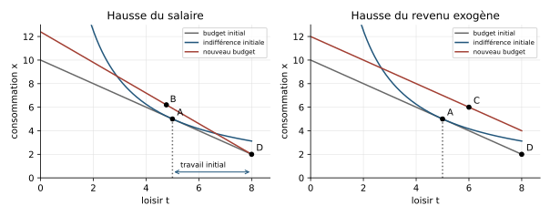
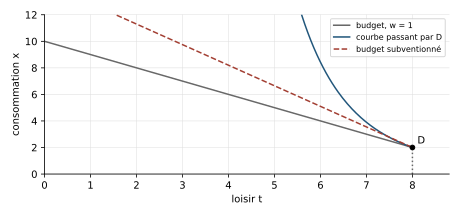

# ENS Paris-Saclay · Analyse microéconomique 2024 — corrigé guidé

*Corrigé rédigé par IA, non officiel. Signalez toute erreur.*

**Rédaction** · GPT-6.2 Astra Ultra · vitesse non renseignée · 26 novembre 2026

## Partie 1 — Le choix entre travail et loisir

Le consommateur dispose de $T$ heures, dont $t$ de loisir et $l=T-t$ de travail. Le revenu hors travail est $y$, le salaire horaire $w$ et le prix du bien $p$. Les conditions de tangence ci-dessous supposent une représentation différentiable régulière, avec utilités marginales positives.

**1.1 — Budget complet.** Éliminer $l$ de $px=y+wl$ donne $px+wt\le Z$, où $Z=y+wT$. Le programme intérieur est $\max u(x,t)$ sous cette contrainte, pour $x>0$ et $0<t<T$. Chaque heure de loisir coûte $w$ de consommation potentielle ; $Z$ est ce que l’individu pourrait dépenser s’il travaillait toutes ses heures. La contrainte est saturée par non-satiété.

**1.2.1 — Multiplicateur.**

*Indication.* Prenez le loisir comme une dépense implicite : une heure de loisir coûte w euros. Différenciez le Lagrangien d’abord par rapport aux deux quantités ; la condition sur le multiplicateur viendra de ces égalités.

Écrivons $\mathcal L=u(x,t)+\theta(Z-px-wt)$. À l’intérieur, $u_x=\theta p$, $u_t=\theta w$ et $px+wt=Z$. Avec $u_x>0$, on a $\theta=u_x/p>0$. La non-satiété impose l’épuisement du budget. Rigoureusement, une transformation croissante dont la dérivée s’annule exactement au point choisi pourrait donner un gradient nul et donc un multiplicateur nul dans cette représentation singulière, sans changer les préférences. Les conditions régulières utilisées pour le TMS écartent ce cas.

**1.2.2 — Sens de $\theta$.** Pour $V(p,w,Z)=\max u$, l’enveloppe donne $\partial V/\partial Z=\theta$ à prix fixés. Un euro de revenu complet supplémentaire augmente l’utilité d’environ $\theta$ dans l’échelle retenue. On le retrouve en divisant l’utilité marginale de chaque usage par son prix.

**1.2.3 — Tangence.** La contrainte et le rapport $u_t/u_x=w/p$ caractérisent le choix intérieur. À satisfaction constante l’individu renoncerait à $u_t/u_x$ unités de consommation pour obtenir une heure de loisir supplémentaire. Le marché lui fait renoncer à $w/p$ unités. Si sa disposition à payer dépasse ce prix, un transfert vers le loisir augmente son utilité, sous réserve de temps disponible. Avec des préférences convexes, une tangence régulière soutient un optimum ; l’unicité requiert plus que la simple convexité.

**1.3 — Repères du graphique.**

*Indication.* Marquez T sur l’axe horizontal avant de prolonger la droite. Le temps libre ne peut dépasser T, alors que le revenu exogène garantit encore une consommation positive à T.

Dans le plan $(t,x)$, $x=Z/p-(w/p)t$, entre $(0,Z/p)$ et la dotation $D=(T,y/p)$. L’intercept horizontal de la droite prolongée est $Z/w=T+y/w>T$, hors du temps disponible. Au point intérieur $A$, une courbe décroissante convexe a la pente $-u_t/u_x=-w/p$. La distance horizontale de $t_A$ à $T$ mesure les heures travaillées.

**1.4 — Salaire accru.** La droite devient plus pentue et pivote autour de $D$. À utilité initiale, l’augmentation du prix relatif du loisir décourage le loisir et favorise le travail. À partir d’un $l>0$, l’agent peut aussi financer davantage de biens ou de loisir à ses anciennes heures : son gain marginal de pouvoir d’achat est $l\,dw$. Si le loisir est normal, cet effet de richesse augmente $t$ et réduit $l$. Sans précision sur les préférences, le signe final est indéterminé ; la figure illustre un cas d’augmentation du travail. Le nouveau budget inclut le panier initial, donc la satisfaction ne baisse pas.

*Repère.* Gardez le même panier physique et calculez la différence entre ses ressources et sa dépense après la hausse du salaire. Le temps disponible rapporte $T\,dw$ de plus mais le loisir choisi coûte $t\,dw$ de plus.

**1.5 — Revenu exogène accru.** Si seul $y$ augmente, la droite se translate verticalement de $dy/p$ sans changer de pente. Seul apparaît l’effet de revenu. Pour un loisir normal, $t$ augmente et $l$ diminue. Une hausse du salaire a également un effet de substitution et son gain de richesse dépend des heures travaillées : les deux interventions ne sont donc pas équivalentes.

## Partie 2 — Non-participation

**2.1 — Contrainte de temps.** Avec $t\le T$, le Lagrangien est $\mathcal L=u+\theta(y+wT-px-wt)+\delta(T-t)$. Il vient $u_x=\theta p$, $u_t=\theta w+\delta$ et $\delta(T-t)=0$, avec $\theta,\delta\ge0$ et le budget saturé.

**2.2 — Salaire de réservation.**

*Indication.* Partez de l’agent qui ne travaille pas et augmentez de quelques minutes la durée de travail. Qu’achète le salaire de ces minutes et quelle valeur accorde-t-il au loisir perdu ?

Si $t<T$, alors $\delta=0$ et la tangence de la première partie s’applique. Au coin $D=(T,y/p)$ (ordre des coordonnées $t,x$), $\delta=u_t-(w/p)u_x\ge0$. Le salaire de réservation est
$$w_r=p\,\frac{u_t(y/p,T)}{u_x(y/p,T)}.$$
Si $w<w_r$, une première heure de travail fait perdre plus d’utilité de loisir qu’elle n’en rapporte en consommation ; le choix optimal est $l=0$. À $w=w_r$, la tangence peut être au coin ; avec stricte convexité il reste unique. Si $w>w_r$, offrir un peu de travail augmente l’utilité et l’optimum quitte ce coin. En dehors d’une hypothèse de stricte convexité, un segment d’indifférence peut produire des choix multiples à l’égalité.

**2.3 — Géométrie du coin.** Le consommateur aimerait prolonger son temps de loisir au-delà de $T$ si l’on prolongeait fictivement le budget. Au point $D$, la pente en valeur absolue de la courbe d’indifférence est supérieure ou égale à $w/p$. Se déplacer à gauche le long de la droite n’achète pas suffisamment de consommation pour compenser le loisir perdu.

**2.4 — Incitation à offrir du travail.** Une prime horaire sur le travail déclaré relève le salaire net des premières heures. Elle laisse $D$ inchangé mais rend la droite plus pentue. Choisir une prime $\sigma$ telle que $w+\sigma>w_r$ rend le travail profitable à la marge. Une réduction de revenu inconditionnel pourrait aussi agir par richesse si le loisir est normal, au prix d’une perte de ressources. La prime horaire cible directement le seuil de participation.

*Repère.* Test local équivalent : dériver $u((y+wl)/p,T-l)$ en $l=0$. Le signe de $(w/p)u_x-u_t$ permet de retrouver le sens de chaque inégalité sans mémoriser la formule.

## Partie 3 — Choix avec minima de consommation et de loisir

**3.1 — Minima.** Écrivons $a=2/3$, $b=1/3$, $X=x-\bar x$, $L=t-\bar t$ et $S=Z-p\bar x-w\bar t=y-p\bar x+w(T-\bar t)$. Les logarithmes exigent $X,L>0$. Les deux barres décrivent les besoins incompressibles dans ce modèle ; l’utilité tend vers $-\infty$ à leur approche. Il faut $S>0$ pour pouvoir dépasser les deux minima.

**3.2 — Demandes et offre.**

*Indication.* Ôtez du revenu complet la dépense qui achèterait exactement les deux minima. Les préférences portant sur les quantités excédentaires sont alors de forme Cobb-Douglas.

Maximiser $a\ln X+b\ln L$ sous $pX+wL=S$ donne $a/X=\theta p$ et $b/L=\theta w$. Comme $a+b=1$, $\theta=1/S$. À l’intérieur,
$$x=\bar x+\frac{aS}{p},\qquad t=\bar t+\frac{bS}{w},\qquad l=T-\bar t-\frac{bS}{w}=a(T-\bar t)-\frac{b(y-p\bar x)}w.$$
Il faut en outre $l>0$ pour cet intérieur. Les poids $a,b$ sont des parts du budget disponible après les dépenses minimales.

**3.3 — Hausse de $\bar x$.** À paramètres nominaux inchangés, $S_{\bar x}=-p$, donc $x_{\bar x}=1-a=b=1/3$, $t_{\bar x}=-bp/w$, $l_{\bar x}=bp/w$. Un minimum plus élevé ampute les ressources souples : l’agent augmente le travail et comprime la partie discrétionnaire de sa consommation. Une dépense alimentaire ou de chauffage devenue indispensable peut se représenter par cette hausse en volume ; une simple inflation relève plutôt de $p$.

**3.4 — Hausse de $p$.**

*Indication.* En dérivant la consommation de bien, le prix intervient deux fois : dans le coût du minimum et dans le pouvoir d’achat du reste du budget. Dans l’expression du loisir, il intervient seulement par ce premier canal.

$S_p=-\bar x$ et
$$x_p=-a\frac{S+p\bar x}{p^2}<0,\qquad t_p=-\frac{b\bar x}{w}<0,\qquad l_p=\frac{b\bar x}{w}>0.$$
Renoncer à un peu de loisir finance le renchérissement de la quantité incompressible.

**3.5 — Hausse de $y$.** $x_y=a/p>0$, $t_y=b/w>0$, $l_y=-b/w<0$. Les deux demandes sont normales ; le supplément de revenu se répartit selon les parts de dépense.

**3.6 — Condition du coin.**

*Indication.* Testez une méthode sans multiplicateur : si la demande de loisir calculée sans limite dépasse T, la borne physique s’impose. Vérifiez dans ce cas que le revenu hors travail finance plus que la consommation minimale.

À $t=T$ la consommation vaut $y/p$, donc il faut $y>p\bar x$. La demande de loisir non contrainte atteint ou dépasse $T$ précisément lorsque
$$y-p\bar x\ge 2w(T-\bar t),\qquad\text{soit}\qquad w\le\frac{y-p\bar x}{2(T-\bar t)}.$$
En effet $p u_t/u_x=p\,bX/(aL)$ évalué en $D$ donne le même seuil. Si $y\le p\bar x$ mais que $S>0$, travailler est indispensable pour dépasser le minimum. Une prime horaire n’incite à quitter l’inactivité que si le salaire franchit le seuil ; le besoin de subsistance et les contraintes de temps rendent l’effet hétérogène.

**3.7 — Utilité indirecte.** Dans le régime intérieur, $V=\ln S+a\ln(a/p)+b\ln(b/w)$, puisque $X=aS/p$, $L=bS/w$. L’expression utilise le revenu complet et inclut la valeur du temps.

**3.8 — Demandes hicksiennes.**

*Indication.* Posez une dépense inconnue au-delà des minima. Déterminez quelle fraction achète chaque quantité excédentaire, puis déduisez de l’utilité cible le montant de dépense qu’il vous faut.

Minimisons $pX+wL+p\bar x+w\bar t$ sous $a\ln X+b\ln L\ge\bar u$. À l’optimum $pX:wL=a:b$ et la contrainte d’utilité est saturée. Si $B$ désigne la dépense au-delà des minima, la relation $e^{\bar u}=(aB/p)^a(bB/w)^b$ donne
$$B=e^{\bar u}(p/a)^a(w/b)^b,\qquad h_x=\bar x+aB/p,\quad h_t=\bar t+bB/w,\quad h_l=T-\bar t-bB/w.$$
Ces fonctions valent dans le régime intérieur demandé ; à la cible initiale on retrouve $B=S$.

**3.9 — Dépense.** $E(p,w,\bar u)=p\bar x+w\bar t+B$. Son gradient en prix est $(h_x,h_t)$ et elle est homogène de degré un en $(p,w)$. Le montant de revenu hors travail nécessaire à cette cible, à salaire donné, serait $E-wT$.

**3.10.1 — Statique comparative du salaire.** À $T,p,y$ fixes, $S_w=T-\bar t$. Ainsi $dx/dw=a(T-\bar t)/p>0$ et $dl/dw=b(y-p\bar x)/w^2$. Le travail augmente si le revenu exogène suffit à dépasser la consommation minimale, diminue s’il est inférieur à ce coût et reste constant en cas d’égalité, tant que l’on demeure à l’intérieur.

**3.10.2 — Identités de Slutsky avec dotation en temps.**

*Indication.* Sur une première ligne, dérivez une demande à revenu complet Z constant. Sur une seconde, laissez Z varier avec le salaire. Le terme supplémentaire vaut le temps disponible multiplié par la sensibilité de la demande à la richesse.

Pour $q=x$ ou $t$, l’identité à revenu complet constant est $(\partial q/\partial w)_Z=(\partial h_q/\partial w)_{\bar u}-tq_Z$. Lorsqu’on varie le salaire à revenu *exogène* inchangé, $dZ/dw=T$. Donc
$$\frac{dx}{dw}=\frac{\partial h_x}{\partial w}+(T-t)x_Z,\qquad
\frac{dl}{dw}=\frac{\partial h_l}{\partial w}+(T-t)l_Z.$$
Dans la seconde identité, prendre $l=T-t$ change le signe des deux termes relatifs à $t$ ; $l_Z=-b/w$. La compensation utilise la demande de loisir $t$, tandis que la richesse supplémentaire nette porte sur $l=T-t$.

**3.10.3 — Valeurs des effets.** Au point de départ où $B=S$, $B_w=bS/w$. Par unité supplémentaire de salaire :

| Quantité | Substitution, utilité constante | Richesse | Total |
|---|---|---|---|
| $x$ | $abS/(pw)>0$ | $al/p>0$ | $a(T-\bar t)/p$ |
| $l$ | $abS/w^2>0$ | $-bl/w<0$ | $b(y-p\bar x)/w^2$ |

Pour $x$, les deux forces s’ajoutent. Pour $l$, la substitution vers le travail et le désir de loisir accru permis par la richesse s’opposent. Le signe total retrouvé par cette décomposition coïncide avec celui de la dérivation directe.

*Repère.* Le jury signale l’erreur consistant à tenir $Z$ fixe quand le salaire varie. On peut la détecter en testant l’agent avec $l=0$ : la valeur de sa dotation et le coût de son loisir montent alors du même montant.

**3.11.1 — Travail à utilité constante.**

*Indication.* Gardez la cible d’utilité dans les demandes hicksiennes et remplacez le salaire par son multiple. Pour chaque quantité excédentaire, distinguez la hausse de la dépense requise de celle de son prix propre.

Posons $g=1+\tau>1$, $w'=gw$. Comme le prélèvement $\varepsilon y$ est calibré pour garder $\bar u$ identique, les nouveaux choix sont hicksiens. $B'=g^bB$, donc $t'-\bar t=g^{b-1}(t-\bar t)=g^{-a}(t-\bar t)$. Le loisir diminue et le nombre d’heures augmente exactement de $(1-g^{-a})(t-\bar t)$.

**3.11.2 — Consommation.** $x'-\bar x=g^b(x-\bar x)$ augmente. La politique maintient le niveau d’indifférence en remplaçant une partie du loisir par davantage de consommation. Les deux résultats supposent que les taux annoncés permettent la compensation et que les solutions considérées sont admissibles.

**3.11.3 — Budget de l’État.**

*Indication.* La taxe porte sur le revenu exogène ; la subvention porte sur les heures travaillées après réforme. Écrivez les deux montants séparément avant de les soustraire.

La compensation vérifie $y(1-\varepsilon)+w'T=E(p,w',\bar u)$ et $y+wT=E(p,w,\bar u)$. En soustrayant, le prélèvement vaut $\varepsilon y=(w'-w)T-[E(p,w',\bar u)-E(p,w,\bar u)]$. La subvention payée sur les heures effectivement travaillées coûte $(w'-w)l'$. Le solde public est donc
$$\varepsilon y-(w'-w)l'=(w'-w)t'-[E(p,w',\bar u)-E(p,w,\bar u)]<0.$$
En effet, $\partial E/\partial w=h_t$ à utilité constante et le loisir compensé décroît strictement sur cet intervalle ; l’augmentation de dépense est l’intégrale de $h_t$, supérieure à la largeur multipliée par la valeur finale $t'$. Le déficit est le coût du déplacement du panier à satisfaction maintenue. À la marge infinitésimale au point initial, le solde est nul au premier ordre ; pour la hausse finie, la subvention s’applique aussi aux heures supplémentaires.

*Repère.* Dessinez $h_t(w)$ entre le salaire initial et le salaire final. La surface sous la courbe dépasse le rectangle de hauteur $t'$. Cette vérification donne le signe du déficit sans manipulation supplémentaire des logarithmes.

## Sources

[Rapport du jury](https://ens-paris-saclay.fr/sites/default/files/CONCOURS/ANNALES_1C/1C_D2_1/2024%20-%20Rapport%20Micro%C3%A9conomique_Eco-Gestion%201_%C3%A9crit.pdf) · [Énoncé officiel](https://ens-paris-saclay.fr/sites/default/files/2024-10/2024_Analyse_micro_economique_EG1.pdf)
