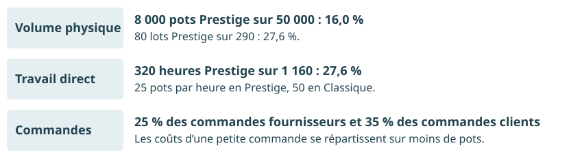

# ENS Paris-Saclay · Épreuve à option — dominante gestion 2024 — corrigé guidé

*Corrigé rédigé par IA, non officiel. Signalez toute erreur.*

**Rédaction** · GPT-6.2 Astra Ultra · vitesse non renseignée · 26 novembre 2026

## Étude de cas

La confiturerie fondée par Julie Augier fabrique deux gammes en pots de 200 g. Classique représente 42 000 pots produits et Prestige 8 000. Les ventes excèdent la production grâce aux stocks d’ouverture. On présente les coûts unitaires à trois décimales et on conserve les quotients non arrondis pour totaliser les charges.

### Fermer le circuit entre deux services auxiliaires

Dessinez une flèche de la logistique vers l’administration et une autre en sens inverse. Inscrivez 10 % sur la première, 20 % sur la seconde. Distribuer d’abord les 18 000 € de la logistique puis s’arrêter laisserait sans affectation les services que l’administration lui rend. Résolvez les deux équations, puis exigez que les colonnes auxiliaires reviennent à zéro et que la somme des centres principaux reste 98 000 €.

### Suivre un pot de sa fabrication à sa vente

Pour un pot Classique, pesez 130 g de fruits et 70 g de sucre. Les prix d’achat sont au kilogramme. Ajoutez le bocal, un cinquantième d’heure de main-d’œuvre et l’unité d’œuvre de production. Ce pot entre ensuite dans un stock où les 2 000 pots d’ouverture n’ont pas coûté le même prix. Calculez le coût moyen de tous les pots disponibles **avant** d’y valoriser les 43 300 sorties. La distribution ne concerne que les pots vendus.

### Recalculer le coût d’une activité

Une commande client sollicite l’administration des ventes et l’expédition ; une même base de 1 150 commandes permet de totaliser leurs deux coûts une seule fois. À l’étape suivante, le pourcentage attribué à chaque gamme est une estimation de consommation, ce qui explique une demi-commande dans le tableau. Une telle moyenne n’implique pas qu’une facture réelle soit coupée en deux.

### Mettre une recommandation à l’épreuve

Si vous proposez d’abandonner Prestige, indiquez quelle commande, quelle heure, quelle dépense salariale et quelle charge de l’atelier disparaîtraient effectivement. Les ventes classiques conserveront-elles le bénéfice du prix de meilleur confiturier obtenu grâce à Prestige ? Testez d’abord un levier réversible, par exemple un minimum de commande ou une livraison groupée, et mesurez ensuite sa marge et sa qualité de service.

## Résolution des dossiers

### Dossier 1 — Gestion financière et comptable

**1. Répartition des charges indirectes.** Notons $L$ et $A$ les coûts de la logistique et de l’administration après leurs prestations réciproques. Le centre entretien ne reçoit aucune prestation. Les équations sont $L=18\,000+0{,}20A$ et $A=8\,000+0{,}10L$. En substituant, $0{,}98L=19\,600$ : **$L=20\,000$ et $A=10\,000$**.

| Mouvement (€) | Logistique | Entretien | Administration | Production | Distribution | Total |
|---|---:|---:|---:|---:|---:|---:|
| Primaire | 18 000 | 14 000 | 8 000 | 36 000 | 22 000 | 98 000 |
| Répartir la logistique | −20 000 | 0 | +2 000 | +6 000 | +12 000 | 0 |
| Répartir l’entretien | 0 | −14 000 | 0 | +11 200 | +2 800 | 0 |
| Répartir l’administration | +2 000 | 0 | −10 000 | +4 000 | +4 000 | 0 |
| **Secondaire** | **0** | **0** | **0** | **57 200** | **40 800** | **98 000** |

Les 50 000 unités fabriquées portent $57\,200/50\,000=1{,}144$ € de production indirecte chacune. Les 51 500 vendues portent $40\,800/51\,500=0{,}792$ € de distribution chacune.

**2. Coût de production par pot.** On suppose que les proportions fournies donnent les consommations de fruits et de sucre par pot fini, sans perte supplémentaire renseignée. Les charges d’approvisionnement sont déjà dans la répartition des centres ; le bocal est consommé par la production.

| Euros par pot | Classique | Prestige |
|---|---:|---:|
| Fruits à 12 €/kg | 0,130 × 12 = 1,560 | 0,170 × 12 = 2,040 |
| Sucre à 1,50 €/kg | 0,070 × 1,50 = 0,105 | 0,030 × 1,50 = 0,045 |
| Bocal et étiquette | 0,450 | 0,450 |
| Travail direct à 25 €/h | 25 / 50 = 0,500 | 25 / 25 = 1,000 |
| Direct de production | 2,615 | 3,535 |
| Indirect de production | 1,144 | 1,144 |
| **Coût de production** | **3,759** | **4,679** |

La production de l’année vaut $42\,000\times3{,}759=157\,878$ € pour Classique et $8\,000\times4{,}679=37\,432$ € pour Prestige.

**3. Résultat analytique par gamme.** Le coût unitaire moyen pondéré (CUMP) divise la valeur disponible par les quantités disponibles, au coût de production.

| Quantités et valeurs de stock | Classique | Prestige |
|---|---:|---:|
| Stock initial | 2 000 × 3,25 € = 6 500 € | 500 × 4,15 € = 2 075 € |
| Quantité disponible | 44 000 | 8 500 |
| Valeur disponible | 164 378 € | 39 507 € |
| **CUMP** | **3,736 €/pot** | **4,648 €/pot** |
| Ventes et coût de production des ventes | 43 300 pots, 161 762,895 € | 8 200 pots, 38 112,635 € |
| Stock final | 700 pots, 2 615,105 € | 300 pots, 1 394,365 € |

| Calcul des ventes (€) | Classique | Prestige | Total |
|---|---:|---:|---:|
| Chiffre d’affaires | 238 150,000 | 57 400,000 | 295 550,000 |
| Coût de production des ventes | 161 762,895 | 38 112,635 | 199 875,531 |
| Coût de distribution | 34 303,689 | 6 496,311 | 40 800,000 |
| Coût de revient des ventes | 196 066,585 | 44 608,946 | 240 675,531 |
| **Résultat analytique** | **42 083,415** | **12 791,054** | **54 874,469** |
| Coût de revient par pot vendu | 4,528 | 5,440 | |

Par exemple, les coûts de Classique sont calculés avec $164\,378/44\,000$ et $40\,800/51\,500$, puis affichés à trois décimales. Multiplier uniquement les quotients affichés peut produire quelques euros d’écart sur des dizaines de milliers de pots.

**4. Compte de résultat.** La production stockée est la valeur finale moins la valeur initiale des produits finis : $2\,615{,}105+1\,394{,}365-8\,575=-4\,565{,}531$ € sur les valeurs non arrondies. Les fruits consommés pèsent $42\,000\times0{,}130+8\,000\times0{,}170=6\,820$ kg ; le sucre, 3 180 kg. À défaut d’autres variations indiquées, les charges sont présentées pour les quantités consommées.

| Produits et charges de l’exercice | Euros |
|---|---:|
| Ventes de produits finis | 295 550,000 |
| Production stockée (déstockage) | −4 565,531 |
| **Total des produits** | **290 984,469** |
| Fruits | 81 840,000 |
| Sucre | 4 770,000 |
| Bocaux et étiquettes | 22 500,000 |
| Main-d’œuvre directe : 1 160 h × 25 € | 29 000,000 |
| Autres charges de l’exercice, réunies dans les centres | 98 000,000 |
| **Total des charges** | **236 110,000** |
| **Résultat sur les données du cas** | **54 874,469** |

Aucun poste financier, exceptionnel ou d’impôt sur le résultat n’est donné. Le résultat disponible concorde avec la somme des deux résultats analytiques. La distribution n’entre pas dans la valorisation des stocks.

**5. Limites des centres d’analyse.** La méthode des sections homogènes a été conçue pour des organisations où des productions relativement standardisées consomment les ressources d’un atelier de façon proportionnelle à une unité d’œuvre. Ici, deux pots reçoivent chacun 1,144 € d’indirect de production alors qu’un pot Prestige exige deux fois plus de travail direct et que les contrôles sont déclenchés par des lots plus petits. Les clés de répartition entre logistique, administration et production sont des conventions ; le système d’équations assure leur cohérence arithmétique, pas leur causalité. Un coût complet moyen dépend aussi du taux d’utilisation des moyens fixes. Pour une commande additionnelle en capacité libre, il faut isoler les coûts qu’elle provoque ; pour la viabilité de long terme, il faut vérifier que l’ensemble des ressources est financé.

**6. Coût des inducteurs ABC.** Regrouper les activités qui utilisent le même inducteur, puis diviser leurs coûts par le nombre total d’unités d’inducteur. Le coût des 1 160 heures directes déjà intégrées aux produits ne se confond pas avec les 28 000 € de frais **indirects** de préparation et de cuisson répartis d’après ces heures.

| Inducteur | Activités regroupées | Coût € | Volume | Coût unitaire € |
|---|---|---:|---:|---:|
| Commande fournisseur | Approvisionnement | 18 000 | 600 | 30,000 |
| Lot fabriqué | Entretien 14 000 + qualité 8 000 + conditionnement 7 000 | 29 000 | 290 | 100,000 |
| Commande client | Administration des ventes 8 000 + expédition 15 000 | 23 000 | 1 150 | 20,000 |
| Heure de main-d’œuvre directe | Préparation et cuisson | 28 000 | 1 160 | 24,138 |
| **Total** | | **98 000** | | |

**7. Coûts unitaires ABC des gammes.** La question fournit expressément 2,60 € et 3,55 € de coûts directs. On impute à chaque gamme ses activités de la période et on rapporte le coût global au nombre de pots produits pour comparer les deux formats, comme coûts complets de gamme. Les parts de commandes du document 5 sont des estimations.

| Activité imputée | Classique : volume × coût | Prestige : volume × coût |
|---|---:|---:|
| Commandes fournisseurs | 450 × 30 = 13 500 € | 150 × 30 = 4 500 € |
| Lots | (42 000 / 200) × 100 = 21 000 € | (8 000 / 100) × 100 = 8 000 € |
| Commandes clients | (1 150 × 65 %) × 20 = 14 950 € | (1 150 × 35 %) × 20 = 8 050 € |
| Heures de MOD | (42 000 / 50) × (28 000 / 1 160) = 20 275,862 € | (8 000 / 25) × (28 000 / 1 160) = 7 724,138 € |
| **Indirect imputé** | **69 725,862 €** | **28 274,138 €** |
| Indirect par pot produit | 1,660 € | 3,534 € |
| Direct demandé par pot | 2,600 € | 3,550 € |
| **Coût de revient ABC** | **4,260 €** | **7,084 €** |
| Prix moins coût complet unitaire | **+1,240 €** | **−0,084 €** |

Le contrôle des charges indirectes donne bien $69\,725{,}862+28\,274{,}138=98\,000$ €. Ce calcul de coût moyen de gamme sur la production, qui inclut des frais d’expédition, ne doit pas servir à porter des produits finis en stock au bilan. Le résultat effectivement réalisé sur les ventes de la question 3 traitait les stocks par CUMP et utilisait d’autres coûts directs.

**8. Recommandations.** Les centres au volume donnaient un coût par pot vendu de 4,528 € et 5,440 €. Avec l’ABC, le coût de référence de Prestige dépasse légèrement ses 7 € de prix de vente. Alors que Prestige pèse 16 % de la production, il suscite 27,6 % des lots et des heures, 25 % des commandes fournisseurs et 35 % des commandes clients. Les unités uniformes masquaient donc la consommation des fonctions de soutien. Le passage à l’ABC change également les coûts directs imposés et la base des calculs ; la différence chiffrée ne doit pas être attribuée au seul choix d’inducteurs.

Il serait imprudent d’abandonner Prestige : il a valu son prix professionnel à Julie et attire des comptes qui achètent aussi Classique. Au prix de 7 €, il laisse 3,45 € au-delà du coût direct de référence pour contribuer à des charges indirectes dont une grande part pourrait subsister. Ce montant n’est pas une marge sur coûts variables démontrée, car « direct » et « variable » décrivent deux propriétés différentes. Étudier les coûts réellement évitables et la contribution des commandes sur les deux gammes. Tester auprès de certaines épiceries une hausse tarifaire ou un tarif minimum de commande, regrouper les expéditions et planifier des séries plus longues sans altérer la qualité. Mesurer l’effet sur réachat, casse, marge par commande et réputation avant généralisation.

**9. Différences de méthode.** Les deux méthodes imputent les charges directes sans clé et cherchent à répartir les charges indirectes. Les centres partent des fonctions et d’une répartition primaire, puis transfèrent les coûts des auxiliaires aux principaux avant de les répartir par unité d’œuvre. L’ABC part de ce que les équipes font : les activités consomment les ressources et les produits ou clients consomment les activités. Le regroupement des dépenses de contrôle, entretien et conditionnement par lot traverse ici les fonctions. Aucun transfert secondaire général des centres auxiliaires vers les centres principaux n’est nécessaire. Les inducteurs rendent visibles les coûts de complexité (lot, commande), mais leur choix reste une hypothèse et leur mesure doit rester proportionnée à la taille de l’atelier.

**10. Deux prolongements managériaux.** D’abord, le management par les activités (ABM) utilise l’ABC pour modifier les processus. Julie peut chiffrer le coût des petites commandes, négocier des calendriers d’expédition et réduire les reprises de lots. La qualité qui a permis l’obtention du prix fait partie de la valeur client : éliminer un contrôle nécessaire dégraderait le service au lieu d’éliminer un gaspillage. Ensuite, la gestion par les **coûts cibles** part du prix accepté par le client moins la marge recherchée. Si Julie vise 0,70 € de marge sur un pot Prestige vendu 7 €, le coût cible est 6,30 €, inférieur de 0,784 € au coût de référence. Les inducteurs permettent de discuter quelles opérations revoir dès la conception du service, sans modifier arbitrairement la recette à 85 % de fruits.

### Dossier 2 — Management de la confiturerie

**11. Adopter une culture financière dans un atelier de trois salariés.** La culture d’entreprise rassemble les valeurs, représentations et pratiques partagées. Au Ventoux, la qualité d’un fruit ou le jugement en dégustation guident les décisions ; un nouvel instrument peut être perçu comme une surveillance si sa finalité reste obscure. Un contrôleur de gestion aide la direction à traduire ses objectifs en budgets, informations et décisions, puis à comprendre les écarts. Chez Coconfiture, le témoignage du document 6 insiste sur le dialogue entre production et direction et sur le suivi en cours d’exercice. Pour une équipe plus petite, le même objectif exige un dispositif plus léger.

À l’intérieur, le contrôleur peut rendre visibles les reprises, le coût d’une petite série et le temps de travail qui protège la qualité de Prestige. Cela aide les équipes à négocier un délai réaliste et Julie à distinguer les commandes rentables. En revanche, un classement individuel selon les pots à l’heure pénaliserait le travail manuel de Prestige et inciterait à prendre les fruits trop tôt ou à réduire les contrôles. À l’extérieur, une information fiable facilite l’obtention d’un financement et la négociation avec les hôtels et épiceries. Une politique purement fondée sur le prix d’achat pourrait fragiliser les producteurs locaux et compromettre la récolte à pleine maturité. Associer fournisseur et atelier à la programmation saisonnière rend le prix et les engagements de volume plus crédibles.

Dans la perspective de Schein, faire évoluer une culture requiert des pratiques qui rendent les nouvelles valeurs observables. Commencer par un problème choisi avec les salariés, par exemple le coût d’une commande de douze pots livrée seule. Le contrôleur explique les chiffres, l’atelier corrige les hypothèses et Julie teste avec le client un regroupement de livraisons. Restituer le résultat aux salariés et reconnaître le gain de service autant que le gain financier. Former chacun à deux ou trois indicateurs, réserver un temps court d’échange, prévoir un droit de signaler qu’une donnée est trompeuse et conserver des critères de dégustation, de traçabilité et de relation aux producteurs. Le succès se mesure aux décisions améliorées et à la réduction des doubles saisies.

**12. Systèmes de gestion et d’information.** Un système de gestion fixe les objectifs, les responsabilités et les règles de décision. Un système d’information réunit personnes, données, procédures et outils pour recueillir et partager une information utilisable. La performance combine l’atteinte du résultat visé, les ressources employées et la capacité de l’atelier à préserver qualité et relations commerciales. Dans l’esprit du tableau de bord prospectif de Kaplan et Norton, relier résultat financier, satisfaction du client, processus et compétences.

| Décision | Information à relier | Usage concret |
|---|---|---|
| Acheter les fruits et ordonnancer | Prévisions de commandes, calendrier de maturité, stocks, capacité des salariés | Plan glissant négocié avec les vergers ; alerte de rupture ou de perte sur fruit périssable. |
| Produire et garantir la qualité | Fiche lot avec fournisseur, recette, temps, quantité entrée/sortie, contrôle et destination | Un seul identifiant de lot permet de remonter un défaut et de connaître rendement et coût. |
| Tarifer et livrer | Commandes par client et gamme, coûts de préparation et d’expédition, délai, réclamations | Suivre la contribution par commande et le taux de livraison à l’heure ; proposer des tournées groupées. |
| Financer la croissance | Devis signés, encaissements prévus, règlements saisonniers des fruits et des bocaux | Budget de trésorerie court et prévision de marge ; expliquer chaque écart avant d’engager une dépense. |

Une base simple reliant commandes, lots et factures, exportable vers la comptabilité, suffit pour démarrer. Attribuer les droits d’accès, faire une sauvegarde testée et rapprocher mensuellement quantités physiques et fichiers. Julie revoit mensuellement marge, rebuts, retours, fidélisation et trésorerie avec les trois salariés. Une IA générative pourrait proposer une première traduction d’une fiche commerciale ou classer des retours clients anonymisés ; recette, allergènes, étiquetage et prix export exigent validation humaine. Évaluer le temps réellement économisé avant d’ajouter un abonnement ou une nouvelle saisie.

**13. Stratégie internationale et politique commerciale.** Dans la matrice d’Ansoff, commencer par exporter les deux gammes revient à développer un marché avec des produits maîtrisés. La différenciation repose sur le terroir du Ventoux, la récolte à maturité et la distinction reçue, plutôt que sur la puissance d’achat d’une confiturerie industrielle. Le modèle initial reste la vente professionnelle : un distributeur spécialisé, des hôtels et des épiceries haut de gamme peuvent commander des volumes compatibles avec l’atelier. Une vente directe étrangère de très petits colis augmenterait justement les frais de commande révélés par l’ABC.

Présélectionner deux marchés selon clientèle ciblée, concurrence, distance, délais douaniers, règles d’étiquetage et protection de la marque. Vérifier les goûts locaux par dégustation et tenir compte des usages culturels : petit-déjeuner hôtelier, cadeau gastronomique, formats et prix peuvent différer. Chez le concurrent du document 7, les salons et les premiers revendeurs ont ouvert des marchés ; sa notoriété parisienne et son taux d’export ne sont pas automatiquement transposables au Ventoux. Un salon professionnel ou un agent local peut permettre de rencontrer quelques acheteurs et tester une commande pilote avant de s’engager dans plusieurs pays.

Calculer par marché un prix rendu qui couvre produit, emballage de transport, casse, démarches, assurance, commission et frais de change. Tester le prix final après marge du distributeur et taxes. Négocier quantité minimale, exclusivité conditionnée à un volume, conditions de règlement et traitement des invendus ; réserver la capacité nécessaire aux clients français. L’engagement progressif décrit par le modèle d’Uppsala limite le coût d’apprentissage pour une petite structure. À l’issue du pilote, décider d’étendre ou d’arrêter selon la marge après logistique, la fréquence des réassorts, la satisfaction et le besoin en trésorerie. Une campagne mettant en avant le prix remporté et la traçabilité peut alors soutenir les distributeurs avec un message adapté à leur public.

## Sources

Épreuve à options, cas Confiturerie du Ventoux, et rapport du jury de la dominante gestion 2024. Le jury souligne le traitement des prestations croisées, des stocks et de la contribution de Prestige à la réputation de la marque. La numérotation suivie ici est celle du sujet.

[Sujet de la dominante, p. 3](https://ens-paris-saclay.fr/sites/default/files/CONCOURS/ANNALES_1C/1C_D2_1/2024_Epreuve_a_option_EcoG1.pdf#page=3) · [Rapport du jury](https://ens-paris-saclay.fr/sites/default/files/CONCOURS/ANNALES_1C/1C_D2_1/2024_Rapport_Eco-Gestion%201_Option_Gestion_ECRIT.pdf) · [Annales institutionnelles](https://ens-paris-saclay.fr/admission/concours/concours-pre-master/annales-concours-pre-master?field_orientation_1c_target_id%5B%5D=289&field_year_target_id%5B%5D=589&page=1)
