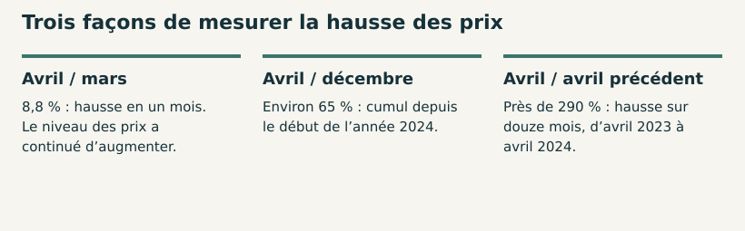

# ENS Paris-Saclay — Économie-gestion option 1 · Espagnol oral 2024 · Corrigé brut

*Corrigé rédigé par IA, non officiel. Signalez toute erreur.*

**Rédaction** · GPT-6.2 Astra Ultra · vitesse non renseignée

Le jury a proposé trois extraits de DW Español les 3 et 4 juin 2024. Il accordait trente minutes de préparation, demandait une présentation de douze à quinze minutes, puis consacrait environ dix minutes à l’entretien.

Les trois publications sources sont identifiées par leur titre et leur chaîne. Le jury ne donne ni la durée ni les bornes des passages effectivement entendus. Les comptes rendus ci-dessous exposent les éléments documentés ; la restitution exacte des extraits demeure ouverte. Les dates affichées par la plateforme pour l’inflation argentine et la semaine de quarante heures précèdent d’un jour celles du rapport (14 et 15 mai, 5 et 6 février).

## 1. Les Canaries face au tourisme de masse

**Compte rendu à partir des éléments identifiés.** En las islas Canarias, numerosas personas protestan contra el modelo de turismo de masas. Les preocupa cómo cambia la vida cotidiana al aumentar la afluencia de visitantes. Destaca el encarecimiento de la vivienda, al que se añade el de otros gastos habituales. El reportaje de DW plantea un dilema para el archipiélago. Recibe ingresos que necesita gracias a quienes pasan allí sus vacaciones y, al mismo tiempo, parte de la población residente tiene cada vez más dificultades para vivir en las islas. Las protestas obligan a preguntarse quién puede seguir viviendo en el lugar que hace posible esa actividad. [Reportage de DW Español](https://www.youtube.com/watch?v=ziUpMflrhes)

**Commentaire.** ¿Qué habría que medir para saber si un destino turístico prospera? Contar llegadas y pernoctaciones permite estimar la actividad de los establecimientos, pero dice poco de la parte de la renta que permanece en el territorio. Un camarero puede ver que el hotel se llena durante más meses al año y comprobar, a la vez, que una habitación cerca de su trabajo se lleva casi todo el aumento de su sueldo. La cuestión es distributiva. El propietario que alquila por noches, el inquilino y el comercio del barrio se enfrentan a consecuencias diferentes de la misma subida de visitantes.

Hay decisiones que permiten actuar sobre esa distribución. Se puede regular la conversión de viviendas residenciales en alojamientos de corta estancia o destinar parte de los ingresos turísticos a transportes y servicios utilizados durante todo el año. Tales medidas tienen límites. Una regulación que ignore las diferencias entre barrios puede afectar a un pequeño propietario sin aumentar la oferta residencial donde más falta hace. Para evaluar el resultado observaría el alquiler en relación con los salarios locales, la estabilidad del empleo y la posibilidad de acceder a los servicios. El éxito del turismo depende también de que quienes lo hacen funcionar puedan permanecer en las islas.

**Relance proposée.** *¿Bastaría con que cada turista gastara más?* Dependería de quién recibiera ese gasto y de qué ocurriera con los alquileres y salarios. Un aumento de ingresos del sector no garantiza una mejoría para el trabajador que alquila su vivienda.

## 2. Argentine — Désinflation et récession

**Compte rendu à partir des éléments identifiés.** DW presenta los datos argentinos de abril de 2024. El ritmo mensual de subida de precios se modera por cuarto mes consecutivo hasta situarse en el 8,8 %. Es la primera tasa mensual inferior al diez por ciento desde que Javier Milei asumió la presidencia. El punto de partida ayuda a interpretar el dato. El aumento acumulado en lo que va de año ronda el 65 % y el interanual se acerca al 290 %. La vivienda y los suministros registran subidas particularmente fuertes, mientras que las de alimentos y bebidas son menores. El reportaje relaciona el descenso de la inflación mensual con una fuerte contracción económica. Los economistas citados señalan el retroceso del consumo, los recortes del gasto, los despidos y el deterioro de sueldos y jubilaciones. [Reportage de DW Español](https://www.youtube.com/watch?v=2cj4Izh0Gho)

**Commentaire.** ¿Qué significa estabilizar una economía para quien vive de un sueldo? Un ritmo de aumentos más lento facilita calcular lo que se podrá pagar el mes siguiente y reduce la incertidumbre de un pequeño negocio cuando encarga mercancía. Esa mejora tiene importancia en un país donde los precios pueden cambiar antes de que llegue el próximo salario. Sin embargo, el presupuesto familiar depende también de los ingresos y de gastos que apenas se pueden aplazar. Una persona que pierda el empleo mientras sigue subiendo el alquiler difícilmente interpretará la última tasa de inflación como una recuperación de su capacidad de compra.

La caída de las ventas puede llevar a un comerciante a moderar sus precios y, al mismo tiempo, a prescindir de un empleado o a posponer una inversión. De ahí que el mismo mecanismo pueda producir un avance en una estadística y un retroceso en otra. Evaluaría la política de estabilización a lo largo del tiempo. Importa saber si puede sostener la reducción del ritmo de precios cuando se reactive el consumo, si los ingresos reales se recuperan y qué protección reciben los hogares que menos margen tienen durante la transición.

**Relance proposée.** *Si la inflación mensual bajara mañana a cero, ¿se recuperaría lo perdido?* Se estabilizaría el nivel de precios de ese momento. Para volver a comprar lo mismo que antes, un hogar necesitaría que sus ingresos alcanzaran ese nivel o que bajaran los precios de los bienes que consume.

## 3. Mexique — Le projet de semaine de quarante heures

**Compte rendu à partir des éléments identifiés.** En el último periodo de sesiones del sexenio de Andrés Manuel López Obrador, el Congreso mexicano tiene pendiente debatir la reducción de la jornada laboral. Se plantea pasar de una semana de cuarenta y ocho horas a otra de cuarenta, con un segundo día de descanso. DW presenta el proyecto como respuesta a una deuda con los trabajadores. A la larga semana laboral se suman unas dos mil doscientas horas de trabajo al año y un salario mínimo que el reportaje sitúa en el extremo inferior de la comparación entre países de la OCDE. El contraste explica por qué el debate abarca tanto el tiempo de descanso como las condiciones materiales de quienes trabajan. [Reportage de DW Español](https://www.youtube.com/watch?v=iX6jsJAbIoY)

**Commentaire.** ¿En qué condiciones se convierte una reducción legal de la jornada en tiempo libre efectivo? Para una persona que tarda una hora en llegar al trabajo, disponer de un segundo día de descanso puede suponer también dos desplazamientos menos. El beneficio familiar supera así el número de horas que desaparecen del horario. Para el comercio que abre seis días, en cambio, es necesario decidir cómo se cubre ese sábado. Reorganizar turnos puede bastar en algunos establecimientos. Otros necesitarán contratar a alguien o revisar el horario de apertura. La ley plantea un mismo objetivo, pero el ajuste exige decisiones diferentes según la actividad.

También importa cómo se registran las horas y qué puede hacer un empleado si se le pide que termine tareas después de fichar. Una reducción que se compense con horas extraordinarias habituales dejaría al trabajador sin el descanso previsto. Yo compararía la duración efectiva de la semana antes y después de la reforma y distinguiría los empleos con contrato de aquellos que quedan fuera de controles regulares. La capacidad de ejercer el derecho importa tanto como las horas que figuran en la norma.

**Relance proposée.** *¿Puede un negocio conservar seis días de apertura con una plantilla que trabaje cinco?* Sí, si escalona los descansos y dispone de suficientes personas con las competencias necesarias. Eso obliga a estudiar los turnos y sus costes antes de prometer que todo seguirá funcionando igual.

[Rapport du jury](https://ens-paris-saclay.fr/sites/default/files/CONCOURS/ANNALES_1C/1C_D2_1/2024_Rapport%20LV%20Espagnol_EcoG1_Oral.pdf) · [Archives de la session](https://ens-paris-saclay.fr/node/10377)
