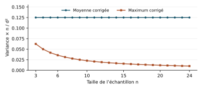
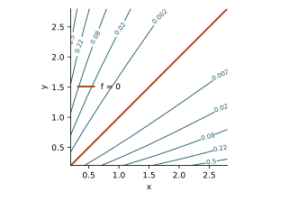

# ENS Paris-Saclay, économie et gestion option 1 — Mathématiques et statistiques 2024 · Corrigé guidé

*Corrigé rédigé par IA, non officiel. Signalez toute erreur.*

**Rédaction** · GPT-6.2 Astra Ultra · vitesse non renseignée

Les trois problèmes sont indépendants. Les questions suivent la numérotation du sujet du 16 avril 2024.

## Problème 1 · Endomorphisme nilpotent et suites

### Question 1

> [!INDICATION]
> Lire chaque colonne dans la base ordonnée.

#### Solution

Les images de la base sont $f(e_1)=2e_1-3e_2+e_3$, $f(e_2)=e_1-e_2$ et $f(e_3)=e_2-e_3$.

### Question 2

> [!INDICATION]
> Étudier les deux dernières colonnes, puis exprimer la première dans leur base.

#### Solution

Les colonnes $C_2=(1,-1,0)^T$ et $C_3=(0,1,-1)^T$ sont indépendantes et $C_1=2C_2-C_3$. L’image est de dimension $2$. L’application n’est pas bijective et le théorème du rang donne $\dim\ker f=3-2=1$.

### Question 3

> [!INDICATION]
> Calculer les images des colonnes de M, puis celle de la colonne commune obtenue.

#### Solution

Le calcul des produits donne
$$M^2=\begin{pmatrix}1&1&1\\-2&-2&-2\\1&1&1\end{pmatrix},\qquad M^3=0.$$
En effet, la colonne commune de $M^2$ est $(1,-2,1)^T$, annulée par $M$. Pour $k=2$, la matrice de $f^k$ est $M^2$, de rang un, avec un noyau de dimension deux. Pour $k\ge3$, la matrice est nulle, de rang zéro, et son noyau est $E$, de dimension trois.

### Question 4

> [!INDICATION]
> Appliquer successivement deux puissances de f à une relation linéaire.

#### Solution

Supposons $a f^2(v)-b f(v)+cv=0$. En appliquant $f^2$ et en utilisant $f^3=0$, on trouve $cf^2(v)=0$, donc $c=0$. En appliquant ensuite $f$, on trouve $-bf^2(v)=0$, donc $b=0$, puis $a=0$. Ces trois vecteurs libres forment une base de $E$. Leurs images sont respectivement $0,-f^2(v),f(v)$, d’où
$$M'=\begin{pmatrix}0&-1&0\\0&0&-1\\0&0&0\end{pmatrix}.$$

### Question 5

> [!INDICATION]
> Lire la troisième colonne de la matrice du carré.

#### Solution

On a $f^2(e_3)=e_1-2e_2+e_3\ne0$, donc $e_3\notin\ker f^2$.

### Question 6

> [!INDICATION]
> Écrire en colonnes les coordonnées des vecteurs de la nouvelle base. Que vaut le carré de cette matrice ?

#### Solution

La base construite est $(e_1-2e_2+e_3,-e_2+e_3,e_3)$. Ses coordonnées dans $\mathcal B$ donnent
$$P=\begin{pmatrix}1&0&0\\-2&-1&0\\1&1&1\end{pmatrix}.$$
La multiplication donne $P^2=I$, donc $P^{-1}=P$. Les colonnes de $MP$ sont $0,(-1,2,-1)^T,(0,1,-1)^T$. Ce sont aussi les colonnes de $PM'$, ce qui vérifie $P^{-1}MP=M'$.

### Question 7

> [!INDICATION]
> Le binôme de Newton se tronque. Conserver aussi les petits indices.

#### Solution

Comme $I$ et $M$ commutent et $M^3=0$, le binôme donne $N^n=I+nM+\tfrac{n(n-1)}2M^2$ pour tout $n\ge0$. En substituant les matrices de l’énoncé et de la question 3, on obtient
$$N^n=\begin{pmatrix}
(n+1)(n+2)/2&n(n+1)/2&n(n-1)/2\\
-n(n+2)&1-n^2&-n(n-2)\\
n(n+1)/2&n(n-1)/2&(n-1)(n-2)/2
\end{pmatrix}.$$
Pour $n=0$ l’expression rend bien $I$, et pour $n=1$ elle rend $I+M$.

### Question 8

> [!INDICATION]
> Lire les trois relations de récurrence ligne par ligne.

#### Solution

La matrice de passage d’un terme au suivant a pour lignes $(3,1,0)$, $(-3,0,1)$, $(1,0,0)$. C’est $N$. Ainsi $X_n=NX_{n-1}$ pour $n\ge1$. À l’indice zéro, $X_0=N^0X_0$. L’égalité $X_n=N^nX_0$ passe au rang suivant par multiplication par $N$ à gauche.

### Question 9

> [!INDICATION]
> Quelle colonne de la puissance est sélectionnée par le vecteur initial ?

#### Solution

Le vecteur $X_0=(0,1,0)^T$ sélectionne la deuxième colonne de $N^n$. Cela donne $p_n=n(n+1)/2$, $q_n=1-n^2$ et $r_n=n(n-1)/2$ pour tout $n\ge0$.

## Problème 2 · Estimation de la borne d’une densité

### Question 1a

> [!INDICATION]
> Vérifier la positivité et intégrer sur le support.

#### Solution

La fonction est positive ou nulle et continue par morceaux. Son intégrale sur la droite vaut $\int_0^d 2t/d^2\,dt=[t^2/d^2]_0^d=1$. C’est une densité.

### Question 1b

> [!INDICATION]
> Intégrer les moments d’ordre un et deux avant de les combiner.

#### Solution

Le support est borné. Pour $k\ge0$, $\mathbb E[X^k]=\int_0^d2t^{k+1}/d^2\,dt=2d^k/(k+2)$. Ainsi $\mathbb E[X]=2d/3$, $\mathbb E[X^2]=d^2/2$ et $\operatorname{Var}(X)=d^2(1/2-4/9)=d^2/18$.

### Question 2a

> [!INDICATION]
> Les deux moyennes de groupe ont la même espérance.

#### Solution

La linéarité de l’espérance donne $\mathbb E[T_1]=\mathbb E[T_2]=2d/3$. Donc $\mathbb E[D_1(a,b)]=(a+b)2d/3$. Puisque $d>0$, l’absence de biais équivaut à $a+b=3/2$.

### Question 2b

> [!INDICATION]
> Les groupes sont indépendants. Utiliser une inégalité quadratique avec les tailles des groupes.

#### Solution

Les deux groupes sont disjoints et les observations indépendantes. Ainsi
$$\operatorname{Var}(D_1(a,b))=\frac{d^2}{18}\left(\frac{a^2}{p}+\frac{b^2}{n-p}\right).$$
Par Cauchy–Schwarz appliquée à $(a/\sqrt p,b/\sqrt{n-p})$ et $(\sqrt p,\sqrt{n-p})$, la parenthèse est au moins $(a+b)^2/n$. L’égalité équivaut à $a/p=b/(n-p)$. Avec la contrainte $a+b=3/2$, l’unique choix est $a=3p/(2n)$, $b=3(n-p)/(2n)$. D’où $D_1^*=\frac{3}{2n}\sum_{i=1}^nX_i=\tfrac32\overline X$.

### Question 2c

> [!INDICATION]
> La variance est multipliée par le carré du coefficient de la moyenne.

#### Solution

L’indépendance donne $\operatorname{Var}(\overline X)=d^2/(18n)$. La variance du premier estimateur est donc
$$\operatorname{Var}(D_1^*)=\left(\frac32\right)^2\frac{d^2}{18n}=\frac{d^2}{8n}\longrightarrow0.$$
On retrouve cette valeur en prenant le cas d’égalité de 2b. Le rapport du jury imprime $d^2/(12n)$ à la page 8. Le carré du coefficient $3/2$ donne le dénominateur $8n$.

### Question 3a

> [!INDICATION]
> Traduire l’événement associé au maximum en intersection.

#### Solution

Pour $0\le t\le d$, la fonction de répartition de $X$ vaut $t^2/d^2$. Par indépendance, la probabilité que les $n$ observations soient toutes au plus $t$ est la puissance $n$ de cette quantité. Ainsi
$$\widehat F(t)=\begin{cases}0&t<0,\\(t/d)^{2n}&0\le t\le d,\\1&t>d.\end{cases}$$
Elle est continue et $C^1$ par morceaux. Une densité vaut $2nt^{2n-1}/d^{2n}$ sur $[0,d]$ et zéro lorsque $t<0$ **ou** $t>d$. Les valeurs aux deux bornes peuvent être choisies librement.

### Question 3b

> [!INDICATION]
> Calculer les moments du maximum sous une seule forme.

#### Solution

Pour $m\ge0$, l’intégration donne $\mathbb E[\widehat D^m]=\int_0^d2nt^{2n+m-1}/d^{2n}\,dt=2nd^m/(2n+m)$. Par conséquent,
$$\mathbb E[\widehat D]=\frac{2n}{2n+1}d,\qquad
\operatorname{Var}(\widehat D)=\left(\frac n{n+1}-\frac{4n^2}{(2n+1)^2}\right)d^2=\frac{nd^2}{(n+1)(2n+1)^2}.$$

### Question 3c

> [!INDICATION]
> Identifier les limites à partir des degrés en n.

#### Solution

À $d$ fixé, $2n/(2n+1)\to1$, donc $\mathbb E[\widehat D]\to d$. La variance est équivalente à $d^2/(4n^2)$, donc tend vers zéro.

### Question 3d

> [!INDICATION]
> Annuler le biais multiplicatif, puis mettre le facteur au carré.

#### Solution

L’équation $k\,2nd/(2n+1)=d$ a pour unique solution $k=(2n+1)/(2n)$. Avec $D_2^*=k\widehat D$, on obtient
$$\operatorname{Var}(D_2^*)=\frac{(2n+1)^2}{4n^2}\frac{nd^2}{(n+1)(2n+1)^2}=\frac{d^2}{4n(n+1)}.$$

### Question 4

> [!INDICATION]
> Comparer directement le quotient des variances des deux estimateurs sans biais.

#### Solution

Le quotient vaut $\operatorname{Var}(D_1^*)/\operatorname{Var}(D_2^*)=(n+1)/2$. Il est strictement supérieur à un pour les tailles de l’énoncé ($n\ge3$). Les deux estimateurs étant sans biais, le maximum corrigé $D_2^*$ a le plus petit risque quadratique. Le quotient $(n+1)/3$ imprimé page 10 du rapport provient de la variance de la question 2c. Le classement final des deux estimateurs est conservé.

## Problème 3 · Étude d’une inégalité logarithmique

### Question 1

> [!INDICATION]
> Étudier d’abord le signe de la deuxième dérivée et la valeur de la première en un.

#### Solution

Sur $]0,+\infty[$, le logarithme et les polynômes sont $C^\infty$. On trouve $g'(t)=\ln t+1/t-1$ et $g''(t)=(t-1)/t^2$. La dérivée $g'$ décroît jusqu’à $1$, puis croît et son minimum vaut $g'(1)=0$. Ainsi $g$ est strictement croissante, avec $g(1)=0$. Ses limites sont $-\infty$ en $0^+$ (car $t\ln t\to0$) et $+\infty$ en $+\infty$ (car $g(t)/t\sim\ln t$). En particulier $g(t)<0$ pour $t<1$. Le codomaine strictement positif annoncé dans le sujet doit donc être lu comme $\mathbb R$, ainsi que le fait le rapport.

### Question 2a

> [!INDICATION]
> Faire apparaître un facteur commun aux deux termes de h.

#### Solution

En écrivant $t^2-1=(t-1)(t+1)$, on obtient $h(t)=2(t-1)[(t+1)\ln t-2(t-1)]$. Le polynôme demandé est $P(t)=2(t-1)$.

### Question 2b

> [!INDICATION]
> Dériver le produit obtenu et examiner le signe de chacun des termes.

#### Solution

La dérivée vaut $h'(t)=2g(t)+2(t-1)g'(t)$. Elle est strictement négative lorsque $0<t<1$, nulle à $1$ et strictement positive lorsque $t>1$. Ainsi $h$ décroît puis croît, et son seul minimum vaut $h(1)=0$. Les limites aux deux extrémités sont $+\infty$ d’après le produit de 2a. En particulier $h(t)\ge0$, avec égalité seulement en $1$.

### Question 3a

> [!INDICATION]
> Factoriser x et exprimer y/x comme un carré.

#### Solution

Posons $s=\sqrt{y/x}>0$. Alors $y=xs^2$, $\ln x-\ln y=-2\ln s$ et $\sqrt{x}-\sqrt y=\sqrt x(1-s)$. Cela donne
$$f(x,y)=x\bigl[2(s^2-1)\ln s-4(1-s)^2\bigr]=xh(s).$$
Ainsi $v(x,y)=\sqrt{y/x}$.

### Question 3b

> [!INDICATION]
> Utiliser la positivité du facteur extérieur et la question 2b.

#### Solution

Comme $x>0$ et $h\ge0$, on a $f(x,y)\ge0$. La caractérisation de l’égalité pour $h$ donne $f(x,y)=0$ exactement lorsque $\sqrt{y/x}=1$, donc $x=y$.

### Question 4a

> [!INDICATION]
> Le domaine est ouvert. Calculer les deux dérivées partielles.

#### Solution

La fonction est différentiable sur le quadrant ouvert. En un extremum local intérieur, ses deux dérivées partielles s’annulent. En posant $t=y/x$, elles valent
$$\partial_x f=-\ln t+4\sqrt t-t-3,\qquad
\partial_y f=\ln t+4/\sqrt t-1/t-3.$$
La seconde expression s’obtient aussi en échangeant $x,y$ dans la première puisque $f$ est symétrique.

### Question 4b

> [!INDICATION]
> Additionner les équations du gradient et compléter un carré.

#### Solution

Posons $u=\sqrt t+1/\sqrt t$, de sorte que $t+1/t=u^2-2$. La somme des dérivées partielles vaut $4u-(u^2-2)-6=-(u-2)^2$. En un point critique, $u=2$, donc $(\sqrt t-1)^2=0$ après multiplication par $\sqrt t$. On obtient $t=1$, soit $x=y$. Réciproquement les deux dérivées de 4a s’annulent lorsque $t=1$. Seuls les points de la diagonale peuvent donc être des extrema.

### Question 4c

> [!INDICATION]
> Comparer la valeur sur la diagonale et la valeur aux autres points.

#### Solution

Le minimum global est $0$, atteint exactement aux points $(x,x)$, $x>0$, d’après 3b. Chacun est approché par des points hors diagonale où la valeur est strictement positive, donc aucun n’est un maximum local. Il n’existe pas non plus de maximum global. Par exemple, $f(\lambda,2\lambda)=\lambda f(1,2)\to+\infty$ pour $\lambda\to+\infty$.

