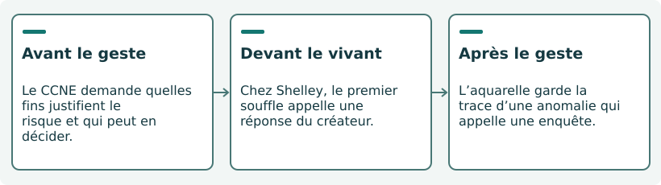

# ENS-PSL · Médecine-Humanités · L’ambivalence des sciences biomédicales 2024 — Corrigé guidé

*Corrigé rédigé par IA, non officiel. Signalez toute erreur.*

**Rédaction** · GPT-6.2 Astra Ultra · vitesse non renseignée

L’écrit de 2024 demande une lecture croisée du roman de Mary Shelley, d’un avis du Comité consultatif national d’éthique et d’une aquarelle de Cornelia Hesse-Honnegger. Les trois pièces interrogent le moment où une intervention doit répondre de ses effets sur un vivant.

## Lire le dossier

- Document 1, p. 1–2 · Mary Shelley, *Frankenstein ou le Prométhée moderne*, traduction d’Alain Morvan. Repérer les changements du regard de Victor et la main tendue à la fin du passage.
- Document 2, p. 3–4 · CCNE, avis 133 du 19 septembre 2019, extrait de la p. 25. Distinguer les objections du comité à une intervention précise et le débat entre organismes sur les décisions futures.
- Document 3, p. 5 · Cornelia Hesse-Honnegger, *Pyrrhocoridae, Pyrrhocoris apterus*, Séljony Mys, Ukraine, 1990. Confronter le dessin à la notice de collecte et au commentaire du jury, p. 3 du rapport.

## La main que le créateur laisse en suspens

**Piste de lecture** · Partir du dernier geste de l’extrait de Shelley. En faire une question que l’on pourra poser aux deux autres pièces en changeant d’échelle et de durée.

Une main se tend vers Victor Frankenstein. Il vient d’accomplir ce qu’il désirait depuis deux ans et s’enfuit au moment où son œuvre semble l’appeler. La scène de Mary Shelley déplace la question que pose toute réussite biomédicale. À quel moment celui qui agit sur le vivant devient-il capable de répondre de ce qu’il fait advenir ? Un avis sur une intervention héréditaire et le portrait d’un insecte recueilli près de Tchernobyl prolongent cette question au-delà du face-à-face de la créature et de son créateur. Les effets d’une décision peuvent se manifester longtemps après elle ou toucher des êtres que personne n’avait comptés parmi ses destinataires.

## Le succès annoncé change de sens

**Piste de lecture** · Suivre la succession de trois indices de vie, puis la reprise du mot « beauté ». En regard, relever la différence, dans l’avis 133, entre la protection future annoncée et l’absence de maladie chez les embryons.

Victor avait choisi chaque trait du corps qu’il assemblait. Son récit commence comme pourrait s’achever un compte rendu de réussite. Un œil s’ouvre, la créature respire, les membres s’animent. Mais la voix qui raconte cette naissance se reprend dès qu’elle tente d’employer le mot « beauté ». Une chevelure noire et des dents blanches lui plaisaient séparément. Dans un visage vivant, leur contraste avec les yeux accroît son effroi. Le lecteur assiste à la naissance d’un regard autant qu’à celle d’un être. Les adjectifs par lesquels Victor condamne l’aspect de la créature nous renseignent déjà sur celui qui la contemple. Quand le bras s’avance et qu’un son se fait entendre, c’est lui qui reconnaît, avec le recul du récit, qu’une parole a peut-être eu lieu. Sa fuite prive les deux êtres du temps nécessaire pour le découvrir.

Dans son avis de 2019, le CCNE part lui aussi d’une naissance effectivement annoncée. Le but revendiqué par He Jiankui était de protéger deux enfants contre une possible infection future. Pour juger l’acte, le comité cherche précisément ce que l’annonce du résultat laisse dans l’ombre. Les embryons ne présentaient pas de pathologie à traiter, les moyens de prévention existants comptaient dans l’appréciation du bénéfice escompté et la modification pouvait avoir des conséquences imprévues. À la différence de Victor, qui change de regard après le premier souffle, les auteurs de l’avis reconstruisent des questions qui auraient dû être discutées avant l’intervention. Comment établir l’intérêt des personnes concernées lorsque le résultat technique tient déjà lieu de justification aux yeux de son auteur ?

## Regarder longtemps pour voir un effet

**Piste de lecture** · Regarder la symétrie approximative des plages sombres puis le contour du thorax. Écrire séparément ce que l’œil distingue, ce que la notice apprend sur le lieu et ce que le jury attribue aux radiations.

L’aquarelle de Cornelia Hesse-Honnegger oblige à ralentir ce jugement. Sur un fond pâle, le corps de l’insecte occupe l’axe vertical de la feuille. L’orange et le noir des ailes opposent des plages fortement délimitées aux contours très légers de la tête. Les deux grandes taches sombres attirent d’abord l’œil par leur correspondance, puis on remarque l’irrégularité du bord gauche du thorax. Une belle composition a retenu l’attention assez longtemps pour rendre sensible un écart de forme. Là où Victor détourne les yeux quand un visage le déçoit, l’artiste consacre du temps à rendre cet individu reconnaissable jusqu’à son asymétrie.

La notice ajoute le nom de l’espèce, le lieu de collecte et la proximité de la zone interdite de Tchernobyl. Grâce à ces indications, le spectateur peut poser la question des effets durables d’une activité humaine sur des êtres qui n’en étaient les destinataires à aucun titre. Le rapport du jury relie la déformation à l’exposition aux radiations. La feuille, considérée comme pièce d’observation, atteste ce que l’artiste a représenté chez un spécimen. Pour établir la fréquence d’une anomalie et en attribuer la cause, il faudrait comparer d’autres spécimens et documenter leurs conditions d’exposition. Cette différence de portée éclaire également l’avis du CCNE. Une annonce de naissance attire l’attention sur un événement, tandis que l’évaluation de ses conséquences demande des observations que cette annonce ne contient pas.

## À qui revient le pouvoir de décider ?

**Piste de lecture** · Comparer les positions datées mentionnées par l’avis. Séparer deux questions dans le raisonnement. Quelles conséquences peut-on connaître ? Qui juge le but poursuivi et au nom de qui ?

Le temps long change le nombre des personnes auxquelles une décision doit pouvoir être expliquée. Le CCNE souligne que la modification peut être transmise à la descendance. La décision d’un chercheur engage dès lors des personnes qui n’ont pu ni en connaître le but ni prendre part au débat. Le comité y voit une démarche apparentée à l’eugénisme, en raison de la sélection d’un caractère souhaité chez des embryons sans pathologie. Il relève aussi que les données exposées oralement ont échappé à l’examen attendu. Ces deux objections portent sur des questions distinctes. Une vérification rigoureuse des résultats répondrait à un défaut de connaissance. Elle laisserait entière la question de savoir qui a qualité pour décider qu’un caractère est préférable.

L’avis montre que le jugement collectif lui-même a une histoire. Le premier sommet international de 2015 formulait des conditions que ses participants jugeaient alors insatisfaites. En 2018, les organisateurs condamnent le cas annoncé tout en envisageant des applications thérapeutiques futures. L’avis attire l’attention sur la place de l’analyse éthique dans cette évolution. L’espérance d’un traitement donne une raison d’examiner une possibilité. Elle crée aussi une obligation de préciser les situations qu’on envisage et les voix qui peuvent s’y faire entendre. Le roman fait éprouver le prix du silence de Victor. L’aquarelle le déplace vers un vivant qui, lui, ne pourra jamais comparaître devant un comité. Faire place aux absents suppose tantôt de leur permettre de parler, tantôt de conserver et de discuter les traces des effets qu’ils subissent.

## Conclusion

**Piste de lecture** · Revenir à la fuite de Victor pour donner un sens concret à la responsabilité. Le jury, p. 2–3 du rapport, valorise une problématique commune capable de conserver la singularité de chaque pièce.

L’ambivalence tient à une différence de temps et de point de vue. Le créateur célèbre l’événement qu’il avait prévu, le vivant qui en résulte lui adresse une demande imprévue, et d’autres pourront encore en subir les conséquences. Le roman laisse un geste sans réponse, l’aquarelle enregistre un signe et le comité reconstitue une délibération qui a manqué. Ensemble ils font de la responsabilité un travail précis, qui commence avec le choix d’une fin, oblige à rester auprès de ce que l’on a produit et se prolonge par l’examen public de ses effets.

[Sujet](https://docs.google.com/viewerng/viewer?embedded=true&url=https://medecine-humanites.ens.psl.eu/wp-content/uploads/2024/07/Sujet_1_Ambivalence-de-la-science-2024-2025.pdf) · [Rapport](https://web.archive.org/web/20250211202642id_/https://medecine-humanites.ens.fr/wp-content/uploads/2024/11/CR-Jury-MH_ED_final-2024_2.pdf)
