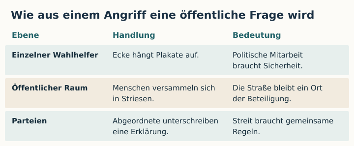
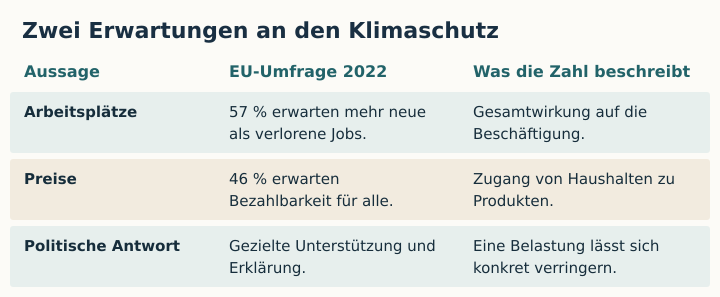
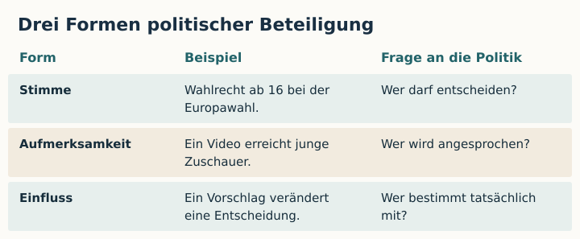

# ENS Rennes · D-E · Allemand (oral) 2024 — Corrigé brut

*Corrigé rédigé par IA, non officiel. Signalez toute erreur.*

**Rédaction** · GPT-6.2 Astra Ultra · vitesse non renseignée

Les cinq coupures distribuées et reproduites dans le fascicule sont commentées.

Les prises de parole et les réponses aux questions sont des propositions d’entraînement.

[Fascicule officiel](https://www.ens-rennes.fr/medias/fichier/sujets-oral-allemand-d-e-2024_1731603701332-pdf) · [Rapport du jury](https://www.ens-rennes.fr/medias/fichier/rapport-de-jury-lve-allemand-oral-d-e-2024_1729181063177-pdf)

## Sujet 1 · Nach Angriff auf SPD-Politiker: Hunderte bei Demonstration in Dresden

Frankfurter Allgemeine Zeitung · 5 mai 2024

### Was verteidigen Menschen, die politisch selten derselben Meinung sind?

Matthias Ecke wurde in Dresden angegriffen, als er Wahlplakate aufhing. Der Bericht vom 5. Mai verfolgt weniger den Angriff selbst als die öffentlichen Antworten darauf. In Striesen, also dort, wo der Angriff stattgefunden hatte, versammelten sich dem Text zufolge rund dreitausend Menschen. In Berlin waren es etwa tausend. Die Wahl des ersten Ortes gibt der Demonstration eine konkrete Bedeutung. Auf einer Straße, auf der politisches Engagement gefährlich geworden war, zeigen Menschen, dass sie diesen Raum weiter gemeinsam nutzen wollen.

Die Rednerin Katrin Göring-Eckardt erinnert an die demokratische Bewegung von 1989. Der Ruf „Wir sind das Volk“ verbindet ihre Aufforderung mit einer ostdeutschen Erfahrung. Sie spricht damit einerseits Menschen an, die diese Geschichte selbst erlebt haben. Andererseits bestreitet sie den Anspruch der heutigen Gegner demokratischer Institutionen, allein für das Volk zu sprechen. Der historische Bezug erklärt also etwas über die Gegenwart, ohne beide Situationen gleichzusetzen.

Neben den Versammlungen steht die Striesener Erklärung. Abgeordnete aus verschiedenen Parteien verpflichten sich darin zu gegenseitigem Respekt. Gerade weil ihre Programme verschieden bleiben, hat die gemeinsame Unterschrift Gewicht. Die Unterzeichner verteidigen die Möglichkeit, öffentlich und ohne Angst über diese Programme zu streiten. Dass laut dem wiedergegebenen Bericht niemand von der AfD unterschrieben hatte und eine Unterschrift von dort auch nicht zugelassen werden sollte, zeigt zugleich, dass die Grenze dieses Bündnisses politisch umstritten sein kann.

Eine Demonstration schützt nicht automatisch jeden Wahlhelfer. Sie kann aber die Bedeutung eines scheinbar alltäglichen Vorgangs sichtbar machen. Wenn Plakate nur noch von Menschen aufgehängt werden können, die persönliche Gefahr auf sich nehmen, verändert sich schon vor dem Wahltag, wer öffentlich zu Wort kommt. Der Artikel lenkt den Blick auf diese Voraussetzung einer freien Wahl.

**Nachfrage. Warum ist der Ort Striesen wichtig?** Dort fand der Angriff statt. Die Versammlung antwortet deshalb mit einer öffentlichen Präsenz am selben Ort.

**Nachfrage. Einigen sich die Parteien auf ein gemeinsames Programm?** Sie verpflichten sich auf Regeln des Umgangs. Ihre inhaltlichen Gegensätze bestehen weiter.

[Coupure officielle, p. 1](https://www.ens-rennes.fr/medias/fichier/sujets-oral-allemand-d-e-2024_1731603701332-pdf#page=1)

## Sujet 2 · Nicht nur Politik: Die Macrons sind in Deutschland

Christoph Hasselbach · Deutsche Welle · 25 mai 2024

### Welche politische Bedeutung hat ein Staatsbesuch?

Der Bericht der Deutschen Welle macht zunächst eine Unterscheidung, die für die weitere Analyse wichtig ist. Gastgeber des französischen Präsidentenpaares ist der Bundespräsident. Begegnungen mit der Bevölkerung und der symbolische Charakter der Reise stehen im Vordergrund. Aus dem Programm in Berlin, Dresden und Münster lässt sich also keine Liste verbindlicher Beschlüsse der deutschen und französischen Regierungen ableiten. Dennoch findet die Reise in einer politisch angespannten Zeit statt.

Vor der Europawahl versucht Macron für ein handlungsfähiges Europa zu werben. Ausgerechnet in Frankreich, wo das Europäische Parlament tagt, genießt diese Institution laut der genannten Umfrage ein besonders geringes Ansehen. Die Ansprache an deutsche und französische Öffentlichkeiten hat deshalb eine eigene Funktion. Ein Preis für Frieden und eine Rede über europäische Souveränität laden die Zuhörer ein, in einer gemeinsamen Geschichte auch eine gemeinsame Aufgabe zu sehen.

Das politische Problem beginnt dort, wo aus einer solchen Vorstellung eine Entscheidung werden soll. Der Artikel erinnert an Macrons früheren Vorschlag eines europäischen Finanzministers und an die zurückhaltende Reaktion in Berlin. Scholz lobt später die Impulse einer neuen Rede, ohne konkrete Antworten zu geben. Der befragte Institutsleiter verweist auf verschiedene Traditionen, politische Visionen zu formulieren. Diese Deutung erklärt einen Teil der Kommunikation. Sie sollte jedoch nicht zu einem pauschalen Urteil über alle Deutschen und Franzosen werden.

Auch die Entscheidungen selbst gehen auseinander. Beim Anteil der Kernenergie haben die Länder unterschiedliche Wege eingeschlagen. In Sicherheitsfragen betont der Experte den Unterschied zwischen der engeren deutschen Orientierung an der NATO und Frankreichs Vorstellung strategischer Autonomie. Freundliche Bilder eines Staatsbesuchs können diese Differenzen nicht auflösen. Sie können aber eine Beziehung sichtbar halten, innerhalb derer man noch über konkrete Entscheidungen verhandeln kann. Gerade dieser begrenzte Anspruch macht die Reise politisch interessant.

**Nachfrage. Wer empfängt Macron in dieser Funktion?** Der Bundespräsident ist der Gastgeber des Staatsbesuchs. Der Bundeskanzler leitet die Regierung.

**Nachfrage. Warum reicht der Hinweis auf politische Mentalitäten nicht aus?** Entscheidungen über Energie und europäische Zusammenarbeit beruhen auch auf Institutionen, wirtschaftlichen Interessen und früheren politischen Entscheidungen.

[Coupure officielle, p. 2](https://www.ens-rennes.fr/medias/fichier/sujets-oral-allemand-d-e-2024_1731603701332-pdf#page=2)

## Sujet 3 · Sollen Arbeitgeber vor der AfD warnen?

Sven Astheimer · Frankfurter Allgemeine Zeitung · 17 mai 2024

### Wie weit darf eine politische Botschaft am Arbeitsplatz gehen?

Mehr als dreißig Konzerne wenden sich vor der Europawahl an über 1,7 Millionen Beschäftigte in Deutschland. Sie werben für Beteiligung, Offenheit und Vielfalt. Sven Astheimer fragt in seinem Kommentar, wie sich ein solcher Aufruf von der Einflussnahme auf die Entscheidung eines einzelnen Wählers unterscheiden lässt. Der Name der AfD erscheint in der Kampagne laut dem Autor nicht. Gerade deshalb muss er erklären, weshalb die Partei dennoch zum Gegenstand seines Textes wird.

Zunächst erinnert er an den 75. Geburtstag des Grundgesetzes. Die Wahl ist frei und geheim. Niemand schuldet seinem Arbeitgeber Auskunft über sein Verhalten an der Urne. Zugleich beschreibt der Autor die wehrhafte Demokratie, deren Institutionen sich unter bestimmten Bedingungen gegen ihre Gegner schützen können. Daraus folgt für ihn auch eine Pflicht zur Toleranz gegenüber Positionen, die nicht verboten sind. Die Grenzen staatlichen Handelns und die Verantwortung eines Unternehmens sind dabei zwei verschiedene Fragen.

An einem Beispiel zeigt der Autor, warum das Verhältnis schwierig ist. Ein allgemeines Bekenntnis zur Vielfalt entscheidet noch nicht darüber, welche Regeln für Zuwanderung sinnvoll sind. Sobald eine Unternehmensleitung eine bestimmte Antwort als einzig möglichen Ausdruck eines gemeinsamen Wertes behandelt, kann sich die persönliche Entscheidung eines Mitarbeiters als Loyalitätstest anfühlen. Eine formelle Anweisung ist dazu nicht erforderlich. Das Machtgefälle am Arbeitsplatz verleiht einer Botschaft ein anderes Gewicht als derselben Aussage in einem privaten Gespräch.

Am Ende billigt Astheimer den Unternehmen ausdrücklich zu, vor wirtschaftlichen Folgen eines möglichen deutschen EU-Austritts zu warnen. Sie besitzen Sachkenntnis über wirtschaftliche Verflechtungen und dürfen ihre Interessen öffentlich begründen. Der Unterschied liegt darin, ob sie eine überprüfbare Folge erläutern oder den Beschäftigten vorschreiben, wie sie abstimmen sollen. Diese Grenze lässt der Kommentar bewusst an einem schwierigen Fall sichtbar werden.

**Nachfrage. Richtet sich der Aufruf ausdrücklich gegen eine namentlich genannte Partei?** Laut dem Kommentar nennt die Kampagne die AfD gerade nicht. Der Autor arbeitet ihre indirekte Bedeutung heraus.

**Nachfrage. Warum erwähnt der Autor einen EU-Austritt?** An dieser Forderung kann er erklären, weshalb Unternehmen wirtschaftliche Folgen öffentlich diskutieren dürfen.

[Coupure officielle, p. 3](https://www.ens-rennes.fr/medias/fichier/sujets-oral-allemand-d-e-2024_1731603701332-pdf#page=3)

## Sujet 4 · Greenlash: In der EU wächst der Widerstand gegen grüne Reformen

D’après Jakob Pallinger · Der Standard · 23 février 2024

### Wie lässt sich Klimaschutz mit sozialer Zustimmung verbinden?

Der Ausdruck „Greenlash“ verbindet die ökologische Wende mit einer Gegenbewegung. Der im Februar 2024 erschienene Text beschreibt Proteste verschiedener Gruppen gegen Maßnahmen des europäischen Green Deals. Die Politikwissenschaftlerin Nathalie Tocci erklärt, dass eine solche Umgestaltung Gewinner und Verlierer hervorbringt. Dabei spricht sie ausdrücklich auch von Menschen, die sich als Verlierer wahrnehmen. Politische Zustimmung hängt von erfahrenen und erwarteten Belastungen ab.

Zwei Prozentzahlen machen den Unterschied zwischen allgemeinen Erwartungen und der Lage eines Haushalts deutlich. Laut dem genannten Eurobarometer erwarten 57 Prozent mehr neue Arbeitsplätze als Arbeitsplatzverluste durch Klimaschutzmaßnahmen. Nur 46 Prozent glauben, nachhaltige Energie und Produkte würden für alle bezahlbar sein. Aus den Zahlen geht nicht hervor, welche einzelnen Befragten beide Antworten gaben. Inhaltlich sind die beiden Einschätzungen jedoch gut vereinbar. Eine neue Industrie kann Beschäftigung schaffen, während die Anschaffungskosten einer notwendigen Umstellung für bestimmte Menschen zu hoch bleiben.

Der Text führt weitere Umfragen an und bringt finanzielle Sorgen mit politischer Entfremdung in Verbindung. Wer Entscheidungen nicht beeinflussen kann und ihre Kosten unmittelbar spürt, hört den Verweis auf ein langfristiges gemeinsames Ziel möglicherweise als Ausweichen vor der eigenen Situation. Eine solche Erklärung darf aber nicht alle Protestierenden zu einer einheitlichen Gruppe machen. Landwirte, Unternehmen und Verbraucher sind in verschiedenen Rollen betroffen und haben unterschiedliche Möglichkeiten, sich anzupassen.

Die genannten Emissionsziele schaffen zudem Zeitdruck. Ein bloßer Aufschub erleichtert den Umbau nicht zwangsläufig. Tocci schlägt Unterstützung dort vor, wo Haushalte und Betriebe notwendige Investitionen nicht allein finanzieren können, sowie eine bessere Kommunikation. Die Reihenfolge ist wichtig. Eine überzeugende Erläuterung kann deutlich machen, wozu eine Maßnahme dient. Sie bezahlt noch keine Rechnung. Zustimmung wird wahrscheinlicher, wenn die Alternativen praktisch erreichbar sind und die Betroffenen erfahren können, wer welchen Teil der Kosten trägt.

**Nachfrage. Widersprechen sich die beiden Prozentzahlen?** Sie beziehen sich auf verschiedene Fragen, nämlich auf die Bilanz der Arbeitsplätze und auf die Bezahlbarkeit für alle.

**Nachfrage. Ist Widerstand gegen eine Maßnahme mit Gleichgültigkeit gegenüber dem Klimawandel gleichzusetzen?** Nein. Der Text berichtet zugleich von verbreiteter Sorge über die Folgen des Klimawandels.

[Coupure officielle, p. 4](https://www.ens-rennes.fr/medias/fichier/sujets-oral-allemand-d-e-2024_1731603701332-pdf#page=4)

## Sujet 5 · Warum die Politik oft an der Jugend vorbeiregiert

Der Spiegel · 25 mai 2024

### Gehört werden, wählen und mitentscheiden

Warum kann Politik an jungen Menschen vorbeigehen, obwohl Politiker sie auf sozialen Medien direkt ansprechen? Der Spiegel-Text zeigt, dass Sichtbarkeit, Wahlrecht und wirksame Beteiligung drei verschiedene Dinge sind. Die Jugendforscherin Sabine Andresen hört häufig den Einwand, junge Menschen seien weder kompetent noch interessiert genug. Sie deutet diesen Einwand als Verteidigung bestehender Macht. Echte Beteiligung würde bedeuten, Entscheidungen nicht mehr allein kontrollieren zu können.

Die Debatte über das Wahlalter macht den institutionellen Unterschied deutlich. Bei der Europawahl und in sechs Bundesländern dürfen Sechzehnjährige zum genannten Zeitpunkt wählen, bei der Bundestagswahl dagegen nicht. Eine Änderung des Grundgesetzes erfordert Zweidrittelmehrheiten im Bundestag und im Bundesrat. Ein Hinweis auf das Alter, in dem Jugendliche einen Mobilfunkvertrag abschließen dürfen, kann eine politische Analogie liefern. Er beweist aber noch nicht, dass für privatrechtliche Verpflichtungen und demokratische Mitentscheidung dieselben Voraussetzungen gelten müssen.

Die Politologin Julia Reuschenbach ergänzt, dass ein niedrigeres Wahlalter allein keine hinreichende Antwort wäre. Sie unterscheidet zwischen Fortschritten bei einzelnen gesellschaftspolitischen Fragen und unerfüllten Erwartungen etwa beim Wohnen, bei der Digitalisierung und beim Klima. Die Altersstruktur der Wahlberechtigten erklärt einen Teil der Anreize für Parteien. Fast vierzig Prozent waren bei der Bundestagswahl 2021 mindestens sechzig Jahre alt. Daraus folgt weder, dass alle Älteren dieselben Interessen haben, noch dass Junge nur über Jugendthemen sprechen möchten.

Die Beispiele von Aktentasche, Schokoladeneiern und einem neu gestalteten Bundesadler wirken am Ende komisch. Sie führen vor, wie leicht die Darstellung von Jugendnähe an die Stelle einer Antwort auf Sachfragen tritt. Ein besserer Test wäre, ob ein Vorschlag junger Menschen ein Parteiprogramm oder eine kommunale Entscheidung tatsächlich verändert. Wer nur die Zahl der Aufrufe eines Videos zählt, misst eine andere Art von Erfolg.

**Nachfrage. Warum braucht das Wahlalter auf Bundesebene besondere Mehrheiten?** Die im Artikel diskutierte Änderung betrifft das Grundgesetz und verlangt in beiden gesetzgebenden Körperschaften eine Zweidrittelmehrheit.

**Nachfrage. Woran ließe sich Mitbestimmung erkennen?** Man könnte nachweisen, dass ein Vorschlag junger Beteiligter beraten wurde und eine Entscheidung beeinflusste, auch wenn das Ergebnis nicht alle überzeugt.

[Coupure officielle, p. 5](https://www.ens-rennes.fr/medias/fichier/sujets-oral-allemand-d-e-2024_1731603701332-pdf#page=5)
