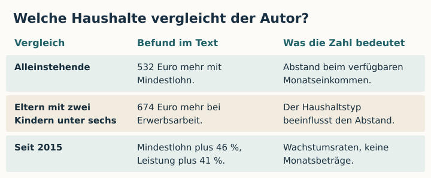

# ENS Rennes · D-E · Allemand 2024 — Corrigé guidé

*Corrigé rédigé par IA, non officiel. Signalez toute erreur.*

**Rédaction** · GPT-6.2 Astra Ultra · vitesse non renseignée

L’épreuve dure quatre heures. Chacune des deux réponses d’expression écrite doit compter de 225 à 275 mots.

## Préparer la copie

### Version et thème

Pour la version, distinguez les deux objets de la prédiction. Au premier paragraphe, *Tatorte* désigne des lieux, et le logiciel cherche une régularité dans des faits enregistrés. Au deuxième, les listes portent sur des personnes. *Wer wie oft verhaftet wurde* renvoie au nombre d’arrestations de chacun, sans préjuger d’une condamnation. Au troisième, suivez les sujets grammaticaux de *kennzeichnen*, *veranlasst* et *erzeugt*. Les logiciels signalent une zone, la police y patrouille davantage, ces patrouilles produisent de nouvelles données. La fréquence des signalements ultérieurs peut ainsi dépendre de l’endroit où l’on a choisi d’observer. Le subjonctif I de *mache* introduit l’opinion optimiste attribuée à certains. Enfin *eingestellt hat* indique que certaines polices municipales ont **cessé** d’employer ces outils.

Pour le thème, construisez une frise. La recherche de partenaires a commencé et se poursuit, d’où *seit Beginn … sucht Deutschland*. L’annonce d’investissements précède le déplacement raconté, d’où *hatte … angekündigt*. Le déplacement accompagne la délégation au sens passif, avec *wird … begleitet*. Disposez les quatre finalités du financement sur le même plan grammatical. Distinguez également *in Südafrika*, l’État sud-africain, de *in Nordafrika*, région géographique. La dernière phrase oppose deux raisons distinctes du choix des destinations, la démographie et le gaz pour le Nigeria, la sécurité des investissements telle que les entreprises la perçoivent pour le Ghana.

### Deux réponses à distinguer

Pour la première, faites deux colonnes au brouillon. Dans l’une, placez l’idée que travailler rapporterait moins que recevoir le Bürgergeld. Dans l’autre, notez les types de ménages utilisés pour vérifier cette affirmation, puis les deux écarts de revenu disponible. Ajoutez une autre objection de l’auteur, qui porte cette fois sur les motivations humaines. Il devient alors possible d’expliquer en quoi le procédé est électoral et comment il oppose artificiellement des groupes qui se recoupent.

La seconde réponse demande *für Sie*. Choisissez un critère personnel que vous puissiez mettre à l’épreuve de deux situations. L’exemple de la maintenance permet ici de montrer qu’une tâche utile peut agir à distance. L’exemple du soin oblige ensuite à examiner les conditions nécessaires pour qu’une tâche utile reste supportable à la personne qui la réalise.

## I. Version

La police prédictive promet beaucoup, jusqu’à empêcher que des infractions soient commises. Elle s’appuie pour cela sur l’analyse de grandes quantités de données. Certains logiciels s’intéressent aux lieux où des infractions pourraient se produire. Si des régularités se dessinent, par exemple si des infractions ont été commises à une certaine heure, au même endroit ou par le même temps, la police a alors intérêt à examiner ces lieux de plus près.

D’autres logiciels prédisent qui pourrait commettre une infraction. Ils recherchent des facteurs de risque dans les antécédents judiciaires et le parcours personnel des individus, par exemple le nombre de fois où telle personne a été arrêtée ou le fait qu’elle ait quitté l’école avant la fin de ses études. À partir de là, ils dressent des listes de personnes susceptibles d’enfreindre la loi. Les services de sécurité de plus de cinquante pays utilisent de tels logiciels, aussi bien dans des démocraties occidentales que dans des États autoritaires.

Certains affirment que la police prédictive rend les villes plus sûres. Les défenseurs des droits humains mettent cependant en garde contre les discriminations qu’elle accentue. Les logiciels désignent souvent les communes à faibles revenus ou les quartiers où vivent des minorités comme de prétendus foyers de délinquance. La police y patrouille donc davantage qu’ailleurs. Cela produit à son tour encore plus de données et enclenche un cercle vicieux de discrimination dans lequel les mêmes zones sont sans cesse signalées. Les logiciels tendent également à désigner comme délinquants potentiels des personnes à faibles revenus ou appartenant à des minorités.

Le public prend de plus en plus conscience des risques de la police prédictive et des préjugés à l’égard de certains groupes sociaux. Aux États-Unis, le débat sur le racisme systémique a conduit la police de certaines villes à cesser de recourir à la reconnaissance faciale et à la police prédictive.

## II. Thème

Seit Beginn des Krieges in der Ukraine und angesichts wachsender Spannungen mit China sucht Deutschland nach neuen Partnern und Energielieferanten. Dabei spielt insbesondere Afrika eine Rolle. Schon im vergangenen Jahr hatte das Bundesministerium für wirtschaftliche Zusammenarbeit und Entwicklung beispielsweise Investitionen in Höhe von 100 Millionen Euro in Nigeria angekündigt. Damit sollten kleine und mittlere Unternehmen unterstützt, die Landwirtschaft gefördert, erneuerbare Energien ausgebaut und die Erwerbstätigkeit von Frauen gestärkt werden. Auch Olaf Scholz hatte bei seinem Besuch in Äthiopien im vergangenen Mai erklärt, die Beziehungen zwischen Nord und Süd bräuchten einen Neuanfang.

Auf seiner nunmehr dritten Reise auf den Kontinent innerhalb von kaum zwei Jahren wird der Bundeskanzler von einer Wirtschaftsdelegation begleitet. Immer mehr deutsche Unternehmen sind nicht nur in Südafrika und Nordafrika tätig, sondern eröffnen auch Niederlassungen in Ost- und Westafrika. Dass Olaf Scholz Ghana und Nigeria besuchen wird, ist natürlich kein Zufall. Nigeria ist das bevölkerungsreichste Land des Kontinents und fördert Erdgas. Ghana wiederum gilt bei deutschen Unternehmen als sicherer Investitionsstandort.

## III.1. Was ist an der Debatte populistisch?

Der Verfasser nennt die Debatte populistisch, weil politische Gegner des Bürgergelds aus einem Vergleich von Einkommen einen Gegensatz zwischen angeblich Fleißigen und angeblich Arbeitsunwilligen machen. Die Erhöhung um zwölf Prozent lässt sich angesichts der Inflation diskutieren. Wer jedoch behauptet, Arbeit lohne sich inzwischen weniger als der Bezug staatlicher Leistungen, müsste zunächst vergleichbare Haushalte gegenüberstellen.

Genau das tut die angeführte Berechnung. Ein alleinstehender Mensch, der zum Mindestlohn arbeitet, hat monatlich 532 Euro mehr zur Verfügung als ohne Erwerbsarbeit. Bei Eltern mit zwei kleinen Kindern beträgt der Abstand 674 Euro. Außerdem ist der Mindestlohn seit seiner Einführung prozentual stärker gestiegen als die entsprechende Sozialleistung. Einzelne spektakuläre Fälle widerlegen diese Vergleiche nicht. Besonders aufschlussreich ist, dass mehr als zwei Millionen Erwerbstätige zusätzliche Leistungen brauchen. Die Gruppen, die gegeneinander ausgespielt werden, überschneiden sich also.

Ein zweiter Kurzschluss betrifft die Beweggründe der Menschen. Ehrenamtliche Arbeit und die Pflege von Angehörigen zeigen, dass Anerkennung, Verantwortung und Zugehörigkeit ebenfalls zum Handeln motivieren. Wer Arbeitslose vor allem mit Sanktionen zur Arbeitsaufnahme bewegen möchte, übersieht häufig gesundheitliche Probleme, fehlende Qualifikationen und unzureichende Kinderbetreuung. Der Autor bestreitet einzelne Missbrauchsfälle keineswegs. Er kritisiert, dass eine Minderheit zum Maßstab für alle gemacht wird.

Den Vorwurf des Populismus erhebt er schließlich wegen der politischen Funktion dieser Darstellung. Wer trotz bekannter Zahlen dieselben Behauptungen wiederholt, kann auf Kosten besonders verletzlicher Menschen Stimmen gewinnen. Eine sachliche Auseinandersetzung müsste dagegen fragen, wie bessere Betreuungsangebote, Weiterbildung und ein höherer tatsächlich verfügbarer Lohn den Zugang zu dauerhafter Beschäftigung erleichtern.

*241 mots.*

## III.2. Wann empfinde ich Arbeit als sinnvoll?

Eine Arbeit erscheint mir sinnvoll, wenn ich begreife, wem sie nützt, und wenn ich an ihrem Ergebnis etwas verändern kann. Dafür muss der Beruf weder besonders angesehen sein noch jederzeit Freude machen. Wer in einem Krankenhaus Geräte wartet, begegnet den Patienten vielleicht selten. Dennoch ist der Zusammenhang zwischen sorgfältiger Wartung und einer verlässlichen Behandlung sehr konkret. Sinn entsteht hier auch dadurch, dass die Kollegen dieses Wissen anerkennen und eine notwendige Reparatur nicht aus Zeitdruck verschieben.

Außerdem gehört für mich die Möglichkeit dazu, Verantwortung zu übernehmen, ohne mit ihr allein gelassen zu werden. Eine Auszubildende kann bereits bei einer kleinen Aufgabe erfahren, dass ihre Entscheidung zählt. Dafür braucht sie eine Person, die ihr etwas erklärt, Fragen zulässt und Fehler mit ihr bespricht. Dagegen kann selbst ein gesellschaftlich wichtiger Beruf seinen Sinn für den Einzelnen verlieren, wenn dauernder Personalmangel jede gute Entscheidung praktisch unmöglich macht.

Der Lohn ist deshalb kein Gegenargument zur Suche nach sinnvoller Arbeit. Wer von einer Tätigkeit leben möchte, muss die Miete bezahlen und Zeit für Erholung haben. Gerade in der Pflege wäre es ungerecht, geringe Bezahlung mit der angeblichen Berufung der Beschäftigten zu rechtfertigen. Unbezahltes Engagement kann ebenfalls sehr sinnvoll sein, sollte aber als freie Entscheidung möglich bleiben.

Schließlich muss nicht jeder Mensch seine ganze Identität aus dem Beruf beziehen. Eine verlässliche Arbeit mit begrenzter Verantwortung kann mir gerade deshalb sinnvoll erscheinen, weil sie Raum für Familie oder ein Ehrenamt lässt. Entscheidend ist, ob ich die Aufgabe und die Bedingungen, unter denen ich sie erfülle, vor mir selbst vertreten kann.

*252 mots.*

[Sujet officiel, pages 2 à 4](https://www.ens-rennes.fr/medias/fichier/sujet-toutes-lve-e-crit-d-e-2024_1729180755099-pdf#page=2) · [Rapport du jury](https://www.ens-rennes.fr/medias/fichier/rapport-de-jury-lve-allemand-e-crit-d-e-2024_1729181005078-pdf)
