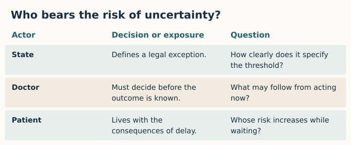
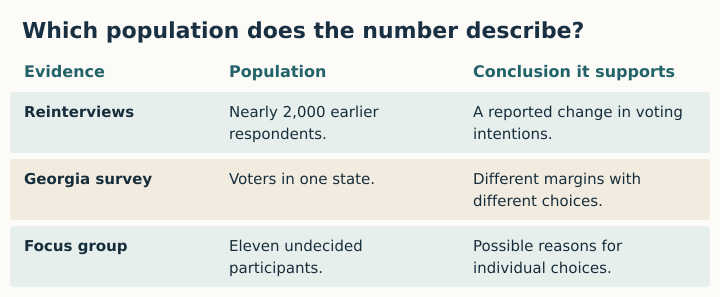
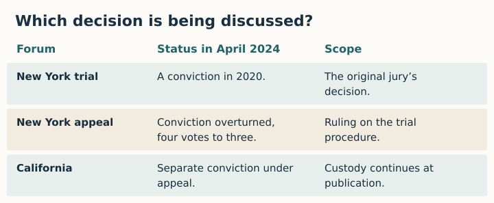

# ENS Rennes · D-E · Anglais oral 2024 — Corrigé guidé

*Corrigé rédigé par IA, non officiel. Signalez toute erreur.*

**Rédaction** · GPT-6.2 Astra Ultra · vitesse non renseignée

Le fascicule comporte les cinq sujets numérotés de 1 à 5. Les 5 coupures reproduites dans le fascicule sont traitées sur les passages effectivement distribués.

Après vingt minutes de préparation, l’exposé et les questions du jury occupent ensemble quinze minutes. Les prises de parole et les échanges ci-dessous sont des propositions d’entraînement.

[Fascicule officiel](https://www.ens-rennes.fr/medias/fichier/sujets-oral-anglais-d-e-2024_1731603717655-pdf) · [Rapport du jury](https://www.ens-rennes.fr/medias/fichier/rapport-de-jury-lve-anglais-oral-d-e-2024_1731604878948-pdf)

### Préparer et défendre son analyse

Le rapport rappelle vingt minutes de préparation pour quinze minutes d’oral, avec un exposé, un échange et, éventuellement, la traduction de quelques lignes. Pendant la préparation, identifiez d’abord la situation décrite et la date à laquelle l’information était disponible. Un jugement annulé, un résultat attendu ou une proposition soutenue par une chroniqueuse appellent des verbes différents en anglais. Préparez ensuite la synthèse en reliant deux ou trois informations qui font évoluer le propos. Prélevez enfin deux indices à analyser et une objection possible. Gardez du temps pour prononcer votre introduction et la transition vers le commentaire.

Le jury demande une présentation intelligible, structurée et vivante. On peut annoncer brièvement deux étapes, expliquer un passage puis regarder le jury au moment de formuler sa conclusion. Pour le sujet 3, posez une question d’interprétation que le texte permet de résoudre, par exemple ce qu’une variation de deux points permet de dire du vote d’un groupe. L’analyse peut alors progresser de la mesure au problème de l’inférence. Connaître l’issue ultérieure de l’élection ne donne pas au journaliste un résultat dont il ne disposait pas au moment d’écrire.

La traduction, si elle est demandée, intervient sur le passage choisi par le jury. Les suggestions ci-dessous servent à travailler un mot ou une structure. Elles ne délimitent pas un passage imposé. Les échanges en anglais sont aussi des propositions d’entraînement. Exercez-vous à répondre brièvement, puis à préciser votre réponse si le jury modifie la question. Une correction immédiate de votre formulation est possible, notamment si vous avez attribué une action à la mauvaise institution.

## Sujet 1 · US state abortion ban exemptions aren’t vague by accident. Uncertainty is the point

The Guardian, Judith Levine, Fri 7 Jun 2024

### How uncertainty can change a legal rule in practice

Imagine a law that permits an intervention in some circumstances, yet leaves the person who must act unable to tell whether those circumstances have already arisen. That is the problem Judith Levine raises in her Guardian opinion column of 7 June 2024. She starts by comparing legal uncertainty with the uncertainty experienced by someone subject to another person’s arbitrary authority. The analogy helps explain fear. The case that follows is what lets the reader test the legal argument.

Amanda Zurawski was told that her pregnancy could not result in a surviving child and that her own health was in danger. Under the Texas law described in the extract, intervention was permitted to prevent death or loss of a major bodily function. The doctors faced serious potential penalties and did not know how immediate the danger had to be. They sent her home. She subsequently developed sepsis and spent three days in intensive care. The sequence matters: a decision to wait changes the patient’s condition while the professionals are waiting for the law’s application to become clearer.

The Center for Reproductive Rights represented twenty patients and two doctors in challenging the uncertainty. Its legal claim and Levine’s political claim are different. The lawyers argued that providers could not know whether medically appropriate conduct would expose them to punishment. The columnist goes further. In her view legislators benefit when providers err on the side of withholding even lawful treatment. This is why she doubts that asking for a clearer exception will solve the underlying problem.

One can see how that mechanism might work without treating every inference about intention as a proven fact. The distribution of risk is enough to make caution predictable. The person deciding may face imprisonment, while the patient bears the immediate health cost of waiting. The state can then attribute the outcome to an individual medical decision. Establishing that each legislator intended precisely this result would require other evidence. That distinction strengthens the reading of the column: its case for the practical effects of ambiguity rests on a documented sequence, while its title presses a more demanding claim about political purpose.

**Examiner. Could perfect wording prevent every difficult decision?** No. Clinical circumstances vary. A more precise rule can still clarify who may exercise judgement and what evidence is needed, reducing a particular source of hesitation.

**Examiner. Why does the writer criticise allies as well as opponents?** She doubts that a legal strategy focused on exceptions can succeed if discouraging action is part of the purpose she ascribes to the prohibition.

**Pour préparer l’échange.** Tracez trois colonnes, pour le risque médical, la règle appliquée et la sanction redoutée. Faites entendre en anglais la différence entre le constat du délai et la thèse de l’intention législative. Pour traduire l’idée de *self-policing*, « s’imposer soi-même des restrictions » restitue ici le mécanisme décrit.

[Coupure distribuée, p. 1](https://www.ens-rennes.fr/medias/fichier/sujets-oral-anglais-d-e-2024_1731603717655-pdf#page=1)

## Sujet 2 · Hundreds of millions head to polls on final day of European elections

The Guardian, Jennifer Rankin, Sun 9 Jun 2024

### What can change before a parliamentary majority changes?

Jennifer Rankin is writing on the final day of the June 2024 European elections. Italian polls have yet to close. Treating the figures in the article as results would destroy the reason for writing it at that moment. It tells readers what is being decided across different national elections and why a shift in representation matters even if the principal groups retain a majority.

There are 720 seats in a directly elected parliament shared by the member states. The centre-right European People’s Party is expected to remain largest, the centre-left group second. Yet the prospect of gains on the radical and far right, alongside losses for liberal and Green parties, changes the range of alliances that might be available. A group need not command a majority of its own to influence the terms on which others can form one.

Rankin explains the stakes by turning from the count to the institution. The European Parliament acts jointly with national ministers on subjects including workers’ rights, farm subsidies and climate policy. It also has to approve the Commission president. These are different kinds of power, and this is not a direct presidential election. The allocation of parliamentary seats may nevertheless affect both legislation and the executive appointment.

Another strand concerns participation. The previous turnout of 50.6 per cent is a reference point, not the turnout being announced for 2024. Some countries have extended voting to sixteen-year-olds. A campaign film links voting with older Europeans’ memories of dictatorship, occupation and repression. The contrast in age is part of the appeal: voting is presented as something inherited which remains effective only when a new generation uses it. Whether the film actually brings people to the polls is a separate empirical question.

The report therefore works at three levels. National contests return representatives, groups in Parliament organise influence, and citizens decide whether this institution deserves their participation. Comparing national headlines alone would obscure how the new legislature will have to operate.

**Examiner. Could the largest party govern on its own?** The largest parliamentary group is not necessarily a majority. Legislative and appointment decisions require enough support across the chamber, and national ministers also participate in legislation.

**Examiner. Why avoid saying that 361 million people definitely voted?** The article is written while polling is under way and separately discusses turnout. A population involved in the election and the eventual number of ballots cast answer different questions.

**Pour préparer l’échange.** Datez le point de vue de la journaliste en citant la fermeture future des bureaux italiens. Dites à voix haute *is expected to*, puis reformulez sans transformer la projection en résultat. Pour *joint legislators*, « ils légifèrent conjointement » rend le rôle partagé du Parlement et des ministres nationaux.

[Coupure distribuée, p. 2](https://www.ens-rennes.fr/medias/fichier/sujets-oral-anglais-d-e-2024_1731603717655-pdf#page=2)

## Sujet 3 · Trump’s lead over Biden narrows after conviction, analysis shows

The Guardian, Joan E Greve, Fri 7 Jun 2024

### What does a small movement in a poll measure?

Joan E Greve examines a claim made immediately after Donald Trump’s conviction in Manhattan. Some Republicans predicted the verdict would damage Joe Biden. Reinterviews of nearly two thousand previous New York Times and Siena College respondents instead suggested that Trump’s national advantage had fallen from three points to one. This represents a narrowing of an advantage. It is neither a Biden lead nor an election result.

Reinterviewing people matters because their earlier answers are available. The article follows some Democratic-leaning respondents who had become disengaged, as well as people who disliked both main candidates. Among previous Biden voters who had said they would switch to Trump, about a quarter now said they would back Biden. That quarter belongs to a selected subgroup. It would be a major error to report a quarter of all American voters changing sides.

The article then complicates a simple story about a political setback. The presidency depends on the electoral college and a national movement may matter differently in different states. In a separate Georgia survey Trump led by five points in a two-candidate comparison, a gap within that survey’s margin of error. When other names were offered the lead reached six points, outside the stated margin. The comparison tells us something about the effect of the options presented. It does not guarantee the state’s eventual result.

Notice also the distinction between judgements about the court case and an intention to vote. Half the Georgia respondents agreed with the verdict even though Trump led in that poll. A person’s evaluation of one event can coexist with other political priorities. The eleven-person focus group at the end helps explain how individuals made sense of the event. It is much too small and differently constituted to supply a national percentage.

Greve’s cautious wording is justified. In a close election small movements deserve attention, but noticing a movement after a verdict is easier than establishing the extent to which the verdict produced it or whether it will last until polling day.

**Examiner. Why cite the narrow 2020 margin in some states?** It explains how a small movement might matter in an electoral-college contest. It does not establish that the same states will be equally close again.

**Examiner. Could a voter accept the verdict and support Trump?** Yes. The poll asks distinct questions about a legal conclusion and a political choice. The data do not require those responses to coincide.

**Pour préparer l’échange.** Dessinez deux lignes, une pour la réinterrogation nationale, l’autre pour le sondage distinct en Géorgie. Ajoutez une troisième case pour le groupe de parole de onze personnes. Faites préciser par votre partenaire à quel groupe appartient le quart mentionné. Traduisez *lead* par « avance » et conservez les points, distincts des pourcentages de répondants.

[Coupure distribuée, p. 3](https://www.ens-rennes.fr/medias/fichier/sujets-oral-anglais-d-e-2024_1731603717655-pdf#page=3)

## Sujet 4 · The law on single-sex spaces is a mess. It needs fixing, not political point-scoring

The Guardian, Sonia Sodha, Sun 9 Jun 2024

### How does an individual case frame a legal argument?

Sonia Sodha opens her June 2024 column with a residential writing retreat for women who have experienced trauma. A friend who organises it is concerned about the conditions under which a single-sex service can operate lawfully. The story gives legal uncertainty a person who has to make a decision. It also gives the argument a starting perspective: we hear first from a provider and from women who value access to that particular service.

The author then explains why she thinks two laws have to be read together. The Equality Act 2010 recognises nine protected characteristics, including sex and gender reassignment. The Gender Recognition Act 2004 provides for a certificate affecting a person’s legal status for many purposes. At the date of the column, Sodha describes disagreement about how the certificate affects the application of the Equality Act. Exceptions for some single-sex services already exist. The dispute concerns the test for using them and the clarity of the rule for providers.

Sodha supports a Conservative proposal to clarify the meaning of sex in the Equality Act. She argues that it would help service providers while maintaining protection against discrimination on grounds of gender reassignment. Both propositions should be attributed to her. The first describes an expected practical benefit. The second is a claim about the legal effects of the change, which a critic might want to test against individual cases. The extract is an intervention in a June 2024 debate, not a neutral account of later law.

The retreat illustrates why collective provision can depend on knowing the relevant rule. It cannot on its own establish what a rule should be for every service, sport or association. A fuller discussion would consider how different people experience access or exclusion, how an organisation establishes a legitimate need and what recourse exists for someone who believes they have faced discrimination. Keeping those questions distinct lets an oral presentation engage seriously with the writer without adopting her polemical language about her opponents.

**Examiner. Why mention both Acts?** The question as framed by Sodha arises from the interaction of a certificate under one statute and protections and exceptions under another.

**Examiner. Which perspective does the introductory story establish most directly?** It gives access to one organiser’s concern. The circumstances of a person seeking admission and the range of other services would require additional evidence.

**Pour préparer l’échange.** Entraînez-vous à expliquer *protected characteristic* et *gender recognition certificate* sans supposer que le jury connaît ces deux mécanismes. Attribuez la thèse de la clarification à Sodha. Quand elle relate la situation vécue par son amie, indiquez quel autre point de vue la scène ne donne pas directement.

[Coupure distribuée, p. 4](https://www.ens-rennes.fr/medias/fichier/sujets-oral-anglais-d-e-2024_1731603717655-pdf#page=4)

## Sujet 5 · #MeToo Founder Calls For Unity, Perseverance After Weinstein Conviction Overturned

The Huffington Post, Nina Golgowski, 26/04/2024

### What did the appeals court decide, and what remains at issue?

In April 2024 New York’s highest court overturned Harvey Weinstein’s 2020 conviction by four votes to three. The Huffington Post reports what followed by contrasting the defence lawyer’s celebration with Tarana Burke’s appeal for perseverance. To understand the disagreement we must separate the conduct alleged, the rules of evidence at trial and the wider meaning people attached to the original verdict.

The majority objected to the admission of evidence concerning allegations by women whose cases were not the charges before that jury. The defence argued that the material made Weinstein answer in effect for other alleged offences. Douglas Wigdor, who represented several accusers, replied that evidence of other acts can in some circumstances help a jury understand intention or a course of conduct. He added that the jury had been instructed about its use. These statements concern the fairness and relevance of evidence. The appeal ruling did not itself determine the truth of every allegation.

Burke brings a different measure of change to the discussion. For survivors who had regarded the original conviction as a sign that institutions might respond differently, reversal could be profoundly discouraging. Yet she also points to the fact that a powerful man had been brought to trial and that many people had spoken publicly. Those developments matter to a social movement without making it independent of the painful consequences of a court ruling. An individual can value fair procedures and still recognise the cost to witnesses of having to go through a trial again.

Finally, the report specifies that a separate conviction in Los Angeles then remained in force and was itself under appeal. It would therefore be wrong to say that this New York decision immediately freed Weinstein. The date and jurisdiction are essential to the meaning of the story. Its most interesting feature is that the lawyers and the activist can all respond to the same decision while answering different questions about justice, accountability and how society changes.

**Examiner. Is overturning a conviction equivalent to an appellate finding of innocence?** No. The reasoning described in the extract concerns how evidence was admitted at trial. It does not settle all underlying factual questions.

**Examiner. Why include Burke’s comment about ten years earlier?** It gives her movement a timescale extending beyond the original conviction and the appeal, while leaving the specific setback fully visible.

**Pour préparer l’échange.** Séparez au brouillon la décision de l’État de New York et la condamnation californienne. Pour rendre *overturned*, proposez « annulée en appel » dans ce contexte. Formulez en deux phrases ce que l’avocat de la défense et Tarana Burke entendent chacun par un changement important. Le premier parle ici de procédure ; la seconde élargit la durée d’observation.

[Coupure distribuée, p. 5](https://www.ens-rennes.fr/medias/fichier/sujets-oral-anglais-d-e-2024_1731603717655-pdf#page=5)
