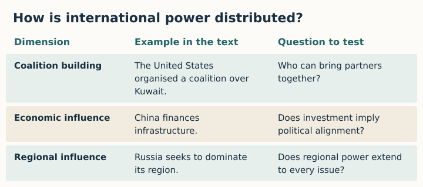

# ENS Rennes · D-E · Anglais 2024 — Corrigé guidé

*Corrigé rédigé par IA, non officiel. Signalez toute erreur.*

**Rédaction** · GPT-6.2 Astra Ultra · vitesse non renseignée

L’épreuve dure quatre heures. Chacune des deux réponses d’expression écrite doit compter de 225 à 275 mots.

## Préparer la copie

### Version et thème

Commencez par le sens économique du groupe *oil demand sustainability programme*. C’est la **demande** de pétrole que le programme cherche à faire durer. Une traduction qui attribuerait au pétrole une qualité écologique renverserait la démarche décrite. *To drive up* indique une hausse que l’on cherche à provoquer. *Overseen by* marque la supervision et *involves* introduit les participants. Distinguez dollars et euros, ainsi que *billion* et « milliard ». Dans la dernière phrase, les deux verbes diffèrent par leur aboutissement. *Phase down* permet une baisse progressive, *phase out* ajoute l’idée d’une disparition à terme. L’article décrit encore une question soumise aux États à la COP28.

Dans le thème, rendez l’appréciation des migrants, avec *a society they find too oppressive*, et gardez une distance comparable au sujet de l’accessibilité des visas. Le nombre journalier sur Weibo concerne des recherches. Le texte ne dit pas que 300 000 personnes distinctes sont parties en Thaïlande. L’historique des années 1990 et 2000 prépare ensuite une comparaison avec les motivations actuelles. *Make a fortune* restitue l’espoir de s’enrichir, *a search for identity* un type de projet différent. La restriction sur la liberté politique appartient aux paroles du chercheur.

### De la synthèse à l’argument personnel

La première question porte sur le degré de multipolarité. Examinez la capacité à organiser une coalition, le poids économique et le pouvoir régional. Associez chaque critère à un exemple, puis demandez si les mêmes États arrivent en tête à chaque fois. L’auteur envisage aussi une part de coïncidence dans la simultanéité des conflits. On peut ainsi reconnaître la redistribution de la puissance sans en faire une explication suffisante de chaque guerre.

Pour la seconde, donnez un sens vérifiable à *Pax Sinica*. Le terme désigne ici l’hypothèse d’un ordre organisé autour de la Chine. Organisez votre réponse autour des conditions à remplir, par exemple le pouvoir de rendre un accord possible, la confiance des États qui y participent et la capacité à en soutenir durablement les règles. Un partenaire commercial peut demander un financement à Pékin tout en conservant une autre alliance de sécurité. Cet exemple permet de mettre à l’épreuve l’idée d’une succession automatique.

## I. Version

L’Arabie saoudite mène un vaste plan d’investissement à l’échelle mondiale pour susciter, dans les pays en développement, une demande pour son pétrole et son gaz, a révélé une enquête menée sous couverture. On savait peu de choses sur le programme destiné à pérenniser la demande de pétrole, mais l’enquête a permis d’obtenir des informations détaillées sur les projets visant à accroître l’utilisation de voitures, d’autobus et d’avions fonctionnant aux énergies fossiles en Afrique et ailleurs, alors que les pays riches se tournent de plus en plus vers les énergies propres.

Le programme est placé sous la supervision du dirigeant de fait de l’Arabie saoudite, le prince héritier Mohammed ben Salmane. Il associe les plus grandes organisations du pays, notamment le Fonds public d’investissement, doté de 700 milliards de dollars, Aramco, première compagnie pétrolière au monde, le groupe pétrochimique Sabic et les principaux ministères du gouvernement.

Le président de la Banque mondiale a récemment déclaré que les pays riches et les entreprises devaient aider les pays en développement à déployer les énergies renouvelables en leur permettant de sauter l’étape d’une croissance économique fondée sur les énergies fossiles, telle qu’on l’avait connue par le passé. L’Arabie saoudite a déclaré souscrire aux objectifs climatiques de l’accord de Paris, qui visent à contenir le réchauffement de la planète nettement en dessous de 2 °C tout en s’efforçant de limiter la hausse à 1,5 °C.

Pour y parvenir, les émissions liées aux énergies fossiles doivent diminuer rapidement, et la majeure partie des réserves de pétrole et de gaz rester dans le sol. Les politiques climatiques, comme le soutien aux voitures électriques, représentent donc une menace importante pour les recettes de cet État riche en pétrole. L’un des grands enjeux de la COP28, le sommet des Nations unies sur le climat, est de savoir si les pays pourront s’engager à réduire progressivement leur recours aux énergies fossiles, voire à y mettre fin.

## II. Thème

Growing numbers of Chinese people are moving to Thailand because they reject a Chinese society they find too oppressive, in a superpower that no longer shows the dynamism their parents’ generation experienced. After living through some of the world’s strictest restrictions during the Covid-19 pandemic, they are choosing to get away to the Southeast Asian kingdom, where their money goes further and the surroundings are conducive to wellbeing.

Thailand is a popular destination because its visas are seen as easier to obtain than those of Western countries. Enrolling in a foreign language course costing between €650 and €1,500 is enough to secure one. On the popular platform Weibo, searches for information on how to move to Thailand were made more than 300,000 times on a single day last January.

“I think there has been a sudden increase in the desire to leave China,” says Xiang Biao, a researcher in social anthropology. Whereas migration in the 1990s and 2000s was associated with the idea of making a fortune abroad, younger generations associate leaving with a personal search for identity. These people are “cosmopolitan and open-minded, and they cherish the idea of freedom. It isn’t necessarily political freedom, but they want to lead what they consider a decent and dignified life,” the researcher explains.

## III.1. How multipolar is the world becoming?

The world is becoming multipolar in the sense that no single government can set the terms of every international negotiation. This is a more limited claim than saying that all major states now exercise comparable power. The article’s account of the period after the Cold War makes the distinction clear. The United States could organise a coalition over Kuwait and help bring parties to the negotiating table in the Middle East. Its leading role never meant that wars had disappeared.

China now offers governments infrastructure finance and access to a major market. A country negotiating such an agreement has opportunities and obligations that cannot be understood solely through its relationship with Washington. Russia, despite its smaller economic weight, can profoundly affect the security of neighbouring states. In Europe, the war in Ukraine also demonstrates the importance of alliances. Many governments have acted together, yet the same governments may disagree about trade or climate policy. Counting states without considering what they can do in each field gives a misleading picture.

The greater number of centres of influence does not automatically explain every simultaneous conflict. As the author acknowledges, some events can coincide, and domestic causes still matter. What multipolarity can help explain is why a common response is difficult to sustain when influential states distrust each other. Climate negotiations illustrate the problem particularly well: action requires cooperation even among commercial competitors. Power is therefore more dispersed than it was in the years immediately following the Cold War, but the distribution remains unequal and varies substantially from one issue to another.

*259 mots.*

## III.2. Is a Pax Sinica likely to succeed the Pax Americana?

The weakening of American predominance creates opportunities for China, but it does not establish that a Chinese-led international order is about to replace it. A word such as “pax” invites us to consider what an order actually supplies. Is it stable trade, security for neighbouring states, a forum for settling disputes, or the willingness to bear the cost of enforcing common rules? Leadership in one of these areas does not guarantee leadership in the others.

China’s economic influence gives it a credible claim to a larger role. Infrastructure investment can build relationships extending well beyond a single contract. A government that depends on a Chinese market or lender has good reason to listen to Beijing. Yet an economically attractive relationship need not generate political allegiance. A state may seek investment from China, trade with Europe and maintain security ties with the United States. Its ability to combine those choices is itself evidence of a more plural order.

There are also reasons to question the analogy with the period following the Cold War. The United States retained a network of alliances even as the wars discussed in the article strained its resources and reputation. Regional governments have interests and memories of their own. They will assess Chinese initiatives partly by the autonomy those arrangements leave them. Finally, climate change requires collective agreements that no government can deliver by itself.

I would therefore expect Chinese influence to grow unevenly, alongside continued American influence and greater bargaining power for some other states. That prospect offers neither an automatic transfer of leadership nor a guarantee of peace.

*263 mots.*

[Sujet officiel, pages 5 à 7](https://www.ens-rennes.fr/medias/fichier/sujet-toutes-lve-e-crit-d-e-2024_1729180755099-pdf#page=5) · [Rapport du jury](https://www.ens-rennes.fr/medias/fichier/rapport-de-jury-lve-anglais-e-crit-d-e-2024_1729181148975-pdf)
